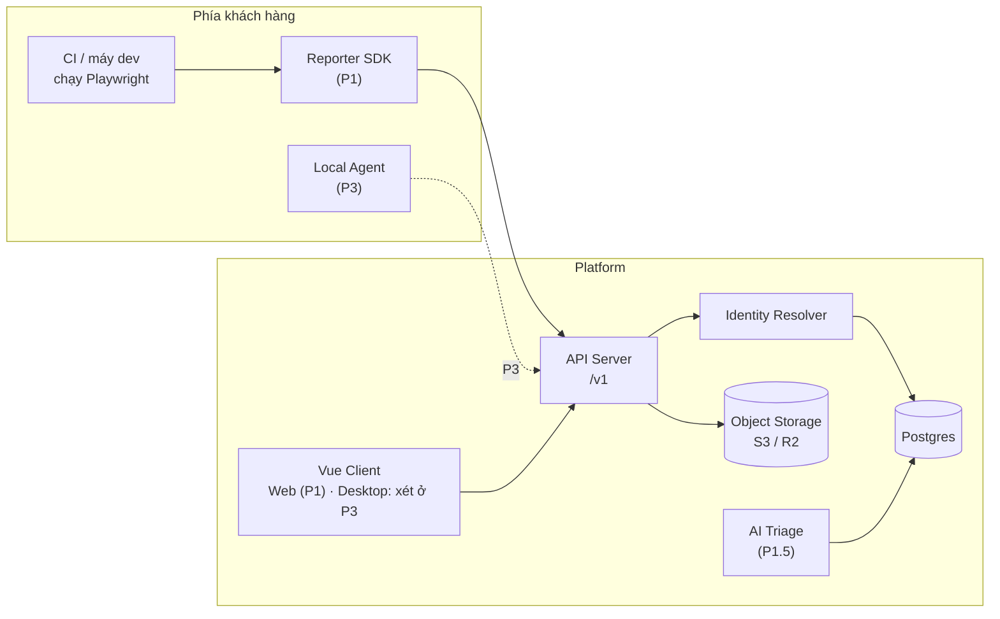
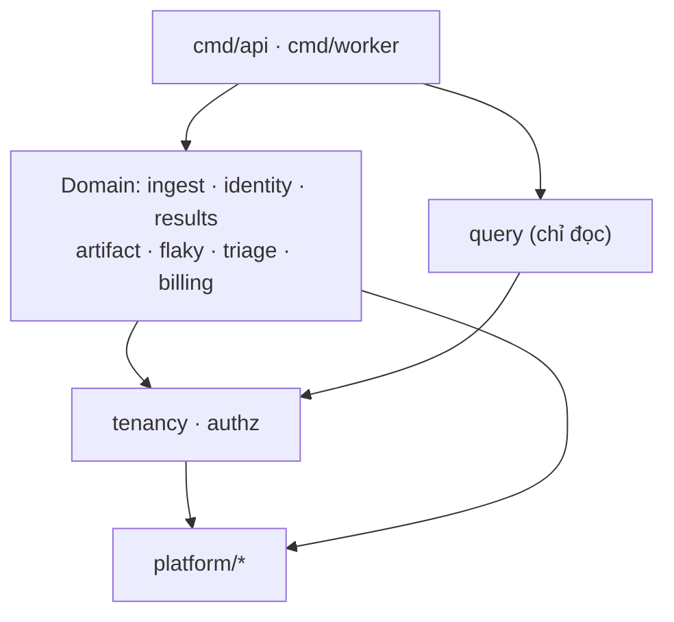
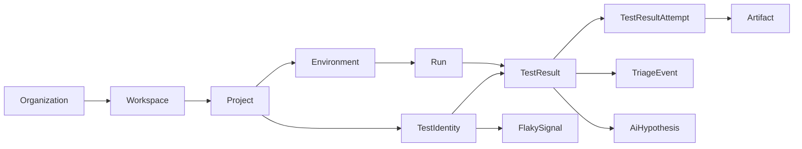
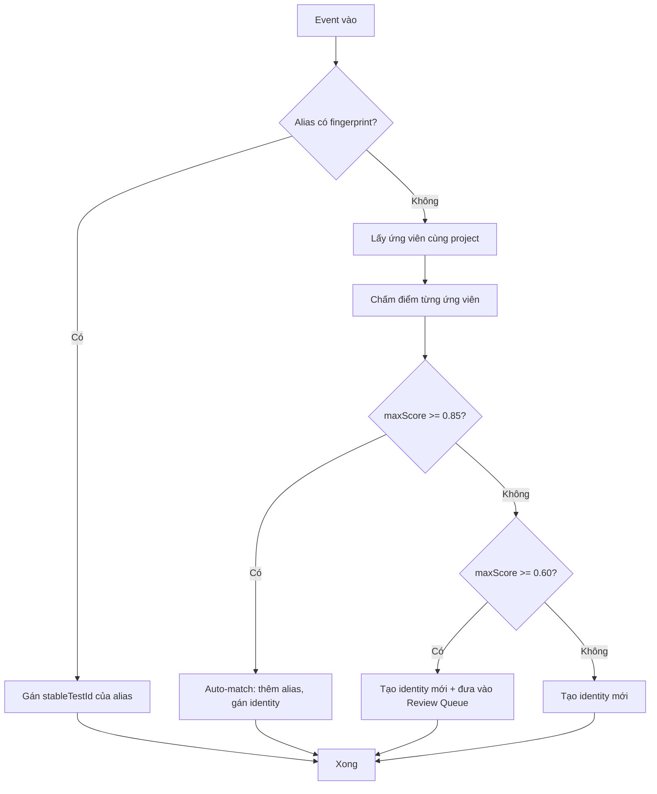

# Automation Testing Platform — Spec hợp nhất

> **Phiên bản:** v3.44 · **Ngày:** 13-10-2026 · **Trạng thái:** kế hoạch tester dùng hằng ngày, demo Windows → pilot → VPS tại §4.11 và yêu cầu mở rộng §6.8.7 (chưa nghiệm thu); 13 ADR đã chốt (QĐ-13 28-09: JUnit backfill, ROI, shadow meter build sẵn; QĐ-11: P1-min xây song song Phase 0, `backend/`; QĐ-9 sửa lần hai 14-09: client Vue 3, hệ giao diện Tailwind + shadcn-vue từ 21-09; **QĐ-12 ngày 21-09: P2 Test Management khởi công song song, backend §6.8 đã lên `main`; bằng chứng thủ công qua `Artifact` và RBAC 6 role từ 22-09, quản lý member ở cả ba tầng qua UI, MFA TOTP cho org owner và đăng nhập Google/GitHub (bật/tắt bằng cấu hình) từ 27-09, mời qua email và quên mật khẩu (SMTP, bật/tắt) từ 28-09**); **P1-min đã build, nằm trên `main` từ 18-09 — tiến độ ở §0.5; gate kỹ thuật T0 T1 T3 T4 ✅, T2 T5 một phần, ở §14.1 (trích `backend/GATES.md`)**; ba plane đã đặc tả; bản đối ngoại sinh bằng pipeline (F12/F16 đóng thật); **Phase 0 — khởi động lại 15-09-2026, Gate-0 26-10-2026; lần chốt 26-08 không diễn ra, xem §5.8**; prototype identity ĐẠT (precision 1,0000 · recall 0,9920); loader Playwright đối chiếu report thật; code sang tiếng Anh (QĐ-3); resolve hai tầng sau N39; bố cục module monolith ở §6.9 (thi hành từ 11-09 theo QĐ-11); 64 phát hiện N đã xử lý, gồm hai vòng đối chiếu prototype ↔ Postgres (N49, N50), một vòng soát harness ↔ tài liệu (N56–N59), hai phát hiện từ việc build P1-min (N60–N61) và ba từ việc build P2 (N62–N64)
> **Nguồn:** v3.0 (`docs/v3.0/`) + v3.1 (`docs/v3.1/`) + bản thẩm định 24-08 + review v3.2 (`docs/SPEC-v3.2-reviewed.md`) + bản đối ngoại `docs/external/`
> **Quy tắc:** Đây là nguồn sự thật duy nhất. Mọi file trong `docs/` là lịch sử, chỉ để tra cứu. Tài liệu nào nói khác file này → file đó sai.

---

## 0. Cách đọc và những gì đã thay đổi khi gộp

### 0.1 Bộ tài liệu này đến từ đâu

| **Bộ** | **Vị trí** | **Vai trò** |
| ------------------- | ------------ | -------------------------------------------------------------------- |
| v3.0                | `docs/v3.0/` | Bản gốc, 8 tài liệu thiết kế + 3 bản đối ngoại. **Đã lỗi thời**      |
| v3.1                | `docs/v3.1/` | Bản viết lại sau thẩm định, 10 tài liệu. Nội dung đúng nhưng rời rạc |
| **SPEC.md**         | root         | **Bản gộp, đã vá lỗi khớp nối. Dùng bản này**                        |

Việc tách `docs/v3.0/` và `docs/v3.1/` cũng xử lý luôn vụ va chạm đánh số: trước đó root có cả `01-ICP-Personas-and-JTBD.md` lẫn `01-decisions.md`, rất dễ mở nhầm.

### 0.2 Nhật ký sửa lỗi qua các vòng review

Các lỗi N01–N10 đến từ lần gộp v3.1; N11–N19 từ review v3.2 ngày 24-08-2026; N20–N23 từ review v3.3; N24–N28 từ vòng kiến trúc execution; N29–N31 từ vòng hoàn thiện ba plane; **N32–N48 từ prototype test identity chạy thật, 26-08 → 28-08-2026** (`prototype/identity/`) — N32/N33 đã rút lại sau khi phát hiện lỗi harness; **N49–N50 từ vòng đối chiếu prototype ↔ Postgres, 29-08 → 30-08-2026**; **N51–N55 từ vòng soát nhất quán nội bộ 08-09 → 09-09-2026** — số đo bị sao chép rồi trôi, và một blocker đã đóng nhưng vẫn còn trong văn bản — hai trong ba hàm similarity mà §9.3 dựa vào không tính giống thứ Postgres thật sự chạy. **N56–N58 từ vòng soát harness ↔ tài liệu 10-09-2026** — vòng trước gỡ hết bản sao của một con số nhưng bỏ sót chính harness đang sinh ra nó, và quy tắc chống trôi của N51 mới chỉ được thi hành bên trong `SPEC.md`; **N59 ngày 11-09** — lần đầu chủ dự án tự chạy `-diag`, và nó in hai kết quả mâu thuẫn trên cùng màn hình; **N60–N61 từ chính việc build P1-min, 16-09 → 18-09** — hai chỗ SPEC nói một đằng mà code chạy thật buộc phải làm một nẻo: §6.9.11 bảo P1-min không có Review Queue trong khi §9.3 và §6.4 buộc phải có, và `ON CONFLICT` một mình không cứu được transaction chạm nhiều key; **N62–N63 từ việc build §6.8, 21-09** — bảng entity thiếu hai thứ mà chính rule gate cần, và một rule gate đọc theo nghĩa đen sẽ chặn vĩnh viễn. Mục đã đánh ✅ là nội dung đã được sửa ngay trong SPEC này.

| # | Lỗi / rủi ro | Cách sửa | Xem mục |
|---|---|---|---|
| N01 | Timeline cũ cho P1 chạy trước Gate-0 | Dời mọi build sản phẩm sau Gate-0 | §4.3 |
| N02 | P1 4–6 người-tháng không khớp phạm vi thật | Ước lượng lại **6,5–11,5**; giữ **P1-min 4–6** | §4.2, §4.4 |
| N03 | `UNIQUE(runId, clientTestId)` làm mất test khi fingerprint trùng | Thêm `occurrenceIndex` | §8.4 |
| N04 | Unique của `TestIdentityAlias` không implement được | Denormalize `projectId` | §8.5 |
| N05 | `flakyScore` chia 0 khi `totalRuns = 1` | Guard `< 2` → `insufficient_data` | §8.6 |
| N06 | `flaky_pass` mất khỏi `Run.status` nhưng nguyên tắc “không xanh sạch” vẫn còn | ✅ **Chốt QĐ-7 phương án B:** giữ enum, dùng `flakyCount`; UI `passed + flakyCount>0` phải hiển thị warning/amber | §1.7, §8.4 |
| N07 | Production Safety Guard biến mất nhưng bản đối ngoại vẫn bán | ✅ **Chốt QĐ-8:** dời sang P3 cùng Local Agent; xóa khỏi MVP/P1 | §1.8, §4.1, §4.7 |
| N08 | Observability và JTBD biến mất | Khôi phục | §3.3, §6.4 |
| N09 | Gate-1 và thuật toán identity dùng hai thước đo khác nhau | Hòa giải về precision/recall | §4.5, §9.6 |
| N10 | Claim về Currents chưa kiểm chứng | Bỏ claim khỏi thông điệp bán hàng; benchmark riêng | §2.4 |
| N11 | **P1 đầy đủ 6,5–11,5 người-tháng nhưng timeline chỉ cho 2 người × 12 tuần ≈ 6 người-tháng** | ✅ Tách timeline P1-min và P1-full; Gate-1 theo cuối scope đã chọn, không hardcode tuần 18 cho mọi trường hợp | §4.3, §4.5 |
| N12 | Partner #3 ký tuần 5 nhưng baseline tiến cứu cần 2 tuần, Gate-0 lại ở cuối tuần 6 | ✅ Yêu cầu đủ 3 partner ký **chậm nhất cuối tuần 4** | §5.6 |
| N13 | Phase 0 tuyên bố kiểm chứng H1–H3 nhưng Gate-0 cũ chỉ bắt H1; có thể pass dù TTRC thấp hoặc không ai trả tiền | ✅ Gate-0 nay bắt đủ **H1 + H2 + H3** | §4.5, §5.1 |
| N14 | `Split` cho phép chọn mốc T nhưng alias schema chỉ cho một mapping fingerprint vĩnh viễn | ✅ Thêm `validFrom/validTo`, partial unique cho alias đang hiệu lực | §8.5, §9.4 |
| N15 | TTRC dùng `firstFailedAt` từ client → lệch clock; acceptance rate có thể đẹp giả nếu user bỏ qua hypothesis rác | ✅ Thêm `failureObservedAt` server-side, `hypothesis_decision_rate` và `triage_coverage` | §1.4, §8.3, §4.5 |
| N16 | Bản đồ cạnh tranh dùng tên dịch vụ Microsoft đã retired và đánh giá thấp overlap của Currents | ✅ Cập nhật thành **Azure App Testing / Playwright Workspaces**; bỏ feature-gap chưa có bằng chứng | §2.4 |
| N17 | Anchor TestRail `$37 × 10` đã cũ theo thông báo giá 2026; regional/founding discount chưa nói có stack hay không | ✅ Cập nhật anchor; discount **không stack** và có contribution-margin floor | §10.5 |
| N18 | API token random dùng Argon2id trên mọi ingest request gây chi phí xác thực không cần thiết; thiếu CSRF/origin guard và kiểm tra kích thước object sau presigned upload | ✅ Token dùng HMAC-SHA-256; thêm Origin/CSRF guard; HEAD/checksum/cleanup multipart | §7.7, §8.8, §11.2, §11.4 |
| N19 | Billing theo `stableTestId` phụ thuộc trực tiếp vào thuật toán merge/split đang còn hiệu chỉnh | ✅ Chưa charge theo active-test ở P1; chạy **shadow meter 4 tuần** trước billing thật | §10.5–10.6 |
| N20 | Pipeline chuyển đổi của v3.2 xóa sạch **3 sơ đồ mermaid** | ✅ Phục hồi nguyên văn từ bản v3.1-merged | §6.1, §8.1, §9.3 |
| N21 | 6 checkbox của checklist đối ngoại bị thay bằng non-breaking space; 614 NBSP lọt vào file | ✅ Phục hồi checkbox; chuẩn hóa NBSP | §4.7 |
| N22 | Separator fingerprint suy biến NUL → byte NUL thật → chuỗi rỗng. Rỗng làm hai test khác nhau trùng fingerprint, đúng lỗi "gộp nhầm" mà §9.6 xếp nặng nhất | ✅ Dùng ký hiệu `U+0000` + cảnh báo tường minh | §9.2 |
| N23 | Stack công nghệ chưa có ADR | ✅ **QĐ-9** | §1.9 |
| N24 | Sharding phá giả định 1 job = 1 run của §7.8 | ✅ `Run.status` là hàm tổng hợp trên tập job | §6.7.2 |
| N25 | Cấm K8s/Kafka đọc như vĩnh viễn; "queue" đọc như FIFO đơn | ✅ Điều kiện cụ thể + nhiều queue | §4.6, §6.7.4, §6.7.8 |
| N26 | Execution Plane quá mỏng | ✅ Thiết kế đầy đủ, không đổi thứ tự phase | §6.6, §6.7, QĐ-10 |
| N27 | Thiếu gate kỹ thuật | ✅ T0–T5 | §14 |
| N28 | Đổi client sang Flutter | ✅ QĐ-9 viết lại, ràng buộc dịch sang Flutter. *Lật lần hai 14-09-2026 (chủ dự án): Vue 3 — QĐ-9 viết lại lần nữa, bốn ràng buộc dịch sang DOM* | §1.9 |
| N29 | P2 ước lượng 2–4 người-tháng nhưng phạm vi thật (mapping, requirement, release gate, ROI, importer) là 3,9–7,5 — lặp đúng bẫy N02 | ✅ Ước lượng lại + gom phạm vi | §4.9.2, §4.1 |
| N30 | Test Management Plane chưa đặc tả; link manual↔automation dễ bị trỏ nhầm vào run thay vì identity | ✅ Thiết kế đầy đủ; link bắt buộc trỏ `TestIdentity.id` | §6.8 |
| N31 | Ý tưởng thương mại (integration, ROI, quality gate) không có chỗ chứa → nguy cơ phình P1 | ✅ Backlog có bằng chứng mở khoá từng mục | §4.9 |
| N32 | ~~Luật `MinGap` làm recall sụp theo mật độ test/file~~ — **RÚT LẠI 26-08.** Đây là lỗi của harness prototype (đặt `PresentInRun=false` cho *mọi* ứng viên), không phải lỗi §9.3. Sau khi sửa: recall 0.128 → **0.992** | ✅ Rút lại; §9.3 giữ nguyên, không sửa gì | §9.6, `prototype/identity/` |
| N33 | ~~Ngưỡng alert Review Queue không khớp điểm vận hành~~ — **RÚT LẠI 26-08.** Hệ quả của cùng lỗi harness. Thực tế: 250 ca rename sinh **2** mục review, không phải 200+ | ✅ Rút lại; ngưỡng 50 của §6.4 giữ nguyên | §6.4 |
| N34 | **Tín hiệu "ứng viên vẫn có mặt trong run → ×0.3" là bộ phận CHỊU LỰC của §9.3**, không phải tinh chỉnh phụ. Tắt nó đi thì recall rơi từ 0.992 xuống 0.128. Trước prototype không ai biết nó gánh nhiều đến vậy | ✅ Ghi rõ vào §9.3 là bất biến, cấm gỡ; có test khóa | §9.3 |
| N35 | **Idiom tham số hóa phổ biến nhất của Playwright nhét tham số vào TITLE, không vào `projectName`** — `for (const x of [10,20]) test(...${x})` sinh hai title khác nhau nhưng `paramSignature` giống hệt. §9.2 không bắt được, `templateKey` §9.5 cũng không gộp được | 🔶 Đã có bản vá (N38), chờ dữ liệu thật. "Title chứa dữ liệu động" ở §9.7 là idiom chuẩn, không phải edge case hiếm | §9.2, §9.5, §9.7 |
| N36 | Từ vựng status của Playwright là `expected\|unexpected\|skipped\|flaky` — **không phải** `passed\|failed`. Quan trọng hơn: **Playwright TỰ tính `flaky`** trong một run | ✅ Ánh xạ trong `playwright.go`; phân vai rõ: Playwright quyết flaky **trong** run, `FlakySignal` §8.6 tổng hợp **xuyên** run — cấm suy diễn lại | §8.4, §8.6 |
| N37 | **`spec.id` của Playwright không dùng được làm định danh bền vững.** Dạng `<hash-file>-<hash-test>`; đo thật: đổi tên 1 test + move 1 file làm vỡ 6/14 entry. Nó fragile đúng bằng fingerprint ngây thơ | ✅ Ghi rõ để không ai với tay tới nó như lối tắt; có test khóa với 2 fixture Playwright thật | §9.1, §9.3 |
| N38 | Bản vá N35 đo được: `TemplateKeyNormalized` gộp đúng biến thể sinh từ vòng `for` (7 → 6 template key trên fixture thật) trong khi **fingerprint giữ nguyên 14** — identity không bị đụng | ✅ `dynamic_title.go`. **Ranh giới bất di dịch:** chuẩn hóa chỉ cho template key, TUYỆT ĐỐI không cho fingerprint | §9.5, §9.7 |
| N39 | **Xung đột §7.6 ↔ §9.3, đo được.** §7.6 resolve inline (p50 < 1s) nhưng tín hiệu quyết định của §9.3 (N34) cần biết test nào đã chạy — lúc ingest thì run chưa xong. Shard, `--grep` và chính batch 500 event đều tạo tầm nhìn từng phần. Đo: recall **0,9920 → 0,3000** ở 50% tầm nhìn | ✅ Resolve hai tầng: tầng 1 inline chỉ exact match (hấp thụ ≥ 90% event); tầng 2 fuzzy tại `run.finish` | §7.6, §9.3 |
| N40 | Điểm tích cực đo được: **precision KHÔNG suy giảm** ở mọi mức tầm nhìn (1.0 ở cả 10%). Luật `MinGap` — tưởng thừa sau N34 — chính là lưới an toàn: nhiều ứng viên cùng "có vẻ vắng mặt" thì không ai nổi bật, auto-match từ chối kích hoạt | ✅ Hai cơ chế bổ trợ nhau, **cấm gỡ cả hai** | §9.3 |
| N41 | **Playwright có hai từ vựng status ở hai tầng, spec chỉ ánh xạ tầng trên.** `timed_out` và `interrupted` của §8.4 **chỉ thấy được ở tầng `results[]`**. Đo trên report thật có `retries:2`: một test timeout bị ánh xạ thành `failed`, mất sạch tín hiệu timeout | ✅ `mapStatus` đọc **cả hai tầng** + `mapAttemptStatus`; có test hồi quy giữ lại hành vi cũ để không ai tái lập | §8.4, §8.7 |
| N42 | Hệ quả nghiệp vụ của N41: §8.7 có category `flaky_timing` và việc phân biệt timeout với assertion-fail là chức năng lõi của sản phẩm. Gộp timeout vào `failed` ở tầng ingest thì AI triage (§1.4) vĩnh viễn không có tín hiệu đó | ✅ Đã chặn từ loader; §8.4 cần ghi rõ nguồn của từng giá trị enum | §1.4, §8.7 |
| N43 | **§9.4 gộp hai thao tác khác nhau vào một tên.** §9.4 gọi `Split` là "undo của auto-match sai" — không phải: `Merge` hồi tố có chủ đích, nên `Split(T)` chỉ sửa được từ T trở đi. Đo: gộp nhầm ngày 10, phát hiện ngày 30 → `SplitFrom` để lại **29/29 ngày** vẫn sai, `UndoMerge` để lại **0/29** | ✅ Tách hai thao tác trong `merge_split.go` | §9.4, §8.5 |
| N44 | Hệ quả UX của N43: cửa sổ hỏng **vô hình** — lịch sử đã gộp vẫn trông như một test hợp lệ, không có gì báo sai. Người review dùng nhầm thao tác sẽ không bao giờ biết | ✅ UI **phải** đề xuất `UndoMerge` khi alias có `source = auto_match`, thay vì để người dùng tự chọn mốc T | §9.4 |
| N45 | **§9.7 mô tả sai ca "xóa test rồi thêm lại sau 2 tháng".** §9.7 nói thành identity mới; đo thật: ứng viên 60 ngày, leaf đổi nhẹ → score **0.868, auto_match**. 90+ ngày mới xuống review, và không bao giờ chạm vùng identity mới. Nguyên nhân: §9.3 biện minh recency bằng lập luận trùng hợp thời điểm nhưng cài nó thành trọng số 10% | ✅ Thêm `RecencyGateDays` tùy chọn, chi phí đo được **bằng 0**. **Cần quyết:** bật gate hay sửa mô tả §9.7 | §9.3, §9.7 |
| N46 | Race test mà §9.7 đánh dấu "bắt buộc" nay đã có và pass: 16 worker × 50 fingerprint → đúng **50 identity**, 750 lần thua race đọc lại đúng identity của bên thắng | 🔶 **Có giới hạn:** máy này thiếu gcc nên `go test -race` chưa chạy được. Đây là kiểm chứng **đúng đắn logic**, chưa phải kiểm chứng data-race ở tầng bộ nhớ. Cần chạy lại trong CI | §9.7 |
| N47 | **§9.3 bước 2 lọc ứng viên bằng ba điều kiện mà §8.9 không index điều kiện nào.** Đo trên prototype (không có index nào), **3 lần chạy 09-09**: 50 rename tốn **163–252ms ở 500 test → 3,5–6,8s ở 10k → 8,3–30,5s ở 25k**. Đây là **cận trên**, không phải dự đoán production. Biên độ thật xem N55 — bản ghi cũ để "±15%" và một điểm duy nhất cho mỗi cỡ | ✅ Thêm 3 index vào §8.9 + cột `canonicalLeafTitle` vào §8.5. Ghi rõ: trần 50 ứng viên giới hạn chi phí **chấm điểm**, không giới hạn chi phí **lọc** | §8.5, §8.9, §9.3 |
| N48 | Tầng 1 (exact match, inline) xử lý 10.000 event trong **7–17ms** (0,7–1,7 µs/event, 4 lần chạy) — ngân sách §7.6 dư hai bậc độ lớn, xác nhận việc tách hai tầng ở N39. Bản ghi cũ để "0,8 µs" như một hằng số dù biên độ thật là 2,4× | ✅ Tách assertion: tầng 1 giữ mốc 1s của §7.6; tầng 2 (spec không đặt deadline) dùng trần 5s chỉ để bắt hồi quy. Test cũ cộng cả hai tầng rồi so với mốc của riêng tầng 1 | §7.6 |
| N49 | **Hàm trigram của prototype không phải `pg_trgm`.** Nó đệm cả chuỗi thay vì cắt thành từ rồi đệm từng từ như `generate_trgm()`, nên sinh trigram vắt qua dấu phân cách. Đo 100k cặp leaf title: lệch trung bình **0,013**, tối đa 0,054, 12 cặp đổi phía ngưỡng 0,4 — và luôn chấm **thấp hơn** Postgres | ✅ Viết lại đúng `generate_trgm()` + test khóa. Số §9.6 không đổi (precision 1,0000 · recall 0,9920) | §9.3 |
| N50 | **Hai trong ba hàm của §9.3 không chạy được ở Postgres như §2 tuyên bố.** Jaccard trên tập describe cha: không có hàm stdlib nào. `fuzzystrmatch.levenshtein()`: **báo lỗi** khi title quá dài, kéo sập cả câu lệnh chấm điểm (đo trên title thật: 195 byte data-driven, 391 byte cho hai row fixture) | ✅ Chấm điểm về tầng ứng dụng — **348–587µs** cho trần 50 ứng viên, **3,5–5,9ms** cho cả run (6 lần chạy 09-09, xem N54); Postgres chỉ lo bước lọc. Sửa câu §2. 🔶 Đơn vị giới hạn (ký tự hay byte) cần verify trên Postgres đích | §2, §9.3 |
| N51 | **Số đo §9.6 bị sao chép ra 5 chỗ và trôi.** Header, N39, N49, §6.9.10 và §7.6 ghi `recall 0,9950` và cặp `0,995 → 0,295`. Chạy lại prototype ngày 08-09: headline là **0,9920** (248/250 auto, 2 review) và 50% tầm nhìn là **0,3000**. `0,9950` là số của sweep mật độ ~128/~285 test/file, bị nhấc lên làm headline; cặp `0,995 → 0,295` chưa bao giờ khớp bảng của chính prototype | ✅ Sửa cả 5 chỗ về số đo được. **Quy tắc:** §9.6 là nơi duy nhất giữ số headline; chỗ khác trích thì phải ghi rõ là trích | §0.2, §7.6, §9.6, §6.9.10 |
| N52 | **§13 và F16 vẫn gọi pipeline đối ngoại là `pandoc`,** trong khi §4.7 và `docs/external/` dùng `npm run build` → `build.mjs`. Nặng hơn: §13 vẫn liệt "chạy pandoc" là **blocker để gửi tài liệu**, mâu thuẫn với chính mục 3 của nó đã đánh ✅ (`.docx` đã sinh, `verify.sh` 11/11). Ai đọc đoạn kết §13 sẽ tưởng còn vướng một bước không tồn tại | ✅ Đổi tên pipeline; viết lại câu blocker — chỉ còn mục 4 (claim competitor) | §12.1, §13 |
| N53 | **§9.6 gán tính ổn định cho sai biến, và bảng số không tái lập được.** §9.6 ghi "mật độ 11→285 test/file cho recall 0.97–0.996", dẫn từ bảng bốn dòng trong README prototype (0,9700 / 0,9850 / 0,9950 / 0,9950) kể một xu hướng **tăng đơn điệu**. Đo lại 09-09 đúng bốn mức đó: **0,9760 / 0,9960 / 0,9880 / 0,9920** — không đơn điệu, không mức nào khớp. Bảng cũ sinh từ harness `_test.go` đã bị thay bằng flag nên **không lệnh nào tái lập được nó**. Và sweep cũ để `-mutate=50` cố định trong khi `-suite` đổi, nên "mật độ 11" đồng thời là "**65% corpus bị rename**" — hai biến trộn vào nhau | ✅ Đo lại tách bạch: giữ rename 10% rồi quét mật độ; giữ mật độ rồi quét rename 1%→80%. **Cả hai trục đều phẳng**, precision 1,0000 khắp nơi. Viết lại §9.6 thành bảng bốn biến kèm lệnh tái lập trong README prototype | §9.6 |
| N54 | **Bài học của N48 chưa được áp cho số của N50.** N48 đã bắt đúng lỗi "chép một lần đo thành hằng số" cho tầng 1, nhưng số chấm điểm của N50 vẫn nằm dạng điểm đơn: `463µs` / `9,3µs mỗi ứng viên` / `4,6ms mỗi run`, ở **ba chỗ** trong SPEC. Chạy 6 lần ngày 09-09: **348–587µs**, tức biên độ **1,7×**. Số cũ không sai — một lần chạy cho đúng 465µs / 9,3µs / 4,654ms — nhưng nó là **một mẫu rút từ phân phối rộng**, được trình bày như hằng số | ✅ Cả ba chỗ đổi sang dải đo được. Kết luận không đổi và giờ đúng ở **cả hai đầu** dải: chấm điểm tốn dưới 0,6% ngân sách 1s của §7.6, nên không có lập luận hiệu năng nào để đẩy bước 3 xuống SQL | §1.9, §9.3 |
| N55 | **Biên độ của N47 bị ghi nhỏ hơn thực tế một bậc, và tài liệu mâu thuẫn với chính công cụ.** README ghi *"các số này dịch khoảng một phần sáu giữa các lần chạy"* rồi đưa dải hẹp (`16,9–19,7s` ở 25k). Đo 3 lần ngày 09-09: 25k trải **8,3s → 30,5s**, tức **3,7×**. Hệ số tăng trưởng cũng không ổn định — tỉ lệ 500→25.000 ra **51× / 121× / 125×**, nên claim "siêu tuyến tính, khoảng 107×" là **một lần rút thăm**, không phải tính chất đo được. Đồng thời `scale_sweep.go` **tự in ra "Cost is linear in project size"**, mâu thuẫn thẳng với README nói siêu tuyến tính | ✅ Thay mọi điểm đơn bằng dải 3 lần chạy; sửa câu in của `scale_sweep.go` thành mô tả cơ chế (quét tuyến tính trên tập identity active) kèm ba tỉ lệ đo được, không khẳng định số mũ. **Quyết định không phụ thuộc chữ số:** ở 8,3s hay 30,5s thì §8.9 vẫn phải có index | §8.9, §9.3, §6.9.9 |
| N56 | **N51 xóa hết bản sao của `0,9950` nhưng không tìm ra thứ đang sinh ra nó.** `visibility_test.go` gọi `VisibilitySweep(500, `**`40`**`, 42, "")`, trong khi §9.6 điều 2 chốt bộ rename ở **50** test × 5 kiểu = 250 ca và `cmd/protoident` mặc định đúng 50. Ở 40 thì 199/200 = **0,9950** — nên mỗi lần `go test ./...` vẫn in ra đúng con số N51 vừa gỡ khỏi 5 chỗ, ngay cạnh CLI in 0,9920 cho cùng một dòng. `gate_test.go` cũng để 40 dưới comment gọi nó là "main §9.6 benchmark". Chẩn đoán của N51 — *"`0,9950` là số của sweep mật độ bị nhấc lên làm headline"* — **sai**, và vì sai nên vòng đó gỡ sạch bản sao mà để nguyên nguồn phát. Cặp `0,995 → 0,295` bị N51 kết luận "chưa bao giờ khớp bảng của chính prototype" thì thực ra `0,9950 → 0,3000` khớp harness này **chính xác**: nó không bị bịa ra, nó được đọc từ một sweep không ai biết là đang đo bộ khác | ✅ Thêm hằng `SpecRenameSetSize = 50` ở `synth.go`, dùng cho cả ba chỗ gọi; test nay in đúng số §9.6 (`full 0,9920 → half 0,3000`). **Mở rộng quy tắc N51:** số headline phải có một chỗ giữ trong văn bản **và một hằng trong code** — tài liệu không tự chống trôi được khi harness còn tự do chọn mẫu số | §9.6, `prototype/identity/` |
| N57 | **Bảng tầm nhìn của N39 chưa từng được chạy lại sau N49.** Đo lại 10-09: bốn dòng tầm nhìn từng phần đều lệch đúng **một ca** so với bảng đang ghi — 0,75 `0,5160→0,5200`; 0,50 `0,2960→0,3000`; 0,25 `0,1880→0,1920`; 0,10 `0,1360→0,1400`. N49 tự tổng kết rằng chỉ dòng 50% dịch, *"một ca trong 200"*, và đọc nó như nhiễu làm tròn | ✅ Sinh lại bảng. **Không phải nhiễu:** chính N49 dự đoán bản trigram cũ chấm **thấp hơn** `pg_trgm`, nên sửa đúng thì thêm đúng một ứng viên vượt ngưỡng lọc 0,4 — ở **mọi** mức và **cùng một chiều**. Bốn dòng cùng dịch một chiều là bằng chứng **mạnh hơn** cho lập luận của N49 so với một dòng mà nó đã ghi | §7.6, §9.3 |
| N58 | **Quy tắc chống trôi của N51 chỉ được thi hành bên trong `SPEC.md`.** Bản sao nằm ngoài file đó sống sót nguyên vẹn: `phase0/README.md` vẫn ghi `recall 0,9950` — bản sao thứ **6**, đúng con số đã bị bác; `README.md` gốc vẫn ghi *"Spec **v3.10** … 52 phát hiện N"*, trễ **hai vòng**; và ngay trong SPEC, tiêu đề §12.2 vẫn đọc "(N01–N50)" trong khi thân của nó nói 55 | ✅ Sửa cả bốn chỗ. Quy tắc *"§9.6 là nơi duy nhất giữ số headline"* áp cho **cả repo**, không riêng SPEC: file điều hướng (`README.md`, `phase0/README.md`) trích thì phải ghi "trích", còn số phiên bản và số phát hiện là thứ **bắt buộc** cập nhật cùng mỗi vòng | §0.2, §9.6, §12.2 |
| N59 | **`-diag` vẫn mang đúng lỗi harness đã khiến N32/N33 bị rút lại.** `Evaluate` được sửa ngày 26-08 để mô hình đúng thực tế — mọi test khác **vẫn có mặt** trong run, chỉ test bị rename là vắng — nhưng `Diagnose`, công cụ giải thích *vì sao* auto-match không nổ, chưa bao giờ được sửa theo: `PresentInRun` để `false` cho **mọi** ứng viên, tức cả 500 test biến mất cùng lúc. Phát hiện 11-09 khi chủ dự án chạy `-diag` lần đầu: nửa trên in **248 auto / 2 review**, nửa dưới in **215 "blocked by gap" `<-- HERE`** — hai con số không thể cùng đúng, in ngay cạnh nhau. Nặng hơn con số là **cách sửa bị chỉ sai**: tool đổ 2 ca review cho `MinGap` (→ hạ gap), thực tế chúng nằm ở dải điểm 0,60–0,85 và hạ gap không đổi được gì | ✅ `Diagnose` mô hình presence y hệt `Evaluate`. Sau sửa: 248 đủ điểm / **0** bị gap chặn / 2 ở dải review — khớp nửa trên; gap p50 nhảy `0,027 → 0,704`, đúng cơ chế N34. `diag_test.go` khóa hai chiều: số của `Diagnose` phải khớp `Evaluate` trên 3 seed (test này **fail** trên code cũ, đúng bằng 33 ≠ 248), và một test tái lập 215/250 để con số đó không thành huyền thoại. **Bài học N32 chưa học hết:** sửa một harness thì phải sửa **mọi** harness chung giả định — `grep PresentInRun` mất 5 giây, còn bug này sống 16 ngày | §9.3, §9.6, `prototype/identity/diag.go` |
| N60 | **§6.9.11 khẳng định P1-min "không có Review Queue service" — nhưng hai mục khác của chính SPEC buộc phải có nó từ P1.** §9.3 tầng 2 đẩy mọi ứng viên ở dải 0,60–0,85 vào review (2/250 ca trên prototype, §9.6) — không có bảng thì resolver không có chỗ đặt ca mờ; §6.4 đặt alert khi queue > 50 — không có gauge thì alert đo vào khoảng không. Cái §4.4 cắt là **giao diện** và thao tác Merge/Split, không phải service. Câu "chốt scope trước, tạo thư mục sau" đúng cho `testmgmt`/`execution`, sai cho review queue | ✅ Tách "service" (P1-min, bắt buộc: bảng `review_queue_items`, gauge `review_queue_pending`, có từ T0 16-09) khỏi "UI" (cắt được). Thực tế 18-09: merge/undo/split/decide đi qua HTTP admin-only, ghi `identity_audit`; UI làm sớm theo yêu cầu chủ dự án — ghi ở §4.4 | §4.4, §6.9.11 |
| N61 | **§9.7 chốt "`UNIQUE` + `ON CONFLICT` → chỉ một identity" cho ca hai run cùng gửi *một* fingerprint lạ — đúng, nhưng resolve thật chạm *hàng chục* key trong một transaction.** T1 (`backend/test/failure`, 16-09): 4 worker resolve song song các run cùng bộ test — ca thường nhất, CI của một project chạy đi chạy lại cùng suite — **deadlock 40P01**: mỗi transaction insert cùng bộ unique key theo thứ tự map ngẫu nhiên của Go. Queue retry che lỗi (job vẫn xong) nhưng mỗi lần là backoff 5 s — vượt p99 < 5 s của §14.2 ngay ở tải nhỏ; test race của §9.7 (N46) không thấy vì nó chỉ đua trên **một** key | ✅ Ghi thành bất biến ở §9.7: transaction ghi nhiều identity/alias/flaky phải sắp key theo **một thứ tự toàn cục** (fingerprint cho identity, identity id cho flaky) trước khi ghi — cùng thứ tự thì transaction sau chỉ xếp hàng rồi đi đường `ON CONFLICT`. Harness khẳng định `last_error IS NULL` cho mọi job: re-run chỉ được đến từ lease hết hạn | §9.7, `backend/GATES.md` §T1 |
| N62 | **§6.8.2 thiếu hai thứ mà §6.8.4 và §4.9.2 của chính nó dùng.** Rule 4 của gate nói "coverage của requirement `p0`" nhưng entity `Requirement` không có `priority`; §4.9.2 ước lượng "TestCase / **Suite** / Plan CRUD" và `TestCase.suiteId FK` trỏ vào một `Suite` chưa được định nghĩa ở đâu. Viết migration là lộ ngay: không có cột thì rule không tính được, không có bảng thì FK không có đích | ✅ Thêm `Requirement.priority` (p0..p3, mặc định p2) và entity `TestSuite` (tên, cha tuỳ chọn, unique theo project + cha) vào §6.8.2; migration `0013_testmgmt.sql` là bản chạy được | §6.8.2, §6.8.4 |
| N63 | **Rule 3 của §6.8.4 — "còn failure chưa có `HYPOTHESIS_ACCEPTED`" — đọc theo nghĩa đen thì một failure đã `MARKED_KNOWN_ISSUE` chặn release mãi mãi.** §8.3 có bốn quyết định kết thúc triage (accept, flaky, known issue, resolved); `query.Triage` cũng chỉ đếm `HYPOTHESIS_ACCEPTED` là "đã triage" cho TTRC — đúng cho TTRC (chỉ có hypothesis mới có root cause), sai cho gate (known issue là quyết định ship có ý thức). Hai định nghĩa "đã triage" cho hai mục đích khác nhau, phải nói rõ | ✅ Gate đọc *decisive event* = `HYPOTHESIS_ACCEPTED \| MARKED_FLAKY \| MARKED_KNOWN_ISSUE \| RESOLVED`; TTRC/coverage §8.3 giữ định nghĩa hẹp. Ghi cả hai ở §6.8.4 | §6.8.4, §8.3 |
| N64 | **§6.8.2 nói "Artifact dùng lại, không tạo bảng mới" cho bằng chứng thủ công, nhưng §8.4 định nghĩa `Artifact.runId` là `FK NOT NULL` với khóa tự nhiên `(runId, clientTestId, occurrenceIndex, attempt, name)` — trong khi §6.8.6 cấm manual execution tạo `Run`.** Hai mục đúng riêng, ghép lại thì không có chỗ đặt hàng: hoặc bịa một Run giả (vi phạm §6.8.6, làm bẩn flaky/TTRC), hoặc tạo bảng mới (vi phạm §6.8.2). Thêm nữa, sweep "unlinked > 1 h" của §6.4 sẽ báo động mãi mãi cho một artifact không bao giờ có attempt | ✅ Migration 0014: `runId`/`clientTestId`/`attempt` nullable, thêm `manualExecutionId`, CHECK buộc theo `kind` (`manual_evidence` ⇔ có execution, không run; kind khác ⇔ ngược lại); sweep và index unlinked chỉ xét `runId IS NOT NULL`. Upload đi **qua api** (`POST …/executions/{id}/evidence`, multipart, api sniff nội dung theo §11.5) chứ không presigned — trình duyệt PUT thẳng lên bucket cần CORS cho từng origin dashboard. Ghi ở §6.8.2, §8.4, §10.4 | §6.8.2, §8.4, §10.4, §6.4 |

### 0.3 Những gì vẫn CẦN người chịu trách nhiệm quyết

QĐ-7 → QĐ-10 đã được **chủ dự án duyệt ngày 25-08-2026**. QĐ-9 được sửa trong cùng ngày (Next.js → Flutter) và sửa lần hai ngày 14-09-2026 (Flutter → Vue 3, §1.9). Còn lại là quyết định vận hành không thể suy ra từ kiến trúc:

| Vấn đề | Khi nào bắt buộc chốt | Xem mục |
|---|---|---|
| **Tên người giữ quyền kill gate** | **Trước ngày bắt đầu Phase 0** | §1.6 |
| **Ngày bắt đầu Phase 0** | Trước khi dùng mốc tuần 1–6 | §4.3, §5.6 |
| ~~P1-min hay P1-full~~ | **Đã chốt P1-min** (QĐ-11, 11-09-2026). Còn mở: có lên P1-full không — chỉ xét sau Gate-0 PASS | §1.11, §4.4 |

> Không cần trì hoãn phỏng vấn Phase 0 chỉ vì chưa chọn P1-min/P1-full. Mục tiêu của Phase 0 chính là tạo dữ liệu để quyết định phạm vi build có đáng đầu tư hay không.

### 0.4 Việc còn treo, KHÔNG được đánh dấu hoàn thành

Ba bản đối ngoại trong `docs/v3.0/` **chưa được sửa** — tôi verify bằng cách đọc file, không phải suy đoán:

```
Automation_Testing_Platform_v3.{md,docx,pptx}    2026-07-07, nguyên vẹn
  MVP mục #1:  "Local Agent"              ← vẫn agent-first, trái QĐ-1
  MVP mục #6:  "Production Safety Guard"  ← vẫn quảng cáo như MVP dù QĐ-8 đã dời sang P3
  Roadmap:     grep "Phase 5|Phase 6" → 0 ← vẫn bị cắt
  .docx:       **Unified Quality...**     ← vẫn còn ** literal

```

README của bộ v3.1 đánh dấu F12 và F16 là "✅ Đóng". **Sai** — quy tắc xuất bản đã viết, nhưng hiện vật chưa sửa. Và nó mâu thuẫn với chính QĐ-1, chỗ ghi *"Chưa sửa xong hai bản đó thì không gửi cho bất kỳ ai bên ngoài."*

Điều này nguy hiểm ở đúng thời điểm: Phase 0 tuần 1–6 là lúc mang deck đi gặp design partner. Ai tin ma trận README sẽ gửi bản pitch agent-first, roadmap cụt, cho đúng nhóm người mà v3.1 vừa quyết định pitch reporter-first.

**Cấm gửi ba file đó ra ngoài cho đến khi regenerate theo §4.7.**

### 0.5 Tiến độ thi hành QĐ-11 và QĐ-12 — cập nhật 27-09-2026

Một chỗ trả lời "plan tới đâu rồi". Con số và lệnh tái lập nằm ở file bằng chứng; bảng này chỉ **trích** (quy tắc N51/N58). Cập nhật cùng mỗi lần merge vào `main`.

| Mảng | Kế hoạch (mục) | Trạng thái 18-09 | Bằng chứng |
|---|---|---|---|
| Backend Go monolith | §6.9 cột P1-min | ✅ trên `main` — mọi module §6.9.11 P1-min (`billing` thêm 28-09, QĐ-13); 12 migration; luật §6.9.3/§6.9.7 cưỡng chế bằng `test/arch` từ commit đầu (QĐ-11 #4) | `backend/README.md`, `backend/test/arch/` |
| Reporter Playwright | §7.5 | ✅ npm reporter: batch 5 s / 100 event, retry 1/2/4/8 s, spool khi mất mạng (run của khách không bao giờ fail), artifact sha256 phía client + cap, HAR strip, fingerprint §9.2 khớp vector Go, error text sạch ANSI | `reporter/playwright/README.md` |
| Dashboard | §4.4 "dashboard v0" + bảng cắt/dời | ✅ Vue 3 (QĐ-9 sửa lần hai; giao diện Tailwind + shadcn-vue, sáng/tối, từ 21-09): sign-in, projects, runs, failure detail (attempt, error/stack, artifact: ảnh/video inline, `trace.zip` trong trace viewer tự host), triage, identity history, flaky. **Làm sớm hơn kế hoạch theo yêu cầu chủ dự án 18-09:** lát đầu màn hình EM (P1.5), Review Queue UI và Merge/Split/Undo UI (§4.4 xếp P2) — chi tiết ở §4.4 "Thực tế" | `frontend/PLAN.md`, `frontend/API_CONTRACT.md` |
| Hợp đồng API | §11.6 API9 | ✅ `backend/deploy/openapi.yaml` (27 operation) là nguồn sự thật; test hai chiều route ↔ spec; Redocly lint trong CI | `docs/openapi-contract-reimplementation.md` |
| Triển khai | §6.4, §11.5 | ✅ image distroless + compose (Postgres 17, migrate một lần, api, worker, Prometheus + alert §6.4, Caddy TLS, backup hằng ngày); CI 4 job: backend, reporter, frontend, e2e trên compose (reporter thật → api thật → UI thật) | `backend/deploy/README.md`, `.github/workflows/ci.yml` |
| RBAC | §11.3, §4.4 "P2 mở rộng" | ✅ **22-09**: 6 role §11.3.1 (migration 0015 trải hàng P1-min), ma trận §11.3.2 là dữ liệu + test chép sáu cột, `authorize()` lấy hợp membership trên chuỗi, `GET /v1/projects` trả `actions[]`; UI ẩn nút theo `actions` (frontend `ProjectAccess`, xóa cache khi đổi user). ✅ **27-09 quản lý member** (§11.3.2 "tầng tương ứng"): 3 route `…/members` sau `member.manage` — danh sách cả role kế thừa từ workspace/org, cấp/đổi/thu hồi role cấp project (maintainer/member/viewer) theo email tài khoản đã verify, mỗi lần ghi `authz_audit` (`role.grant` kèm role cũ, `role.revoke`; migration 0016); màn hình Members chỉ hiện với ai có `member.manage`. ✅ **27-09 tầng workspace/org**: cùng bộ route cho `/v1/workspaces/{id}/members` (workspace_admin) và `/v1/organizations/{id}/members` (org_admin/org_owner), `GET /v1/member-scopes` dẫn vào màn hình Team; **luật owner**: chỉ owner (`org.manage`) được cấp/đổi/gỡ role owner (`403 OWNER_ONLY`), và tổ chức luôn giữ ít nhất một owner (`409 LAST_OWNER` — áp cả cho `cmd/admin`, khóa hàng owner để hai lần hạ quyền đồng thời không cùng lọt). ✅ **28-09 mời qua email**: `MAIL=smtp` thì thêm một email chưa có tài khoản sẽ gửi lời mời (xem hàng dưới) | `backend/internal/authz/rules.go`, `authz_test.go`, `cmd/api/api_test.go`, `frontend/src/features/reports/projectAccess.ts`, `cmd/api/members.go`, `members_test.go`, `frontend/src/features/members/` |
| MFA TOTP | §11.2, §4.4 "P2" | ✅ **27-09**: TOTP RFC 6238 (SHA-1, 6 số, 30 s, lệch ±1 bước, mỗi mã dùng một lần), secret niêm phong AES-GCM bằng khóa dẫn từ `TOKEN_PEPPER`, 10 recovery code (lưu HMAC), đăng nhập hai bước (`202` + challenge 5 phút → `POST /v1/session/mfa`), mã sai chung rate limit với mật khẩu; **org owner bắt buộc** — phiên của owner chưa bật chỉ tới được route session/MFA (`403 MFA_ENROLLMENT_REQUIRED`), UI đưa thẳng tới trang Security; owner không tắt được; bật MFA thu hồi mọi phiên khác; audit `mfa.enable`/`mfa.disable`/`mfa.recovery_used` (migration 0017). Cũng 27-09: mã QR trên trang Security (vẽ bằng SVG từ ma trận `uqr`, không `v-html`; kiểm bằng giải mã ảnh chụp) và `admin user mfa-reset` cho operator (bắt buộc `-actor` + `-reason`, thu hồi mọi phiên, ghi `mfa.disable` kèm `via: operator reset`). OAuth: xem hàng dưới | `backend/internal/authz/mfa.go`, `totp.go`, `mfa_test.go`, `cmd/api/mfa_test.go`, `frontend/src/features/account/` |
| OAuth Google/GitHub | §11.2, §4.4 "P2" | ✅ **27-09**: công tắc riêng từng provider ở backend (`OAUTH_GOOGLE` / `OAUTH_GITHUB` = on|off, mặc định off; bật mà thiếu client id/secret hoặc `PUBLIC_URL` thì api không khởi động); authorization code + PKCE S256, state trong cookie ký HMAC (không bảng nào để làm đầy); nhận người bằng subject ổn định của provider, lần đầu liên kết theo email **đã verify ở cả hai phía** (audit `identity.link`, migration 0018), **không tự tạo tài khoản**; tài khoản bật MFA vẫn phải nhập mã; gọi ra ngoài chỉ qua `platform/outbound` (allowlist host lấy từ cấu hình, không theo redirect). 28-09: trang Security có mục "Connected accounts" — xem và gỡ liên kết của chính mình (audit `identity.unlink`, migration 0019), không gỡ được cách đăng nhập cuối cùng (`409 LAST_SIGN_IN`) | `backend/internal/authz/oauth.go`, `oauth_http.go`, `internal/platform/outbound/`, `cmd/api/oauth_test.go` |
| Mời qua email | §11.2 "mời member", §11.6 API6 | ✅ **28-09**: công tắc `MAIL=off|smtp` (mặc định off; SMTP chuẩn — dùng được SES, Resend, Mailgun, relay công ty; `SMTP_TLS=starttls|tls`, `none` chỉ dev). Mail bật: thêm email chưa có tài khoản vào project/workspace/org → `202 {invitation}`, gửi link `/invite#<token>` (fragment — token không bao giờ tới server trong URL hay log), token dùng một lần, lưu HMAC, hạn 7 ngày, một lời mời mở cho mỗi (email, node); gửi mail thất bại → lời mời bị thu hồi, `502 MAIL_FAILED`. Nhận lời mời: đặt mật khẩu → tài khoản tạo ở trạng thái đã verify, gán role, đăng nhập; email đã có tài khoản thì chỉ gán role và bảo đăng nhập (link không chiếm được tài khoản). Token sai tính vào giới hạn đăng nhập theo IP. Luật owner giữ nguyên (mời owner chỉ owner làm được). Danh sách lời mời đang chờ + rút lại trên trang Members; audit `invitation.create/revoke/accept` (migration 0020) | `internal/platform/mail/`, `internal/authz/invitations.go`, `invite_http.go`, `cmd/api/invitations.go`, `invitations_test.go`, `frontend/src/features/auth/InvitePage.vue` |
| Quên mật khẩu | §11.2 | ✅ **28-09**: cùng công tắc `MAIL=smtp` (bootstrap `passwordReset`). `POST /v1/session/password/forgot` luôn trả cùng `202` cho email có hay không có tài khoản; mail gửi nền để thời gian trả lời cũng không lộ; mỗi yêu cầu (dù email có tồn tại) tính vào 5 lần/15 phút theo email và theo IP. Link `/reset#<token>`: dùng một lần, 30 phút, yêu cầu mới thay link cũ, lưu HMAC. `POST …/reset` đặt mật khẩu, đánh dấu email đã verify, thu hồi mọi phiên, mở khóa đếm sai mật khẩu, audit `password.reset` (migration 0021); không tự đăng nhập — MFA vẫn hỏi lần sau | `internal/authz/passwordreset.go`, `reset_http.go`, `cmd/api/invitations_test.go` (`TestPasswordReset`), `frontend/src/features/auth/PasswordPage.vue` |
| Gate kỹ thuật | §14 | T0 T1 T3 T4 ✅ · T2 một phần · T5 một phần — cột "Trạng thái" §14.1 | `backend/GATES.md` |
| Gate sản phẩm | §4.5, §5.8 | Không đổi: Gate-0 **26-10-2026**. Code không được nhắc tới ở đó (QĐ-11 #2) | §5.8 |

**P2 — Test Management Plane (QĐ-12, khởi công 21-09-2026):**

| Khối §4.9.2 | Trạng thái 21-09 | Bằng chứng |
|---|---|---|
| TestCase / Suite / Plan CRUD | ✅ backend: `internal/testmgmt` (migration 0013), 25 route dashboard + 1 route CI, hợp đồng trong `openapi.yaml` (53 operation; 56 từ 27-09 với 3 route member); ✅ UI: `frontend/src/features/testmgmt/` — 4 màn hình chính + 3 màn chi tiết, live-check bước 13 chạy trên api thật | `backend/README.md`, `frontend/PLAN.md` |
| Manual execution + evidence | ✅ execution (append-only, verdict mới nhất theo case, plan closed từ chối) + UI một nút mỗi verdict, ghi chú; ✅ **evidence 22-09**: `manual_evidence` vào enum §8.4 (migration 0014, N64), upload multipart qua api `POST …/executions/{id}/evidence` (cap 20 MB, sniff nội dung, plan closed → 409), đọc lại qua `GET …/artifacts/{id}/content`; UI: kẹp giấy trên hàng đã có verdict, ảnh hiện thumbnail, file khác là link; live-check bước 14 upload thật và kiểm thumbnail decode | `internal/artifact` (`PutEvidence`), `cmd/api/testmgmt.go`, `frontend/…/PlanDetailPage.vue` |
| Automation mapping `TestCaseAutomationLink` | ✅ trỏ `TestIdentity.id`, kiểm qua contract của identity: khác project → 404, merged/retired → 409; case thành `automated` ở link đầu | test module + `cmd/api/api_test.go` |
| Requirement mapping v0 + coverage | ✅ `requirement_coverage`, `coveredBy` trên requirement, p0 coverage tính cho gate | cùng trên |
| Importer CSV/Excel | ✅ CSV upsert theo key/tiêu đề, tạo suite + requirement lạ, báo lỗi theo dòng; ✅ **JUnit backfill 28-09 (QĐ-13)**: token + dashboard, một file = một run qua pipeline reporter, idempotent, Surefire flaky/rerun thành attempt; UI nút "Import JUnit" trên trang Runs cho maintainer+; live-check CI upload thật | `internal/testmgmt/csv.go`, `internal/ingest/junit.go` |
| Importer TestRail | — đúng luật §6.8.5: chỉ khi có khách nêu tên | |
| Release + quality gate + API cho CI | ✅ 5 rule khai báo, mức riêng từng rule, verdict máy đọc, override ghi tên, `GET /v1/releases/{id}/gate` cho token `project:read`; ngưỡng 3 % là `[ASSUMPTION]` trong `testmgmt.DefaultPolicy`. UI: trang release hiện 5 rule (mức, áp dụng, chi tiết), nút Evaluate, quyết định Approve/Block/Ship kèm ghi chú, cảnh báo override có tên người, snippet curl cho CI | `internal/testmgmt/gate.go`, `frontend/…/ReleaseDetailPage.vue` |
| ROI dashboard | ✅ **28-09 (QĐ-13)**: màn hình "Return on triage" theo tháng; coverage + untriaged đứng đầu (quy tắc 1); chỉ giờ, tiền chỉ từ đơn giá người xem gõ, không lưu/gửi (quy tắc 2); không có baseline đo được → "Not enough data" (quy tắc 3). Baseline §5.4 nhập tay, append-only, nhãn retrospective/prospective + người nhập (migration 0022). live-check CI: màn hình trống → maintainer nhập baseline → ra giờ | `internal/testmgmt/roi.go`, `query.ROIFacts` |

Cross-tenant walk (§14.3) nay phân loại 70 route và đi 55 route tài nguyên (27-09: 2 route OAuth miễn vì là điều hướng ẩn danh, có test riêng; route member ba tầng, fixture `userId`/`workspaceId`/`organizationId`; route MFA và `member-scopes` miễn vì chỉ theo người dùng, có test riêng) với 3 principal lạ mỗi route; `test/arch` xác nhận `testmgmt` chỉ import `identity` + `platform/*` (gate đọc Intelligence Plane qua interface `Evidence` do `cmd/api` nối vào `query`).

**Chưa làm, và vì sao:** (OAuth và MFA đã làm 27-09; JUnit backfill, ROI và `billing` shadow meter đã làm 28-09 theo QĐ-13 — meter chỉ có nghĩa khi partner đẩy dữ liệu thật, nên 4 tuần của §10.6 bắt đầu đếm từ lúc đó); export/import CSV cho review (không cần nữa vì UI đã có). **Postgres TLS ✅ 28-09** (compose chạy `APP_ENV=prod` nguyên trạng: `cmd/pgtls`, `hostssl` only, client `verify-full`; config prod đòi `verify-full`/`verify-ca`). **Cần hạ tầng, không phải code:** soak 24–72 h với S3 trên host riêng (T5), ingest 100 đồng thời đo trên server (T2), pentest trước khách trả tiền đầu tiên (§11.6).

---

## 1. Bản ghi quyết định (ADR)

> Trạng thái: **CHỐT** (đã quyết, mọi phần khác phải theo) · **CHỐT TẠM ****`[ASSUMPTION]`** (đủ để làm việc, Phase 0 có quyền lật) · **CẦN QUYẾT** (chưa ai quyết). Muốn lật một quyết định CHỐT phải có dữ liệu mới — phỏng vấn, số đo, hợp đồng. Không lật bằng cảm giác.

### 1.1 QĐ-1 — Onboarding: reporter-first ✅ CHỐT

Người dùng cài `@platform/playwright-reporter` (một dòng trong `playwright.config.ts`), test vẫn chạy trên CI/máy của họ như cũ, reporter đẩy kết quả + artifact lên platform. Local agent là **đường nâng cấp** cho scheduling và thực thi có kiểm soát, không phải điều kiện dùng sản phẩm.

**Lý do:**

1. Khả thi 8/10 so với 5/10 — đội 1–2 người ship được thay vì không ship được.
2. Time-to-value: 10 phút (cài package) so với nửa ngày (cài, cấu hình, vận hành agent trong mạng nội bộ).
3. Khớp wedge "không bắt bỏ Playwright" — reporter là mô hình xâm lấn thấp nhất có thể.
4. Agent vẫn nằm trong tầm nhìn (P3). Đây là quyết định về **thứ tự**, không phải loại bỏ.

**Hệ quả bắt buộc:**

- Local agent chuyển từ P1 sang **P3** (§4.1).
- Phần Agent Protocol (§7.8) giữ làm thiết kế P3, chưa build. Phần Ingestion API (§7.2) là hợp đồng P1.
- Production Safety Guard **đã chốt dời sang P3** theo QĐ-8.
- Ba bản đối ngoại **phải viết lại** trước khi gửi ra ngoài (§0.4).

**Trade-off chấp nhận:** không kiểm soát môi trường chạy test ở P1 → mất một số tín hiệu (resource máy chạy, network condition). Các tín hiệu đó phục vụ P4+, không chặn giá trị lõi.

### 1.2 QĐ-2 — Wedge: Report Center, định vị quanh aggregation `[ASSUMPTION]`

Wedge 12 tháng đầu: **"Bộ nhớ dài hạn cho bộ test E2E của bạn"** — tổng hợp xuyên nhiều run: lịch sử, trend, flaky detection, triage cấp team. **Không** bán "rich artifacts" làm luận điểm chính (Playwright cho miễn phí rồi).

**Vì sao tạm chọn hướng này thay vì "cầu nối manual → automation":**

1. Đường kỹ thuật ngắn hơn, tận dụng đúng khối đã ước lượng. Hướng "cầu nối" kéo Test Management (P2, 2–4 người-tháng, nhiều importer đuôi dài) lên trước.
2. Chứng minh được TTRC bằng số trong một chu kỳ gate; hướng "cầu nối" khó có chỉ số sắc như vậy.
3. Hướng "cầu nối" không mất đi: nếu Phase 0 cho thấy ≥ 8/15 team phỏng vấn có bộ test thủ công lớn chạy song song và coi đó là pain #1 → lật tại Gate-0, chi phí lật gần bằng 0 vì chưa code.

**Câu hỏi Phase 0 phải trả lời để chốt cứng:** trong 15 phỏng vấn, pain nào được xếp #1 nhiều hơn — "không biết fail vì sao / flaky" hay "quản lý song song manual + automation"?

### 1.3 QĐ-3 — Thị trường: sản phẩm tiếng Anh, GTM từ VN/SEA `[ASSUMPTION]`

- Sản phẩm, docs, UI: **tiếng Anh** ngay từ đầu. Thêm i18n vi/th/id sau — chi phí thêm ngôn ngữ nhỏ hơn nhiều chi phí quốc-tế-hóa một sản phẩm sinh ra bằng tiếng Việt.
- Design partner và khách trả tiền đầu tiên: **VN + SEA** — nơi có lợi thế thật (giá theo mặt bằng địa phương, hỗ trợ tại chỗ, TestRail/Xray đắt khi quy đổi) mà Currents/Allure không có.
- Giá niêm yết USD, có regional pricing cho SEA (§10.5).

**Lý do:** đây không phải ngã ba thật — lấy được cả hai nếu tách "sản phẩm" khỏi "kênh bán". Rủi ro của "quốc tế ngay": không có kênh phân phối, đốt thời gian vào content marketing trong khi Phase 0 cần phỏng vấn mặt-đối-mặt. Rủi ro của "VN-only": khóa sản phẩm vào tiếng Việt, sau gỡ rất đắt.

### 1.4 QĐ-4 — AI Triage v0 vào Phase 1.5 ✅ CHỐT

Phạm vi v0 (cố ý hẹp):

- **Input:** TestResult fail + error message + stack trace + diff so với lần pass gần nhất + lịch sử flaky của `stableTestId`.
- **Output:** *một* root-cause hypothesis có cấu trúc `{category, confidence, evidence[], suggestedAction}`, category lấy từ taxonomy §8.7.
- Chỉ **đề xuất**, người **duyệt**. Hành vi duyệt sinh `TriageEvent`; AI không bao giờ tự đóng issue, tự re-run, tự sửa test.

**Metric bắt buộc từ ngày đầu:**

- `hypothesis_acceptance_rate = accepted / (accepted + rejected)`.
- `hypothesis_decision_rate = (accepted + rejected) / eligible_hypotheses` — chống trường hợp hypothesis rác bị bỏ qua nên acceptance rate nhìn đẹp giả.
- `triage_coverage = failures có HYPOTHESIS_ACCEPTED / failures đủ điều kiện triage`.

**Guardrail:**

- Chỉ kết luận chất lượng AI khi rolling 14 ngày có **≥ 30 quyết định**. Ít hơn → `insufficient_data`, không bật/tắt bằng mẫu quá nhỏ.
- Nếu `hypothesis_acceptance_rate < 40%` **và** `hypothesis_decision_rate ≥ 60%` trong 2 cửa sổ 14 ngày liên tiếp → tắt mặc định, chuyển opt-in.
- Nếu `hypothesis_decision_rate < 60%` → ưu tiên sửa UX/context/instrumentation; không được tuyên bố AI tốt chỉ từ acceptance rate.
- Confidence < 0.5 gắn nhãn `low confidence`.
- Fail trùng fingerprint trong cùng ngày không chạy lại hypothesis; LLM có trần cứng §10.3.

**Lý do:** 0,5–1 người-tháng một khi schema chuẩn; đây là lớp tăng tốc triage, không phải điều kiện tồn tại của Report Center.

### 1.5 QĐ-5 — Không build managed agent trong 12 tháng đầu ✅ CHỐT

Managed agent (container do platform vận hành, resource limit, egress policy, sandbox) = tự xây một CI thu nhỏ: 3–6 người-tháng + gánh vận hành vĩnh viễn.

**Điều kiện mở lại** (ghi để khỏi tranh cãi lại từ đầu): ≥ 3 khách trả tiền yêu cầu **bằng văn bản** VÀ sẵn sàng trả gói cao hơn ≥ 2× cho tính năng này; HOẶC một hợp đồng enterprise coi đây là điều kiện ký.

Trước đó, mọi nhu cầu "chạy hộ" trả lời bằng: reporter trên CI sẵn có của khách + local agent (P3) khách tự vận hành.

### 1.6 QĐ-6 — Ngưỡng dừng của Phase 0 ✅ CHỐT

> Nếu sau **6 tuần** kể từ ngày bắt đầu Phase 0 không có đủ **3 design partner** thỏa cả 3 điều kiện: (a) có bộ E2E Playwright/Cypress thật đang chạy ≥ 3 lần/tuần, (b) ký cam kết phản hồi hàng tuần (mẫu §5.5), (c) đồng ý cho đo baseline TTRC — thì **dừng, không chuyển sang Phase 1**. Hai lựa chọn tại điểm dừng: đổi wedge (quay lại QĐ-2, phương án "cầu nối") hoặc đóng dự án.

**Người có quyền tuyên bố gate trượt** — điền trước khi bắt đầu Phase 0. Không được là "cả team quyết": quyết định tập thể về việc dừng là quyết định không bao giờ được ra.

| **Vai trò** | **Tên** | **Ngày ký** |
| ------------------------- | ------------------------ | -------- |
| Người giữ quyền kill gate | `tvinhthanhsg@gmail.com` (chủ dự án) | 26-08-2026 |

**"Vừa build vừa tìm partner" bị cấm tường minh trong 6 tuần này.** Ngoại lệ duy nhất: prototype test-identity (§4.3 tuần 3–4) — đó là hoạt động giảm rủi ro kỹ thuật, không phải build sản phẩm.

### 1.7 QĐ-7 — `flaky_pass` ở cấp Run ✅ CHỐT: phương án B *(chủ dự án duyệt 25-08-2026)*

**Quyết định:** giữ `Run.status = queued|running|passed|failed|error|cancelled`; thêm/giữ `Run.flakyCount int`.

Bất biến sản phẩm:

1. `Run.status = passed` chỉ nói **không còn test fail cuối cùng**.
2. Nếu `flakyCount > 0`, dashboard **không được hiển thị clean green**. Trạng thái trình bày phải là `Passed with flaky tests`/warning (amber), có badge số lượng.
3. API/filter phải cho phép `hasFlaky=true`; client không được suy diễn “passed = hoàn toàn sạch”.
4. `flakyCount` là dữ liệu dẫn xuất từ `TestResult.finalStatus = flaky_pass`, phải recompute được nếu cần.

**Lý do:** tránh phình enum và tránh mọi query “passed” phải nhớ gộp hai status, nhưng vẫn giữ nguyên nguyên tắc v3.0 rằng retry-pass không được che flakiness.

### 1.8 QĐ-8 — Production Safety Guard ✅ CHỐT: dời sang P3 *(chủ dự án duyệt 25-08-2026)*

**Quyết định:** Production Safety Guard **không thuộc MVP/P1**. Nó được dời sang **P3**, gắn với Local Agent/Scheduler.

**Lý do kỹ thuật:** reporter-first chỉ quan sát kết quả sau khi test đã chạy; platform không điều khiển execution nên không thể chặn một destructive test trước khi nó chạm production. Safety Guard chỉ có ý nghĩa ở execution path do agent kiểm soát.

**Hệ quả:**

- Xóa `Production Safety Guard` khỏi mọi danh sách MVP/P1 và khỏi differentiator hiện tại.
- P3 mới được phép hứa các guard như environment allowlist, destructive-test policy, approval trước prod smoke.
- Nếu Phase 0 có ≥ 5/15 ICP xếp production-safety là pain quan trọng **và** có ít nhất một khách sẵn sàng trả tiền cho execution control → được quyền xem lại thứ tự P3 bằng ADR mới.
- Ba bản đối ngoại cũ vẫn bị cấm gửi cho tới khi regenerate theo §4.7.

### 1.9 QĐ-9 — Stack: Go backend, Vue client ✅ CHỐT *(chủ dự án duyệt 25-08-2026; sửa cùng ngày Next.js → Flutter; **sửa lần hai 14-09-2026: Flutter → Vue 3** — quyết định ghi tại `frontend/PLAN.md`, SPEC cập nhật 18-09-2026)*

**Quyết định:**

```text
Client              Vue 3 + TypeScript — Vite, Pinia, vue-router; giao diện Tailwind CSS 4 + shadcn-vue (reka-ui), token OKLCH trong một file, font Geist tự host, sáng/tối; Web. Desktop/Mobile xét lại ở P3 (xem "Phạm vi theo phase")
Backend             Go        — monolith, control plane; hai vai `api` và `worker` từ một module, mỗi vai một binary
Local Agent         Go        — P3
Playwright Reporter TypeScript — bắt buộc, §7.5
Database            PostgreSQL 17 — đồng thời là job queue của P1 (bảng `jobs`, lease + `FOR UPDATE SKIP LOCKED`); nhiều logical queue §6.7.4 khi Execution cần
Artifact            S3 / R2   — store `memory` chỉ cho dev và CI
Observability       Prometheus + alert §6.4; log JSON có `request_id`
Biên triển khai     Caddy (TLS, phục vụ `frontend/dist`, proxy `/v1`) trước image distroless
```

**Vì sao Go ở backend:** ingestion là hot path (batch 500 event / 5 MB, §7.4); resolver chạy bất đồng bộ p50 < 1 s (§7.6) hợp mô hình goroutine; HMAC token verify (§8.8, N18) là stdlib; chunked upload streaming (§7.7) là thế mạnh; single binary + RAM thấp ăn thẳng vào dòng "DB + compute ~$3–5/team" của §10.3. bước **lọc** ứng viên của §9.3 dùng `pg_trgm` phía Postgres (đúng index GIN của §8.9), còn bước **chấm điểm** chạy trong Go — đo được 3,5–5,9ms cho cả một run, và tránh được giới hạn độ dài của `fuzzystrmatch` (N50). Phần còn lại vài trăm dòng Go.

**Vì sao Vue thay Flutter (14-09-2026):** chủ dự án quyết; đây là quyết định của người trả công sức, không phải kết luận của một benchmark. Điều thấy được sau bốn ngày build trên stack mới, ghi để lần lật kế tiếp (nếu có) có dữ liệu:

1. **Dashboard là ứng dụng văn bản dày** — error, stack trace, bảng dài, link sâu vào từng failure. DOM cho sẵn text-selection, tìm trong trang, URL chia sẻ được, đọc màn hình; ràng buộc 2 của bản Flutter (bọc `SelectionArea` mọi chỗ) tồn tại chỉ để bù cái canvas không có.
2. **Trace viewer nhúng thẳng.** Playwright trace viewer là web app; trên DOM nó chạy cùng origin tại `/trace/` (vendored từ `playwright-core` ghim version), lấy `trace.zip` bằng chính session cookie — không webview, không host thứ ba. Ràng buộc 4 cũ về webview Linux desktop biến mất.
3. **Hai ngôn ngữ thay ba.** Reporter bắt buộc là TypeScript (§7.5); client cùng ngôn ngữ nghĩa là một toolchain, một bộ lint/test, một cách nghĩ về kiểu — với đội 1–2 người đây là chi phí thật đã bớt.
4. **Lý do gốc chọn Flutter chưa có gì đòi hôm nay.** "Một codebase Web + Desktop + Mobile" chỉ có giá khi P3 có Local Agent chạy trên máy tester. Đó là hai phase nữa và một quyết định riêng lúc đó (PWA, Tauri, hay Flutter cho riêng UI agent) — không trả trước bằng canvas ở P1.

**Bốn ràng buộc bắt buộc — vi phạm là bug, không phải style** (dịch từ bản Flutter sang DOM; cái nào cưỡng chế bằng test thì ghi tên test):

1. **Client KHÔNG chứa logic backend.** Toàn bộ API sống ở Go dưới `/v1/` (§6.5); §11.3.3 yêu cầu **một hàm `authorize()` duy nhất** — hai nơi enforce quyền là đường thẳng tới BOLA (API1, §11.6). Cưỡng chế: component không được import repository hay HTTP client; đường đi bắt buộc `view → composable → repository → ApiClient` (`frontend/tests/architecture.test.ts`). UI ẩn nút khi thiếu quyền là tiện; server trả 403/404 mới là luật.
2. **Copy được stack trace là yêu cầu chức năng, không phải chi tiết UI.** DOM cho chọn văn bản sẵn, nhưng vẫn **bắt buộc nút Copy tường minh** trên mọi khối error/stack/log (`TechnicalBlock`), và văn bản phải sạch mã màu terminal — reporter gỡ ANSI tại nguồn, client gỡ lần hai cho dữ liệu cũ hoặc reporter khác.
3. **Không đưa nội dung report vào HTML thô.** Mọi dữ liệu từ report (tên test, error, stack, tên artifact) chỉ đi qua text interpolation; **`v-html` bị cấm** bằng test kiến trúc; byte artifact trả với `Content-Security-Policy: default-src 'none'; sandbox` + `nosniff`; api có `X-Frame-Options: DENY`. Mặt tích cực của canvas ở bản cũ (XSS khó) nay phải **giữ bằng luật**, không còn miễn phí — đó là cái giá của DOM và nó được trả bằng test.
4. **Trace viewer nhúng, không viết lại.** Vendored, ghim version cùng `playwright-core`, phục vụ từ origin của dashboard; mở ở tab riêng với URL trỏ về `/v1/projects/{id}/artifacts/{id}/content`. Tuyệt đối không viết lại trace viewer, không đẩy trace của khách qua `trace.playwright.dev`.

**Phạm vi theo phase:** P1 ship **Vue Web** (bundle có ngưỡng kích thước gác trong `npm run build`; trace viewer vendored không tính vào ngưỡng). Desktop/Mobile **không** làm ở P1 và **không** còn được stack hôm nay trả trước; mở lại đúng lúc P3 có Local Agent, như một quyết định riêng có prototype.

**Đánh đổi đã chấp nhận, ghi rõ để sau khỏi ngạc nhiên:**

- **Vector XSS quay lại ở dạng luật thay vì dạng kiến trúc.** Ràng buộc 3 sống bằng test; ai gỡ test đó là gỡ hàng rào.
- **Client desktop cho P3 chưa có đường trả trước.** Nếu P3 đòi UI trên máy tester, đó là công sức mới — chấp nhận, vì hai phase là quá xa để trả trước bằng UX kém hơn ở P1.
- **Hai lần đổi stack client trong ba tuần** (Next.js → Flutter → Vue). Bản nháp Flutter đã gỡ khỏi `frontend/` ngày 18-09 (còn trong lịch sử git); không giữ hai client song song.
- **Giao diện là hệ thống token + bộ primitive, không phải CSS tự viết.** 20-09 chủ dự án thấy dashboard "nhìn nhót" và định quay về Next.js; nguyên nhân nằm ở 1 468 dòng CSS tay, không ở framework. 21-09 thay bằng Tailwind CSS 4 + shadcn-vue trên `frontend/src/shared/theme.css` (một file giữ màu/chữ/bo góc, palette tối chọn tay, màu trạng thái dành riêng, palette biểu đồ §8.7 đã kiểm chứng), `src/components/ui/` sinh bằng CLI và không sửa tay. Kết quả đo được: bundle đầu 41,2 → 44,4 KiB gzip, 28 test và live-check 12 bước không đổi — đổi vỏ, không đổi hợp đồng.
- Nếu sau này cần landing page, docs, pricing, public shared report thì làm **static site riêng, cực nhẹ**, không kéo app chính theo.

**Chưa chốt — phải khóa cùng pricing:** model LLM cho AI Triage (§1.4). §10.3 giả định ~$0.01/hypothesis (6k token vào, 500 ra), tương đương model hạng Haiku. Model hạng Opus khoảng $0.04/hypothesis → biến phí nhảy từ $9–10 lên ~$24/team/tháng, và quy tắc "giá Team ≥ 5× biến phí" sẽ đòi giá ~$120 thay vì $49. **Không được chọn model tách rời khỏi pricing.** Benchmark ở P1.5, khóa model và giá cùng lúc trước Gate-1.5.

### 1.10 QĐ-10 — Execution Plane là domain riêng, thiết kế trước nhưng không kéo lên trước gate ✅ CHỐT *(chủ dự án duyệt 25-08-2026)*

**Quyết định:** viết đầy đủ kiến trúc Execution Plane **ngay bây giờ** (§6.7), nhưng **không** đổi thứ tự phase và **không** build trước khi gate cho phép.

**Vì sao viết ngay:** spec cũ chỉ có "Scheduler & Agent" ở P3 và "distributed runner" ở P5 — quá mỏng để P1 tránh được các quyết định khóa đường. Job model, run/job/shard vocabulary, và quy tắc tổng hợp `Run.status` (§6.7.2) phải đúng từ P1 vì `TestResult`/`Run` schema đã đóng băng ở đó.

**Vì sao không kéo lên:** ba lý do, mỗi lý do tự nó đủ.

1. **Runner do platform vận hành = QĐ-5**, đang là KHÔNG trong 12 tháng đầu, với điều kiện mở lại đã ghi rõ (≥ 3 khách trả tiền yêu cầu bằng văn bản). Hiện có 0 khách vì Phase 0 chưa bắt đầu.
2. **Kinh tế đảo ngược:** §6.7.9 tính ra biến phí $35–65/team/tháng thay vì $9–10, đòi giá $175–325 thay vì $49, và phải viết lại trục tính tiền §10.5.
3. **Định vị đảo ngược:** §2.4 xếp Azure App Testing là 🔴 nghiêm trọng nhất và cách tách được viết là *"MS bán compute — ta bán trí nhớ và triage"*. Lấy scheduler làm moat là bỏ vế phải để đánh vào vế trái, trên sân và giá compute của Microsoft.

**Được phép làm ở P3 mà không đụng quyết định nào:** parallel execution với **runner của khách** (khách chạy nhiều local agent song song). Pull-only §7.8 đã hỗ trợ, chi phí compute bằng 0 với platform.

**Điều kiện xét lại:** đúng điều kiện mở lại của QĐ-5, kèm một ADR riêng viết lại §10.

### 1.11 QĐ-11 — Xây P1-min song song Phase 0 ✅ CHỐT *(chủ dự án quyết 11-09-2026)*

**Quyết định:** lật §5.7 mục 1 và điều kiện vào của §6.9. P1-min (§4.4) khởi công ngay, chạy **song song** với Phase 0 khởi động lại 15-09 (§5.8). Phạm vi chốt là **P1-min** — §13 mục 6 chốt sớm; mở rộng lên P1-full chỉ được xét **sau** Gate-0 PASS, không trước.

**Lý do:** chủ dự án muốn xây hệ thống. Giữ một SPEC nói "hỏi trước, xây sau" trong khi thực tế xây trước là giữ một kế hoạch không ai theo — tệ hơn là đổi kế hoạch cho thật. §5.7 được viết vì "xây dễ chịu hơn hỏi người lạ"; 17 ngày đầu chứng minh đúng điều đó (prototype xong sớm 2 tuần, outreach 0). Quyết định này **không** phủ nhận lý do đó — nó chấp nhận rủi ro có tên và đặt điều kiện ràng buộc.

**Rủi ro nhận, ghi rõ để không ai ngạc nhiên:**

1. **Code lấn outreach lần nữa.** Đã xảy ra một lần. Điều kiện 1 dưới đây tồn tại vì thế.
2. **Xây thứ không ai trả tiền.** Gate-0 vẫn là cổng kinh doanh với đủ 6 điều §4.5. Code không phải bằng chứng.
3. **Sunk cost làm mềm tay tại Gate-0.** Người ký QĐ-6 sẽ đứng trước một codebase đã tốn công và một bảng dữ liệu có thể nói KILL.

**Điều kiện ràng buộc — đây là luật, không phải gợi ý:**

1. **Ngày nào không gửi outreach thì ngày đó không code.** Bảng theo dõi hằng ngày trong `phase0/07-outreach-messages.md` có cột `Code?` — điền sau khi điền cột `Contact gửi`, không điền trước. **Tuần 0 (12→14-09), khi chưa thể gửi:** đơn vị thay thế là **≥ 8 tên thêm vào tracker trong ngày** (30 tên / 4 ngày). **Ngày 11-09 là ngoại lệ duy nhất, ghi nhận ở đây:** khung `backend/` và test kiến trúc dựng cùng ngày quyết định với 0 tên — vì không có test kiến trúc thì điều kiện 4 không thi hành được. Từ 12-09 không có ngoại lệ.
2. **Gate-0 giữ nguyên.** Sáu điều kiện §4.5, quyền kill QĐ-6, ngày 26-10. Tại Gate-0, code đã viết **không được nhắc tới** như lý lẽ. Nếu KILL, `backend/` là bài học Go, không phải sản phẩm — và điều đó phải được nói thành lời trước khi viết dòng đầu.
3. **Ba thứ §4.4 cấm cắt vẫn cấm cắt:** test identity + resolver, artifact cap phía server, tenant isolation + test cross-tenant.
4. **§6.9.3 và §6.9.7 cưỡng chế từ commit đầu.** Test kiến trúc (`backend/test/arch/`) phải tồn tại và chạy **trước** khi có module domain thứ hai. Luật không có test sẽ trôi trong một quý — §6.9.12 mục 5.
5. **Code không dùng làm mockup validation.** §5.7 mục 2 vẫn nguyên hiệu lực: không demo cho người phỏng vấn rồi tính "có" là bằng chứng. Người phỏng vấn không biết `backend/` tồn tại.

**Hệ quả tới văn bản:** §5.7 mục 1, §6.9 câu mở đầu, §13 mục 6, §0.3, `phase0/README.md` mục cấm #1, `README.md` luật #2 — tất cả trỏ về đây.

### 1.12 QĐ-12 — Khởi công P2 Test Management song song, trước Gate-1.5 ✅ CHỐT *(chủ dự án quyết 21-09-2026)*

**Quyết định:** lật điều kiện vào của §4.1 dòng P2 ("Gate-1.5 pass **và** dữ liệu khách ủng hộ") cho phần **code**: `internal/testmgmt` (§6.8) xây ngay, cùng cách QĐ-11 đã làm với P1-min. Phạm vi là **đúng §6.8 như đã thiết kế**, theo thứ tự §4.9.2, không thêm hạng mục nào của §4.9.1 (Jira/Linear linking, ROI) khi chưa có bằng chứng mở khoá của riêng nó.

**Lý do:** P1-min đã xong phần code và các gate còn lại cần hạ tầng, không cần người viết code (§0.5). Thời gian rảnh đó hoặc đi vào P2, hoặc không đi đâu. §6.8 đã được thiết kế trước chính vì lý do này ("viết trước để P1 không đóng băng schema theo cách chặn đường P2") — xây nó bây giờ là kiểm chứng thiết kế ấy bằng migration và test, sớm hơn lúc có khách.

**Rủi ro nhận:** xây thứ chưa ai trả tiền (như QĐ-11 #2); và §6.8 là **3,9–7,5 người-tháng** (§4.9.2, N29) — P2 không nhỏ, và không có gì ở đây nói nó nhỏ hơn.

**Điều kiện ràng buộc:**

1. **Gate sản phẩm không đổi.** Gate-0 (26-10), Gate-1, Gate-1.5 giữ nguyên sáu, bốn, bốn điều kiện. Code P2 không phải bằng chứng ở gate nào — QĐ-11 #2 áp nguyên văn.
2. **Ba luật §6.8.6 cưỡng chế từ commit đầu:** link chỉ trỏ `TestIdentity.id`; manual execution không tạo `Run`; gate **đọc** Intelligence Plane, không tính lại flaky/TTRC. Cái thứ ba thi hành bằng interface `Evidence` phía người dùng (§6.9.4) — `testmgmt` không import `results`/`flaky`/`triage`, và `test/arch` giữ số domain import ≤ 3.
3. **Importer thứ hai chỉ khi có khách nêu tên** (§6.8.5). CSV là importer duy nhất được build sẵn. *(Lật cho JUnit XML bởi QĐ-13, 28-09.)*
4. **ROI không hiện khi không có baseline đo được** (§6.8.3 #3). Không có màn hình ROI trước khi có số Phase 0. *(QĐ-13: màn hình được xây; không baseline thì nó nói "chưa đủ dữ liệu".)*
5. **Ngưỡng gate là `[ASSUMPTION]`** (§6.8.4): 3 % flaky, p0 coverage giảm — giữ ở một chỗ (`testmgmt.DefaultPolicy`), hiệu chỉnh bằng dữ liệu partner, không bằng cảm giác.

**Hệ quả tới văn bản:** §4.1 dòng P2, §6.8 câu mở đầu, §6.9.2, §6.9.5, §6.9.11, §11.3.2 (hành động P2), §0.5.

### 1.13 QĐ-13 — Build sẵn JUnit backfill, màn hình ROI và billing shadow meter ✅ CHỐT *(chủ dự án quyết 28-09-2026)*

**Quyết định:** lật ba điều kiện "chờ bằng chứng" cho phần **code**: QĐ-12 #3 / §6.8.5 (importer thứ hai chỉ khi có khách nêu tên) cho **JUnit XML**; QĐ-12 #4 (không màn hình ROI trước số Phase 0) cho **màn hình ROI §6.8.3**; §10.6 (shadow meter chỉ có nghĩa khi partner đẩy dữ liệu thật) cho **billing shadow meter**. Như QĐ-11 và QĐ-12: code xây ngay, gate sản phẩm không đổi.

**Lý do:** mọi phần code khác của P2 đã xong và các gate còn lại chờ hạ tầng (§0.5); chủ dự án chọn dùng thời gian đó cho ba mục này thay vì để trống.

**Điều kiện ràng buộc — luật cũ đổi hình, không biến mất:**

1. **JUnit đi đúng đường của reporter** (§8.4): một file thành một run qua create → events → finish, tier-1/tier-2 identity, flaky fold, TTRC — không bảng riêng, không đường tắt. Identity namespace riêng (`framework`, mặc định `junit`), không `paramSignature` trừ phần `[...]` cuối tên (§6.8.5 "cẩn thận identity"). Import lại cùng file = cùng run (idempotent), và không bao giờ ghi thêm vào run do reporter tạo. TestRail/Xray vẫn theo luật §6.8.5 cũ.
2. **ROI giữ nguyên ba quy tắc §6.8.3:** hiện kèm `triage_coverage` và `untriaged_rate`; chỉ **giờ**, tiền chỉ khi EM tự nhập đơn giá; **không có baseline đo được thì màn hình nói "chưa đủ dữ liệu"**, không tự dựng baseline. Baseline do người nhập, gắn nhãn `retrospective`/`prospective` (§5.4) và tên người nhập.
3. **Shadow meter chỉ đếm, không tính tiền, không chặn** (§10.6): usage theo project/tháng; không có ngưỡng nào dừng ingest vì con số này.
4. **Không phải bằng chứng ở gate nào** — QĐ-11 #2 áp nguyên văn.

**Hệ quả tới văn bản:** §6.8.3, §6.8.5, §10.6, §0.5, QĐ-12 #3/#4 (chú thích lật).

### 1.14 Phụ lục — 5 câu hỏi mở của v3.0, đã chốt

| **Câu hỏi** | **Quyết định** | **Ghi chú** |
| ------------------------------------ | ------------------------ | ------------------------------------------------------- |
| Long polling hay WebSocket cho agent | **Long polling** (P3)    | WebSocket chỉ khi có số đo cho thấy cần                 |
| Timeout mặc định                     | Bảng chuẩn §7.9          | request 30 s, claim TTL 60 s, heartbeat 20 s            |
| Ngưỡng chunked upload                | **≥ 8 MB**               | Dưới ngưỡng: single PUT                                 |
| Số phiên bản protocol hỗ trợ         | **N và N−1**             | N−2 trả `426 Upgrade Required`                          |
| Agent tự cập nhật                    | **Opt-in, mặc định tắt** | Enterprise không bao giờ chấp nhận auto-update mặc định |

---

## 2. Định vị và cạnh tranh

### 2.1 Định vị một câu

> **"Bộ nhớ dài hạn cho bộ test E2E của bạn"** — Playwright cho bạn biết *lần chạy này* fail thế nào; chúng tôi cho bạn biết *test này* đã hành xử ra sao qua 500 lần chạy gần nhất, nó có flaky không, fail lần này giống lần nào trước đó, và giả thuyết nguyên nhân là gì.

### 2.2 Xếp hạng differentiator

Thứ tự cũ đặt "rich artifacts" ngang hàng các giá trị khác — sai, vì Playwright cho miễn phí screenshot/video/trace viewer.

| **Hạng** | **Differentiator** | **Vì sao phòng thủ được** |
| ------------------------------------------- | ------------------------------------------------------------------------------- | ---------------------------------------------------------------------------------------------------------------------- |
| 1                                           | **Aggregation xuyên run**: lịch sử, trend, flaky detection ở cấp `stableTestId` | Đòi hỏi test identity ổn định (§9) — khối khó nhất, chính là moat. Trace viewer của Playwright chỉ nhìn được 1 run     |
| 2                                           | **AI triage có vòng phản hồi đo được**: hypothesis → accept/reject → TTRC       | ReportPortal có AI phân loại, nhưng không đo và không bán bằng chỉ số TTRC. Chỉ số là thông điệp, không phải tính năng |
| 3                                           | **Triage cấp team**: assign, trạng thái, lịch sử quyết định trên từng failure   | Trace viewer là công cụ cá nhân; triage là công cụ của team                                                            |
| 4                                           | Rich artifacts gắn đúng attempt + retention thông minh                          | Hạ xuống hàng *table stakes* — phải có, không dùng để bán                                                              |

> Lưu ý QĐ-8: "Safety Policy" từng là differentiator #5 ở v3.0. Nó không còn trong danh sách này vì reporter-first không thực thi test. Đừng để nó quay lại slide.

### 2.3 Câu trả lời chuẩn cho phản biện nặng nhất

**"Playwright HTML report + trace viewer đủ dùng rồi."**

> "Đúng — cho *một* lần chạy, trên *máy của một người*. Ba câu Playwright report không trả lời được: (1) test này pass hôm nay nhưng đã fail 7 lần trong 30 ngày qua — nó flaky hay vừa hỏng thật? (2) lỗi này đã từng xuất hiện chưa, ai xử lý, kết luận là gì? (3) cả team đang nhìn chung một bức tranh nào về sức khỏe bộ test? Nếu team anh/chị chưa từng cần trả lời 3 câu đó thì sản phẩm này chưa dành cho anh/chị — và đó là dữ liệu Phase 0 chúng tôi cần."

Câu cuối quan trọng: người phỏng vấn **không được tranh cãi** để bảo vệ sản phẩm. Trả lời "đủ dùng" là dữ liệu H1 âm, ghi nhận và đi tiếp.

### 2.4 Bản đồ cạnh tranh — cập nhật 24-08-2026

| Đối thủ | Loại / overlap hiện tại | Đe dọa | Cách định vị an toàn |
|---|---|---|---|
| **Azure App Testing — Playwright Workspaces** | Cloud-hosted browsers + reporting, test runs, artifacts, trace viewer. **Microsoft Playwright Testing cũ đã retired ngày 08-03-2026.** | 🔴 Nghiêm trọng nhất | Không claim “Microsoft yếu ở history/flaky” nếu chưa benchmark. Tách bằng workflow triage xuyên run, CI không phụ thuộc Azure, test identity và giá/hỗ trợ SEA — tất cả phải đo bằng benchmark/Phase 0. |
| **Currents.dev** | Reporter + dashboard Playwright, test history, flaky detection/monitoring/quarantine, error analysis, orchestration | 🔴 Rất cao | Đây là đối thủ hình dạng gần nhất. **Bỏ claim “yếu ở rename identity” cho tới khi kiểm chứng.** So sánh thật trên rename/move, triage workflow, TTRC, onboarding và pricing. |
| **ReportPortal** | OSS/hosted reporting + analysis/AI, history và issue workflow | 🟠 Cao | Không bán “AI analysis” như phát minh mới. Giá trị phải là onboarding nhẹ + E2E-specific identity + workflow đo TTRC. Tránh claim chủ quan kiểu “UX cũ” nếu chưa có user test. |
| **Allure TestOps** | Reporting + test management + analytics | 🟠 TB–cao | Tách bằng developer-first onboarding và reporter-first wedge; giá/độ nặng phải verify trước khi đưa ra bán hàng. |
| **Datadog Test Optimization** | CI visibility/test optimization trong suite observability | 🔴 Cao với org đã dùng Datadog | Tập trung team không muốn mua cả observability suite; so sánh trên E2E depth và total cost, không bằng feature claim chưa đo. |
| **Qase / Testomat.io** | Test management + automation | 🟡 Trung bình | Nếu QĐ-2 lật sang manual→automation, nhóm này thành đối thủ chính và bảng này phải viết lại. |
| **TestRail / Xray** | Test management truyền thống | 🟡 Trung bình | Chủ yếu là benchmark ngân sách/process, không phải đối thủ P1 trực tiếp. |
| Katalon / mabl / Testim | Platform thay thế/bao quanh framework | 🟢 Thấp–TB | Phản-định-vị: “giữ Playwright/CI hiện tại”; vẫn theo dõi vì họ có thể mở reporting/AI sâu hơn. |

**Quy tắc competitor claims:** chỉ được dùng trong tài liệu bán hàng khi có một trong ba bằng chứng: (a) docs chính thức hiện hành, (b) account benchmark có ảnh/changelog ngày kiểm chứng, hoặc (c) lời khách hàng được ghi nguồn. Claim không có bằng chứng phải viết `[CHƯA KIỂM CHỨNG]` hoặc bỏ hẳn.

**Deliverable Phase 0 bổ sung:** ít nhất 5/15 interview phải hỏi “đang dùng gì để xem/triage automation results?”; nếu có user Currents/ReportPortal/Allure, hỏi cụ thể điều gì vẫn làm họ mất thời gian. Đây là phép thử trực tiếp xem wedge có thật sự khác biệt hay chỉ khác wording.

### 2.5 ICP và người giữ ngân sách

- **ICP (người dùng):** QA Automation Lead / SDET lead. Team 3–15 QA+dev, bộ Playwright/Cypress 100–1000 test, chạy CI hằng ngày.
- **Người giữ ngân sách:** Engineering Manager / Head of Engineering — **thường không phải ICP**. Hệ quả bắt buộc:
  - Dashboard phải có **một màn hình cho EM**: trend sức khỏe bộ test theo tuần, TTRC, thời gian đội đốt vào flaky. Đây là vũ khí để ICP đi xin ngân sách.
  - Pricing phải có con số EM so được với lương giờ kỹ sư: *"flaky đốt của team anh X giờ/tháng ≈ $Y; gói này giá $Y/10"*.
  - Mẫu email "gửi sếp của bạn" là **deliverable của Phase 0**, không phải afterthought. → `phase0/08-email-gui-sep.md`. Ở Phase 0 nó là **dụng cụ đo H3**, đưa ở câu D3 để xem ICP có điền nổi các ô số hay không; **không gửi cho sếp của ai** khi chưa có sản phẩm.

---

## 3. ICP, Persona và JTBD

> Khôi phục từ `docs/v3.0/01-ICP-Personas-and-JTBD.md` — nội dung này biến mất hoàn toàn khỏi bộ v3.1 (N08). Đã rút gọn về phần còn hiệu lực sau QĐ-1 và QĐ-2.

### 3.1 Persona

| **Persona** | **Vai trò trong MVP** | **Nhu cầu chính** |
| ----------------------------------------- | ------------------ | ------------------------------------------------------- |
| **QA Automation Lead**                    | 🎯 ICP chính       | Triage failure nhanh, phát hiện flaky, niềm tin vào CI  |
| **Engineering Manager**                   | 💰 Người duyệt chi | Trend sức khỏe, TTRC, release confidence                |
| **Developer**                             | Người dùng phụ     | Artifact gắn commit/branch, lỗi network/console rõ ràng |
| **QA Manual**                             | Ngoài phạm vi P1   | Vào từ P2 (Test Management) — hoặc sớm hơn nếu QĐ-2 lật |
| **PO / BA**                               | Ngoài phạm vi      | Trạng thái release cấp cao                              |

**Không tối ưu cho ở MVP:** solo developer, người học Playwright, team chưa có quy trình test, tổ chức đòi SSO/RBAC đầy đủ ngay từ đầu.

### 3.2 Nỗi đau của người mua

> *"Automation E2E của chúng tôi có chạy, nhưng khi nó fail thì mất quá lâu để biết đó là bug thật, test flaky, lỗi môi trường hay lỗi code test."*

### 3.3 Jobs To Be Done

| **#** | **JTBD** | **Phase phục vụ** |
| ---------------------- | ----------------------------------------------------------------------------------------------------------- | ------------------------------------------------------------------- |
| 1                      | Khi test fail sau deploy, hiểu nhanh **cái gì fail và vì sao**, để quyết định rollback / sửa app / sửa test | P1 + P1.5                                                           |
| 2                      | Gom screenshot, video, trace, console, network vào **một report**, khỏi nhảy giữa CI log và devtools        | P1                                                                  |
| 3                      | Test lúc pass lúc fail → hệ thống **tự nhận diện và gắn nhãn flaky**, để team không coi là pass sạch        | P1                                                                  |
| 4                      | So sánh môi trường / browser / commit khi "local pass, staging fail"                                        | P1                                                                  |
| 5                      | ~~Chạy smoke test trên production an toàn, test phá hoại bị chặn~~                                          | ✅ **QĐ-8:** không khả thi ở reporter-first; dời sang P3 |
| 6                      | Trước release, thấy flow nào pass/fail/skip để **ra quyết định có bằng chứng**                              | P1                                                                  |
| 7                      | Nhận diện case thủ công nào nên chuyển thành automation                                                     | P2 (hoặc P1 nếu lật QĐ-2)                                           |
| 8                      | AI tóm tắt nguyên nhân khả dĩ + hành động tiếp theo                                                         | P1.5                                                                |

### 3.4 Hành trình người dùng MVP

```
Đăng ký → Tạo project → Cài reporter vào repo Playwright sẵn có
   → Run đầu tiên tự đẩy lên → Xem report có artifact
   → (P1.5) AI tóm tắt nguyên nhân → Người duyệt hypothesis
   → Quyết định: công cụ này có tiết kiệm thời gian debug không?

```

---

## 4. Roadmap và Gates

> Đây là **bản đồ định hướng có gate**, không phải kế hoạch thi công. Chỉ P0, P1, P1.5 được lập kế hoạch chi tiết; P2+ chỉ lập kế hoạch sau khi gate trước pass.

### 4.1 Roadmap tổng

| **Phase** | **Tên** | **Nội dung lõi** | **Điều kiện vào** | **Người-tháng** |
| ------------------------------------------------ | ----------------- | ------------------------------------------------------------------------------------------------- | ----------------------------------------- | ------------------------------- |
| **P0**                                           | Validate          | 15 phỏng vấn, 3 design partner, baseline TTRC                                                     | Bắt đầu ngay                              | 0 code (trừ prototype identity) |
| **P1**                                           | Report Center v0  | Ingestion API, Reporter SDK, test identity v1, artifact, dashboard v0, trace viewer, authN + RBAC | **Gate-0 pass**                           | **6,5–11,5** (§4.2)             |
| **P1.5**                                         | AI Triage v0      | Hypothesis + accept/reject + TriageEvent + đo TTRC                                                | **Gate-1 pass**, schema đứng yên ≥ 2 tuần | 0,5–1                           |
| **P2**                                           | Test Management   | Manual test, automation mapping, requirement, ROI, release gate, import (§6.8)                    | Gate-1.5 pass **và** dữ liệu khách ủng hộ — **code lật bởi QĐ-12 (21-09): backend §6.8 xây trước, gate giữ nguyên** | **3,9–7,5** (§4.9.2)            |
| **P3**                                           | Scheduler & Agent | Local agent (pull-only), scheduler, CI ingestion, notification, **Safety Guard (QĐ-8)**           | Khách trả tiền yêu cầu scheduling         | 3–5                             |
| **P4**                                           | AI nâng cao       | Smart triage, phân cụm failure, gợi ý fix                                                         | `acceptance_rate` v0 ≥ 60% ổn định        | 2–3                             |
| **P5**                                           | Mở rộng           | Visual regression, performance, security, distributed runner                                      | Chỉ khi có cầu trả tiền                   | —                               |
| **P6**                                           | Enterprise        | SSO, RBAC nâng cao, audit log, plugin marketplace, on-prem                                        | Hợp đồng enterprise cụ thể                | —                               |

**Thay đổi so với v3.0:** local agent P1 → **P3** (QĐ-1); AI triage tách khỏi P4 thành **P1.5** (QĐ-4); managed agent **loại** khỏi 12 tháng đầu (QĐ-5); Safety Guard P1 → **P3** (QĐ-8, đã chốt).

### 4.2 Phạm vi P1 thật — gom từ 5 nơi (sửa N02)

Bản v3.1 ghi P1 = "4–6 người-tháng" cho một dòng liệt kê ngắn. Nhưng phạm vi P1 thật nằm rải khắp các tài liệu khác. Đây là danh sách đầy đủ:

| **Khối** | **Nguồn yêu cầu** | **Người-tháng** |
| ------------------------------------------------------------------ | --------------------------- | ------------ |
| Ingestion API (§7.2)                                               | §7                          | 0,5–1        |
| Playwright Reporter SDK (§7.5)                                     | §7                          | 0,5–1        |
| Test identity v1 + resolver (§9)                                   | §9                          | 1,5–3        |
| **Merge / Split / Review Queue UI**                                | §9.4 — *"bắt buộc có ở P1"* | 0,5–1        |
| Artifact pipeline: cap, chunked, retention job                     | §7.7, §10.4                 | 1–1,5        |
| **Xử lý client-side cho 5 loại artifact** (nén, cắt, strip)        | §10.4                       | 0,3–0,5      |
| Dashboard v0: run list, test history, flaky view                   | §4.3                        | 1,5–2        |
| Trace viewer nhúng                                                 | §4.3                        | 0,5–1        |
| **Màn hình EM**                                                    | §2.5 — *"phải có"*          | 0,3–0,5      |
| **AuthN đầy đủ**: email/pass + OAuth + verify + MFA TOTP + session | §11.2                       | 0,5–1        |
| **RBAC 6 role + ma trận quyền + test cross-tenant**                | §11.3                       | 0,5–1        |
| **Tổng**                                                           |                             | **6,5–11,5** |

Sáu khối in đậm là những khối **không có trong dòng roadmap gốc** nhưng lại được các tài liệu khác tuyên bố "bắt buộc có ở P1". Đây là nguồn gốc của sai lệch ước lượng.

### 4.3 Timeline — tách theo scope để không vượt capacity

**Phase 0 — tuần 1–6** (cố định)

| Tuần | Việc | Deliverable kiểm chứng được |
|---|---|---|
| 1–6 | Phỏng vấn, tuyển partner, đo baseline TTRC | 15 notes; 3 cam kết; baseline đủ điều kiện §5.4 |
| 3–4 | Prototype test identity — ngoại lệ code duy nhất | ≥ 500 test result thật; precision/recall |
| 6 | **Gate-0** | Biên bản pass/kill có chữ ký |

Sau Gate-0, timeline phụ thuộc scope đã chọn. **Không được dùng cùng một lịch 12 tuần cho cả P1-min và P1-full.**

#### Track A — P1-min (mục tiêu 12 tuần, phù hợp 2 người full-time)

- Tuần 7–9: Ingestion API + schema + email/password + tenant isolation.
- Tuần 9–12: Reporter SDK + artifact pipeline tối thiểu.
- Tuần 12–16: Dashboard v0 + history/flaky + trace.
- Tuần 15–18: identity operations dạng script/CSV + 3-role RBAC + hardening.
- Cuối tuần 18: **Gate-1**, nếu đủ mọi điều kiện §4.5.

Capacity: 2 người × 12 tuần ≈ 6 người-tháng, khớp P1-min 4–6 người-tháng.

#### Track B — P1-full (6,5–11,5 người-tháng)

Với **2 người full-time**, duration thực tế theo capacity là khoảng **14–25 tuần sau Gate-0** (chưa tính buffer tuyển dụng/leave). Gate-1 diễn ra ở **cuối scope P1 thực tế**, không hardcode tuần 18.

Trình tự bắt buộc vẫn giữ:

1. Ingestion/schema/authN nền.
2. Reporter + artifact.
3. Test identity + dashboard/history.
4. Merge/Split/Review Queue UI + full RBAC + EM screen + hardening.
5. ≥ 2 tuần usage thật của cả 3 partner trước Gate-1.

> Nếu management yêu cầu “Gate-1 ở tuần 18” thì đó **chính là quyết định chọn P1-min**, không phải ép P1-full vào lịch ngắn hơn estimate.

**Phase 1.5 — 6 tuần sau Gate-1**

- Tuần G1+1 → G1+3: AI Triage v0 + instrumentation.
- Tuần G1+3 → G1+6: vận hành, đủ sample, đo TTRC/decision/coverage.
- Cuối G1+6: **Gate-1.5**.

**Kết luận về 90 ngày:** P0 + P1 + P1.5 không thể nằm trong 90 ngày với scope hiện tại. Nếu deadline 90 ngày là ràng buộc cứng, phải đổi mục tiêu từ “P0→P1.5” thành một milestone hẹp hơn, ví dụ “Gate-0 + ingestion/reporter alpha”.

### 4.4 P1-min — nếu bắt buộc phải vừa 12 tuần

Cắt về đúng lõi chứng minh giá trị. Ước lượng sau cắt: **4–6 người-tháng** (chính là con số v3.1 đưa ra — nó đúng cho phạm vi này, không đúng cho phạm vi §4.2).

| **Cắt khỏi P1** | **Thay bằng** | **Dời sang** |
| --------------------------------- | ------------------------------------------------- | ---------- |
| OAuth Google/GitHub               | Chỉ email + password                              | P2 — **đã làm 27-09**, bật/tắt từng provider         |
| MFA TOTP                          | —                                                 | P2 — **đã làm 27-09**         |
| RBAC 6 role                       | 3 role: `admin` / `member` / `viewer`             | P2 mở rộng — **đã làm 22-09** |
| Merge/Split **UI**                | Script vận hành maintainer chạy tay, có ghi audit | P2         |
| Review Queue **UI**               | Export CSV + import quyết định                    | P2         |
| Màn hình EM                       | —                                                 | P1.5       |
| Xử lý client-side 5 loại artifact | Chỉ video + trace                                 | P2         |

**Không được cắt, dù có gì xảy ra:** test identity + resolver (không có nó thì không có sản phẩm), artifact cap phía server (không có nó thì lỗ tiền), tenant isolation + test cross-tenant (không có nó thì rò dữ liệu giữa khách).

**Thực tế trên `main` 18-09-2026** — bảng trên là kế hoạch cắt, bảng này là cái đã xảy ra:

| Dòng | Đã làm | Ghi chú |
|---|---|---|
| OAuth, MFA | **27-09**: OAuth Google/GitHub (công tắc `OAUTH_GOOGLE`/`OAUTH_GITHUB`, mặc định off) và MFA TOTP (bắt buộc cho org owner, §11.2) | login email + password (argon2id), session cookie + CSRF (§11.2) |
| RBAC | **6 role §11.3.1 từ 22-09** (migration 0015: `admin` cũ → `org_owner` ở org / `workspace_admin` ở workspace / `maintainer` ở project; `member`/`viewer` trên project) | một `authorize()` (§11.3.3), ma trận §11.3.2 là bảng dữ liệu trong `authz/rules.go` và test `TestMatrixMatchesSpec` chép nguyên sáu cột; `GET /v1/projects` trả `actions[]` cho UI ẩn nút; `cmd/api/tenant_walk_test.go` gọi mọi route bằng resource của tenant khác |
| Merge/Split | **làm sớm** — HTTP admin-only (`merge`, `undo-merge`, `split`) + UI trong lịch sử identity, ghi `identity_audit` | không có script/CSV; xem N60 |
| Review Queue | **service có từ T0** (bắt buộc — N60); UI quyết định `merged` / `kept` làm sớm 18-09 theo yêu cầu chủ dự án | export/import CSV không làm vì UI đã có |
| Màn hình EM | **lát đầu** 18-09 — KPI triage cửa sổ 30/90 ngày + trend theo tuần theo category §8.7 | phần còn lại của §2.5 vẫn P1.5 |
| Artifact client-side | reporter gửi screenshot + video + trace; dashboard hiện ảnh/video inline, trace trong viewer tự host | đủ 5 loại vẫn P2 |

Ba thứ "không được cắt" đều có test giữ: identity + resolver (`internal/identity`, harness T1), cap artifact phía server (`internal/artifact`), tenant isolation (`tenant_walk_test.go`, T4). Bằng chứng: `backend/GATES.md`.

### 4.5 Gates

#### Gate-0 — cuối tuần 6

**PASS khi đủ cả 6:**

1. ≥ 15 phỏng vấn ICP hoàn thành, ghi chú theo mẫu §5.3.
2. 3 design partner ký cam kết (§5.5), có bộ E2E thật chạy ≥ 3 lần/tuần.
3. Baseline TTRC **tiến cứu đủ 2 tuần cho cả 3 partner**; có `n`, median, p90, `% rerun-cho-qua`.
4. **H1:** pain “không biết fail vì sao / flaky” nằm top-2 của ≥ 8/15.
5. **H2:** median baseline TTRC ≥ 20 phút/failure ở ≥ 2/3 partner.
6. **H3:** ≥ 5/15 người nói được **một con số ngân sách hoặc ngưỡng giá** họ/sếp có thể duyệt cho bài toán này, kèm quy trình ai duyệt.

**KILL / PIVOT:**

- Thiếu điều 2 → thi hành QĐ-6.
- H1 trượt nhưng manual+automation là top-1 của ≥ 8/15 → lật wedge QĐ-2 và viết lại §2/§4 trước build.
- H2 trượt → không build wedge “giảm TTRC” chỉ vì partner lịch sự đồng ý.
- H3 trượt → chưa có bằng chứng commercial; không mở P1-full. Muốn tiếp tục chỉ được làm P1-min/prototype nếu kill-gate owner ghi rõ lý do và giới hạn ngân sách.

#### Gate-1 — cuối scope P1 đã chọn

**PASS khi đủ cả 4:**

1. Cả 3 partner đẩy report từ dự án thật ≥ 2 tuần liên tục, ≥ 3 run/tuần/partner.
2. Test identity v1: `precision ≥ 0.98`, `recall ≥ 0.80`, đo trên ≥ 200 quyết định match thủ công cùng phương pháp §9.6.
3. ≥ 2/3 partner trả lời “có” cho câu: *“Nếu ngày mai dịch vụ tắt, công việc của anh/chị có bị ảnh hưởng không?”*
4. Chụp baseline **trước AI** cho `triage_coverage` và `untriaged_rate`; đây là mốc so sánh Gate-1.5.

**KILL:** < 2 partner còn dùng thật tại Gate-1 → quay lại QĐ-2, không mở P1.5.

#### Gate-1.5 — 6 tuần sau Gate-1

**PASS khi đủ cả 4:**

1. **Ít nhất 2/3 partner** giảm median TTRC ≥ 30% so với baseline P0. Không pool tất cả failure thành một median vì partner volume lớn sẽ lấn partner nhỏ.
2. `hypothesis_acceptance_rate ≥ 40%`.
3. `hypothesis_decision_rate ≥ 60%` và rolling 14 ngày có ≥ 30 quyết định; nếu không → `insufficient_data`.
4. `triage_coverage ≥ 70%` để TTRC không đẹp giả vì chỉ tính các failure dễ.

**KILL cho AI, không kill dự án:** acceptance < 40% ở hai cửa sổ đủ sample → AI về opt-in; Report Center vẫn đi tiếp nếu Gate-1 đã chứng minh giá trị.

#### Gate-2 trở đi

Chỉ viết chi tiết khi gate trước pass. Mỗi gate phải có: (a) số định lượng, (b) người có quyền kill, (c) hành động cụ thể khi trượt.

### 4.6 Nguyên tắc thi công

1. **Prototype rủi ro cao nhất trước** — test identity đi trước dashboard.
2. **Schema đóng băng trước khi build AI** — P1.5 chỉ bắt đầu khi §8 không có migration mới trong 2 tuần.
3. **Boring stack** — Go monolith + Postgres (kiêm job queue ở P1) + object storage (S3/R2); client Vue 3 (Web). Chi tiết và ràng buộc ở **QĐ-9 (§1.9)**. **Chưa** K8s, **chưa** microservices, **chưa** Kafka — điều kiện dùng ghi cụ thể ở §6.7.8, không phải cấm vĩnh viễn. "Queue" ở đây nghĩa là **nhiều logical queue + nhiều worker pool** (§6.7.4), không phải một FIFO toàn hệ thống. Nâng cấp khi có số đo, không khi có cảm giác.
4. **Mọi tuần đều ship cho partner** — không sprint nào kết thúc bằng "demo nội bộ".

### 4.7 Quy tắc tài liệu đối ngoại

1. **Không cắt roadmap.** Bản tóm tắt/deck được rút gọn nhưng phải hiện đủ P0–P6; P5–P6 gắn nhãn *"Vision 3–5 năm, gated by demand"*. Cắt hẳn tạo cảm giác sản phẩm không có đường lên enterprise.
2. **Một nguồn sinh nhiều định dạng.** `SPEC.md` là gốc nội bộ; bản đối ngoại là `docs/external/Automation-Testing-Platform-Summary.md`, sinh từ SPEC chứ không viết tay song song. `.docx`/`.pptx` sinh bằng pipeline, **cấm copy-paste tay Markdown vào Word** — đó là nguyên nhân lỗi `**` literal trong bản v3.0 cũ:

   ```bash
   cd docs/external
   npm install && npm run build   # sinh .docx từ Markdown
   ./verify.sh                     # gác checklist §4.7, exit code là cổng
   ```

3. **Checklist trước khi gửi ra ngoài:**
   - [ ] Không còn ký tự `**`, `#`, ` ``` ` literal trong bản Word/PowerPoint
   - [ ] MVP mục #1 là **Reporter SDK**, không phải Local Agent
   - [ ] Roadmap hiện đủ P0–P6
   - [ ] **Đã xóa "Production Safety Guard" khỏi mục MVP** (QĐ-8)
   - [ ] Không có khẳng định `[CHƯA KIỂM CHỨNG]` nào về đối thủ
   - [ ] Ghi version + ngày, trỏ về commit của `SPEC.md`
4. Cho đến khi checklist trên xanh hết: **ba file trong ****`docs/v3.0/`**** bị cấm gửi ra ngoài.**

### 4.8 Khả thi theo quy mô đội

| **Quy mô** | **Phạm vi khả thi** | **Thời gian** |
| ---------------------------------- | ----------------------------- | ------------------------------------------------------ |
| 1 người / part-time                | P0 + **P1-min** reporter-only | 4–6 tháng                                              |
| 1 người full-time                  | P0 + P1 đầy đủ                | 8–12 tháng                                             |
| 2–3 người full-time                | P0 + P1 + P1.5                | 6–9 tháng                                              |
| 2–3 người full-time                | Thêm agent cơ bản (P3 sớm)    | 9–12 tháng                                             |
| < 5 người                          | Toàn bộ P0–P6                 | Không khả thi trong 1–2 năm. P5–P6 là tầm nhìn 3–5 năm |

---

### 4.9 Backlog thương mại — có điều kiện, không nằm trong P1

> **Thứ tự bất di bất dịch:** Correctness → Reliability → Parallelism → Observability → Security → Scale (§14), **rồi mới** UX → Pricing → Sales. Không bàn thương mại hoá khi invariant kỹ thuật chưa chứng minh được.
>
> Mục này tồn tại để **không mất ý tưởng mà cũng không phình P1**. Mỗi hạng mục có một **bằng chứng mở khoá** cụ thể — không mục nào được kéo vào sớm bằng cảm giác "cái này chắc cần".

#### 4.9.1 Backlog

| Hạng mục | Phase | Bằng chứng mở khoá | Vì sao không ở P1 |
|---|---|---|---|
| **Slack/Teams notification** khi run fail, link thẳng tới trang triage | P1.5 | ≥ 6/15 phỏng vấn nói notification là điều kiện dùng thật (câu B8, §5.3) | Rẻ và đúng differentiator #3 (triage cấp team) — nhưng P1 đã 6,5–11,5 người-tháng. Nếu Gate-0 cho bằng chứng thì đây là mục **đầu tiên** được kéo vào |
| **Jira / Linear issue linking** | P2 | ≥ 5/15 nói failure luôn phải thành ticket | Cần mô hình Requirement (§6.8.2) mới link đúng chỗ |
| **CI webhook ingestion** (GitHub Actions, GitLab, Jenkins, Azure DevOps, Bitbucket) | P3 | Khách yêu cầu ingest kết quả không qua reporter | Reporter SDK đã phủ được luồng chính; mỗi CI là một adapter riêng, đuôi dài |
| **GitHub App / PR status check** | P3 | ≥ 2 khách trả tiền yêu cầu | Nặng hơn webhook nhiều; chỉ đáng khi đã có khách |
| **ROI dashboard** (giờ triage tiết kiệm, giờ đốt vào flaky) | P2 | Có baseline TTRC thật (§5.4) **và** ≥ 4 tuần dữ liệu sau Gate-1.5 | Không có baseline thì con số là bịa — xem 3 quy tắc ở §6.8.3 |
| **Release confidence + quality gate** | P2 | Có ≥ 1 partner mô tả được quy trình release hiện tại của họ | Cần `TestCase.isCritical` và Release entity (§6.8.4) |
| **Manual ↔ automation mapping** | P2 | Chính là lõi P2 | Cần `TestIdentity` ổn định trước (§6.8.1) |
| **Enterprise layer** (SSO/SAML, audit đầy đủ, data residency, IP allowlist, export/delete, on-prem) | P6 | Một hợp đồng enterprise cụ thể | §11.7 đã ghi rõ phần nào cố ý chưa làm |

#### 4.9.2 Ước lượng P2 — cùng loại sai lệch với N02, sửa luôn

§4.1 ghi P2 = **2–4 người-tháng** cho dòng *"Manual test, import TestRail/Xray/Excel"*. Nhưng phạm vi P2 thật, sau khi viết §6.8, lớn hơn:

| Khối | Người-tháng |
|---|---|
| TestCase / Suite / Plan CRUD | 0,5–1 |
| Manual execution + evidence capture (dùng lại Artifact) | 0,5–1 |
| **Automation mapping** (`TestCaseAutomationLink`) | 0,5–1 |
| Requirement mapping v0 + coverage | 0,3–0,5 |
| Importer: CSV/Excel + JUnit backfill | 0,5–1 |
| Importer: TestRail (chỉ khi có khách yêu cầu) | 0,5–1 |
| Release + quality gate + confidence screen + API cho CI | 0,8–1,5 |
| ROI dashboard | 0,3–0,5 |
| **Tổng** | **3,9–7,5** |

Con số 2–4 chỉ đúng nếu P2 = "test case CRUD + một importer CSV". Ghi rõ ở đây để lúc vào P2 không lặp lại đúng cái bẫy của N02.

#### 4.9.3 Ba thứ bắt buộc để thương mại được

Ghi lại để giữ tiêu điểm khi backlog phình:

| # | Thứ | Thiếu thì sao |
|---|---|---|
| 1 | Integration (CI / Jira / Slack) + onboarding < 15 phút | Khó acquire user |
| 2 | ROI / Release confidence | Khó thuyết phục người duyệt ngân sách (EM, §2.5) |
| 3 | Execution Plane có parallelism thật | Khó tăng ARPU, khó thành platform |

**Kafka, K8s, microservices không nằm trong danh sách này.** Chúng là lựa chọn hiện thực khi scale (§6.7.8), không phải thứ khách trả tiền. Khách trả vì test chạy nhanh hơn, ít flaky hơn, debug nhanh hơn, release tự tin hơn.

> **Cảnh báo về mục 3:** parallelism với runner **của khách** đi được ở P3 mà không đụng quyết định nào. Parallelism với runner **của platform** là QĐ-5 và §6.7.9 — sản phẩm khác, kinh tế khác, cần ADR riêng.

---

### 4.10 Bức tranh tổng — ba plane, phase, và hai loại gate

Một chỗ duy nhất để thấy toàn cảnh. Chi tiết ở §6.6 (plane), §4.1 (phase), §4.5 (gate sản phẩm), §14 (gate kỹ thuật).

```text
        PLANE            P0      P1     P1.5    P2      P3      P4    P5/P6
─────────────────────────────────────────────────────────────────────────────
Test Intelligence         ·      ███    ███     ░       ░       ██     ░
  §6.1–6.5                       build  build   mở      mở      mở
                                                rộng    rộng

Test Management           ·       ·      ·     ███      ░       ·      ██
  §6.8                                         build   mở rộng        enterprise

Execution                 ·       ·      ·      ·      ███     ·      ██
  §6.7                                                 build         distributed
─────────────────────────────────────────────────────────────────────────────
GATE SẢN PHẨM          Gate-0         Gate-1  Gate-1.5   ▲      ▲
                          │              │       │       │      │
                       dừng/pivot    dừng/pivot  │   khách trả  acceptance
                                              billing  tiền yêu  ≥ 60%
                                                       cầu
GATE KỸ THUẬT             ·    T0 T1 T4          ·    T2-EX     ·      ·
                               T2 T3 T5
─────────────────────────────────────────────────────────────────────────────
       ███ đang build      ██ có điều kiện      ░ mở rộng      · không đụng
```

**Ba điều bức tranh này nói ra:**

1. **P1 chỉ chạm một plane.** Đó là chủ đích (QĐ-1, QĐ-2), không phải thiếu sót. Hai plane còn lại đã có thiết kế để P1 không đóng băng schema theo cách chặn đường — nhưng chưa build dòng nào.
2. **Hai loại gate chạy song song và độc lập.** Gate sản phẩm trượt → kill hoặc pivot (QĐ-6). Gate kỹ thuật trượt → **không** kill dự án, chỉ chặn việc mở cho người thật cho tới khi sửa. Một hệ thống được yêu thích nhưng mất dữ liệu vẫn là hệ thống hỏng.
3. **Không plane nào tự định nghĩa khái niệm test riêng.** Test Management nối vào automation qua `TestIdentity` (§6.8.1); Execution chia shard bằng lịch sử của Intelligence Plane (§6.7.3). `TestIdentity` (§9) là trục chung — đó là lý do nó được prototype ở tuần 3–4 của P0, trước cả dashboard.

**Đường đi ngắn nhất tới câu trả lời "có nên làm tiếp không":** 6 tuần Phase 0 → Gate-0. Không cần build gì để tới đó ngoài prototype identity.

### 4.11 Kế hoạch tester dùng hằng ngày — demo Windows, pilot, rồi VPS (13-10-2026)

**Mục tiêu được chủ dự án xác nhận:** tester dùng platform làm nơi làm việc chính, từ requirement, lập kế hoạch, thực hiện test, ghi bằng chứng, liên kết bug và retest tới quyết định release. Hỗ trợ quản lý nhiều loại testing và giữ kết quả đủ rõ để người dùng kiểm chứng. Đây là kế hoạch triển khai bổ sung cho P2 và tích hợp kết quả; không phải tuyên bố đã hoàn thành hoặc production-ready.

**Điểm xuất phát:** các chức năng đã có theo §0.5 gồm case/suite/requirement/plan, manual execution và evidence, automation mapping, release gate, reporter Playwright và import JUnit XML. Chúng cần kiểm chứng trên stack thật và mở rộng nghiệp vụ theo §6.8.7. Không dùng kết quả unit test/build thay cho bằng chứng E2E, vận hành hoặc pilot.

**Thứ tự triển khai:** GĐ1 → GĐ2 → GĐ3 → GĐ4 → GĐ5 → GĐ6. Các giai đoạn này là mốc triển khai, không đổi tên phase P0–P6; gate sản phẩm §4.5 và gate kỹ thuật §14 vẫn độc lập. Chốt lịch và capacity sau khi rà soát khoảng trống GĐ2; chưa cam kết số tuần khi chưa biết người triển khai và tải pilot.

| Giai đoạn | Trạng thái (13-10-2026) | Phạm vi triển khai | Tiêu chí nghiệm thu / bằng chứng |
|---|---|---|---|
| **GĐ1 — Nền tảng demo nội bộ** | `in_progress` — sửa reporter và audit đã kiểm tra local; còn E2E, demo và restore | Kiểm chứng sửa reporter: occurrence theo `TestCase` xuyên retry, timeout gồm response body; audit dependency sạch. Chạy E2E stack thật. Dựng laptop Windows bằng Docker Desktop + Git Bash và `server/atp.sh`; cấu hình artifact bền vững, backup; project demo có manual, automation, failed, flaky, blocked | Tester đăng nhập, hoàn thành vòng test và xem evidence; retry/artifact đúng test; restart giữ database và artifact; restore backup thành công. Lưu kết quả CI/E2E và biên bản demo. Bản sửa chỉ được đánh hoàn tất khi có bằng chứng tương ứng |
| **GĐ2 — Công việc tester hằng ngày** | `in_progress` — snapshot, step result, retest/lịch sử, plan membership/phân công, context/audit và bulk/export đã kiểm chứng; còn nghiệm thu luồng đầy đủ với team | Precondition, test data, phân công, kết quả từng bước; danh sách case và tiến độ plan; phiên bản case tại execution; liên kết bug và retest; lịch sử, lọc, thao tác hàng loạt, export | Team hoàn thành requirement → case → plan → execution → bug → retest → release trong platform. Case chưa chạy hiện rõ; sửa case không đổi bằng chứng cũ; retest không ghi đè lần trước. Các bước chính không cần Excel để bù |
| **GĐ3 — Phân loại testing** | `planned` | Các chiều cấp độ, mục đích, nhãn sử dụng, cách thực hiện; subtype Performance theo §6.8.7. API/UI, filter, plan selection, migration và import/export cùng hiểu taxonomy | Một case có thể là System + Functional + E2E + Regression + Automated; dữ liệu cũ vẫn đọc được, không đoán loại từ framework; truy vấn/lập plan theo taxonomy hoạt động |
| **GĐ4 — Kết quả chuyên biệt** | `planned` | Ưu tiên Performance, sau đó Security, Accessibility, Compatibility, Recovery, Usability theo nhu cầu pilot. Thiết kế contract kết quả, lưu báo cáo gốc, nguồn và phiên bản công cụ; tích hợp công cụ chạy ngoài platform | Mỗi adapter có fixture thật, kiểm mapping và đối chiếu báo cáo gốc; giữ đơn vị/ngưỡng/cấu hình; thiếu dữ liệu hoặc lỗi import không thành passed. Một nhóm chỉ được ghi là hỗ trợ khi có workflow và bằng chứng riêng |
| **GĐ5 — Pilot và độ tin cậy** | `planned` — chưa nghiệm thu pilot | Một nhóm tester dùng project thật ít nhất hai chu kỳ kiểm thử/release; kiểm quyền và tenant isolation, audit, ingest trùng/mất mạng, restart API/worker, restore. Đo tải pilot và soak 24–72 h theo §14 | Không còn lỗi nghiêm trọng chưa xử lý về mất dữ liệu, gắn nhầm kết quả, truy cập sai quyền hoặc quyết định release. Gate chỉ rõ evidence và dữ liệu thiếu; override có actor/lý do. Có báo cáo pilot thật và kết quả vận hành; không tự điền số đo |
| **GĐ6 — VPS** | `planned` — triển khai sau pilot | Dựng staging trước, HTTPS, database/artifact bền vững, monitoring, backup ngoài host, rollback; diễn tập di chuyển rồi chuyển dữ liệu pilot và chạy smoke/E2E | Đối chiếu dữ liệu và artifact sau chuyển; restore và rollback đã thử; smoke/E2E xanh trên VPS; đo lại capacity trên host đích. Chuyển VPS không tự động đồng nghĩa đủ điều kiện production hoặc khách trả tiền |

**Ưu tiên hiện tại:** GĐ1 và GĐ2. Phân loại và adapter mở rộng sau khi luồng hằng ngày đủ dùng. GĐ4 có thể triển khai từng nhóm; nhóm chưa nghiệm thu phải hiển thị đúng trạng thái, không quảng bá là đã hỗ trợ. VPS phục vụ mở rộng sau pilot; pentest trước khách trả tiền đầu tiên vẫn theo §11.6.

**Phạm vi vận hành demo:** laptop cắm nguồn, không sleep khi phục vụ; cấu hình địa chỉ LAN, firewall và chứng chỉ HTTPS cho máy truy cập. Artifact phải ở object storage bền vững khi cần giữ bằng chứng; không dùng bộ nhớ API làm kho evidence của pilot. Backup database và artifact phải có bản ngoài laptop, có chính sách retention và diễn tập restore. Chỉ mở phạm vi truy cập đã cấu hình cho demo nội bộ.

**Ranh giới:** mở rộng quản lý và tích hợp kết quả không kéo managed runner, scheduling, agent hay production execution guard lên trước QĐ-5/QĐ-8/QĐ-10. Luật importer theo khách cụ thể ở §6.8.5 vẫn áp dụng; từng adapter mới phải chốt nguồn, contract và phạm vi trước khi build. Gate release hiện tại không tự động đánh giá các nhóm mới cho tới khi có evidence contract và rule tương ứng được nghiệm thu.

**Theo dõi thực thi:** mỗi giai đoạn cần danh sách đầu việc, người chịu trách nhiệm, trạng thái (`planned`, `in_progress`, `verified`) và liên kết bằng chứng. Chỉ cập nhật §0.5 thành đã hoàn thành sau nghiệm thu; kế hoạch này không thay bằng chứng trong `backend/GATES.md`.

#### 4.11.1 Lát triển khai đã kiểm chứng — 13-10-2026

| Hạng mục | Trạng thái | Bằng chứng / phần còn lại |
|---|---|---|
| Snapshot case tại execution | `verified` | Migration `0030_manual_execution_history.sql`, test Postgres `TestExecutionSnapshotRetestAndHistory`; thay tên/steps không đổi snapshot cũ. Execution cũ giữ NULL và UI báo thiếu snapshot; kiểm version case để từ chối ghi theo dữ liệu đã bị sửa |
| Kết quả từng bước, bug URL, retest | `verified` | Contract execution POST bổ sung stepResults/bugUrl/retestOf; retest phải cùng case/plan/project. Passed không chứa step failed/blocked; URL chỉ HTTP(S), không credentials. UI không bỏ âm thầm actual result chưa chọn status |
| Lịch sử execution và evidence cũ | `verified` | Plan GET trả 200 execution mới nhất, giữ dữ liệu cũ và báo historyTruncated; test giới hạn 201 dòng. UI xem snapshot, actual result, bug và artifact của lần trước |
| Kiểm chứng UI/API thật cho lát này | `verified` | `frontend/scripts/live-manual-history.mjs`: login thật → execution failed → upload evidence → sửa case → retest passed → đọc lại snapshot/evidence. Chrome desktop 1440×960, mobile 390×844; ảnh `frontend/test-results/manual-history-*.png`; không overflow ngang/page error |
| Kiểm tra hồi quy | `verified` trong phạm vi đã chạy | Frontend 77 test pass, build/bundle gate pass; reporter 20 pass/1 opt-in skip; npm audit 0. Backend chạy Postgres thật; lần chạy rộng gặp trùng cổng harness restore trên Windows, restore chạy riêng với RESTORE_TEST=1 đã pass. Không coi test S3/load/soak opt-in chưa bật là đã nghiệm thu |
| Phạm vi case cố định của plan | `verified` | Migration `0031_plan_membership.sql` đóng băng plan cũ, giữ case obsolete có execution; POST nhận caseIds, PATCH thay scope. Test case mới không tự vào plan; không gỡ case có execution; UI lấy case từ plan, không từ danh sách project bị giới hạn |
| Phân công tester và trạng thái công việc | `verified` | PATCH kiểm email đã verify và quyền testmgmt.write trong project; user ngoài project/viewer/không tồn tại cùng trả 404. Start không tạo verdict; execution đặt completed. Ghi actor/action/details vào test_plan_audit trong transaction; expectedUpdatedAt chặn ghi đè phiên bản cũ |
| Hồi quy lát membership | `verified` | 81 test frontend pass; build/bundle gate 52,2 KiB gzip; test migration từ schema 0030 giữ evidence/case obsolete, test Postgres testmgmt/API/arch và OpenAPI lint pass (7 warning đã có). live-manual-history.mjs kiểm scope rỗng → chọn case → phân công → start → execution → retest/evidence trên Chrome desktop/mobile |
| Precondition/test data và audit case | `verified` | Migration 0032, case POST/PATCH/CSV và snapshot execution; giới hạn 16.000 byte UTF-8 mỗi trường. CSV thiếu cột không xóa context cũ; audit actor/action/changedFields và trước/sau trong transaction; API trả 50 summary và báo truncation; không dựng lại lịch sử cũ |
| Hồi quy lát context/audit | `verified` | 84 test frontend pass; build/bundle gate 52,4 KiB gzip; Postgres testmgmt/API/arch và OpenAPI lint pass. Chrome live kiểm editor/audit và snapshot cũ ở desktop/tablet/mobile (1440/768/360 px); test scope, stale edit, CSV, byte limit và audit 50+ dòng |
| Bulk metadata và export case | `verified` | POST bulk tối đa 100 case/batch, version bắt buộc, kết quả từng case và audit transaction; không retry tự động khi kết quả chưa xác nhận. GET export kiểm project/tenant, chọn tối đa 200 hoặc toàn bộ filter, giới hạn 5000 dòng/8 MiB không trả CSV một phần; steps_json và chống formula, import round-trip |
| Hồi quy lát bulk/export | `verified` | 90 test frontend pass, build/bundle gate 52,7 KiB gzip; Postgres testmgmt/API/arch pass. live-case-bulk.mjs kiểm concurrent edit → conflict/success → giữ selection/report → audit actor → download selected/filter thật. Chrome 1440/768/360 px không overflow/page error; npm audit --audit-level=low báo 0 vulnerabilities local, chưa push/không khẳng định CI xanh |
| Hoàn tất GĐ1 / GĐ2 | `in_progress` | Docker chưa khởi động thành công; native demo chỉ loopback và artifact trong memory. Còn deployment bền vững/E2E toàn stack và nghiệm thu luồng đầy đủ GĐ2 với team. Chưa nghiệm thu pilot, soak dài hoặc VPS |

---

## 5. Phase 0 Playbook

> Mục tiêu: chứng minh hoặc bác bỏ 3 giả thuyết bằng dữ liệu, trong 6 tuần, **không viết code sản phẩm**.
> **Khởi động lại 15-09-2026.** Lần chốt 26-08 không diễn ra — xem §5.8. Lịch ngày thật ở §5.8; bộ công cụ thi hành ở `phase0/`.

### 5.1 Ba giả thuyết phải kiểm chứng

| **#** | **Giả thuyết** | **Cách đo** | **Ngưỡng chấp nhận** |
| -------------------------------------- | ------------------------------------------------------------ | ------------------------------------------------- | ------------------------------------------ |
| H1                                     | Pain "không biết fail vì sao / flaky" đủ nặng và đủ tần suất | Pain ranking trong phỏng vấn                      | Top-2 của ≥ 8/15 người                     |
| H2                                     | TTRC hiện tại đủ lớn để đáng tiền                            | Đo baseline (§5.4)                                | Trung vị ≥ 20 phút/failure ở ≥ 2/3 partner |
| H3                                     | ICP kéo được ngân sách                                       | Hỏi thẳng ngân sách + quy trình duyệt (B5–B6 + D3) | ≥ 5/15 nói được con số/ngưỡng họ hoặc sếp có thể duyệt |

### 5.2 Tuyển 15 người phỏng vấn

- **Screener** (đủ cả 3 mới tính vào 15): (1) đang trực tiếp maintain bộ Playwright/Cypress ≥ 50 test; (2) bộ test chạy ≥ 3 lần/tuần trên CI; (3) team ≥ 3 người đọc kết quả test.
- **Kênh** (VN/SEA theo QĐ-3): cộng đồng Testing VN (Facebook/Discord/Telegram QA), meetup, LinkedIn outreach cá nhân hóa, mạng lưới cựu đồng nghiệp/học viên. Nhịp mục tiêu: **5 booking/tuần từ tuần 1**.
- **Không tính vào 15:** người chỉ làm manual testing (trừ khi kiểm chứng nhánh wedge B), agency demo, người không xem CI hàng tuần.

### 5.3 Kịch bản phỏng vấn (45 phút, bán cấu trúc)

> Nguyên tắc: hỏi về **quá khứ cụ thể**, không hỏi "anh/chị có muốn tính năng X không" — ai cũng nói muốn, đó là dữ liệu rác.

**Phần A — Bối cảnh (5')**

- A1. Bộ test hiện tại: framework, số test, tần suất chạy, chạy ở đâu?
- A2. Ai xem kết quả? Bằng công cụ gì?

**Phần B — Pain thật (25')**

- B1. *"Kể tôi nghe lần ****gần nhất**** một test fail mà anh/chị phải điều tra. Chuyện gì xảy ra, từng bước?"* — đào: mở gì, hỏi ai, mất bao lâu, kết luận là gì.
- B2. *"Lần đó mất bao lâu từ lúc thấy fail đến lúc biết nguyên nhân?"* — ghi con số, kể cả ước lượng.
- B3. *"Tháng qua có test nào fail đi fail lại mà team kết luận 'chắc flaky, rerun đi' không? Bao nhiêu cái? Ai quyết định đó là flaky, dựa vào gì?"*
- B4. *"Có lần nào rerun cho qua rồi hóa ra là bug thật lọt ra production không?"* — **câu ăn tiền**; nếu có, hỏi thiệt hại.
- B5. *"Team đang trả tiền cho công cụ QA/CI nào? Bao nhiêu/tháng?"*
- B6. *"Lần gần nhất team mua một tool mới: ai đề xuất, ai duyệt, mất bao lâu?"*
- B7. **Pain ranking** — đưa 5 thẻ, nhờ xếp hạng: (i) không biết fail vì sao · (ii) flaky làm mất niềm tin vào CI · (iii) quản lý manual + automation song song · (iv) viết test mới tốn công · (v) chạy test quá chậm. *Thẻ (iii) chính là phép thử wedge B của QĐ-2.*
- B8. *“Hiện team dùng gì để xem/triage kết quả automation? Nếu là Currents/ReportPortal/Allure/Datadog, điều gì vẫn khiến anh/chị phải mở thêm CI log/Slack/Jira?”* — dùng để kiểm chứng wedge cạnh tranh, không pitch.

**Phần C — Phản chứng (10')**

- C1. *"Playwright report + trace viewer đang thiếu gì với anh/chị?"* — nếu trả lời "đủ dùng", đào tiếp bằng §2.3; nếu vẫn đủ → **ghi nhận, không tranh cãi**. Đây là dữ liệu H1 âm.
- C2. *"Nếu có công cụ trả lời được [pain #1 của họ], nó phải làm được tối thiểu gì thì mới đáng cài thêm?"*

**Phần D — Chốt (5')**

- D1. Mời làm design partner (đọc nguyên văn cam kết §5.5).
- D2. Xin giới thiệu 2 người cùng vai trò.
- D3. Sau khi đã hỏi pain và buying process, cho xem **một bảng giá ngắn** §10.5 rồi hỏi: *“Ở mức nào anh/chị có thể tự duyệt / cần xin sếp / chắc chắn không mua?”* Ghi số và lý do. Không dùng câu trả lời này thay cho hành vi mua thật.

### 5.4 Đo baseline TTRC

**Định nghĩa đo** (khớp §8.3): TTRC của một failure = thời điểm team **chấp nhận** một giả thuyết nguyên nhân − thời điểm failure **được hệ thống/CI surface cho team**. Ở P0, mốc đầu lấy từ CI notification/report timestamp; sau khi dùng platform, mốc chuẩn là `TestResult.failureObservedAt` do server ghi khi nhận failure đầu tiên. Không dùng clock của máy runner làm nguồn sự thật metric.

Dùng **cả hai** phương pháp cho mỗi partner:

1. **Hồi cứu** (tuần đầu hợp tác): cùng partner mở 10 failure gần nhất trong CI history + Slack/Jira, dựng lại timeline từng cái. Nhanh, nhưng có recall bias — ghi rõ nhãn `retrospective`.
2. **Tiến cứu** (2 tuần): partner log mỗi failure điều tra vào form 4 ô — `thời điểm thấy fail` / `thời điểm có kết luận` / `kết luận (category theo §8.7)` / `có rerun-cho-qua không`. Nhắc qua Slack 2 lần/tuần. **Đây là số baseline chính thức.**

**Output bắt buộc:** bảng mỗi partner gồm `n failure`, `trung vị TTRC`, `p90 TTRC`, `% rerun-cho-qua`. Không có bảng này = Gate-0 chưa đủ điều kiện pass, kể cả đã đủ 3 partner.

### 5.5 Mẫu cam kết Design Partner

> **Cam kết Design Partner — [Tên platform]**
>
> **Bên A (platform) cam kết:** (1) miễn phí sử dụng ≥ 12 tháng; (2) hỗ trợ trực tiếp qua kênh riêng, phản hồi < 1 ngày làm việc; (3) không sử dụng dữ liệu test của Bên B ngoài mục đích vận hành dịch vụ và cải thiện sản phẩm, không chia sẻ cho bên thứ ba, xóa toàn bộ theo yêu cầu trong 7 ngày; (4) ưu đãi giá sáng lập nếu chuyển sang trả phí.
>
> **Bên B (design partner) cam kết:** (1) tích hợp reporter vào ≥ 1 dự án thật chạy ≥ 3 lần/tuần; (2) call phản hồi 30 phút/tuần trong 12 tuần; (3) cho phép đo baseline TTRC theo §5.4; (4) phản hồi thẳng — chê được hoan nghênh hơn khen.
>
> Hai bên có quyền dừng bất cứ lúc nào bằng thông báo email; điều khoản dữ liệu (A.3) vẫn hiệu lực sau khi dừng.

### 5.6 Vận hành 6 tuần

| Tuần | Việc chính | Cờ đỏ cần phản ứng |
|---|---|---|
| 1 | Outreach ≥ 30 contact, 3–5 phỏng vấn | < 3 booking → đổi kênh ngay |
| 2 | 5 phỏng vấn; partner #1 ký; bắt đầu baseline #1 | Không ai chịu ký dù pain cao → dữ liệu H1 âm |
| 3 | 5 phỏng vấn; partner #2 ký; baseline #2; prototype identity | Ứng viên partner không qua screener → không tính |
| 4 | Phỏng vấn bù; **partner #3 phải ký chậm nhất cuối tuần 4**; baseline #3 bắt đầu | Nếu chưa có #3 cuối tuần 4, Gate-0 tuần 6 có nguy cơ toán học không đủ 2 tuần baseline |
| 5 | Duy trì baseline cả 3; tổng hợp H1/H2/H3 + competitor tool usage | H2/H3 yếu → chuẩn bị kill/pivot, không “làm đẹp” dữ liệu |
| 6 | Đủ 14 ngày baseline #3; họp Gate-0 theo 6 điều kiện §4.5 | Bất kỳ điều kiện nào trượt → thi hành nhánh kill/pivot; extension chỉ một lần và phải do kill-gate owner ký |

**Bất biến lịch:** ký partner #3 ở tuần 5 **không còn hợp lệ**, vì baseline tiến cứu yêu cầu 2 tuần mà Gate-0 ở cuối tuần 6.

### 5.7 Anti-pattern bị cấm

- ~~Viết code sản phẩm "tranh thủ"~~ — **lật bởi QĐ-11 ngày 11-09-2026:** P1-min xây song song, với điều kiện *ngày nào không gửi outreach thì ngày đó không code*. Lý do luật này từng tồn tại vẫn đúng; đọc QĐ-11 trước khi viện dẫn nó.
- Demo mockup rồi hỏi "anh/chị có dùng không" và tính câu trả lời "có" là validation.
- Tính bạn bè nể nang vào 3 design partner — partner phải qua screener §5.2 như mọi người.
- Đổi câu hỏi phỏng vấn giữa chừng khiến 15 mẫu không so được với nhau. Được phép **thêm** câu, không được sửa/bỏ câu B1–B7.

---

### 5.8 Lịch Phase 0 — ngày thật, khởi động lại

> **Phase 0 bắt đầu 15-09-2026** — lần chốt thứ hai. Người giữ quyền kill gate: `tvinhthanhsg@gmail.com` (§1.6, ký 26-08-2026).
> Mọi mốc dưới đây là **ngày cứng**, không phải ước lượng. Bộ công cụ thi hành nằm ở `phase0/`.

**Lần chốt đầu không diễn ra.** Ngày 26-08-2026 từng được ghi là ngày bắt đầu, nhưng đến 11-09 — ngày 17/42 — tracker vẫn 0/30 contact, 0 phỏng vấn, 0 partner. Hai mốc 01-09 và 08-09 trượt không phải vì kết quả xấu, mà vì **chưa có hành động nào để có kết quả**. Ngày 11-09, chủ dự án chọn đường C trong `phase0/README.md`: thừa nhận Phase 0 chưa khởi động và chốt lại ngày. **Đây không phải quyền gia hạn một lần của §5.6** — gia hạn là kéo dài một Phase 0 đang chạy; đây là ghi nhận nó chưa chạy. Quyền gia hạn vẫn còn nguyên, và vẫn chỉ có một lần.

**Điều kiện để ngày bắt đầu có hiệu lực:** đợt outreach đầu tiên **đã gửi và đã ghi vào `01-outreach-tracker.md`** trong ngày 15-09. Hết 15-09 mà tracker vẫn 0 → ngày bắt đầu chưa xảy ra, không đếm ngày, và không có lần chốt thứ ba trước khi trả lời được câu hỏi vì sao lần hai cũng không gửi.

| Tuần | Ngày | Việc chính | Mốc cứng |
|---|---|---|---|
| 0 | **11-09 → 14-09** | Lập danh sách ≥ 30 contact vào tracker — không cần ai trả lời | Hết 14-09 chưa đủ 30 tên → chưa được bấm bắt đầu |
| 1 | **15-09 → 21-09** | Gửi outreach ≥ 30 contact; 3–5 phỏng vấn đầu | < 3 booking cuối 21-09 → **đổi kênh ngay** |
| 2 | **22-09 → 28-09** | 5 phỏng vấn; partner #1 ký; bắt đầu baseline #1 | |
| 3 | **29-09 → 05-10** | 5 phỏng vấn; partner #2 ký; baseline #2; **prototype test identity** trên ≥ 500 test result thật | Prototype đã xong trên corpus tổng hợp (§9.6); mục này chỉ còn chờ dữ liệu partner |
| 4 | **06-10 → 12-10** | Phỏng vấn bù; **partner #3 ký** | **12-10 là hạn chót ký partner #3.** Trễ một ngày là baseline tiến cứu không đủ 14 ngày trước Gate-0 |
| 5 | **13-10 → 19-10** | Duy trì baseline cả 3; tổng hợp H1/H2/H3 | H2 hoặc H3 yếu → chuẩn bị kill/pivot, không "làm đẹp" dữ liệu |
| 6 | **20-10 → 26-10** | Đủ 14 ngày baseline #3; chốt bảng | |
| — | **26-10-2026** | **HỌP GATE-0** | Đối chiếu đủ 6 điều kiện §4.5; ra biên bản pass/kill có chữ ký |

**Số học của lịch này** — lý do 12-10 là hạn chót không thương lượng: baseline tiến cứu cần **14 ngày** (§5.4). Ký partner #3 ngày 12-10 → baseline chạy 12-10 → 25-10 → vừa đủ trước Gate-0 ngày 26-10. Ký ngày 13-10 là **toán học không cho phép** pass Gate-0 đúng hạn, bất kể mọi thứ khác tốt đến đâu.

**Cam kết đi kèm việc bấm nút bắt đầu:**

- Ngày 26-10-2026, nếu không đủ 3 design partner đạt chuẩn §5.2 → thi hành QĐ-6: **dừng, đổi wedge, hoặc đóng dự án**. Người ký ở §1.6 là người tuyên bố, không phải cả team.
- Gia hạn tối đa **một lần**, phải do chính người đó ký, và phải ghi lý do vào biên bản.
- Trong 6 tuần này **cấm viết code sản phẩm** (§5.7). Ngoại lệ duy nhất: prototype test identity ở tuần 3.

---

## 6. Kiến trúc hệ thống

### 6.1 Thành phần



| **Thành phần** | **Phase** | **Trách nhiệm** |
| ------------------------------ | ---- | ------------------------------------------------------------------------- |
| **Reporter SDK**               | P1   | Thu kết quả từ Playwright, tính fingerprint, batch event, upload artifact |
| **API Server**                 | P1   | AuthN/AuthZ, ingestion, artifact, query báo cáo                           |
| **Identity Resolver**          | P1   | `clientTestId` → `stableTestId` (§9)                                      |
| **Vue Client**                 | P1   | Run list, test history, flaky view, trace viewer tự host, triage UI, review queue + merge/split, màn hình EM (lát đầu). P1 chỉ Web; Desktop/Mobile xét lại ở P3 (QĐ-9) |
| **AI Triage**                  | P1.5 | Sinh hypothesis, ghi `TriageEvent`                                        |
| **Local Agent**                | P3   | Thực thi test theo job, pull-only                                         |

### 6.2 Nguyên tắc kiến trúc giữ từ v3.0

1. **Agent pull-only** — agent luôn gọi ra, server không bao giờ gọi vào. Không mở port inbound trong mạng khách. *(Giữ nguyên, đúng.)*
2. **Framework là engine, không phải sản phẩm** — Playwright/Cypress/Jest/Pytest là engine. Platform điều phối và báo cáo, không thay thế.
3. **AI đề xuất, người duyệt** — AI không bao giờ tự sửa test theo cách che giấu regression thật.
4. **Report Center nhận từ mọi nguồn** — không chỉ từ automation: kết quả thủ công (P2), CI ingestion (P3), import lịch sử (P2) đều phải vào chung một schema.

### 6.3 Multi-tenancy

```
Organization → Workspace → Project → Environment → Run

```

Mỗi tenant phải có: cô lập dữ liệu, kiểm soát truy cập, audit, chính sách truy cập artifact, cấu hình retention. Chi tiết quyền ở §11.3, token scope ở §8.8.

### 6.4 Observability (khôi phục — N08)

> Mục này biến mất hoàn toàn khỏi v3.1. Nó không phải nice-to-have: **Gate-1 phụ thuộc vào việc partner đẩy report thành công liên tục 2 tuần**, mà không có gì theo dõi tỉ lệ lỗi ingest thì không biết mình đang trượt cho đến khi partner bỏ đi.

| **Nhóm** | **Chỉ số bắt buộc từ P1** | **Ngưỡng cảnh báo** |
| -------------------------------------------- | ------------------------------------------------------------------ | ----------------------- |
| **Ingestion**                                | Tỉ lệ lỗi `POST /v1/runs` và `/events` theo project                | > 1% trong 15 phút      |
|                                              | Số run mở quá 6 giờ bị auto-close                                  | > 2/ngày/project        |
|                                              | Độ trễ resolver `clientTestId → stableTestId` (p50, p99)           | p99 > 5 s               |
| **Artifact**                                 | Tỉ lệ upload thất bại, tỉ lệ checksum mismatch                     | > 2%                    |
|                                              | Số artifact ở trạng thái `unlinked` quá 1 giờ                      | > 0                     |
| **Identity**                                 | Số identity mới tạo/ngày/project (đột biến = dấu hiệu vỡ identity) | > 3× baseline tuần      |
|                                              | Độ dài Review Queue                                                | > 50 cặp chờ            |
| **Chi phí**                                  | Dung lượng storage theo org; biến phí/org so với doanh thu         | > 40% doanh thu (§10.3) |
|                                              | Số hypothesis LLM/ngày/org                                         | chạm trần gói           |
| **Sản phẩm** | `untriaged_rate`, `triage_coverage`, `hypothesis_acceptance_rate`, `hypothesis_decision_rate` | acceptance < 40%; decision rate < 60%; coverage < 70% ở cửa sổ Gate-1.5 |
| **Hạ tầng**                                  | Lỗi API 5xx, độ trễ p99, độ trễ queue                              | theo chuẩn thường       |

Mọi log có correlation id. **Không** log token, password, hay nội dung artifact (§11.5).

### 6.5 Versioning API

Mọi API công khai có version: `/v1/runs`, `/v1/artifacts`, `/v1/agent/...`. Reporter SDK và agent protocol gửi kèm `X-Protocol-Version`. Hỗ trợ N và N−1; N−2 trả `426 Upgrade Required`.

---

### 6.6 Ba plane của sản phẩm

Sản phẩm dài hạn gồm ba plane độc lập về mặt kiến trúc. Tách rõ để không nhầm "xem kết quả test" với "chạy test hộ" — hai bài toán khác nhau về chi phí, đối thủ và độ khó.

| Plane | Nội dung | Phase | Trạng thái |
|---|---|---|---|
| **Test Intelligence** | Report, history xuyên run, test identity, flaky detection, AI triage, analytics | P1 + P1.5 | Đã đặc tả đủ để build; bố cục module ở **§6.9** |
| **Execution** | Scheduler, job dispatch, runner registry, capability matching, sharding, tenant quota, retry/cancel, autoscaling | P3 (+ P5 distributed) | **Thiết kế ở §6.7** — chưa build |
| **Test Management** | Manual test, test case, requirement mapping, ROI, release gate, evidence | P2 | **Thiết kế ở §6.8** — chưa build |

**P1 chỉ làm Test Intelligence Plane.** Đó là lựa chọn có chủ đích (QĐ-1, QĐ-2), không phải thiếu sót. Nhưng tên sản phẩm là "Automation Testing Platform", nên sớm muộn người dùng sẽ kỳ vọng chọn test rồi bấm Run — và lúc đó Execution Plane phải là một domain đầy đủ, không phải "thêm cái queue với cái agent".

**Hệ quả cho Manual tester:** ở P1 sản phẩm chưa dành cho họ. Muốn phủ cả QA team thì phải có Test Management Plane (P2) — đừng bán "platform hỗ trợ tester" khi mới có một plane.

### 6.7 Execution Plane — thiết kế P3–P5

> **Chưa build.** Mục này tồn tại để P1 không thiết kế ra thứ chặn đường P3, và để không phải nghĩ lại từ đầu khi tới đó. Điều kiện vào P3 vẫn theo §4.1, không đổi.

#### 6.7.1 Ba khái niệm phải tách bạch

Spec trước đây dùng "Run" và "Job" gần như 1:1. Sharding phá giả định đó:

| Khái niệm | Định nghĩa | Ai thấy |
|---|---|---|
| **Run** | Một lần người dùng muốn test. Đơn vị nghiệp vụ, đơn vị báo cáo | Người dùng |
| **Job** | Một đơn vị scheduler giao cho đúng một agent. **Một Run sinh N Job** | Vận hành |
| **Shard** | Tập test cụ thể trong một Job | Nội bộ agent |

```text
Run #1001  (1000 test)
   ├── Job 1  → shard [1..50]     → agent-03
   ├── Job 2  → shard [51..100]   → agent-07
   ├── ...
   └── Job 20 → shard [951..1000] → agent-19
```

#### 6.7.2 Hệ quả bắt buộc: bảng §7.8 phải đọc theo Job, Run là hàm tổng hợp

Bảng ánh xạ ở §7.8 viết cho mô hình **một Job = một Run**. Với sharding nó **không còn đủ**: Run #1001 có 15 job xong và 5 job đang chạy thì status là gì?

Quy tắc bổ sung — `Run.status` là **hàm tổng hợp trên tập Job của run đó**, không phải ánh xạ trực tiếp:

| Điều kiện trên tập Job | `Run.status` |
|---|---|
| Mọi job `pending`/`claimed` | `queued` |
| Có ít nhất một job `running`/`uploading` | `running` |
| Mọi job kết thúc, không có test fail, không job `failed` | `passed` |
| Mọi job kết thúc, có ít nhất một test fail | `failed` |
| Có job `failed`/`abandoned` đã hết lượt retry và shard đó không có kết quả | `error` + `errorReason = SHARD_LOST` |
| Mọi job `cancelled` | `cancelled` |

Ba bất biến phải có test:

1. **Kết quả bộ phận không được đọc như kết quả đầy đủ.** Run chưa gom đủ shard thì không được kết luận `passed` — mất một shard mà báo xanh là lỗi nặng nhất của kiến trúc này.
2. `Run.flakyCount` (QĐ-7) tính sau khi gom đủ mọi shard, không tính dần.
3. `UNIQUE(runId, clientTestId, occurrenceIndex)` của §8.4 vẫn giữ: mỗi test chạy trong đúng một shard, nên nhiều job ghi song song vào cùng một run không đụng khóa. Cần test race cho trường hợp shard bị retry sinh kết quả trùng.

#### 6.7.3 Sharding — và chỗ Intelligence Plane trả nợ cho Execution Plane

Chia shard theo **số lượng test** là cách ngây thơ: 50 test nhanh và 50 test chậm cho ra hai shard lệch nhau nhiều lần, tổng thời gian bị shard chậm nhất quyết định.

Chia theo **thời lượng lịch sử** thì tốt hơn nhiều — và platform **đã có sẵn dữ liệu đó** trong `TestResult.durationMs` theo `stableTestId` (§8.4, §8.9). Thuật toán: sắp test theo p50 duration giảm dần, rải greedy vào shard có tổng thời lượng nhỏ nhất (LPT scheduling).

Đây là điểm nối đáng giá giữa hai plane, và là lập luận cạnh tranh thật: **một runner không có lịch sử thì không thể chia shard tối ưu.** Ai chỉ bán compute sẽ chia đều theo số lượng; ai có trí nhớ thì chia theo thời gian thật. Test mới chưa có lịch sử thì dùng p50 của suite làm ước lượng ban đầu.

#### 6.7.4 Queue topology — nhiều hàng đợi, không phải một FIFO

"Monolith + queue" ở §4.6 **không có nghĩa là một hàng đợi duy nhất**. Phân theo `job.type` và capability, mỗi loại có worker pool riêng, consume độc lập:

```text
                    Go API / Scheduler
                            |
     +---------------+------+-------+---------------+
     |               |              |               |
  e2e queue      api queue    perf queue     visual queue
     |               |              |               |
 pool browser   pool nhẹ      pool CPU cao   pool browser+
     |               |              |               |
     +---------------+------+-------+---------------+
                            |
                     artifact queue
                            |
                        pool riêng
```

Khách A chạy 500 E2E không có lý do gì chặn khách B chạy API test. Artifact tách hàng đợi riêng vì nó là I/O-bound, không nên tranh worker với execution.

Ở P3 toàn bộ chỗ này vẫn nằm trong **một Go binary**: queue là bảng Postgres (`FOR UPDATE SKIP LOCKED`) hoặc Redis, worker pool là các nhóm goroutine. Không cần broker riêng cho tới khi §6.7.8 có điều kiện.

#### 6.7.5 Capability matching và resource requirement

Job mang yêu cầu tài nguyên; agent đăng ký năng lực; scheduler ghép.

```json
{
  "type": "e2e",
  "framework": "playwright",
  "browser": "chromium",
  "cpu": 2, "memoryMb": 4096,
  "isolated": false,
  "timeoutSeconds": 1800,
  "priority": 5
}
```

| Loại job | CPU | RAM | Ràng buộc |
|---|---|---|---|
| `e2e` | 2 | 4 GB | cần browser |
| `api` | 0,5 | 512 MB | — |
| `unit` / `integration` | 1 | 1 GB | — |
| `visual` | 2 | 4 GB | browser + artifact nặng |
| `performance` | 8 | 16 GB | **isolated** — không chia máy với job khác, nếu không số đo vô nghĩa |

Quy tắc ghép: `agent.capabilities ⊇ job.requirements` **và** agent còn đủ CPU/RAM chưa cấp phát. Agent đăng ký năng lực lúc register (§7.8 đã có `capabilities`); scheduler chỉ chọn trong tập khớp.

#### 6.7.6 Tenant fairness — FIFO thuần là bug, không phải đơn giản hóa

Nếu Company A đẩy 20.000 job thì Company B với 5 job **không được** xuống cuối hàng.

Cơ chế: **quota concurrency theo org** + chọn job theo thứ tự có ưu tiên công bằng.

```text
orgA maxConcurrentJobs = 50
orgB maxConcurrentJobs = 10
orgC maxConcurrentJobs = 20
```

Vòng lặp scheduler, mỗi khi có agent rảnh:

```text
1. Loại mọi org đã chạm maxConcurrentJobs
2. Loại mọi job mà agent không đủ capability/resource
3. Sắp còn lại theo:  priority DESC
                    → số job đang chạy của org ASC   (đây là vế công bằng)
                    → enqueuedAt ASC                 (FIFO trong nội bộ org)
4. Gán job đầu tiên
```

Vế thứ hai là thứ chặn khách lớn bóp chết khách nhỏ: A chạm trần 50 thì mọi agent còn lại thuộc về B và C. Deficit round robin có trọng số là bước nâng cấp sau, chỉ làm khi có số đo cho thấy quota tĩnh không đủ.

`maxConcurrentJobs` gắn theo gói (§10.5) và **là đòn bẩy tính tiền tự nhiên** của Execution Plane — nhưng xem cảnh báo §6.7.9 trước khi coi đó là mô hình giá.

#### 6.7.7 Retry, timeout, cancellation

- **Retry ở cấp Job, không cấp Run.** Job `failed` vì hạ tầng → re-queue thành job **mới** cùng shard, tối đa 2 lần. Job có test fail (lỗi nghiệp vụ) **không retry** — đó là kết quả thật.
- Phân biệt này bắt buộc: `failed` (hạ tầng) và test-fail là hai chuyện khác nhau, §7.8 đã tách đúng, giữ nguyên.
- **Timeout** theo bảng §7.9; job hard timeout mặc định 60 phút, cấu hình theo job.
- **Cancel Run** → phát `cancel_requested` tới mọi job của run; job chưa claim thì xóa khỏi queue ngay. Run chỉ về `cancelled` khi **mọi** job đã ack hoặc bị coi là abandoned (deadline 120 s, §7.9).

#### 6.7.8 Khi nào Kafka và K8s mới xứng đáng

§4.6 nói "không K8s, không microservices, không Kafka". Đó **không phải nguyên tắc vĩnh viễn** — nó là *chưa dùng cho tới khi workload chứng minh cần*. Điều kiện cụ thể, ghi sẵn để khỏi tranh cãi bằng cảm tính:

| Công nghệ | Chỉ dùng khi | Trước đó dùng gì |
|---|---|---|
| **Broker riêng** (NATS/RabbitMQ/SQS) | Queue Postgres cho thấy p99 claim latency > 2 s ở tải thật, hoặc cần fanout tới worker ngoài process | Postgres `FOR UPDATE SKIP LOCKED` |
| **Kafka** | Có **≥ 3 consumer độc lập** trên cùng event stream (vd `test.completed` → analytics + billing + notification + flaky detector) và cần replay lịch sử | Gọi hàm trong monolith; outbox table nếu cần độ bền |
| **Kubernetes** | Đã mở lại QĐ-5 (platform tự vận hành runner) **và** cần scale động vượt quá một pool VM cố định | Agent do khách tự chạy; hoặc pool VM cố định |
| **Microservices** | Một domain có nhịp deploy hoặc profile scale khác hẳn phần còn lại, đo được | Module trong monolith |

Lưu ý: **Kafka không phải công cụ điều phối job.** Nó là event log. Dispatch job cần visibility timeout, ack/nack, per-message retry — thứ SQS/RabbitMQ/NATS làm tự nhiên còn Kafka phải tự dựng.

#### 6.7.9 Câu chưa trả lời — và nó chặn mọi thứ ở đây

**Ai sở hữu runner?** Thiết kế trên đúng cho cả hai mô hình, nhưng kinh tế thì trái ngược:

| Mô hình | Ai trả tiền compute | Chi phí cho platform | Trạng thái |
|---|---|---|---|
| **Khách tự chạy nhiều local agent** | Khách | ~0 | Hợp QĐ-1, hợp mô hình pull-only §7.8, đi được ở P3 |
| **Platform vận hành runner pool** | **Platform** | 3–6 người-tháng + gánh vận hành vĩnh viễn + hoá đơn compute | **QĐ-5 nói KHÔNG** trong 12 tháng đầu |

Ước lượng thô cho mô hình thứ hai, theo team chuẩn §10.2 (300 test, ~11 run/ngày, ~100 phút runner-time mỗi run): khoảng **550 runner-giờ/tháng**; container chạy được Chromium ở mức $0,05–0,10/giờ cho ra **$27–55/team/tháng**. Biến phí nhảy từ $9–10 lên **$35–65**, và quy tắc "giá Team ≥ 5× biến phí" của §10.3 sẽ đòi **$175–325/tháng** thay vì $49. Trục tính tiền cũng phải đổi từ active-test-count sang test-minute, tức viết lại §10.5.

**Kết luận:** parallel execution với runner **của khách** đi được ở P3 mà không đụng quyết định nào. Parallel execution với runner **của platform** là sản phẩm khác, cần mở lại QĐ-5 theo đúng điều kiện đã ghi (≥ 3 khách trả tiền yêu cầu bằng văn bản, hoặc một hợp đồng enterprise) và một ADR riêng viết lại §10.

### 6.8 Test Management Plane — thiết kế P2

> **Đang build từ 21-09-2026 theo QĐ-12** — backend `backend/internal/testmgmt` (migration 0013) và UI `frontend/src/features/testmgmt` cùng ngày; tiến độ ở §0.5. Mục này vẫn là bản thiết kế; chỗ code buộc phải khác đi được ghi thành N62–N63 và sửa ngay dưới. Điều kiện vào P2 của §4.1 vẫn là cổng **sản phẩm**; QĐ-12 chỉ lật phần code.

#### 6.8.1 Chuỗi truy vết — lý do tồn tại của plane này

```text
Requirement
     ↓
Test Case  (thủ công hoặc tự động)
     ↓
Automated Test  ──→ stableTestId (§8.5)
     ↓
Latest Run / lịch sử
     ↓
Release Evidence  ──→ quyết định ship / không ship
```

Giá trị không nằm ở việc lưu test case — TestRail làm việc đó 15 năm rồi. Giá trị nằm ở **mắt xích thứ ba**: test case thủ công nối được vào `stableTestId` thật, nên trạng thái automation và lịch sử flaky chảy ngược lên tới requirement và release. Đó là thứ TestRail/Xray làm yếu vì họ không sở hữu dữ liệu execution.

**Hệ quả kiến trúc:** link phải trỏ tới **`TestIdentity.id`**, không phải `TestResult.id` và tuyệt đối không phải `clientTestId`. Trỏ vào run là mất liên kết ngay run kế tiếp; trỏ vào `clientTestId` là vỡ khi test bị rename. Đây chính là chỗ khoản đầu tư §9 trả cổ tức lần thứ hai.

#### 6.8.2 Entity bổ sung (P2)

```
Requirement
  id uuid PK; projectId uuid FK
  externalKey text NULL        -- JIRA-123, Linear ID…; unique theo project khi có
  title text; status enum: draft|active|done|dropped
  priority enum: p0|p1|p2|p3 DEFAULT p2   -- N62: rule 4 của §6.8.4 cần nó

TestSuite                          -- N62: §4.9.2 và TestCase.suiteId đã dùng, chưa từng định nghĩa
  id uuid PK; projectId uuid FK; parentId uuid FK NULL
  name text; UNIQUE(projectId, parentId, name)

TestCase
  id uuid PK; projectId uuid FK; suiteId uuid FK NULL
  title text; steps jsonb; expected text
  priority enum: p0|p1|p2|p3
  isCritical bool DEFAULT false     -- dùng cho release gate §6.8.4
  automationStatus enum: manual_only|automation_candidate|automated|obsolete
                                    -- link đầu → automated; hết link → automation_candidate (server làm, không phải người)
  externalKey text NULL             -- khóa upsert của importer (TC-42, TestRail C123); unique theo project khi có
  ownerId uuid NULL

TestCaseAutomationLink            -- mắt xích quan trọng nhất
  id uuid PK
  testCaseId   uuid FK NOT NULL
  stableTestId uuid FK → TestIdentity NOT NULL   -- KHÔNG phải TestResult
  linkType enum: exact|partial|superset
  createdBy uuid; createdAt timestamptz
  UNIQUE(testCaseId, stableTestId)

RequirementCoverage
  requirementId uuid FK; testCaseId uuid FK
  UNIQUE(requirementId, testCaseId)

TestPlan
  id uuid PK; projectId uuid FK; name text
  environmentId uuid FK NULL; status enum: draft|active|closed

ManualExecution                   -- một lần chạy tay một test case
  id uuid PK; testPlanId uuid FK; testCaseId uuid FK
  executedBy uuid; status enum: passed|failed|blocked|skipped
  note text; executedAt timestamptz

Release
  id uuid PK; projectId uuid FK; version text
  status enum: open|blocked|approved|shipped
  decidedBy uuid NULL; decidedAt timestamptz NULL
```

**Artifact dùng lại, không tạo bảng mới:** bằng chứng thủ công (ảnh chụp, video quay tay) đi qua đúng `Artifact` của §8.4. Cần thêm giá trị `manual_evidence` vào enum `kind` — theo §8.10, đó là **migration có review**, và nó phải nằm trong P2 chứ không lén thêm ở P1.

**Như đã cài (22-09, migration 0014 — N64):** `Artifact.kind = manual_evidence`, `manualExecutionId` trỏ `ManualExecution.id` (uuid thường, không FK chéo module), `runId`/`clientTestId`/`attempt` NULL và CHECK buộc theo `kind`. Upload **qua api**: `POST /v1/projects/{p}/test-plans/{planId}/executions/{id}/evidence`, `multipart/form-data` một part `file`, quyền `testmgmt.write`, plan `closed` → 409 (cùng luật với ghi verdict). Api tự đặt object vào store (`objstore.Put`) rồi ghi hàng đã `verified` — không presigned, vì trình duyệt PUT thẳng lên bucket cần CORS cho từng origin dashboard và mất lớp kiểm nội dung. Chính sách nội dung (§11.5): `image/png|webp|jpeg`, `video/webm|mp4`, `application/pdf`, `text/plain`, **và** kiểu khai phải trùng kiểu sniff từ byte — file HTML đổi tên `.png` bị 400. Cap 20 MB, retention 90 / 365 / 365 ngày (§10.4, `[ASSUMPTION]`). Đọc lại qua đúng `GET …/artifacts/{id}/content`; `TestPlan.executions[].evidence[]` liệt kê `ArtifactRef`. Sweep "unlinked" (§6.4) và `LinkPending` chỉ xét artifact có `runId`. Reporter **không** declare được kind này (`ValidKind` từ chối).

#### 6.8.3 ROI — biến TTRC thành con số người duyệt ngân sách hiểu được

§2.5 nói người giữ ngân sách là EM, không phải ICP. Màn hình EM (§4.2) hiện mới có trend; P2 thêm phép quy đổi ra giờ và tiền, **tính thẳng từ `TriageEvent` (§8.3)** chứ không phải số ước lượng bịa:

```text
giờ triage tiết kiệm/tháng
  = Σ (TTRC_baseline − TTRC_hiện tại) trên các failure đã triage
    ... baseline lấy từ đo Phase 0 (§5.4), cố định làm mốc so sánh

giờ đốt vào flaky/tháng
  = Σ thời lượng các attempt fail-rồi-retry-pass
    + (số lần MARKED_FLAKY × thời gian điều tra trung vị)
```

Ba quy tắc bắt buộc để con số này không thành marketing rỗng:

1. **Hiện kèm `triage_coverage` và `untriaged_rate`.** TTRC đẹp mà 70% failure không ai triage là số ảo (§8.3) — không được giấu mẫu số.
2. **Không tự quy ra tiền bằng lương giả định.** Hiện **giờ**; cho EM tự nhập lương giờ nếu muốn ra tiền. Tự bịa "$X tiết kiệm" là cách nhanh nhất mất uy tín với người mua.
3. **Baseline phải là baseline đo được**, gắn nhãn `retrospective` hay `prospective` theo §5.4. Không có baseline thì không hiện ROI, hiện "chưa đủ dữ liệu".

**Như đã cài (28-09, QĐ-13):** `GET /v1/projects/{id}/roi?month=YYYY-MM` (mọi người xem được project) tính một tháng lịch UTC. Số đo do `query.ROIFacts` (Intelligence Plane) trả qua interface `Evidence` — `testmgmt` chỉ làm phép tính: `savedHours = n_triaged × baseline_median − Σ TTRC` (âm thì hiện âm), `flakyHours = Σ thời lượng attempt fail trước khi flaky_pass + MARKED_FLAKY × thời gian điều tra trung vị` — số hạng sau **chỉ khi** baseline có đo thời gian điều tra, không thì bỏ và nói rõ. Baseline (`ttrc_baselines`, `POST …/roi/baselines`, `project.configure`): số failure, trung vị, p90, % rerun-cho-qua, khoảng thời gian (không được kết thúc ở tương lai), ghi chú, người nhập; prospective mới nhất áp dụng, không có thì retrospective mới nhất (§5.4). Dưới 10 failure đã triage: hiện kèm cảnh báo "chưa thành xu hướng".

#### 6.8.4 Release confidence và quality gate — chỗ sản phẩm bước vào delivery process

Đây là thứ biến dashboard thành một mắt xích của quy trình ship, không chỉ chỗ để xem.

```text
Release 2026.08.26
├── Critical flows      : 98% pass  (49/50)
├── Flaky               : 3 test
├── Known issue         : 1
├── Untriaged failure   : 2
└── Release confidence  : BLOCKED  ← vì có untriaged failure
```

Policy khai báo được, chạy ở server, trả kết quả máy đọc được để CI dùng:

| Rule `[ASSUMPTION — ngưỡng phải hiệu chỉnh]` | Hành động khi vi phạm |
|---|---|
| Có regression ở test case `isCritical` | `blocked` |
| `flakyRate` của suite > 3% | `warn` |
| Còn failure chưa có **quyết định triage** — `HYPOTHESIS_ACCEPTED` \| `MARKED_FLAKY` \| `MARKED_KNOWN_ISSUE` \| `RESOLVED` (N63; TTRC §8.3 vẫn chỉ đếm accepted) | `blocked` |
| Coverage của requirement `p0` giảm so với release trước | `warn` |
| Prod smoke chưa được approve | `blocked` — **chỉ có nghĩa từ P3** (QĐ-8) |

Ba ràng buộc thiết kế:

1. **Gate phải override được, và override phải ghi tên người.** Gate không override được sẽ bị team vô hiệu hoá bằng cách ngừng dùng. `Release.decidedBy` tồn tại chính vì việc này.
2. **Kết quả gate là API máy đọc được**, để CI của khách gọi và tự chặn deploy. Nếu chỉ hiện trên UI thì nó là báo cáo, không phải gate.
3. **`warn` không được âm thầm thành `blocked`.** Mỗi rule khai báo rõ mức, không suy diễn.

**Như đã cài (21-09):** `POST …/releases/{id}/evaluate` đọc run **đã kết thúc mới nhất** của project (thu hẹp theo `Release.branch` nếu đặt) qua `query.GateEvidence`, chấm 5 rule, ghi kết quả vào `Release.lastGate` và **không đổi** `Release.status` — gate khuyên, người quyết (`POST …/decision`, admin, ghi `decidedBy`). Rule không có nghĩa (prod smoke trước P3, p0 coverage ở release đầu, không có run) trả `applies: false` — được báo, không được đếm. CI đọc `GET /v1/releases/{id}/gate` bằng token `project:read`. Verdict `no_evidence` khi chưa có run nào kết thúc.

#### 6.8.5 Import — đường vào, và cái đuôi dài phải nhìn thẳng

Không import được thì chi phí chuyển đổi quá cao, P2 vô nghĩa. Nhưng **mỗi importer là một đuôi dài riêng** — đây là lý do §4.1 ước lượng P2 bị lệch (xem §4.9.2).

| Nguồn | Độ khó | Ghi chú |
|---|---|---|
| CSV / Excel | Thấp | Làm trước; đủ để phần lớn team SEA vào được |
| JUnit XML (backfill lịch sử) | Thấp–TB | Chảy thẳng vào §8.4; cẩn thận identity vì JUnit không có `paramSignature` |
| TestRail | TB | API ổn định, mapping field nhiều |
| Xray / Zephyr | Cao | Gắn chặt Jira, mô hình dữ liệu khác hẳn |

**Quy tắc:** chỉ build importer thứ hai trở đi khi có **khách cụ thể yêu cầu**, không build sẵn cho tương lai. *(QĐ-13 lật riêng cho JUnit XML.)*

**JUnit XML như đã cài (28-09, QĐ-13):** `POST /v1/imports/junit` (token `project:ingest`, cho CI/script backfill từng file) và `POST /v1/projects/{id}/imports/junit` (dashboard, `project.configure`), cùng `ingest.ImportJUnit`: một file → một run qua create → events → finish như reporter, nên identity tier 1/2, flaky fold, TTRC chạy y hệt. `<testcase>` → một result: `file` (hoặc classname đổi `.` thành `/`) là file, phần classname ngoài file là describe, `[...]` cuối tên là `paramSignature`; `<failure>`/`<error>` → failed (timed_out nếu tên/type nói timeout), `<skipped>` → skipped; Surefire `<flakyFailure>` → attempt fail trước lần pass (outcome flaky, N36), `<rerunFailure>` → thêm attempt fail. Thời gian lấy từ `timestamp` của testsuite (không zone = UTC) cộng dồn `time`; file không có ngày thì bắt buộc `startedAt` — lịch sử không được mang ngày hôm nay. `localRunId` suy từ nội dung file + environment + framework → import lại là cùng run; `localRunId` của run do reporter tạo → 409 `RUN_CONFLICT`. XML: `encoding/xml` không DTD/entity ngoài (XXE, billion laughs bị từ chối — có test), ≤ 20 MiB.

#### 6.8.6 Ranh giới với plane khác

- Test Management **không** được tự định nghĩa khái niệm test riêng. Mọi liên kết tới automation đi qua `TestIdentity`.
- Manual execution **không** tạo `Run`. Nó là `ManualExecution`, có thể gom vào một `TestPlan` — trộn vào `Run` sẽ làm bẩn mọi metric flaky và TTRC vốn giả định execution là tự động.
- Release gate **đọc** từ Intelligence Plane, không tự tính lại flaky hay TTRC.

#### 6.8.7 Mở rộng nghiệp vụ tester và loại testing — kế hoạch theo §4.11

**Trạng thái:** yêu cầu triển khai, chưa phải schema/API đã cài. Giữ các bất biến §6.8.6 và modular monolith §6.9; chốt migration, API contract và quyền cho từng lát nghiệp vụ trước khi sửa code.

**Phân loại nhiều chiều:** không có một enum duy nhất trộn tất cả loại test. `Manual`/`Automated` là cách thực hiện; framework và định dạng báo cáo là nguồn tích hợp, không phải cấp độ hoặc mục đích.

| Chiều | Giá trị khởi đầu | Quy tắc |
|---|---|---|
| Cấp độ | Unit, Integration, System, Acceptance | Có thể chưa phân loại; không tự suy từ Playwright/JUnit |
| Mục đích | Functional, Performance, Security, Usability, Accessibility, Compatibility, Recovery | Có thể gắn nhiều mục đích khi có nghĩa; chỉ chọn giá trị không tạo workflow chuyên biệt |
| Nhãn sử dụng | Smoke, Regression, E2E | Nhiều nhãn trên cùng case; E2E mô tả phạm vi luồng, không thay thế cấp độ |
| Cách thực hiện | Manual, Automated | Case có thể được thực hiện theo cả hai cách; giữ `automationStatus` hiện tại và phân biệt cách thực hiện của từng execution |
| Subtype Performance | Load, Stress, Spike, Soak/Endurance, Volume, Scalability | Chỉ áp dụng khi có mục đích Performance; lưu định nghĩa kịch bản và ngưỡng trước chạy |

**Luồng manual cần bổ sung:** precondition và test data; plan có membership rõ, người được phân công và tiến độ (`not_run`, `in_progress` là trạng thái công việc, không thêm vào verdict hoàn tất một cách ngầm định). Execution giữ phiên bản/snapshot case, kết quả thực tế từng bước, actor, thời điểm và evidence. Verdict hoàn tất tiếp tục passed/failed/blocked/skipped; append-only và plan closed theo contract hiện tại. Sửa case sau chạy không đổi execution cũ; migration execution cũ phải ghi rõ khi không có snapshot hoặc kết quả từng bước, không dựng lại lịch sử từ case hiện tại.

**Bug và retest:** trước tiên hỗ trợ liên kết bug bằng external key/URL, trạng thái và quan hệ tới case/execution; không mặc định xây issue tracker đầy đủ. Retest tạo execution mới có liên kết lần trước; giữ nguyên evidence cũ. Đồng bộ tracker hai chiều là scope riêng cần nguồn cụ thể. Thao tác hàng loạt phải kiểm quyền/tình trạng từng tài nguyên và trả lỗi rõ; export tuân thủ project/tenant và phân quyền.

**Contract kết quả chuyên biệt tối thiểu:**

| Nhóm | Nội dung bắt buộc để người dùng đánh giá |
|---|---|
| Performance | Kịch bản/subtype, môi trường và phiên bản ứng dụng, cấu hình tải/dữ liệu, thời lượng, latency p95/p99, throughput, error rate với đơn vị và cửa sổ đo; ngưỡng đã chọn, giá trị thực tế và báo cáo gốc. Scalability ghi cấu hình tài nguyên từng lần so sánh |
| Security | Phát hiện, severity theo nguồn, vị trí, bằng chứng được kiểm soát quyền truy cập, trạng thái xử lý và retest |
| Accessibility | Bộ tiêu chí/phiên bản được áp dụng, vị trí vi phạm, evidence; phân biệt kiểm tự động và đánh giá thủ công |
| Compatibility | Ma trận trình duyệt/hệ điều hành/thiết bị/phiên bản; kết quả và evidence theo từng tổ hợp, tổ hợp chưa chạy hiển thị rõ |
| Recovery | Sự cố được tạo, điều kiện ban đầu, mục tiêu phục hồi, thời gian thực tế, mất dữ liệu và evidence |
| Usability | Nhiệm vụ, tiêu chí đánh giá, phương pháp, quan sát/phản hồi và kết luận; không tự suy passed chỉ từ số người tham gia |

Mọi kết quả nhập giữ source, phiên bản adapter/công cụ, môi trường, thời gian chạy, báo cáo gốc và trạng thái import; có khóa idempotency và lỗi mapping rõ ràng. Dữ liệu thiếu, import lỗi, không chạy và không áp dụng phải phân biệt; không biến thành passed hoặc bằng chứng release đầy đủ.

Không ép findings hoặc time series vào `TestResult`/`Attempt` và metric flaky/TTRC. Chốt model theo domain cho nhóm mới; chỉ liên kết automation qua `TestIdentity` khi có identity phù hợp. Gate tiêu thụ evidence qua contract; từng rule khai báo phạm vi, độ mới dữ liệu, ngưỡng và xử lý thiếu dữ liệu. Bổ sung audit cho sửa case, phân công, verdict, bug link, retest, policy và override theo quyền; không tự động mở rộng gate hiện có chỉ vì thêm taxonomy.

### 6.9 Bố cục module của monolith — thi hành từ 11-09-2026 theo QĐ-11

> **Đã build ở `backend/` theo cột P1-min của §6.9.11 — trên `main` từ 18-09-2026, tiến độ ở §0.5.** Điều kiện vào ban đầu là Gate-0 PASS và đã chốt scope; QĐ-11 (11-09-2026) lật vế đầu và chốt vế sau là **P1-min**. Gate-0 vẫn là cổng kinh doanh — KILL thì `backend/` là bài học, không phải sản phẩm.
>
> Lý do mục này tồn tại: QĐ-9 chốt "Go monolith" nhưng không nói monolith đó **có hình gì bên trong**. Monolith không có ranh giới cưỡng chế được thì sau 12 tháng thành big ball of mud, và lúc đó §6.7.8 có cho phép tách microservice cũng không tách nổi — vì không tìm ra đường cắt.

#### 6.9.1 Nguyên tắc: module là đơn vị **có thể** tách, và chưa tách

Một module hợp lệ khi thỏa cả bốn:

1. **Sở hữu dữ liệu riêng.** Bảng của nó, không ai đọc thẳng (§6.9.5).
2. **Phơi ra một interface Go duy nhất.** Mọi thứ khác nằm sau `internal/` lồng nhau — compiler chặn, không phải code review chặn.
3. **Tách ra thành service được mà không sửa module khác.** Nếu tách phải sửa 5 chỗ thì ranh giới đang sai.
4. **Có lý do tồn tại nói được bằng một câu nghiệp vụ.** `ingest` là "nhận kết quả test"; `utils` không phải module.

> **Đây không phải microservices trá hình.** Tách thật chỉ khi đo được điều kiện §6.7.8: *"một domain có nhịp deploy hoặc profile scale khác hẳn phần còn lại, đo được"*. Trước đó tất cả chạy trong một binary, một process, gọi nhau bằng function call.

#### 6.9.2 Cây thư mục

```text
backend/
  cmd/
    api/            # HTTP server — /v1 (§6.5)
    worker/         # consumer của các logical queue (§6.7.4)
    migrate/        # schema migration, chạy tách khỏi api (§8.10)
  internal/
    platform/       # hạ tầng, KHÔNG biết gì về nghiệp vụ
      config/       #   env + validate lúc khởi động, fail fast
      log/          #   structured, có correlation id (§6.4)
      metric/       #   mọi chỉ số §6.4 — bắt buộc từ P1
      pg/           #   pool, tx helper, FOR UPDATE SKIP LOCKED
      objstore/     #   S3/R2, presigned URL, multipart (§7.7)
      queue/        #   NHIỀU logical queue (§6.7.4), không phải một FIFO
      outbox/       #   §6.7.8 — độ bền cho event khi cần
      httpx/        #   middleware: auth, rate limit, CSRF/Origin (N18)
      idem/         #   idempotency key store (§7.1)
    tenancy/        # Organization -> Workspace -> Project -> Environment (§8.2)
    authz/          # token HMAC-SHA-256 (§8.8), RBAC 3 role (§11.3)
    ingest/         # §7.2-7.4 — hot path
    identity/       # §9 — resolver HAI TẦNG (§6.9.10)
    results/        # §8.4 Run / TestResult / TestResultAttempt
    artifact/       # §7.7 upload, §10.4 cap + retention
    flaky/          # §8.6 FlakySignal — tổng hợp XUYÊN run
    triage/         # §8.3 TriageEvent, §8.7 taxonomy, §1.4 AI (P1.5)
    query/          # read model cho dashboard (§6.9.5)
    billing/        # §10.6 shadow meter — đọc, không charge trước Gate-1.5
    testmgmt/       # §6.8 Test Management Plane — từ 21-09-2026 (QĐ-12)
  api/              # OpenAPI spec; type sinh ra từ đây, không viết tay
  test/
    arch/           # test cưỡng chế luật phụ thuộc (§6.9.7)
    integration/    # §14.3 failure injection
```

Một thư mục **đặt chỗ sẵn, chưa tạo**: `internal/execution/` (§6.7, P3). `internal/testmgmt/` đã tạo 21-09-2026 theo QĐ-12 — đúng như dự tính, không phải sửa gì ở P1 để nó vào được.

#### 6.9.3 Luật phụ thuộc — bất biến quan trọng nhất của mục này



| Từ | Được import | Cấm |
|---|---|---|
| `platform/*` | stdlib + thư viện ngoài | **Mọi thứ trong `internal/` khác.** Hạ tầng không được biết nghiệp vụ |
| `tenancy`, `authz` | `platform/*` | Domain module |
| Domain module | `platform/*`, `tenancy`, `authz`, và **interface công khai** của domain khác | Package con bên trong domain khác |
| `query` | `platform/*`, `tenancy` | **Ghi bất cứ thứ gì.** Chỉ đọc |
| `cmd/*` | tất cả | — |

**Ba luật cứng:**

1. **Đồ thị phụ thuộc phải phi chu trình.** Cần gọi ngược chiều thì dùng event (§6.9.6), không dùng callback interface — callback là chu trình được che.
2. **Không có package `models` / `entity` / `common` dùng chung.** Đây là cách chết kinh điển của monolith: mọi module import nó, nó phình ra, và sau 6 tháng không tách được gì nữa. Type nghiệp vụ **thuộc về module sở hữu**; module khác nhận qua interface.
3. **Import trực tiếp tối đa 3 domain khác.** Vượt là dấu hiệu module này đang làm việc của orchestrator — hoặc tách nhỏ, hoặc đẩy phần phối hợp lên `cmd/`.

#### 6.9.4 Hợp đồng của một module

Mỗi domain module có đúng một file phơi ra bên ngoài. Phần còn lại nằm trong `internal/` lồng — Go compiler cấm, không cần discipline:

```text
internal/identity/
  identity.go          # DUY NHẤT file người khác import: interface + type
  internal/
    resolve/           # không ai ngoài identity/ import được
    score/
    fingerprint/
    store/
```

```go
// identity.go — hợp đồng, không phải implementation
package identity

type Service interface {
    ResolveInline(ctx, ProjectID, []Fingerprint) ([]Resolution, error)
    ResolveDeferred(ctx, RunID) (DeferredReport, error)
    UndoMerge(ctx, AliasID, Actor) error
    SplitFrom(ctx, IdentityID, at time.Time, Actor) error
}
```

**Luật:** interface khai báo ở **phía người dùng** khi chỉ một module cần (Go idiom), khai báo ở phía sở hữu khi từ 2 module trở lên cần. Không tạo interface "cho đủ bộ" — interface một implementation, không có test double, là chi phí thuần.

#### 6.9.5 Ranh giới dữ liệu — chỗ modular monolith thường vỡ

Cùng một Postgres, nhưng **mỗi bảng có đúng một module sở hữu**:

| Module | Sở hữu bảng |
|---|---|
| `tenancy` | `Organization`, `Workspace`, `Project`, `Environment` |
| `authz` | `ApiToken`, `Membership`, `Role` |
| `results` | `Run`, `TestResult`, `TestResultAttempt` |
| `identity` | `TestIdentity`, `TestIdentityAlias`, `ReviewQueueItem` |
| `artifact` | `Artifact` |
| `flaky` | `FlakySignal` |
| `triage` | `TriageEvent`, `AiHypothesis` |
| `testmgmt` | `TestSuite`, `Requirement`, `TestCase`, `TestCaseAutomationLink`, `RequirementCoverage`, `TestPlan`, `ManualExecution`, `Release` (P2) |

**Cấm cross-module JOIN trong code ghi.** Cần dữ liệu của module khác thì gọi interface của nó. Đây là thứ đắt nhất phải giữ, và cũng là thứ duy nhất làm §6.7.8 khả thi — ngày cần tách `ingest` ra service, nếu đã có 40 câu SQL join xuyên 6 bảng của 5 module thì không tách được nữa.

**Ngoại lệ có kiểm soát: `query`.** Dashboard cần join thật (§14.2: 100k–1M test result, p95 < 500 ms). `query` được đọc mọi bảng nhưng:

- **chỉ đọc** — không một câu `INSERT`/`UPDATE`/`DELETE` nào, test kiến trúc cưỡng chế;
- không chứa luật nghiệp vụ, chỉ hình dạng dữ liệu cho UI;
- mọi truy vấn có test hồi quy khi chạm ngưỡng §14.2.

Đổi lại: `query` là module **hy sinh được**. Tách `results` ra service thì `query` phải viết lại — chấp nhận trước, ghi ở đây để sau không ai bất ngờ.

#### 6.9.6 Transaction và event

**Transaction:** một use case chạy trong **một** transaction, truyền xuống qua `ctx`. Module nhận `tx` từ caller, không tự mở. Không có transaction phân tán, không có kiểu "gọi module khác rồi hy vọng cả hai cùng thành công".

**Event — ba mức, chọn theo yêu cầu độ bền, không theo sở thích:**

| Mức | Dùng khi | Ví dụ |
|---|---|---|
| Gọi hàm trực tiếp | Cùng transaction, cần kết quả ngay | `identity.ResolveInline()` trong `ingest` |
| In-process bus | Fire-and-forget, mất được | Cập nhật metric, invalidate cache |
| **Outbox** | **Không được mất** | `run.finished` -> identity tầng 2 -> flaky -> billing meter |

Đường ranh: **mọi thứ ảnh hưởng tới tiền, tới kết quả test, hoặc tới trạng thái run đều đi outbox** — ghi `outbox` row trong cùng transaction, worker đọc và phát. §14.3 yêu cầu *"kill worker giữa job → không mất kết quả đã nhận"*; chỉ outbox giữ được bất biến đó.

⚠️ Kafka vẫn **chưa** dùng cho tới khi đủ điều kiện §6.7.8 (từ 3 consumer độc lập trở lên + cần replay). Outbox trên Postgres đi được rất xa trước điểm đó.

#### 6.9.7 Cưỡng chế — bằng compiler và CI, không bằng thiện chí

Luật không kiểm tra tự động là luật sẽ bị vi phạm trong vòng một quý.

| Cơ chế | Bắt được gì |
|---|---|
| **`internal/` lồng nhau** | Import xuyên vào ruột module — compiler từ chối. Mạnh nhất vì không bypass được |
| **`depguard` trong golangci-lint** | Bảng §6.9.3, ví dụ `platform/*` import ngược lên domain |
| **Test kiến trúc** (`test/arch/`) | Chu trình phụ thuộc; `query` có câu ghi; module import quá 3 domain |
| **`go test -race` trong CI** | N46 còn treo: máy dev thiếu gcc nên chưa chạy được. **Phải xanh trước T1** |
| **CODEOWNERS theo module** | Đổi ranh giới thì đúng người phải duyệt |

Thêm hai thứ N50 để lại, chạy trên Postgres thật trong CI: giới hạn `fuzzystrmatch` là ký tự hay byte, và parity `pg_trgm` với `similarity.go`.

#### 6.9.8 Scale monolith trước khi tách — theo đúng thứ tự này

§6.7.8 nói tách khi *đo được*. Trước đó còn rất nhiều dư địa, và mỗi bước rẻ hơn tách một bậc:

| Bước | Làm gì | Đủ tới đâu |
|---|---|---|
| 1 | Index đúng (§8.9 + 3 index N47) | Phần lớn vấn đề p95 giai đoạn đầu là thiếu index, không phải thiếu máy |
| 2 | **Tách process, chung code:** `cmd/api` và `cmd/worker` scale độc lập | Ingest và resolver tầng 2 có profile khác hẳn nhau |
| 3 | Read replica cho `query` | §14.2 dashboard p95 < 500 ms, tách khỏi hot path ingest |
| 4 | Nhiều worker pool theo `job.type` (§6.7.4) | Resolver chậm không chặn artifact cleanup |
| 5 | Partition `TestResult` theo thời gian | Khi một project chạm 1M row (§14.2) |
| 6 | Broker riêng thay queue Postgres | Điều kiện §6.7.8: p99 claim latency > 2 s ở tải thật |
| 7 | **Mới tới đây mới tách service** | Điều kiện §6.7.8 |

**Bước 2 là bước quan trọng nhất và hay bị bỏ qua.** Một binary chạy hai lệnh khác nhau cho gần hết lợi ích scale của microservices, mà không có network hop, không có transaction phân tán, không phải versioning API nội bộ.

#### 6.9.9 Đường cắt — khi buộc phải tách thì cắt ở đâu

Xếp theo thứ tự khả năng phải tách trước, kèm dấu hiệu đo được:

| Ứng viên | Dấu hiệu bắt buộc có trước khi tách | Ghi chú |
|---|---|---|
| `ingest` | p95 §14.2 trượt vì contention với dashboard, sau khi đã làm bước 1–4 §6.9.8 | Hot path, stateless, ranh giới sạch nhất |
| `triage` | Chi phí/độ trễ LLM cần isolation và rate limit riêng (§10.3 kill-switch) | Chỉ có nghĩa từ P1.5 |
| `identity` tầng 2 | CPU-bound; N47 đo **8,3–30,5 s** cho 25k test **khi chưa có index** | Tách **process** (bước 2) gần như chắc chắn đã đủ |
| `execution` | P3, và chỉ khi QĐ-5 mở lại (§6.7.9) | Là plane riêng từ đầu (§6.6), không phải "tách ra" |

**Không bao giờ tách:** `tenancy` và `authz`. Mọi request đều đi qua chúng; tách ra là thêm một network hop vào 100% lưu lượng để đổi lấy không gì cả — và §14.3 đặt tenant isolation là gate release, thứ càng ít chỗ sai càng tốt.

#### 6.9.10 `identity` — hai ràng buộc không được thiết kế hỏng

**1. Hai tầng, không phải một hàm.** N39 đo được: resolve inline lúc ingest chỉ thấy một phần run, recall rơi **0,9920 → 0,3000** ở 50% tầm nhìn. Nên interface §6.9.4 phơi ra **hai** entry point với hai ngân sách khác nhau:

| | Gọi từ | Ngân sách | Hấp thụ |
|---|---|---|---|
| `ResolveInline` | `ingest`, trong request | §7.6 p50 < 1 s (đo được 0,7–1,7 µs/event) | ~90,9% event |
| `ResolveDeferred` | worker, tại `run.finish` | Spec không đặt deadline; trần 5 s chỉ để bắt hồi quy | ~9,1% |

Gộp hai thứ này thành một `Resolve()` là xoá phát hiện đắt nhất của prototype ngay tại chữ ký hàm.

**2. Di trú từ prototype: giữ invariant, không giữ code.** `prototype/identity` chỉ khoảng 3.300 dòng, viết lại rẻ. Thứ không được mất là **các test khóa** — mỗi cái là một vòng đo đã trả giá:

| Test | Khóa | Mất thì |
|---|---|---|
| `presence_test.go` | N34 tín hiệu ×0,3 | recall 0,992 → 0,128 |
| `visibility_test.go` | N39/N40 `MinGap` | mất lưới an toàn giữ precision 1,0 |
| `fingerprint_test.go` | N22 separator `U+0000` | hai test khác nhau trùng fingerprint |
| `retries_test.go` · `regression_test.go` | N41 status hai tầng | `timed_out` thành `failed`, AI triage vĩnh viễn mù |
| `similarity_test.go` | N49 parity `generate_trgm()` | ngưỡng 0,4 tuned trên hàm sai |
| `pgparity_test.go` | N50 chấm điểm ở tầng ứng dụng | `fuzzystrmatch` sập với title dài |
| `merge_split_test.go` | N43 `UndoMerge` khác `SplitFrom` | gộp nhầm 29 ngày vẫn sai sau khi "sửa" |

Chuyển sang `backend/internal/identity/` là **port có kèm test**, không phải copy thư mục. Test nào không chạy được ở layout mới thì viết lại test, không bỏ test.

#### 6.9.11 Module nào tồn tại ở phase nào

Đây là lý do §6.9 không thi hành được trước Gate-0 — cột P1-min và P1-full khác nhau:

| Module | P1-min | P1-full | P1.5 | P2 | P3 |
|---|---|---|---|---|---|
| `platform/*`, `tenancy`, `authz` | ✅ | ✅ | | | |
| `ingest`, `results`, `artifact` | ✅ | ✅ | | | |
| `identity` | ✅ resolver hai tầng + **review queue service** (bắt buộc — N60) + merge/undo/split qua HTTP admin-only có audit. *Thực tế 18-09: UI cũng đã có, làm sớm theo yêu cầu chủ dự án (§4.4)* | ✅ + Review Queue UI, `UndoMerge` có giao diện | | | |
| `flaky` | ✅ | ✅ | | | |
| `query` | ✅ dashboard v0. *Thực tế 18-09: có thêm lát đầu màn hình EM* | ✅ + màn hình EM (§2.5) | | | |
| `triage` | ✅ ghi `TriageEvent` thủ công | ghi `TriageEvent` thủ công | ✅ AI hypothesis | | |
| `billing` | — | shadow meter (§10.6) | | | |
| `testmgmt` | — | — | — | ✅ §6.8 — *backend + UI trên `main` từ 21-09 (QĐ-12)* | |
| `execution` | — | — | — | — | ✅ §6.7 |

§4.3 Track A ghi P1-min làm *"identity operations dạng script/CSV"* — đọc đúng là **không cần giao diện** cho merge/split ở P1-min. Nó **không** có nghĩa là không có Review Queue service: §9.3 tầng 2 và alert §6.4 đòi bảng và gauge từ ngày đầu (N60). Nguyên tắc **chốt scope trước, tạo thư mục sau** vẫn đúng cho `execution` — module chưa có một dòng nào trong `backend/`; `testmgmt` được tạo khi chủ dự án chốt QĐ-12.

#### 6.9.12 Sáu thứ giết modular monolith

1. **Package `common` / `models` / `utils` dùng chung.** Nguyên nhân số một, không có ngoại lệ.
2. **Cross-module JOIN trong code ghi.** Rẻ hôm nay, khoá cứng mọi đường tách về sau.
3. **Interface "cho đủ bộ".** Một implementation, không test double → chi phí thuần, và che mất ranh giới thật.
4. **Chu trình che bằng callback.** `A` nhận `func()` của `B` thì vẫn là `A` phụ thuộc `B`. Dùng event.
5. **Luật không có test.** §6.9.7 tồn tại vì luật chỉ nằm trong code review sẽ trôi trong một quý.
6. **Tách service vì "cho sạch".** §6.7.8 đòi số đo. Chưa có số thì câu trả lời là §6.9.8 bước 2.

---

## 7. Ingestion API & Agent Protocol

> **Phần A (§7.1–7.7) là hợp đồng của P1 — build ngay.** **Phần B (§7.8–7.9) là thiết kế P3 — giữ để không thiết kế P1 chặn đường P3, chưa build.**

### 7.1 Nguyên tắc giao thức

1. **Idempotent by default** — mọi request ghi mang idempotency key; server dedupe, retry của client không bao giờ nhân đôi dữ liệu.
2. **Client không cần biết ID của server tại thời điểm phát sự kiện** — mọi sự kiện khóa theo định danh client tự tính (`localRunId`, `clientTestId`, `attempt`); server tự resolve (§7.6).
3. **Server quyết định trần** (kích thước, rate, page size); client chỉ xin trong trần.
4. **Versioning** — prefix `/v1/`, header `X-Protocol-Version`.
5. **Error format thống nhất** — `{"error": {"code": "RUN_NOT_FOUND", "message": "...", "details": {}}}`. Code máy đọc được, không leak stack trace/SQL.

### 7.2 Endpoints (P1)

**Xác thực:** header `Authorization: Bearer <ingest_token>`. Scope tối thiểu `project:ingest` trên đúng 1 Project. Sai/thiếu token → `401`; token đúng nhưng sai project → `404` (không lộ tồn tại của project khác).

| **#** | **Endpoint** | **Mục đích** | **Idempotency** |
| -------------------------------- | ------------------------------------------ | ------------------------------------------ | ------------------------------------------------------------- |
| 1                                | `POST /v1/runs`                            | Khai báo run mới                           | `localRunId` (UUID reporter sinh) — gửi lại trả run cũ, `200` |
| 2                                | `POST /v1/runs/{localRunId}/events`        | Batch sự kiện test (≤ 500 event hoặc 5 MB) | `(localRunId, event.sequence)`                                |
| 3                                | `POST /v1/runs/{localRunId}/finish`        | Đóng run, gửi tổng kết                     | Gọi lần 2 → `200`, không đổi trạng thái                       |
| 4                                | `POST /v1/artifacts`                       | Khai báo artifact + xin URL upload         | `(localRunId, clientTestId, attempt, artifactName)`           |
| 5                                | `PUT <presigned-url>` / chunked            | Upload nội dung                            | Theo cơ chế storage                                           |
| 6                                | `POST /v1/artifacts/{artifactId}/complete` | Chốt upload, gửi checksum                  | `artifactId`                                                  |

### 7.3 Payload

`POST /v1/runs`:

```json
{
  "localRunId": "0198c3e1-...",
  "environmentKey": "staging",
  "trigger": {"type": "ci", "provider": "github-actions", "ref": "refs/heads/main",
              "commitSha": "ab12...", "ciRunUrl": "https://..."},
  "framework": {"name": "playwright", "version": "1.46.0"},
  "reporter": {"name": "@platform/playwright-reporter", "version": "0.3.1", "protocolVersion": "1.1"},
  "startedAt": "2026-08-24T02:11:04.120Z"
}

```

Response `201`: `{"runId": "run_9f2...", "limits": {...}, "identityMap": {}}`. `runId` do server cấp, reporter lưu nhưng **không bắt buộc dùng** — mọi call sau khóa theo `localRunId`. `limits` là trần artifact (§10.4) — reporter đọc từ đây, **không hardcode**.

Event trong batch — ba trường in đậm chính là chỗ v3.0 gãy:

```json
{
  "sequence": 42,
  "type": "test.finished",
  "clientTestId": "ct_5f0e...",
  "occurrenceIndex": 0,
  "attempt": 1,
  "identity": {
    "framework": "playwright",
    "filePath": "tests/checkout/payment.spec.ts",
    "titlePath": ["Checkout", "Payment", "declines expired card"],
    "paramSignature": "browser=firefox"
  },
  "status": "failed",
  "durationMs": 8412,
  "error": {"message": "...", "stack": "...", "snippet": "..."},
  "startedAt": "...", "finishedAt": "..."
}

```

- **`clientTestId`** — fingerprint reporter tự tính theo §9.2, deterministic, không cần mạng. Client không bao giờ cần biết `stableTestId`.
- **`occurrenceIndex`** — 0-based, phân biệt nhiều test **trùng fingerprint trong cùng một run** (§9.7 chấp nhận trường hợp này). Reporter đánh số theo thứ tự gặp. *(Sửa N03 — thiếu trường này thì unique constraint ở §8.4 làm hỏng ingest.)*
- **`attempt`** — 0-based, bắt buộc trên mọi event `test.*` và mọi artifact.
- **`identity`** — raw signals để server chạy matching; gửi kèm mỗi lần vì rẻ và giúp server tự phục hồi khi client tính fingerprint sai version.

Response batch: `{"accepted": 500, "identityMap": {"ct_5f0e...": "st_a91..."}}`. Reporter **có thể** cache để hiển thị link, nhưng giao thức không phụ thuộc vào việc này.

### 7.4 Trần tài nguyên (server-enforced)

| **Trần** | **Mặc định** | **Khi vượt** |
| ------------------------------- | ---------------------- | -------------------------------------------------- |
| Event/batch                     | 500 event hoặc 5 MB    | `413` + `BATCH_TOO_LARGE`                          |
| Rate/token                      | 60 req/phút, burst 120 | `429` + `Retry-After`                              |
| Kích thước artifact             | Theo loại — §10.4      | `413` tại bước khai báo, kèm limit trong `details` |
| Run mở quá 6 giờ không `finish` | —                      | Auto-close, status `error`, reason `RUN_TIMED_OUT` |

### 7.5 Yêu cầu với Reporter SDK

- Buffer + gửi batch mỗi **5 s hoặc 100 event**; retry exponential backoff (1/2/4/8 s, tối đa 5 lần) cho 5xx/timeout; **không retry** 4xx trừ 429.
- Mất mạng toàn bộ: ghi spool file local, in cảnh báo, **không làm fail test run của người dùng**. Reporter chết thì test vẫn xanh — **đây là bất biến sản phẩm, không được đánh đổi.**
- Timeout mọi request: 30 s.
- HAR strip `Authorization`/`Cookie` **phía client trước khi upload**, mặc định bật (§11.1).

### 7.6 Identity handshake

Vấn đề v3.0: client phát `testId`, schema khóa theo `stableTestId` server cấp — client không thể biết ID server tại thời điểm phát sự kiện. Giải pháp: **hai không gian ID, một chiều resolve.**

1. Client chỉ nói bằng `clientTestId` + `occurrenceIndex` + `attempt` + raw identity signals.
2. Server resolve `clientTestId → stableTestId` bằng §9, **hai tầng** (sửa N39):
   - **Tầng 1 — inline với ingest, p50 < 1 s:** *chỉ* exact match trên alias. Không cần thông tin presence, hấp thụ ≥ 90% event (≥ 99% ở tần suất rename thật). Event được nhận và lưu ngay theo `clientTestId`.
   - **Tầng 2 — tại `run.finish`:** fuzzy matching (§9.3 bước 2–4) cho các fingerprint lạ, lúc này mới biết đủ test nào đã chạy. Backfill `stableTestId` vào `TestResult`.

   **Vì sao không gộp làm một:** tín hiệu quyết định của §9.3 hỏi "ứng viên còn xuất hiện trong run này không?". Lúc ingest thì run chưa xong — test **chưa báo cáo** trông giống hệt test **đã biến mất**. Shard, `--grep`, và chính batch 500 event của §7.2 đều tạo tầm nhìn từng phần. Đo được: recall rơi từ 0,9920 xuống 0,3000 ở 50% tầm nhìn (N39). Precision vẫn 1.0 nhờ luật `MinGap` (N40), nên đây là mất tự động hóa chứ không phải mất an toàn — nhưng Review Queue sẽ ngập, vượt xa ngưỡng cảnh báo 50 của §6.4.
3. Artifact tham chiếu `(localRunId, clientTestId, occurrenceIndex, attempt)` — server nối về `TestResultAttempt` sau khi resolve. Artifact đến **trước** event `test.finished` vẫn hợp lệ (out-of-order tolerant): giữ trạng thái `unlinked` tối đa 1 giờ rồi mới cảnh báo.
4. Reporter đổi version thuật toán fingerprint → raw signals cho phép server match tiếp mà không vỡ lịch sử (§9.5).

### 7.7 Artifact và upload

Metadata bắt buộc: `{localRunId, clientTestId, occurrenceIndex, attempt, name, kind, contentType, sizeBytes, sha256}`. `kind` enum: `screenshot | video | trace | har | log | attachment`.

**Quy kết theo attempt là bất biến** — video của attempt 0 (fail) và attempt 1 (pass) là hai artifact khác nhau. Chính chênh lệch giữa hai attempt là input đắt giá nhất của AI triage và flaky detection.

- `sizeBytes < 8 MB`: single `PUT` lên presigned URL (TTL 15 phút).
- `≥ 8 MB`: chunked — `POST /v1/artifacts` trả `uploadId` + danh sách presigned part URL (part 8 MB); client upload song song ≤ 4 part; `complete` gửi danh sách ETag + sha256 toàn file. Resume bằng cách gọi lại endpoint 4 với cùng idempotency key → server trả danh sách part đã nhận.
- Khi `complete`, server **HEAD object** để verify `sizeBytes` thực tế + content type policy, sau đó verify sha256; client khai nhỏ nhưng upload lớn không được vượt quota/cap. Lệch → `422 CHECKSUM_MISMATCH`/`SIZE_MISMATCH`, object bị xóa.
- Multipart upload chưa `complete` phải có lifecycle cleanup tự động (mặc định 24 giờ) để không tạo storage leak. Object key do server sinh; client không được điều khiển path/bucket.

### 7.8 Phần B — Agent Protocol (thiết kế P3)

**Mô hình:** pull-only. Agent long-poll `POST /v1/agent/jobs/claim` (giữ kết nối tối đa 30 s; không có job → `204`, poll lại ngay).

**Chốt: long polling, không WebSocket.** Lý do: đơn giản vận hành qua mọi proxy/firewall doanh nghiệp; nhu cầu latency của job scheduling là giây, không phải mili-giây. Điều kiện xét lại: poll chiếm > 5% chi phí hạ tầng, hoặc khách cần cancel latency < 5 s.

**Ánh xạ Job state ↔ Run status.** Nguyên tắc gốc: **Job là hợp đồng giữa server và agent; Run là sự thật nghiệp vụ cho người dùng.** Mọi job state phải chiếu về đúng một run status:

| **Job state** | **Nghĩa** | **Run status** | **Ghi chú hòa giải** |
| -------------------------------------------- | -------------------------------- | ----------------------- | ------------------------------------------------------------------------------------------------------------------------------ |
| `pending`                                    | Chờ agent nhận                   | `queued`                |                                                                                                                                |
| `claimed`                                    | Agent đã claim, chưa chạy        | `queued`                | **Sửa v3.0:** claimed KHÔNG phải running. Người dùng thấy "queued (claimed by agent-07)" qua `run.claimInfo`, không qua status |
| `running`                                    | Đang thực thi                    | `running`               |                                                                                                                                |
| `uploading`                                  | Test xong, đang đẩy artifact     | `running`               | Kết quả chưa đầy đủ thì run chưa kết thúc                                                                                      |
| `completed`                                  | Job xong trọn vẹn                | `passed` / `failed`     | Theo kết quả test                                                                                                              |
| `failed`                                     | Job gãy vì hạ tầng               | `error` + `errorReason` | Phân biệt "test fail" với "không chạy được"                                                                                    |
| `cancel_requested`                           | Server yêu cầu hủy, chờ ack      | `running`               | Trạng thái chuyển tiếp job-only; UI hiện badge "cancelling" từ `run.cancelRequestedAt`                                         |
| `cancelled`                                  | Agent ack hủy xong               | `cancelled`             |                                                                                                                                |
| `abandoned`                                  | Mất heartbeat quá `3 × interval` | `error` + `AGENT_LOST`  | **Sửa v3.0:** abandoned có đích đến rõ ràng. Job có thể re-queue thành job MỚI; mặc định run cũ đóng `error`, không resurrect  |

**Bất biến kiểm chứng được bằng test:** (1) không job state nào thiếu dòng trong bảng này; (2) run đã ở trạng thái kết thúc thì không job event nào đổi được nó; (3) `cancel_requested` quá 120 s không ack → server tự chuyển `abandoned`.

### 7.9 Bảng timeout chuẩn

| **Tham số** | **Giá trị** | **Ghi chú** |
| ------------------------- | ---------------- | ------------------------------------------------------------------------- |
| HTTP request timeout      | 30 s             | Mọi call                                                                  |
| Long-poll hold            | 30 s             |                                                                           |
| Claim TTL                 | 60 s             | Claim không chuyển `running` trong TTL → job về `pending`                 |
| Heartbeat interval        | 20 s             |                                                                           |
| Abandoned threshold       | 60 s             | `3 × heartbeat`                                                           |
| Cancel ack deadline       | 120 s            |                                                                           |
| Job hard timeout          | Mặc định 60 phút | Cấu hình theo job. Vượt → agent kill process, job `failed`, `JOB_TIMEOUT` |

### 7.10 Bảo mật giao thức

- Ingest token chỉ có `project:ingest` — **write-only by design**. Lộ trên CI log thì kẻ xấu chỉ ghi được report rác vào 1 project, không đọc được gì.
- Mọi endpoint list có pagination bắt buộc, max page size 100.
- Payload từ reporter là **untrusted input**: validate schema khai báo tại biên; strip HTML trong error message trước khi render — stack trace là vector XSS kinh điển của dashboard test.
- Server **không bao giờ fetch URL do client gửi** trong payload (vd `ciRunUrl`) — chỉ lưu và render như link. Chống SSRF.

---

## 8. Canonical Data Schema

> Quy ước: Postgres, mọi timestamp `timestamptz` UTC, khóa chính `uuid v7`. Bảng dưới ghi trường then chốt; `createdAt`/`updatedAt` mặc định có ở mọi bảng.

### 8.1 Sơ đồ quan hệ



### 8.2 Phân cấp tổ chức

| **Entity** | **Trường then chốt** | **Ghi chú** |
| --------------------------------- | ----------------------------------------------- | ----------------------------------------------- |
| `Organization`                    | `id, name, slug, planId`                        | Đơn vị billing                                  |
| `Workspace`                       | `id, orgId, name`                               | Nhóm project theo phòng ban/sản phẩm            |
| `Project`                         | `id, workspaceId, name, defaultBranch`          | Đơn vị của ingest token và test identity        |
| `Environment`                     | `id, projectId, key` (`staging`, `prod-smoke`…) | Cùng test, khác environment = lịch sử tách nhau |

### 8.3 TriageEvent — nguồn sự thật duy nhất của TTRC

```
TriageEvent
  id              uuid PK
  testResultId    uuid FK → TestResult, NOT NULL, indexed
  runId           uuid FK → Run
  type            enum NOT NULL:
                    FAILURE_SEEN
                    HYPOTHESIS_PROPOSED
                    HYPOTHESIS_ACCEPTED
                    HYPOTHESIS_REJECTED
                    MARKED_FLAKY
                    MARKED_KNOWN_ISSUE
                    ASSIGNED
                    RESOLVED
  actorType       enum NOT NULL: USER | AI | SYSTEM
  actorId         uuid NULL
  hypothesisId    uuid NULL FK → AiHypothesis
  payload         jsonb
  occurredAt      timestamptz NOT NULL
```

**Mốc thời gian canonical:**

- `TestResult.failureObservedAt` = timestamp **server-side** lúc platform nhận attempt fail đầu tiên của TestResult. Ghi đúng một lần.
- `TestResult.firstFailedAt` vẫn giữ timestamp do runner gửi để forensic/ingest-lag, nhưng **không dùng làm nguồn sự thật của TTRC** vì clock runner có thể lệch.
- `ingestLagMs = failureObservedAt - clientFinishedAt` là observability, không phải KPI sản phẩm.

**Metric:**

- `TTRC = min(HYPOTHESIS_ACCEPTED.occurredAt) − failureObservedAt`.
- Failure chưa có `HYPOTHESIS_ACCEPTED` không đi vào median; phải xuất hiện trong `untriaged_rate`.
- `triage_coverage = failures có HYPOTHESIS_ACCEPTED / failures đủ điều kiện`.
- `time_to_first_view = first FAILURE_SEEN − failureObservedAt`.
- AI acceptance chỉ có ý nghĩa cùng `hypothesis_decision_rate`; hypothesis bị user bỏ qua không được vô hình khỏi denominator của quality reporting.

**UI bắt buộc phát event:** mở failure detail → `FAILURE_SEEN` (dedupe user+testResult/24h); Accept/Reject/Mark flaky/Assign phát event tương ứng. Không có đường cập nhật TTRC ngoài `TriageEvent`.

### 8.4 Run / TestResult / Attempt / Artifact

```
Run
  id            uuid PK
  environmentId uuid FK NOT NULL
  localRunId    uuid NOT NULL, UNIQUE(environmentId, localRunId)   -- idempotency
  status        enum: queued|running|passed|failed|error|cancelled  -- khớp §7.8
  flakyCount    int NOT NULL DEFAULT 0   -- QĐ-7 phương án B; derived từ finalStatus=flaky_pass
  errorReason   text NULL                -- AGENT_LOST, RUN_TIMED_OUT…
  trigger       jsonb;  commitSha text;  branch text
  claimInfo     jsonb NULL               -- luồng agent P3
  startedAt / finishedAt  timestamptz

TestResult                          -- một test trong một run (gộp mọi attempt)
  id              uuid PK
  runId           uuid FK NOT NULL
  stableTestId    uuid FK → TestIdentity NULL   -- backfill sau resolve (§7.6)
  clientTestId    text NOT NULL, indexed
  occurrenceIndex int NOT NULL DEFAULT 0        -- sửa N03
  displayName     text;  suiteName text
  finalStatus     enum NOT NULL: passed|failed|skipped|timed_out|interrupted|flaky_pass
  failureCategory enum NULL                     -- taxonomy §8.7
  attemptCount    int NOT NULL DEFAULT 1
  firstFailedAt   timestamptz NULL              -- client timestamp, forensic
  failureObservedAt timestamptz NULL               -- server timestamp, mốc gốc canonical của TTRC
  durationMs      int
  UNIQUE(runId, clientTestId, occurrenceIndex)  -- sửa N03

```

> **N03 — vì sao có ****`occurrenceIndex`****:** §9.7 chấp nhận rằng hai test khác nhau trùng cả file lẫn title sẽ sinh cùng fingerprint. Với `UNIQUE(runId, clientTestId)` như bản v3.1, hai test đó trong cùng một run sẽ **vi phạm ràng buộc** — test thứ hai bị từ chối hoặc đè lên test thứ nhất. Một "giới hạn chấp nhận được" ở tầng tài liệu biến thành **lỗi ingest cứng** ở tầng DB. Thêm `occurrenceIndex` giữ nguyên giới hạn (hai test vẫn chung `stableTestId`, lịch sử vẫn lẫn) nhưng không làm mất dữ liệu.

> **Nguồn của từng giá trị enum khi ingest từ Playwright (N41, đo trên report thật):**
>
> | `finalStatus` | Lấy từ đâu |
> |---|---|
> | `passed` | `test.status = expected` |
> | `failed` | `test.status = unexpected` **và** attempt cuối là `failed` |
> | `timed_out` | `test.status = unexpected` **và** attempt cuối là `timedOut` ← **chỉ thấy ở tầng result** |
> | `interrupted` | attempt cuối là `interrupted` ← **chỉ thấy ở tầng result** |
> | `skipped` | `test.status = skipped`, hoặc `expected` với `expectedStatus = skipped` |
> | `flaky_pass` | `test.status = flaky` — **Playwright tự quyết, reporter mang sang, cấm suy diễn lại** (N36) |
>
> Ánh xạ chỉ từ `test.status` sẽ gộp timeout thành `failed` và mất vĩnh viễn tín hiệu mà `flaky_timing` (§8.7) và AI triage (§1.4) cần.

```
TestResultAttempt               -- attempt là entity, không phải cột đếm
  id            uuid PK
  testResultId  uuid FK NOT NULL
  attempt       int NOT NULL (0-based), UNIQUE(testResultId, attempt)
  status        enum: passed|failed|skipped|timed_out|interrupted
  error         jsonb           -- message, stack, snippet
  workerId      text NULL;  agentId uuid NULL
  startedAt / finishedAt;  durationMs int

Artifact
  id                  uuid PK
  testResultAttemptId uuid FK NULL   -- NULL khi unlinked (§7.6), job nền nối
  runId               uuid FK NULL       -- NOT NULL cho mọi kind trừ manual_evidence (0014, N64)
  manualExecutionId   uuid NULL          -- chỉ manual_evidence: ManualExecution.id (§6.8.2), CHECK buộc theo kind
  clientTestId        text;  occurrenceIndex int;  attempt int   -- khóa nối từ giao thức
  kind        enum: screenshot|video|trace|har|log|attachment|manual_evidence   -- manual_evidence: §6.8.2, chỉ api ghi
  name text;  contentType text;  sizeBytes bigint;  sha256 text
  storageKey  text
  status      enum: pending|uploaded|verified|expired|deleted
  expiresAt   timestamptz NOT NULL   -- retention §10.4, ghi tại lúc ghi-nhận

```

`expiresAt` được tính **tại thời điểm ghi nhận**, không tính lúc dọn — đổi policy chỉ ảnh hưởng artifact mới, khỏi tranh cãi hồi tố.

### 8.5 TestIdentity

```
TestIdentity
  id                 uuid PK
  projectId          uuid FK NOT NULL
  status             enum: active|merged|retired
  mergedIntoId       uuid FK → TestIdentity NULL
  canonicalTitlePath text[]
  canonicalFilePath  text
  canonicalLeafTitle text          -- N47: cột thật, để GIN-index được (không index nổi phần tử của text[])
  paramSignature     text NULL
  templateKey        text
  currentFingerprint text NOT NULL, indexed
  firstSeenAt / lastSeenAt timestamptz
  UNIQUE(projectId, currentFingerprint) WHERE status = 'active'

TestIdentityAlias
  id          uuid PK
  identityId  uuid FK NOT NULL
  projectId   uuid FK NOT NULL
  fingerprint text NOT NULL
  source      enum: exact|auto_match|manual_merge|manual_split
  matchScore  numeric NULL
  createdBy   uuid NULL
  validFrom   timestamptz NOT NULL
  validTo     timestamptz NULL
  UNIQUE(projectId, fingerprint) WHERE validTo IS NULL
  INDEX(projectId, fingerprint, validFrom, validTo)
```

**Vì sao alias có validity interval:** split §9.4 cho phép chọn mốc T. Không có `validFrom/validTo`, một fingerprint chỉ có thể trỏ về một identity cho toàn bộ lịch sử nên “split từ thời điểm T” không implement được.

**Resolve realtime:** event mới chỉ tra alias `validTo IS NULL`. **Backfill lịch sử:** chọn alias có `eventTime ∈ [validFrom, validTo)`.

Rename = đóng/mở alias theo lịch sử nhưng vẫn giữ một current mapping. Merge/split phải ghi audit. Collision mà hai test thật **cùng fingerprint trong cùng thời điểm** vẫn là giới hạn v1; `occurrenceIndex` chống mất dữ liệu nhưng không tạo stable identity riêng cho collision đó (§9.7).

### 8.6 FlakySignal

```
FlakySignal              -- 1 dòng = trạng thái flaky hiện hành của 1 identity/environment
  id            uuid PK
  identityId    uuid FK NOT NULL
  environmentId uuid FK NOT NULL
  UNIQUE(identityId, environmentId)
  windowDays    int NOT NULL DEFAULT 30
  totalRuns     int;  failedRuns int;  flakyPassRuns int
  flipCount     int                    -- số lần đổi pass↔fail liên tiếp trong cửa sổ
  flakyScore    numeric(4,3) NULL      -- 0–1, NULL khi chưa đủ dữ liệu
  verdict       enum: insufficient_data|stable|suspect|flaky|quarantine_suggested
  computedAt    timestamptz

```

**Công thức** `[ASSUMPTION]` — hệ số khởi điểm, hiệu chỉnh bằng dữ liệu partner ở P1, mọi thay đổi ghi vào changelog schema:

```
if totalRuns < 2:                     -- sửa N05: chặn chia 0
    flakyScore = NULL
    verdict    = 'insufficient_data'
else:
    flakyScore = 0.5 × (flipCount / (totalRuns − 1))
               + 0.3 × (flakyPassRuns / totalRuns)
               + 0.2 × recencyWeight(fail gần nhất)

```

Ngưỡng verdict khởi điểm: `≥ 0.6` → `flaky`; `0.3–0.6` → `suspect`. Job nền tính lại mỗi khi run finish (incremental, không full scan).

`MARKED_FLAKY` của người (TriageEvent) là **nhãn giám sát** — lưu làm ground truth để hiệu chỉnh công thức, **không ghi đè** score.

### 8.7 Taxonomy `failureCategory` — enum đóng, dùng chung cho người và AI

| **Code** | **Nghĩa** | **Ví dụ tín hiệu** |
| --------------------------- | ---------------------- | -------------------------------------------------- |
| `app_bug`                   | Bug thật của ứng dụng  | Assertion nghiệp vụ fail ổn định sau deploy        |
| `test_bug`                  | Lỗi trong code test    | Selector sai, assertion sai sau đổi UI có chủ đích |
| `flaky_timing`              | Race/timing trong test | Fail ngẫu nhiên ở wait, pass khi retry             |
| `env_infra`                 | Môi trường / hạ tầng   | DNS, service phụ thuộc down, disk đầy              |
| `env_data`                  | Dữ liệu test           | Fixture hết hạn, seed đổi, tài khoản bị khóa       |
| `dependency_external`       | Bên thứ ba             | Sandbox payment lỗi, API ngoài 5xx                 |
| `unknown`                   | Chưa xác định          | Mặc định trước triage                              |

Query "failure category trends" chạy thẳng: `GROUP BY failureCategory, date_trunc('week', firstFailedAt)`.

```
AiHypothesis
  id uuid PK;  testResultId uuid FK
  category enum (§8.7);  confidence numeric CHECK (confidence BETWEEN 0 AND 1)
  evidence jsonb;  suggestedAction text
  model text;  promptVersion text;  costUsd numeric

```

Người accept → `TestResult.failureCategory` nhận giá trị của hypothesis.

### 8.8 Token scope

```
ApiToken
  id uuid PK
  tokenHash    text          -- HMAC-SHA-256(secret, serverPepper); token random high-entropy, không dùng Argon2 cho hot path
  scopeLevel   enum: organization|workspace|project|environment
  scopeId      uuid NOT NULL
  permissions  text[]        -- {project:ingest}, {project:read}…
  name text;  createdBy uuid
  lastUsedAt;  expiresAt;  revokedAt  timestamptz NULL

```

Chuỗi phân cấp đầy đủ: **Organization → Workspace → Project → Environment**. Run **không** phải tầng scope — run là dữ liệu, không phải ranh giới quyền. Token tầng trên bao trùm tầng dưới; kiểm tra quyền = walk-up cây bằng **một hàm duy nhất** `authorize(token, resource, permission)` dùng chung mọi endpoint (§11.3.3).

Ingest token mặc định: `scopeLevel = project`, `permissions = {project:ingest}` — least privilege, write-only.

### 8.9 Index tối thiểu cho query nóng

| **Query** | **Index** |
| ------------------- | ----------------------------------------------------------------- |
| Lịch sử một test    | `TestResult(stableTestId, createdAt DESC)`                        |
| Run list theo env   | `Run(environmentId, startedAt DESC)`                              |
| Resolve fingerprint | `TestIdentityAlias(projectId, fingerprint)` + partial unique §8.5 |
| TTRC dashboard      | `TriageEvent(testResultId, type, occurredAt)`                     |
| Dọn retention       | `Artifact(expiresAt) WHERE status = 'verified'`                   |
| Gộp parameterized   | `TestIdentity(templateKey)`                                       |
| Lọc ứng viên — cùng file (§9.3 b2) | `TestIdentity(projectId, canonicalFilePath) WHERE status='active'` |
| Lọc ứng viên — trùng leaf title | `TestIdentity(projectId, canonicalLeafTitle) WHERE status='active'` |
| Lọc ứng viên — trigram leaf title | `GIN (projectId, canonicalLeafTitle gin_trgm_ops) WHERE status='active'` (cần `btree_gin` cho cột uuid) — **cần `canonicalLeafTitle` là cột thật** (§8.5); không GIN-index được một phần tử của `text[]`. **Sửa 07-10 (migration 0029):** bản đầu chỉ index `canonicalLeafTitle`, nên `%` khớp tên test của **mọi tenant** rồi mới lọc `projectId` — tìm ứng viên chậm dần theo số khách, và tên kiểu "should login" thì khách nào cũng có. Đo 20 project × 5 000 identity, cache ấm: 31 ms → 14 ms mỗi fingerprint lạ |


> **Vì sao ba index này bắt buộc (N47):** §9.3 bước 2 lọc ứng viên bằng đúng ba điều kiện trên. Thiếu index thì mỗi fingerprint lạ phải quét toàn bộ `TestIdentity` đang active của project. Đo trên prototype không index, 3 lần chạy 09-09: một đợt refactor đổi tên 50 test tốn **3,5–6,8 s ở project 10.000 test** và **8,3–30,5 s ở 25.000**. Biên độ giữa các lần chạy tới **3,7×** ở cỡ lớn nhất (N55), nên đọc bậc độ lớn chứ đừng đọc chữ số — kết luận "phải có index" không đổi ở bất kỳ đầu nào của dải.
>
> Lưu ý thêm: **trần 50 ứng viên của §9.3 giới hạn chi phí chấm điểm, không giới hạn chi phí lọc** — trần chỉ áp sau khi đã duyệt hết. Chỉ index mới cắt được phần quét.
### 8.10 Quy tắc tiến hóa schema

- Mọi thay đổi = migration file, chạy được trên DB có dữ liệu. Expand → migrate → contract.
- Enum chỉ thêm giá trị qua migration có review; **không bao giờ đổi nghĩa giá trị cũ**.
- P1.5 chỉ bắt đầu khi mục này không có migration mới trong 2 tuần (§4.6).

---

## 9. Thuật toán Test Identity

> **Khối rủi ro cao nhất của sản phẩm.** Không có identity ổn định → không có lịch sử, không có trend, không có flaky, không có AI. Vì vậy nó được prototype ở **tuần 3–4 của Phase 0**, trước cả dashboard.

### 9.1 Bài toán và phạm vi v1

- **Input:** dòng event từ reporter, mỗi event mang `identity` raw `{framework, filePath, titlePath[], paramSignature}` + `clientTestId`.
- **Output:** mỗi event được gán về đúng một `stableTestId`, bền vững qua: đổi tên test, đổi tên/di chuyển file, thêm bớt describe block, thay đổi tham số hóa.
- **Ngoài phạm vi v1** (ghi rõ để khỏi phình): match xuyên framework (Playwright ↔ Cypress), match bằng AST của code test, match xuyên project.

### 9.2 Fingerprint (chạy ở client, deterministic)

```
normalizedFilePath = filePath
  → thay '\' bằng '/'
  → bỏ prefix root của repo (reporter tự phát hiện từ cwd/config)
  → lowercase phần đuôi mở rộng
normalizedTitle    = mỗi phần tử titlePath: trim, gộp whitespace liên tiếp thành 1 space
paramSignature     = key=value sort theo key, join bằng '&' (rỗng nếu không tham số hóa)

fingerprint  = "fp1:" + sha256(
                 framework + "\n" + normalizedFilePath + "\n" +
                 join(normalizedTitle, U+0000) + "\n" + paramSignature)
clientTestId = "ct_" + first16bytes(fingerprint) (hex)

```

- **Separator giữa các phần tử `titlePath` là ký tự U+0000 (NUL) — không phải dấu cách, và tuyệt đối không phải chuỗi rỗng.** Dấu cách gây nhập nhằng (`["a b","c"]` và `["a","b c"]` cho cùng fingerprint); chuỗi rỗng còn tệ hơn (`["Check","outPayment"]` = `["Checkout","Payment"]`) và dẫn thẳng tới gộp nhầm hai test — đúng lỗi mà §9.6 xếp nặng hơn tách nhầm. Tài liệu ghi `U+0000` dạng ký hiệu thay vì escape backslash-u có chủ đích: escape đã hai lần bị pipeline chuyển đổi làm hỏng (N22).
- Prefix `fp1:` là **version của thuật toán fingerprint** — đổi cách chuẩn hóa = tăng version; server match được cả hai đời nhờ raw signals (§9.5).
- **Không** đưa số thứ tự test, line number, hay thời gian vào fingerprint — chúng đổi liên tục, gây vỡ identity giả.

### 9.3 Pipeline resolve phía server



**Bước 1 — Exact match (đường nóng, > 99% event).** Tra `TestIdentityAlias(projectId, fingerprint) WHERE validTo IS NULL`. Trúng → xong, O(1) theo partial index. Đây là lý do resolve chạy được inline trong pipeline ingest (p50 < 1 s).

**Bước 2 — Candidate set.** Fingerprint lạ → lấy `TestIdentity.status = active` cùng `projectId` thỏa **ít nhất một**: cùng `canonicalFilePath`; hoặc cùng leaf title; hoặc trigram similarity của leaf title ≥ 0.4 (`pg_trgm`). Giới hạn 50 ứng viên điểm thô cao nhất.

> **Cạm bẫy cài đặt (N49).** Ngưỡng 0,4 chỉ có nghĩa nếu tính đúng cách `pg_trgm` tính. `generate_trgm()` **cắt chuỗi thành từ trước** — mọi ký tự không phải chữ/số (`/`, `.`, `-`, `_`, khoảng trắng) đều là dấu cắt — rồi mới đệm **từng từ** hai khoảng trắng đầu, một khoảng trắng cuối. Đệm cả chuỗi rồi mới cắt trigram sẽ sinh ra trigram vắt qua dấu phân cách và chấm **thấp hơn** Postgres (đo được: lệch trung bình 0,013, tối đa 0,054). Nếu tầng ứng dụng cần tự tính similarity ngoài Postgres, phải cài đúng ngữ nghĩa này, nếu không hai bên sẽ lọc ra hai tập ứng viên khác nhau.

**Bước 3 — Chấm điểm.**

> **Bước 3 chạy ở tầng ứng dụng, không phải trong SQL (N50).** Bước 2 thuộc về Postgres vì nó cần index GIN của §8.9 để lọc. Bước 3 thì không: nó chấm nhiều nhất 50 ứng viên, đo được **348–587µs** cho đủ trần và **3,5–5,9ms** cho 10 fingerprint lạ của một run bình thường (§9.7) — **dưới 0,6%** ngân sách 1s của §7.6 kể cả ở đầu xấu nhất của dải (6 lần chạy, N54). Đổi lại, tránh được hai thứ: `fuzzystrmatch.levenshtein()` **báo lỗi** khi title vượt giới hạn độ dài (title data-driven đo được đã 195 byte, hai row fixture là 391 byte), và `S_title` cần Jaccard trên **tập describe cha** — thứ mà `pg_trgm` không tính được, vì `similarity()` là Jaccard trên trigram của một chuỗi.

```
score = 0.45·S_title + 0.25·S_file + 0.20·S_param + 0.10·S_recency

```

| **Thành phần** | **Cách tính** |
| ----------------------- | -------------------------------------------------------------------------------------------------------------------------------- |
| `S_title`               | Leaf giống hệt = 1.0; khác thì normalized Levenshtein trên leaf (trọng số 0.7) + Jaccard trên các describe cha (0.3)             |
| `S_file`                | Giống hệt = 1.0; cùng thư mục khác tên file = 0.6; cùng tên file khác thư mục (file bị move) = 0.7; còn lại = trigram similarity |
| `S_param`               | Giống hệt = 1.0; cùng tập key khác value = 0.5; khác tập key = 0                                                                 |
| `S_recency`             | `lastSeenAt` trong 7 ngày = 1.0, suy giảm tuyến tính về 0 ở 90 ngày                                                              |

`S_recency` có lý do rõ ràng: rename thường thấy ngay run kế tiếp — identity "biến mất" **đúng lúc** fingerprint lạ xuất hiện là tín hiệu mạnh.

**Tín hiệu tăng cường:**

- Trong **cùng run**, identity ứng viên **không** xuất hiện (đúng kịch bản rename) → `+0.05`.
- Ứng viên **vẫn** xuất hiện trong run này với fingerprint cũ (nghĩa là đây là test mới thật, không phải rename) → `score × 0.3`. Phạt nặng, chống gộp nhầm hai test khác nhau.

**Bước 4 — Ngưỡng.**

| **Điều kiện** | **Hành động** |
| --------------------------------------------------- | ---------------------------------------------------------------------------- |
| `score ≥ 0.85` **và** cách ứng viên #2 ≥ 0.10       | Auto-match: thêm alias `source = auto_match`, ghi `matchScore`               |
| `0.60 ≤ score < 0.85`, hoặc top-2 sát nhau (< 0.10) | Tạo identity mới **ngay** (không chặn ingest) + đẩy cặp vào **Review Queue** |
| `score < 0.60`                                      | Identity mới, không hỏi                                                      |

Ngưỡng `0.85`/`0.60` và các trọng số là `[ASSUMPTION]` khởi điểm — hiệu chỉnh ở prototype §9.6 bằng dữ liệu thật, ghi giá trị chốt vào changelog.

> **Hai bất biến của bước này — cấm gỡ khi tối ưu về sau** (đo được ở `prototype/identity/`):
>
> 1. **Tín hiệu presence (`× 0.3`) là bộ phận chịu lực (N34).** Vô hiệu hóa nó thì recall rơi từ 0.992 xuống 0.128. Nó là thứ tách ứng viên đúng ra khỏi đám test gần-giống trong cùng file.
> 2. **Luật `MinGap` là lưới an toàn (N40).** Khi tầm nhìn run chỉ có một phần — shard, `--grep`, batch chưa đủ — nhiều ứng viên cùng "có vẻ vắng mặt" và cùng điểm cao; `MinGap` khiến auto-match từ chối kích hoạt. Nhờ đó precision giữ **1.0 ở mọi mức tầm nhìn, kể cả 10%**. Gỡ nó đi là mở đường cho gộp nhầm hàng loạt.
>
> Hai cơ chế bổ trợ nhau: presence cho khả năng **phân biệt**, gap cho **an toàn** khi presence không đáng tin. Đây cũng là lý do §7.6 phải resolve hai tầng.

### 9.4 Công cụ thủ công (bắt buộc có ở P1)

Dù xấu cũng phải có — thuật toán **chắc chắn** sai một tỉ lệ, và không có đường undo thì lịch sử bẩn vĩnh viễn.

- **Merge:** chọn 2+ identity → gộp; mọi alias trỏ về identity đích; nguồn `status = merged, mergedIntoId = đích`; `TestResult` backfill bằng job nền; `TriageEvent` giữ nguyên (đã trỏ `testResultId`). Ghi audit `source = manual_merge, createdBy`.
- **Split:** chọn một alias tách khỏi identity → tạo identity mới. Nếu split toàn bộ lịch sử, reassign alias. Nếu chọn mốc T, đóng mapping cũ bằng `validTo=T`, tạo alias mới cùng fingerprint với `validFrom=T`, rồi backfill `TestResult` theo event time. Đây là **undo của auto-match sai**. Split **không giải được** hai test thật có fingerprint giống hệt và cùng tồn tại trong cùng giai đoạn; đó là giới hạn v1 §9.7.
- **Review Queue UI:** danh sách cặp nghi rename, hiển thị diff title/file/param + score, hai nút Merge / Keep separate. Mỗi quyết định lưu làm **ground truth** để hiệu chỉnh trọng số.


> **Sửa sau prototype (N43, 28-08):** mục trên gọi `Split` là *"undo của auto-match sai"*. **Không đúng** — đó là hai thao tác khác nhau và cần hai cài đặt khác nhau:
>
> | Thao tác | Nghĩa | Lịch sử trước mốc |
> |---|---|---|
> | **`SplitFrom(T)`** | "Test này **thật sự tách đôi** từ thời điểm T" | Giữ nguyên trạng thái đã gộp — **đúng** |
> | **`UndoMerge`** | "Merge đó **là sai**, đáng lẽ không bao giờ xảy ra" | Khôi phục nguyên trạng trước merge |
>
> Lý do phải tách: `Merge` **hồi tố có chủ đích** — gộp toàn bộ lịch sử chính là mục đích khi bắt được một rename bị sót. Vì vậy `SplitFrom(T)` chỉ sửa được từ T trở đi. Đo trên prototype: gộp nhầm ngày 10, phát hiện ngày 30 → `SplitFrom(day 30)` để lại **29/29 ngày** vẫn gán sai; `UndoMerge` để lại **0/29**.
>
> **Ràng buộc UX (N44):** cửa sổ hỏng **vô hình** — lịch sử đã gộp vẫn trông như một test hợp lệ, không có tín hiệu nào báo sai. Người review chọn nhầm thao tác sẽ không bao giờ biết. Vì audit trail đã ghi đúng thời điểm và nguồn của merge, UI **phải tự đề xuất** `UndoMerge` khi alias có `source = auto_match`, thay vì để người dùng tự chọn mốc T.
> Ở phương án **P1-min** (§4.4), ba mục trên có thể xuống dạng script + CSV, nhưng **không được bỏ hẳn**.

### 9.5 Parameterized test và tiến hóa thuật toán

**Parameterized:** mỗi tổ hợp param = một `TestIdentity` riêng (vì flaky thường chỉ ở một browser/tham số), NHƯNG các identity cùng `(filePath, titlePath)` khác `paramSignature` được nhóm bằng `templateKey = sha256(filePath + titlePath)`. Dashboard hiển thị gộp theo template, drill-down theo param. Không cần bảng mới, chỉ cần index (§8.9).

> **Bổ sung sau prototype (N35/N38, 26-08):** idiom phổ biến nhất của Playwright — sinh test trong vòng `for` — nhét tham số vào **title**, không vào `projectName`. Các biến thể đó có `titlePath` khác nhau nên `templateKey` ở trên **không gộp được**. Bản vá đã đo: chuẩn hóa giá trị động (số, UUID, hex, ngày ISO, email) thành placeholder rồi mới hash — `prototype/identity/dynamic_title.go`.
>
> **Ranh giới bắt buộc:** chuẩn hóa này chỉ áp cho **template key**, tuyệt đối **không** cho fingerprint. Hai biến thể `for` là hai test thật, phải giữ identity riêng và lịch sử flaky riêng. Gộp chúng ở tầng fingerprint chính là lỗi gộp-nhầm mà §9.6 xếp nặng nhất.
>
> Đánh đổi đã biết: `handles 404` và `handles 500` cũng gộp chung dưới `handles <num>`. Với grouping trên dashboard thì thường là điều mong muốn; cần kiểm chứng trên dữ liệu partner trước khi đưa ra khỏi prototype.

**Client nâng fingerprint ****`fp1 → fp2`****:** server thấy prefix lạ → chạy pipeline như fingerprint mới. Vì raw signals đi kèm mọi event (§7.3), exact-match theo `(filePath, titlePath, param)` chuẩn hóa lại server-side sẽ bắt được → thêm alias `fp2` vào identity cũ. **Kịch bản này phải có integration test riêng.**

**Server đổi trọng số:** chỉ ảnh hưởng match tương lai; không re-run quá khứ trừ khi chạy chiến dịch backfill có chủ đích.

### 9.6 Prototype tuần 3–4 — tiêu chí đạt

1. Chạy trên ≥ 500 test result thật từ ≥ 2 design partner (xin export JSON report Playwright).
2. Tự tạo bộ thử nghiệm rename: lấy 50 test thật, mô phỏng 5 kiểu đổi (đổi leaf title, đổi describe, move file, đổi cả hai, thêm param) → đo precision/recall của auto-match. **Con số 50 này là một phần của tiêu chí, không phải tham số tự do:** nó được ghim trong code thành `SpecRenameSetSize` (`prototype/identity/synth.go`) và mọi harness báo cáo số §9.6 phải dùng nó. Harness tự chọn mẫu số khác thì báo recall trên một tập khác — ở 40 test là 199/200 = 0,9950, đúng con số N51 đã bác mà vẫn được sinh ra suốt (N56). Sweep nào cố ý đổi bộ rename thì phải nói rõ là đang đổi.
3. **Ngưỡng đạt: precision ≥ 0.98, recall ≥ 0.80.** Precision quan trọng hơn recall vì **gộp nhầm tệ hơn tách nhầm** — gộp nhầm làm bẩn lịch sử của hai test, tách nhầm chỉ tốn công review.
4. **Không đạt → đơn giản hóa:** v1 chỉ auto-match khi `score ≥ 0.95`, dồn phần còn lại vào Review Queue. Sản phẩm vẫn ship được với nhiều review thủ công hơn. Ghi kết quả vào biên bản Gate-0.

Cùng bộ chỉ số này được dùng lại ở Gate-1 (§4.5) — một định nghĩa duy nhất, không hai thước đo.

**Kết quả vòng 1 — chạy 26-08-2026 trên dữ liệu tổng hợp** (`prototype/identity/`):

| | Kết quả | Ngưỡng | |
|---|---|---|---|
| Precision | **1.0000** | ≥ 0.98 | ĐẠT — không một ca gộp nhầm ở bất kỳ cấu hình nào |
| Recall | **0.9920** | ≥ 0.80 | ĐẠT |

**Ổn định qua mọi biến đã quét** — đo lại 09-09-2026, lệnh tái lập ghi ở `prototype/identity/README.md`:

| Biến | Dải quét | Precision | Recall |
|---|---|---|---|
| Ngưỡng gap | 0,02 → 0,20 | 1,0000 | **0,9920 giống hệt nhau ở cả năm mức** |
| Seed | 1 · 7 · 99 · 12345 | 1,0000 | 0,9880 – 0,9960 |
| Mật độ | 11 → 285 test/file | 1,0000 | 0,9750 – 1,0000 |
| **Tỉ lệ rename** | **1% → 80% corpus** | **1,0000** | **0,9867 – 1,0000** |

Hai dòng dưới không theo xu hướng nào — dao động là nhiễu của seed, không phải hàm của biến. Kết luận đúng vì thế **mạnh hơn** bản cũ: thuật toán không nhạy với mật độ **lẫn** tỉ lệ rename, và precision giữ 1,0000 kể cả khi 80% corpus bị đổi tên cùng lúc — đúng kịch bản refactor lớn, lúc identity dễ vỡ nhất. Bản cũ gán tính ổn định cho riêng mật độ và trộn hai biến vào nhau (N53).

**Phát hiện quan trọng nhất (N34):** tín hiệu *"ứng viên vẫn xuất hiện trong run này → score × 0.3"* là **bộ phận chịu lực** của thuật toán, không phải tinh chỉnh phụ. Một lần chạy với tín hiệu này bị vô hiệu hoá cho recall **0.128**; bật đúng thì lên **0.992**. Lý do: khi test X bị đổi tên, mọi test gần-giống X vẫn chạy với fingerprint cũ và bị phạt, để lại đúng một ứng viên nổi bật. Không có nó, các test cùng file có điểm gần bằng nhau và luật `MinGap` chặn hết.

**Hệ quả bắt buộc:** tín hiệu này là bất biến của §9.3 — cấm gỡ, cấm làm yếu đi khi tối ưu hiệu năng sau này. `prototype/identity/fingerprint_test.go` có test khóa lại.

Vẫn phải chạy lại trên report thật ở tuần 3 theo §9.6 điều 1 — dữ liệu tổng hợp không thay thế được bước đó.

### 9.7 Edge case bắt buộc có test

| **Case** | **Hành vi đúng** |
| ----------------------------------------------------- | ---------------------------------------------------------------------------------------------------------------------------------------------- |
| Hai test trùng cả title lẫn file (framework cho phép) | Fingerprint trùng → cùng identity; `occurrenceIndex` chỉ chống mất dữ liệu trong run. **Không thể split bền vững thành hai stable identity ở v1** vì occurrence order có thể đổi. Ghi rõ giới hạn trong docs |
| Title chứa dữ liệu động (`"order #8412 succeeds"`)    | v1: hai identity — Review Queue sẽ đầy. Backlog v2: phát hiện pattern số/uuid trong title, chuẩn hóa thành placeholder                         |
| Xóa test rồi thêm lại sau 2 tháng | Fingerprint giống hệt → exact match nối lại đúng (alias còn đó). **Nhưng nếu title đổi nhẹ, ứng viên 60 ngày vẫn `auto_match` ở score 0.868** — `S_recency` chỉ nặng 10%, không đủ sức chặn (N45). 90+ ngày mới xuống review; không bao giờ thành identity mới. Bật `RecencyGateDays` nếu muốn chặn thật |
| 10.000 test/run                                       | Bước 2–3 chỉ chạy cho fingerprint lạ; run bình thường có < 10 fingerprint lạ                                                                   |
| Hai run song song cùng gửi fingerprint lạ giống nhau  | `UNIQUE(projectId, fingerprint)` §8.5 + upsert `ON CONFLICT` → chỉ một identity được tạo, request kia nhận identity đó. **Test race bắt buộc.** **Và (N61):** một transaction ghi nhiều key phải sắp key theo **thứ tự toàn cục** (fingerprint cho identity/alias, identity id cho flaky) trước khi ghi — không thì hai worker resolve cùng bộ test deadlock 40P01 và retry nuốt p99 §14.2. Harness T1 khẳng định `last_error IS NULL` cho mọi job |

---

## 10. Mô hình chi phí, trần artifact và pricing

> Mọi con số tiền là `[ASSUMPTION]` theo đơn giá phổ biến 2026 — cập nhật theo nhà cung cấp thực tế trước khi chốt giá. **Cấu trúc** của mô hình là phần chốt cứng.

### 10.1 Nguyên tắc kinh tế

1. **Không tài khoản nào được lỗ biến-phí** (storage + egress + LLM) ở trạng thái dùng bình thường của gói.
2. Chi phí biến thiên phải bị chặn trần bằng **cơ chế sản phẩm** (cap, quota, retention), không bằng hy vọng.
3. Chọn storage có **egress rẻ/miễn phí** (Cloudflare R2 hoặc tương đương). Dashboard test là sản phẩm người dùng *xem lại* artifact nhiều lần — egress S3 chuẩn sẽ ăn hết margin.

### 10.2 Mô hình khối lượng — "team chuẩn" làm đơn vị tính

**Team chuẩn:** 300 test E2E, chạy 1 lần/đêm + 10 run nhỏ/ngày, fail rate 5%, retry 1 lần cho fail, bật video-on-fail và trace-on-retry.

| **Thành phần** | **Tính** | **/đêm** | **/tháng** |
| ---------------------------- | ------------------------------------------------ | ----------------- | ----------------- |
| Fail + retry                 | 300 × 5% = 15 fail → 30 attempt có artifact nặng |                   |                   |
| Video (cap 20 MB)            | 30 × \~12 MB                                     | 360 MB            | \~11 GB           |
| Trace (cap 50 MB)            | 15 × \~15 MB                                     | 225 MB            | \~7 GB            |
| Screenshot + log             | 300 × \~60 KB                                    | 18 MB             | \~0,5 GB          |
| Run nhỏ ban ngày             | \~30% khối đêm                                   | \~180 MB          | \~5,5 GB          |
| **Tổng ghi mới**             |                                                  | **\~0,8 GB/ngày** | **\~24 GB/tháng** |

Với retention §10.4: **storage thường trực ≈ 12–15 GB/team chuẩn**.

### 10.3 Biến phí / team chuẩn / tháng `[ASSUMPTION]`

| **Khoản** | **Đơn giá giả định** | **Thành tiền** |
| ----------------------------------- | ------------------------------------------------------------- | ----------- |
| Storage 15 GB                       | R2 $0.015/GB                                                  | $0.23       |
| Class-A/B operations (\~500k)       |                                                               | \~$0.50     |
| Egress xem lại artifact             | R2 = $0 — **chính là lý do chọn**                             | $0          |
| LLM triage                          | 15 fail mới/ngày × \~6k token in + 500 out ≈ $0.01/hypothesis | \~$4.50     |
| DB + compute phân bổ                |                                                               | \~$3–5      |
| **Tổng biến phí**                   |                                                               | **≈ $9–10** |

**List price target** của Team nên xấp xỉ ≥ 5× biến phí ở giả định hiện tại → ~$49/tháng. Đây là target margin cho giá niêm yết, **không phải** lý do cho phép discount xuống tùy ý; mọi discount vẫn phải qua contribution-margin floor §10.5.

**Kill-switch chi phí:**

- Alert khi biến phí một org > **40% doanh thu** org đó trong tháng (§6.4).
- LLM trần cứng: tối đa **200 hypothesis/org/ngày** (Free: 20).
- Fail trùng fingerprint trong cùng ngày **không chạy lại** hypothesis (QĐ-4).

### 10.4 Trần artifact và retention (server-enforced)

| **Kind** | **Cap** | **Xử lý client trước upload** | **Retention (Free / Team / Business)** |
| ---------------------------------------------------------------------- | --------- | ----------------------------------------------------------------------------------- | ----------------- |
| `screenshot`                                                           | 5 MB      | Nén PNG→WebP nếu > 1 MB                                                             | 14 / 30 / 90 ngày |
| `video`                                                                | **20 MB** | Reporter cấu hình Playwright ghi 800×450; vượt cap thì cắt giữ 60 s cuối trước fail | 7 / 14 / 30       |
| `trace`                                                                | 50 MB     | Vượt cap: strip snapshot ảnh, giữ action + network                                  | 7 / 14 / 30       |
| `har`                                                                  | 20 MB     | Strip response body > 100 KB **và** strip `Authorization`/`Cookie` (§11.1)          | 7 / 14 / 30       |
| `log` / `attachment`                                                   | 10 MB     | gzip                                                                                | 14 / 30 / 90      |
| `manual_evidence` `[ASSUMPTION]`                                       | 20 MB     | Không có — api nhận thẳng, sniff nội dung (§6.8.2)                                  | 90 / 365 / 365    |

- `manual_evidence` giữ lâu hơn artifact của run vì nó đỡ cho quyết định release (§6.8.4) và câu hỏi "trước khi ship đã kiểm gì" đến sau nhiều tháng; con số là giả định, chốt khi có khách.
- Vượt cap sau xử lý → artifact bị từ chối `413`, **run vẫn hợp lệ**, dashboard hiện "video exceeded limit" kèm hướng dẫn cấu hình. **Không bao giờ** làm fail run của khách vì artifact.
- Quota tổng theo gói (§10.5): chạm 80% → email + banner; chạm 100% → artifact mới bị từ chối, **metadata + kết quả test vẫn nhận**. Suy giảm có kiểm soát, không chết.
- Kịch bản 400 MB/video của v3.0 không thể xảy ra nữa vì cap chặn ở tầng sản phẩm.
- **Như đã cài (05-10, migration 0027):** project được giữ **ngắn hơn** bảng trên, không bao giờ dài hơn — gói là thứ được trả tiền (§11.3.2 "Sửa retention"). Override theo (project, kind) trong `artifact_retention`, đọc ngay trong câu INSERT ghi artifact nên ingest không thêm round trip; số áp dụng = `min(override, gói)`, nên hạ gói sau khi đặt override vẫn không vượt gói. Áp cho artifact ghi từ lúc đổi; artifact đã lưu giữ `expiresAt` cũ.

### 10.5 Packaging `[ASSUMPTION — phải validate trước billing]`

**Trục thử nghiệm:** active test count = số `stableTestId` có kết quả trong 30 ngày. Trục này tránh per-seat và dễ giải thích, nhưng **chưa được coi là billing truth** vì `stableTestId` còn bị merge/split trong giai đoạn học thuật toán (N19).

| | Free | Team $49/th | Business $199/th | Enterprise (P6) |
|---|---:|---:|---:|---|
| Active tests (shadow meter ở P1) | 100 | 1.000 | 5.000 | tùy |
| Projects | 1 | 10 | không giới hạn | tùy |
| Thành viên | 3 | không giới hạn | không giới hạn | tùy |
| Storage quota | 2 GB | 50 GB | 250 GB | tùy |
| AI hypothesis/ngày | 20 | 200 | 1.000 | tùy |
| Flaky history | 30 ngày | 1 năm | không giới hạn | tùy |
| RBAC | cơ bản | cơ bản | nâng cao | SSO/audit/on-prem |

**Discount rules:**

- Founding partner: tối đa −50% giá Team nếu giữ lời hứa §5.5.
- Regional SEA: −40% self-serve.
- **Không stack discount.** Một account chỉ nhận một rule giá.
- Giá thực thu phải giữ **contribution margin dự kiến ≥ 55%** trên biến phí rolling 3 tháng; thấp hơn thì giảm quota/AI/storage hoặc đổi price, không “hy vọng scale sẽ cứu”.

**Price anchor bên ngoài:** thông báo TestRail cho monthly subscription từ 01-08-2026 nêu Professional **$41/user/tháng** cho nhóm đến 20 users; 10 user ≈ **$410/tháng**. Không hardcode anchor này vào deck lâu dài — re-verify trước mỗi lần regenerate tài liệu đối ngoại.

**Billing meter rule:** trước Gate-1.5 chỉ chạy shadow meter. Merge/split không được tạo hóa đơn hồi tố.

### 10.6 Kiểm chứng pricing và meter

- B5/B6 + D3 phải cho ra: tool spend hiện tại, ai duyệt, ngưỡng tự quẹt được, và khoảng giá “không cần xin sếp”.
- Không hỏi “anh/chị có mua không?” như validation. Ghi mức giá + quy trình duyệt + công cụ họ đang trả tiền.
- **Shadow billing 4 tuần trước billing thật:** mỗi ngày ghi `activeStableIds`, raw distinct client fingerprints, số merge/split/review. Nếu identity correction làm meter lệch > 2% hoặc gây jump không giải thích được → **không charge theo active-test count**, đổi meter trước launch.
- Gate-1.5 pass xong mới mở billing thật; trước đó partner dùng free.

**Như đã cài (28-09, QĐ-13):** module `internal/billing` (migration 0023 `meter_daily`, một hàng mỗi project mỗi ngày UTC). Worker ghi **ngày hôm qua** ở lần sweep đầu tiên thấy nó thiếu (`cmd/admin meter record -day` ghi bù; ghi lại một ngày là thay, không cộng dồn). Số đo do `query.MeterFacts` trả qua interface `billing.Source` (billing không đọc bảng của module khác): `activeTests` = stable id có kết quả trong 30 ngày, identity đã merge gộp vào đích — đúng như hóa đơn sẽ thấy; `rawFingerprints` = clientTestId khác nhau cùng 30 ngày; merge/undo/split/review trong ngày; run, result, byte artifact đã verify chưa hết hạn. Luật §10.6 thành code: `drift` = |tăng trưởng(active) − tăng trưởng(raw)| so với ngày ghi trước; > 2 % → ngày bị gắn cờ; `ready` chỉ khi ≥ 28 ngày và không ngày nào bị cờ, không thì `reasons` nói bằng lời. Owner xem ở `GET /v1/organizations/{id}/meter` và trang Team → Usage. Không hóa đơn, không quota nào đọc bảng này.

## 11. Security, AuthN và RBAC

### 11.1 Mô hình đe dọa rút gọn

Dữ liệu test E2E nhạy cảm hơn vẻ ngoài. Nó chứa: URL môi trường staging nội bộ, error message có thể lộ SQL/stack, HAR chứa **token/cookie thật** của môi trường test, và video quay màn hình có dữ liệu.

**Tài sản phải bảo vệ:** (1) artifact, (2) ingest token nằm rải trên CI của khách, (3) ranh giới tenant. **Kẻ tấn công điển hình:** người nhặt được token từ CI log public; thành viên tenant khác; scraper.

**Hệ quả thiết kế bắt buộc ở P1:**

- HAR được strip `Authorization`/`Cookie` **phía reporter, trước khi upload**. Mặc định bật, tắt được nhưng phải có chủ đích.
- Artifact URL luôn là presigned ngắn hạn (15 phút). **Không có URL công khai bền.**

### 11.2 Xác thực dashboard

- Email + password (argon2id) và OAuth Google/GitHub. Email verify bắt buộc trước khi tạo/join org. **SSO (SAML/OIDC) là P6** — không kéo lên.
- Session: cookie `httpOnly + Secure + SameSite=Lax`, server-side revoke được. Đổi password → revoke mọi session khác.
- Mọi request state-changing từ dashboard phải kiểm tra **Origin/Referer allowlist** và dùng CSRF token (double-submit hoặc server-issued). CORS/SameSite không được coi là lớp CSRF duy nhất.
- Login / forgot-password / OTP: rate limit theo IP **và** theo account (5 lần/15 phút → backoff). Thông báo lỗi **không phân biệt** "sai email" với "sai password" (chống user enumeration); forgot-password luôn trả *"nếu email tồn tại, đã gửi"*.
- **MFA TOTP cho org owner từ P1** — rẻ, và là câu trả lời cho câu hỏi security review đầu tiên của mọi khách doanh nghiệp.

> Ở **P1-min** (§4.4): chỉ email + password, bỏ OAuth và MFA. Rate limit và chống enumeration **không được bỏ**.

**Như đã cài — đổi password (29-09, migration 0024):** `POST /v1/session/password {current, password}` cho người đang đăng nhập (trang Security). Mật khẩu hiện tại được kiểm như một lần đăng nhập và chịu cùng giới hạn (theo tài khoản — khóa bằng user id — và theo IP): session bị đánh cắp không đoán được để chiếm tài khoản. Đổi xong: session đang dùng giữ nguyên, **mọi session khác bị thu hồi**, ghi `authz_audit` `password.change`; MFA không đổi. Tài khoản chỉ đăng nhập bằng Google/GitHub không có password để đổi → `409 NO_PASSWORD`, đặt password đầu tiên bằng "quên mật khẩu" (hộp thư chứng minh chủ tài khoản). Trước 29-09 chỉ có reset qua email và `cmd/admin user set-password` — dòng "đổi password → revoke mọi session khác" của §11.2 chưa có đường cho chính người dùng.

**Như đã cài — MFA (27-09, migration 0017):** TOTP theo RFC 6238 với tham số mọi app authenticator mặc định (HMAC-SHA-1, 6 chữ số, bước 30 s); chấp nhận lệch ±1 bước, và chỉ mã có bước **sau** bước đã dùng (`totp_last_step`) — không phát lại được mã đã thấy. Secret server phải đọc được nên không băm được: niêm phong AES-256-GCM, khóa = HMAC(`TOKEN_PEPPER`, nhãn), dữ liệu kèm là user id (chép sang hàng khác không mở được) — **đổi pepper làm mất mọi MFA đã bật** như mất mọi token. Bật: `setup` sinh secret chờ → mã hợp lệ đầu tiên mới bật, trả 10 recovery code (chỉ hiện một lần, lưu HMAC) và thu hồi mọi phiên khác. Đăng nhập: mật khẩu đúng trên tài khoản đã bật → `202 {mfa, challenge}`, **không** có cookie; `POST /v1/session/mfa {challenge, code}` (Origin + double-submit như login) mới mở phiên; challenge dùng một lần, sống 5 phút; mã sai tính chung bộ đếm IP + account với mật khẩu (5/15 phút → backoff). **Org owner:** không tắt được; khi chưa bật, `SessionMiddleware` chỉ cho route session/MFA (`403 MFA_ENROLLMENT_REQUIRED`), cờ tính trong cùng câu query xác thực phiên. Audit `mfa.enable`, `mfa.disable`, `mfa.recovery_used`. Mất cả điện thoại lẫn recovery code: operator chạy `admin user mfa-reset -id … -actor … -reason …` sau khi xác minh người (MFA tắt, mọi phiên bị thu hồi, audit ghi người làm và lý do; owner sẽ bị giữ ở bước bật MFA lại ở lần đăng nhập sau). Trang Security có mã QR (SVG vẽ từ ma trận, kiểm bằng giải mã ảnh chụp).

**Như đã cài — OAuth Google/GitHub (27-09, migration 0018):** mỗi provider một công tắc ở backend (`OAUTH_GOOGLE`, `OAUTH_GITHUB` = on|off, mặc định off, kèm `…_CLIENT_ID`/`…_CLIENT_SECRET`; `PUBLIC_URL` dựng redirect URI `…/v1/session/oauth/<provider>/callback`); provider tắt thì không có nút trên trang đăng nhập (bootstrap trả `providers`) và route trả "disabled". Luồng: authorization code + PKCE S256; state, verifier và đường quay về nằm trong một cookie HttpOnly ký HMAC (khóa dẫn từ pepper), sống 10 phút, dùng một lần — không có gì lưu server trước khi provider trả lời. Người được nhận bằng **subject ổn định** của provider (`user_identities`), không bằng email hôm nay; lần đầu liên kết với tài khoản có cùng email khi email **đã verify ở cả hai phía** (Google `email_verified`, GitHub email primary đã verify), ghi `identity.link`. Không tự tạo tài khoản (§11.2 chưa có đăng ký): email lạ → `/sign-in?oauth=no_account`; một tài khoản Google khác cùng email với tài khoản đã liên kết → `conflict` (không chiếm được). Tài khoản bật MFA: callback không mở phiên mà đưa tới bước nhập mã, challenge nằm trong cookie HttpOnly `atp_mfa`. Đường quay về chỉ là path trong app (URL ngoài, `//…`, `/v1/…` → `/`). Gọi Google/GitHub đi qua `platform/outbound` — client chỉ tới được host lấy từ cấu hình provider, không theo redirect, giới hạn thời gian và kích thước; `test/arch` vẫn cấm HTTP ra ngoài ở mọi module khác (§11.6 API7). 28-09: trang Security liệt kê liên kết của chính người dùng và cho gỡ (`GET`/`DELETE /v1/session/identities`, audit `identity.unlink`, migration 0019); tài khoản không có mật khẩu không gỡ được liên kết cuối (`409 LAST_SIGN_IN`) để khỏi tự khóa mình. Chưa có: liên kết thêm provider khi đang đăng nhập (hiện liên kết xảy ra lúc đăng nhập bằng provider có email trùng).

### 11.3 RBAC

#### 11.3.1 Vai trò (cố ý phẳng; custom role là P6)

| **Role** | **Gán ở tầng** | **Dành cho** |
| -------------------------- | ------------ | ----------------------------------------------------------- |
| `org_owner`                | Organization | Founder/quản trị cao nhất — billing, xóa org, quản lý owner |
| `org_admin`                | Organization | Quản lý workspace/member/token toàn org                     |
| `workspace_admin`          | Workspace    | Quản lý project + member trong workspace                    |
| `maintainer`               | Project      | Vận hành project: token ingest, retention, merge identity   |
| `member`                   | Project      | Làm việc hằng ngày: triage, assign, xem mọi thứ             |
| `viewer`                   | Project      | Chỉ đọc (miễn phí không giới hạn — §10.5)                   |

Kế thừa xuống theo cây Org → Workspace → Project. Một người có thể giữ role khác nhau ở project khác nhau.

#### 11.3.2 Ma trận quyền (hành động P1)

| **Hành động** | **owner** | **admin** | **ws_admin** | **maintainer** | **member** | **viewer** |
| ------------------------------------------------------ | - | - | - | - | - | - |
| Xem run/test/artifact/dashboard                        | ✅ | ✅ | ✅ | ✅ | ✅ | ✅ |
| Triage: accept/reject, mark flaky, assign              | ✅ | ✅ | ✅ | ✅ | ✅ | ❌ |
| Merge/split test identity                              | ✅ | ✅ | ✅ | ✅ | ❌ | ❌ |
| Tạo/thu hồi ingest token                               | ✅ | ✅ | ✅ | ✅ | ❌ | ❌ |
| Sửa retention/cấu hình project                         | ✅ | ✅ | ✅ | ✅ | ❌ | ❌ |
| Tạo/xóa project                                        | ✅ | ✅ | ✅ | ❌ | ❌ | ❌ |
| Quản lý member (tầng tương ứng)                        | ✅ | ✅ | ✅ | ❌ | ❌ | ❌ |
| Billing, xóa org                                       | ✅ | ❌ | ❌ | ❌ | ❌ | ❌ |
| Xóa dữ liệu run/artifact thủ công                      | ✅ | ✅ | ❌ | ✅ | ❌ | ❌ |
| *(P2)* Test case / requirement / plan / execution / import | ✅ | ✅ | ✅ | ✅ | ✅ | ❌ |
| *(P2)* Quyết định release (approve / block / ship, ghi tên) | ✅ | ✅ | ✅ | ✅ | ❌ | ❌ |

**Quy tắc UI:** hành động không có quyền → **ẩn nút**. Gọi thẳng API/URL → `403` (resource nhìn thấy được) hoặc `404` (resource ngoài tenant — không lộ tồn tại). **Cả hai nhánh có integration test.**

#### 11.3.3 Thi hành

- **Một hàm ****`authorize(principal, resource, action)`**** duy nhất**, gọi ở service layer, walk-up cây tổ chức. Không endpoint nào tự viết if-check riêng — đây là cách duy nhất để "không endpoint nào quên được".
- Mọi query dữ liệu mang **điều kiện tenant trong chính câu query** (`WHERE project_id IN (accessible)`), không lọc sau ở application. Chống BOLA tận gốc.
- **Test bắt buộc trong CI:** user A gọi từng endpoint với resource của org B → 100% phải `403`/`404`. Bộ test này là **gate release**, không phải nice-to-have.

**Như đã cài — tạo project trên dashboard (29-09):** nửa "tạo" của dòng "Tạo/xóa project": `POST /v1/workspaces/{id}/projects {name, defaultBranch?}` cho `project.manage` trên workspace (workspace admin, org admin/owner); trùng tên → 409. UI: trang workspace ở Team có "New project", tạo xong chuyển thẳng sang CI tokens của project mới — hai bước là đủ để một team tự nối CI, không cần người vận hành. **Xóa project (29-09, migration 0025, chủ dự án chọn xóa mềm):** `DELETE /v1/projects/{id} {confirmName}` (phải gõ lại đúng tên) — `project.manage`. Xóa là **mềm**: tenancy thôi trả project ở `GetProject`/`ProjectScope`/`ListProjects`, nên mọi route (dashboard lẫn ingest bằng CI token) thành 404 ngay lập tức, không phải sửa từng route; tên được giải phóng (unique index chỉ trên project sống). Khôi phục trong **30 ngày** từ trang workspace (`GET …/workspaces/{id}/projects/deleted`, `POST …/projects/{id}/restore`; tên đã bị chiếm → 409). Hết hạn, worker gọi `PurgeProject` của từng module — artifact (object trong bucket trước, rồi hàng), triage, flaky, identity, testmgmt, results, authz (token của project và environment, membership, lời mời) — tenancy cuối cùng; dừng giữa chừng thì lần sau làm nốt. Lịch sử shadow meter được giữ (là cái đã đếm, không phải dữ liệu project) và project đã xóa không bị đếm trong thời gian chờ. Xóa / khôi phục / purge ghi `authz_audit` (`project.*`, người làm hoặc `system`). **Xóa run (29-09, migration 0026, `data.delete` — owner, org admin, maintainer; không phải workspace admin, đúng §11.3.2):** `DELETE /v1/projects/{id}/runs/{runId}`, `GET …/runs/deleted`, `POST …/runs/{runId}/restore`. Cũng mềm, 30 ngày. Khác project ở chỗ run được đọc từ nhiều nơi, nên **mọi** truy vấn đọc run hoặc kết quả của nó mang `deleted_at IS NULL`: danh sách, chi tiết, kết quả, lịch sử identity (cả sparkline 30 lần gần nhất), trend, triage metrics, ROI, release gate, meter, và lịch sử flaky trong `results` — flaky signal của các test trong run được đánh dấu tính lại, sweep kế tiếp dựng lại không có run đó (có test: 2 run → 1 run, 0 fail). Run còn đang nhận kết quả → 409 `RUN_OPEN`. Hết hạn: artifact (object trước), triage của các result, review item của run, rồi result và run; identity của test giữ nguyên. Audit `run.delete/restore/purge`.

**Như đã cài — cấu hình project (05-10, migration 0027):** dòng "Sửa retention/cấu hình project". `GET /v1/projects/{id}/settings` cho mọi người xem được project: tên, nhánh mặc định, gói của org và retention từng kind (`planDays`, `days`, `override`). `PATCH` cùng đường cho `project.configure` (maintainer trở lên): `name`, `defaultBranch`, `retention {kind: days}` — days từ 1 tới số của gói, `0` = quay về số của gói, lớn hơn gói → `400 RETENTION_ABOVE_PLAN`; mọi giá trị được kiểm trước khi ghi, nên body bị từ chối không đổi gì (kể cả tên đi kèm); trùng tên → 409. Mỗi lần đổi thật ghi `authz_audit` `project.configure` kèm cũ → mới; body không đổi gì thì không ghi.

**Như đã cài — xóa tổ chức (05-10, migration 0028):** dòng "Billing, xóa org", chủ dự án chọn xóa mềm 30 ngày như project. `DELETE /v1/organizations/{id} {confirmName}` chỉ cho `org.manage` (org owner — owner đã bắt buộc MFA, §11.2), phải gõ đúng tên tổ chức. Từ lúc trả lời, tenancy không còn trả về tổ chức, workspace hay project dưới nó (mọi đọc project mang điều kiện "org còn sống"), nên mọi route và mọi CI token bên dưới → 404, meter (§10.6) cũng không đếm. Chỉ owner của tổ chức thấy nó ở `GET /v1/organizations/deleted` và khôi phục bằng `POST …/{id}/restore` (người khác, org còn sống hoặc đã purge → 404). Project đã bị xóa riêng trước đó vẫn ở trạng thái xóa sau khi khôi phục tổ chức. Slug vẫn giữ chỗ trong cửa sổ nên khôi phục không bao giờ đụng trùng. Hết 30 ngày, worker purge từng project như purge một project (mỗi project một dòng `project.purge`), rồi membership / lời mời / token ở tầng org và workspace, rồi workspace và tổ chức; lịch sử meter giữ lại như với project. Audit `organization.delete|restore|purge`. Lời mời còn mở vào tổ chức đã xóa vẫn chấp nhận được trong cửa sổ (role nằm trong tổ chức bị ẩn; purge xóa nó) — cố ý, để khôi phục không làm mất lời mời.

**Như đã cài — ingest token trên dashboard (29-09):** dòng "Tạo/thu hồi ingest token" có đường cho người dùng (trước đó chỉ `cmd/admin token issue/revoke`, nên khách không tự nối CI được). `GET|POST /v1/projects/{id}/tokens`, `DELETE …/tokens/{tokenId}`, cần `token.manage` (maintainer trở lên). Mặc định `project:ingest`, thêm `project:read` cho pipeline đọc release gate; hạn 30/90/365 ngày (mặc định 365, §11.4). Secret chỉ nằm trong câu trả lời của POST (mọi câu trả lời `/v1` là `no-store`); danh sách chỉ có prefix `atp_ing_xxxxxxxx…`, ngày dùng cuối, hạn, trạng thái. Thu hồi ghi `authz_audit` `token.revoke` với người đang đăng nhập; token của project khác không với tới qua project này (404). UI: "CI tokens" trong menu project.

**Như đã cài (22-09, migration 0015):** sáu role đúng bảng §11.3.1, mỗi role gắn ở **một** tầng (`RoleLevel`; `GrantRole` và CHECK trong DB cùng từ chối gán sai tầng) và kế thừa xuống. Ma trận §11.3.2 là bảng dữ liệu `authz/rules.go` — **không phải bậc thang**: hàng "xóa dữ liệu run/artifact" cho maintainer mà không cho ws_admin, nên `authorize()` lấy **hợp** của mọi membership trên chuỗi org → workspace → project thay vì "role mạnh nhất". `TestMatrixMatchesSpec` chép nguyên sáu cột. Hàng cũ của P1-min: `admin` ở org → `org_owner` (P1-min org admin có `org.manage`, nay chỉ owner có), ở workspace → `workspace_admin`, ở project → `maintainer`; `member`/`viewer` gán trên org/workspace được **trải** thành một hàng mỗi project bên dưới rồi xóa (chạy thật trên DB có dữ liệu 22-09). "Ẩn nút": `GET /v1/projects` trả `actions[]` tính từ chính các membership đã đi qua để liệt kê project (không thêm query), UI dựa vào đó; server vẫn kiểm mọi call. **Quản lý member (27-09, migration 0016):** `GET|POST /v1/projects/{id}/members`, `DELETE …/members/{userId}`, đều sau `member.manage` (ws_admin trở lên — maintainer không có). Danh sách gồm mọi membership trên chuỗi org → workspace → project (hàng kế thừa chỉ đọc từ project). Cấp role chỉ nhận role tầng project; người được thêm phải là tài khoản **đã verify** (chưa có mailer/tự đăng ký, §11.2), nên `404 USER_NOT_FOUND` cho người quản lý biết email chưa dùng — chấp nhận, xem §11.6 API6. Cấp lại với role khác là đổi role (có thể hạ quyền), nên mỗi lần cấp do người làm cũng ghi `authz_audit` (`role.grant`, kèm role cũ) cùng transaction. **Tầng workspace/org (27-09):** cùng ba route cho `/v1/workspaces/{id}/members` (cấp `workspace_admin`) và `/v1/organizations/{id}/members` (cấp `org_admin`, `org_owner`), sau `member.manage` của node đó; danh sách gồm hàng kế thừa từ tầng trên (chỉ đọc). `GET /v1/member-scopes` trả org + workspace người gọi quản lý (org admin/owner thấy org và mọi workspace; ws admin thấy workspace đó) — màn hình Team. **Luật owner** (chốt với chủ dự án 27-09): chỉ owner (`org.manage`) được cấp role owner, đổi hay gỡ người đang là owner (`403 OWNER_ONLY`); tổ chức luôn còn ít nhất một owner — hạ quyền hay gỡ owner cuối bị từ chối (`ErrLastOwner` → `409 LAST_OWNER`) ở cả api lẫn `cmd/admin`, trong transaction khóa các hàng owner. Owner mới bị giữ ở bước bật MFA (§11.2). **Mời qua email (28-09, migration 0020):** khi `MAIL=smtp`, `POST …/members` cho một email chưa có tài khoản tạo lời mời thay vì `USER_NOT_FOUND` (người quản lý vẫn biết email đó chưa có tài khoản — như trước). Token `atp_inv_…` 256 bit, chỉ lưu HMAC(pepper), dùng một lần, hạn 7 ngày; mời lại cùng (email, node) thay lời mời cũ. Link là `${PUBLIC_URL}/invite#<token>` — phần fragment không bao giờ được trình duyệt gửi lên server nên token không vào access log của api hay proxy; trang đọc rồi xóa nó khỏi thanh địa chỉ và lịch sử, chỉ gửi trong body `POST /v1/invitations/lookup|accept` (Origin + CSRF như login; token sai tính vào giới hạn theo IP). Nhận lời mời tạo tài khoản đã verify (link chứng minh sở hữu email), gán role, mở phiên; nếu trong lúc đó email đã có tài khoản thì chỉ gán role và trả `409 ACCOUNT_EXISTS` — link không bao giờ thay cho mật khẩu của tài khoản có sẵn. Nội dung mail: văn bản thuần, người mời, tên node, role, link, hạn; tên tổ chức/project do người dùng đặt được lọc ký tự điều khiển trước khi vào Subject và `platform/mail` từ chối mọi CR/LF trong header. Gửi mail lỗi → thu hồi lời mời ngay (`502 MAIL_FAILED`), không để lại link không ai nhận. **Quên mật khẩu (28-09, migration 0021):** đúng hai luật §11.2 ở trên — "forgot-password luôn trả 'nếu email tồn tại, đã gửi'" (một câu trả lời `202` giống hệt; trước câu trả lời chỉ có phần đếm giới hạn — tra tài khoản, ghi token và gửi mail chạy sau, nên cả thời gian trả lời cũng không phân biệt) và "rate limit theo IP và theo account" (mọi yêu cầu đều đếm, kể cả email không tồn tại, nên chính giới hạn cũng không lộ gì). Token `atp_rst_…` một lần, 30 phút, lưu HMAC; link `/reset#<token>` (fragment như lời mời). Đặt lại: mật khẩu mới (chính sách cũ), email thành đã verify, thu hồi **mọi** phiên, xóa bộ đếm khóa đăng nhập của email, audit `password.reset`; không mở phiên mới. Chưa có: custom role (P6).

### 11.4 Vòng đời ingest token

- Cấp theo §8.8: mặc định `project:ingest`, write-only. Secret phải random ≥ 256 bit. Hiển thị bản rõ **một lần duy nhất**; lưu prefix 8 ký tự để lookup + `HMAC-SHA-256(secret, serverPepper)` để verify. **Argon2id chỉ dùng cho password người dùng**, không dùng trên hot path của API token.
- `lastUsedAt` cập nhật (throttle 5 phút) — bảng token cho maintainer thấy token nào chết để dọn.
- Revoke tức thời. Expiry mặc định 1 năm, nhắc trước 30 ngày.
- **Đăng ký prefix ****`atp_ing_`**** với GitHub Secret Scanning** ngay khi có user ngoài. Token loại này nằm trên CI, **sẽ** bị lộ — câu hỏi chỉ là phát hiện nhanh cỡ nào.
- Blast radius khi lộ: ghi report rác vào 1 project. Phòng thêm: rate limit theo token (§7.4) + alert khi ingest volume một token tăng > 10× baseline tuần.

### 11.5 Chuẩn hạ tầng P1

- TLS mọi nơi + HSTS. CORS chỉ định origin cụ thể của dashboard — **không** `*` cho API có credential.
- Error production không leak stack trace/SQL/path. Debug/Swagger không public.
- Secrets qua env/secret manager, có `.env.example`. Log có correlation id, **không** chứa token/password/nội dung artifact.
- Container non-root, image pin version, healthcheck.
- Backup Postgres hằng ngày **và restore thử trước Gate-1** — backup chưa restore thử = chưa có backup. RPO 24 h, RTO 4 h cho giai đoạn design partner.
- Render dữ liệu từ report (title, error, stack) **luôn escape**. Stack trace là untrusted input.
- Artifact `attachment`/`log` không được inline render HTML/SVG tùy ý; mặc định `Content-Disposition: attachment` + `X-Content-Type-Options: nosniff`. Chỉ viewer đã allowlist (trace/image/video/text) mới render inline.

### 11.6 Checklist OWASP API Top 10 (chạy trước mọi release)

| **#** | **Rủi ro** | **Phòng thủ** | **Bằng chứng phải có** |
| -------------------------------------- | ----------------------------------------------------------------------------------------------------------------------------------------------------------- | -------------------------------------------------- | - |
| API1 BOLA                              | Tenant condition trong query + `authorize()` tập trung (§11.3.3)                                                                                            | Bộ test cross-tenant pass 100%                     |   |
| API2 AuthN                             | §11.2: argon2id, session revoke, rate limit login, MFA owner                                                                                                | Test brute-force bị chặn                           |  27-09: MFA owner — `TestMFALifecycle` (vector RFC 6238, phát lại bị từ chối, 5 mã sai → khóa, challenge hết hạn, recovery dùng một lần), `TestOwnerMFAOverHTTP` (owner chưa bật → 403 ngoài route MFA, authenticator độc lập) |
| API3 Property-level                    | DTO/serializer theo role; update qua struct chỉ chứa field cho phép                                                                                         | Test gửi `{"role":"org_owner"}` bị bỏ qua/`400`    |   |
| API4 Resource                          | Trần §7.4 + cap artifact §10.4 + quota + LLM cap §10.3                                                                                                      | Test vượt từng trần trả đúng `413`/`429`           |  28-09: giới hạn theo IP đếm client thật sau proxy (`TRUSTED_PROXIES`); argon2 chỉ chạy sau khi qua giới hạn — `backend/GATES.md` "Rà soát bảo mật 28-09" |
| API5 Function-level                    | Ma trận §11.3.2; admin action check **role**, không chỉ check login                                                                                         | Test viewer gọi endpoint maintainer → `403`        |   |
| API6 Business flow                     | Đăng ký + mời member + forgot-password có rate limit; Free quota chặn farm storage                                                                          | Ngưỡng ghi trong config, có test                   |  27-09: thêm member theo email sau rate limit 600/phút/user; `USER_NOT_FOUND` lộ email có tài khoản cho người có `member.manage` (chấp nhận). 28-09: lời mời qua email — token sai tính vào giới hạn đăng nhập theo IP (`TestInvitations`: lần thứ 6 → 429), token chỉ trong fragment/body |
| API7 SSRF                              | Server không fetch URL client cung cấp (§7.10); `ciRunUrl` chỉ render                                                                                       | Grep codebase: không outbound fetch từ input       |  27-09: HTTP ra ngoài chỉ ở `platform/objstore` và `platform/outbound` (allowlist host từ cấu hình OAuth, không theo redirect, body ≤ 1 MiB) — `TestNoOutboundHTTPFromDomainModules` |
| API8 Misconfig                         | §11.5; review config đủ lớp app → proxy → container → cloud → DB                                                                                            | Checklist ký trước release                         |   |
| API9 Inventory                         | Chỉ `/v1/`; OpenAPI là nguồn sự thật; token có `lastUsedAt`; endpoint bỏ = chặn thật + ghi ngày tắt                                                         | Diff OpenAPI mỗi release                           |   |
| API10 Unsafe consumption               | P1 phụ thuộc ngoài duy nhất: LLM provider + OAuth. Response LLM **validate schema** trước khi lưu `AiHypothesis` (category ∈ enum §8.7, confidence ∈ [0,1]) | Test LLM trả rác → hypothesis bị loại, không crash |  27-09 OAuth: trả lời provider decode JSON có giới hạn, thiếu `sub`/`id` → từ chối, email chỉ dùng khi đã verify — `cmd/api/oauth_test.go`, `platform/outbound` test |

### 11.7 Rủi ro còn lại (cố ý chưa làm ở P1)

- **Chưa có WAF/bot management** — chấp nhận ở quy mô design partner; bật Cloudflare proxy khi mở đăng ký public.
- **Chưa có audit log đầy đủ** (P6) — P1 chỉ log hành động phá hủy (xóa, revoke, merge) vào bảng đơn giản.
- **Chưa pentest bên thứ ba** — điều kiện bắt buộc: trước khách trả phí đầu tiên có dữ liệu production trong artifact, tối thiểu một vòng pentest thuê ngoài hoặc bug bounty private.
- **HAR stripping là best-effort phía client** — khách tắt đi thì token thật của họ nằm trong artifact. Docs phải cảnh báo đậm, mặc định luôn bật.

---

## 12. Ma trận truy vết

### 12.1 Phát hiện từ bản thẩm định v3.0 (F01–F16)

| **#** | **Phát hiện** | **Xử lý tại** | **Trạng thái** |
| --------------------------------- | -------------------------------------------- | ------------------------------------------------------------ | ------------------------------------------------------------------ |
| F01                               | TTRC không đo được từ schema                 | §8.3 `TriageEvent`, §5.4 baseline                            | ✅ Đóng                                                             |
| F02                               | Chưa chốt reporter/agent-first               | QĐ-1, lan truyền §4, §7                                      | ✅ Đóng                                                             |
| F03                               | Chưa có design partner                       | §5 playbook, Gate-0 kill criteria                            | 🔶 **Mở theo thiết kế** — đóng bằng hành động, không bằng tài liệu |
| F04                               | Bản đồ cạnh tranh thiếu                      | §2.4                                                         | ✅ Đóng *(1 khẳng định còn **`[CHƯA KIỂM CHỨNG]`**)*                |
| F05                               | Job state ≠ Run status                       | §7.8 bảng ánh xạ                                             | ✅ Đóng                                                             |
| F06                               | Identity đứt ở giao thức                     | §7.6 handshake                                               | ✅ Đóng                                                             |
| F07                               | Artifact mất `attemptId`                     | §7.7, §8.4                                                   | ✅ Đóng                                                             |
| F08                               | Identity chưa có thuật toán                  | §9                                                           | ✅ Đóng                                                             |
| F09                               | Không có mô hình chi phí                     | §10.2–10.4                                                   | ✅ Đóng                                                             |
| F10                               | Thiếu pricing / RBAC / authN                 | §10.5, §11.2–11.3                                            | ✅ Đóng                                                             |
| F11                               | Mục lỗi thời trong tài liệu 07 cũ            | File đã chuyển vào `docs/v3.0/`, không còn ở đường đọc chính | ✅ Đóng                                                             |
| F12                               | Roadmap bị cắt ở bản đối ngoại               | Nguồn mới `docs/external/` đã đủ P0–P6, qua checklist §4.7    | ✅ **Đóng** — `.docx` đã sinh bằng pipeline `docs/external/build.mjs`, qua 11/11 mục checklist §4.7 (`verify.sh`) |
| F13                               | `FlakySignal`/`TestIdentity` không có trường | §8.5, §8.6                                                   | ✅ Đóng                                                             |
| F14                               | Thiếu enum và taxonomy                       | §8.4, §8.7                                                   | ✅ Đóng                                                             |
| F15                               | Token scope bỏ tầng Workspace                | §8.8, §11.3                                                  | ✅ Đóng                                                             |
| F16                               | `.docx` còn `**` literal                     | Nguồn mới sạch; sinh bằng pipeline `build.mjs` (§4.7)              | ✅ **Đóng** — `.docx` đã sinh bằng pipeline `docs/external/build.mjs`, qua 11/11 mục checklist §4.7 (`verify.sh`) |

**15 đóng · 1 mở theo thiết kế (F03).** F12 và F16 — hai mục treo từ bản thẩm định đầu tiên — nay đã đóng thật: bản `.docx` sinh bằng pipeline `docs/external/build.mjs` và qua đủ 11/11 mục checklist §4.7 do `verify.sh` kiểm. README của bộ v3.1 từng đánh dấu chúng đóng khi hiện vật chưa sửa; lần này có script chứng minh.

### 12.2 Phát hiện khi review hợp nhất (N01–N63)

Danh sách đầy đủ 63 phát hiện nằm ở **§0.2**. Một bảng, một chỗ sửa.

Trước đây mục này giữ một bản tóm tắt song song của đúng 50 dòng đó. Hai bảng cho cùng một danh sách nghĩa là mỗi phát hiện phải sửa hai lần — và chúng **đã** lệch nhau thật: khi sửa số đo của N47 ngày 30-08, bản thứ ba nằm trong §8.9 bị bỏ sót vì không ai nhớ nó tồn tại. Trùng lặp không làm tài liệu đầy đủ hơn, nó chỉ làm tài liệu sai ở nhiều chỗ hơn.

## 13. Việc phải làm trước và trong Phase 0

| # | Việc | Ai | Deadline |
|---|---|---|---|
| 1 | ~~Điền tên người giữ quyền kill gate~~ → **xong** 26-08-2026: `tvinhthanhsg@gmail.com` (§1.6) | Owner dự án | ✅ |
| 2 | ~~Chốt ngày bắt đầu Phase 0~~ → **chốt lại 11-09-2026**: bắt đầu 15-09-2026, Gate-0 26-10-2026 (§5.8). Lần chốt đầu (26-08 → 06-10) không diễn ra — 0 outreach sau 17 ngày | Owner dự án | ✅ |
| 3 | ~~Viết lại + sinh bản đối ngoại~~ → **xong**: `docs/external/` có nguồn Markdown, `build.mjs` sinh `.docx`, `verify.sh` gác checklist §4.7 (11/11 pass). `.pptx` chưa làm — có lý do ghi ở README | Doc owner | ✅ |
| 4 | Bỏ mọi claim competitor chưa có bằng chứng; benchmark Currents/Azure/ReportPortal | Product/tech | Trong P0; trước public comparison |
| 5 | Có đủ 3 design partner **chậm nhất cuối tuần 4** để đủ baseline | Product | Tuần 4 |
| 6 | ~~Chọn P1-min hoặc P1-full~~ → **chốt P1-min 11-09-2026** theo QĐ-11, khởi công song song Phase 0. P1-full chỉ xét sau Gate-0 PASS | Kill-gate owner | ✅ |
| 7 | Chạy shadow pricing meter; chưa charge theo `stableTestId` | Product/engineering | P1 → trước Gate-1.5 |
| 8 | **Khóa model LLM cùng lúc với giá** — benchmark hypothesis trên vài model; model hạng Opus đẩy biến phí $9–10 → ~$24/team và phá sàn giá $49 (QĐ-9, §10.3) | Product/engineering | P1.5, trước Gate-1.5 |
| 9 | Xây P1-min song song Phase 0 (QĐ-11) | Owner dự án | ✅ code trên `main` 18-09-2026 (§0.5); T2/T5 phần cần server còn mở (§14.1) |

**Phase 0 khởi động lại 15-09-2026** (§5.8) — lần chốt 26-08 không diễn ra. Mục 1 và 2 đã đóng. Mốc kế tiếp: **14-09 đủ 30 tên trong tracker**, **21-09 chốt ≥ 3 booking**, **12-10 hạn chót partner #3**, rồi **26-10 họp Gate-0**.  
**Blocker để gửi tài liệu đối ngoại:** chỉ còn mục 4 — mọi claim competitor chưa kiểm chứng. Mục 3 đã đóng: `.md` và `.docx` đều sẵn sàng, `verify.sh` gác 11/11. `.pptx` chưa có nguồn, và đó là lựa chọn có lý do ghi ở `docs/external/README.md`.  
**P1-min đã build song song theo QĐ-11 (§0.5); Gate-0 không đổi và code không được nhắc tới ở đó (QĐ-11 #2). P1-full chỉ xét sau Gate-0 PASS.**

---
## 14. Technical Readiness Gates (T0–T5)

> **Đây là loại gate khác với Gate-0/1/1.5.** Gate sản phẩm (§4.5) hỏi *"có nên build tiếp không"*. Gate kỹ thuật hỏi *"có được phép cho người thật vào không"*. Hai loại chạy song song và **cả hai đều phải pass**: một hệ thống được yêu thích nhưng mất dữ liệu vẫn là hệ thống hỏng.

**Thứ tự ưu tiên xuyên suốt:** Correctness → Reliability → Parallelism → Observability → Security → Scale. Chỉ sau đó mới tới UX → Pricing → Sales. Không bàn thương mại hoá khi invariant kỹ thuật chưa được chứng minh.

### 14.1 Các gate

| Gate | Chứng minh được điều gì | Phase áp dụng | Trạng thái 18-09-2026 — trích `backend/GATES.md` |
|---|---|---|---|
| **T0** | Core flow chạy end-to-end: reporter đẩy được run thật lên, dashboard hiện đúng | P1, trước partner đầu tiên | ✅ 16-09 — reporter thật đẩy run, dashboard hiện đúng; CI `e2e` chạy lại toàn bộ trên compose (reporter → api → UI, 12 bước) |
| **T1** | **Không mất dữ liệu** + idempotency + retry an toàn | P1, trước partner đầu tiên | ✅ 16-09 — 3 kịch bản kill/drop trên binary thật + unit cho phần còn lại; tìm và sửa deadlock 40P01 (N61) |
| **T2** | Load/concurrency đạt target §14.2 | P1, trước partner thứ ba | ⏳ 17-09 — dashboard 100k–1M ✅, resolver p99 ✅, ingest 100 đồng thời **✗ trên laptop** (p95 ≈ 2 s, từ 8,4 s) — cần server + máy phát tải riêng |
| **T3** | Failure recovery + observability đủ để biết mình đang hỏng | P1, trước Gate-1 | ✅ 17-09 — alert §6.4 trên tên metric thật, gauge phía api, 4 kịch bản hỏng nhìn thấy ở `/metrics`, log không lộ bí mật |
| **T4** | Security + tenant isolation | P1, trước partner đầu tiên (không phải sau) | ✅ 16/17-09 — walk mọi route bằng resource tenant khác; §11.6 có bằng chứng từng dòng; restore drill ✅ (RTO ≈ 2 s ở cỡ test); audit revoke ✅. **Còn mở: pentest** |
| **T5** | Soak test 24–72 h ổn định, không rò bộ nhớ / không phình queue | P1, trước Gate-1 | ⏳ 18-09 — harness chạy 2 h trên laptop: 0 lỗi, mọi trend phẳng; sửa 3 lỗi tích lũy (`jobs` không dọn, backlog quét cả bảng, grant store dev không xóa). **24–72 h cần host riêng + S3** |
| **T2-EX** | Parallelism và fairness của Execution Plane | **P3**, không áp dụng ở P1 | · P3 |

> **Lưu ý về thứ tự:** T4 (tenant isolation) phải xong **trước** người dùng thật đầu tiên, không xếp sau như thói quen thường thấy. Rò dữ liệu giữa hai khách là lỗi không sửa lại được bằng patch — uy tín đã mất rồi.
>
> **P1 không có execution.** Reporter-first (QĐ-1) nghĩa là test chạy trên CI của khách. Mọi tiêu chí parallel/scheduler/fairness thuộc **T2-EX** và chỉ có nghĩa ở P3.

### 14.2 Target định lượng

| Nhóm | Target | Nguồn/liên quan |
|---|---|---|
| **Ingestion** | 500 event/request; 100 request đồng thời; error rate < 1%; p95 < 1 s | Trần đã có ở §7.4 |
| | Resolver `clientTestId → stableTestId` p50 < 1 s, p99 < 5 s | §7.6, §6.4 |
| **Queue** | Không mất job; retry có backoff; duplicate-safe; worker crash vẫn recover | §7.1 idempotency |
| **Dashboard** | 100k–1M test result trong project; query thường dùng p95 < 500 ms | Index §8.9 |
| **Artifact** | Upload fail < 2%; checksum mismatch xử lý đúng; không artifact `unlinked` quá 1 h | §6.4, §7.7 |
| **T2-EX (P3)** | 1 run chia 20 shard chạy song song; tenant B không bị tenant A chặn | §6.7.3, §6.7.6 |

### 14.3 Failure injection — bắt buộc chạy, không phải nice-to-have

Mỗi kịch bản phải giữ đúng invariant, không chỉ "không crash":

| Kịch bản | Invariant phải giữ | Đã chạy — trích `backend/GATES.md` |
|---|---|---|
| Kill worker giữa job | Job được recover hoặc đánh dấu đúng; không mất kết quả đã nhận | ✅ `test/failure` `TestKillWorkerMidJobThenRecover` — 36/36 job done, 0 dead, đúng 12 identity dù 4 worker song song |
| Kill API giữa batch ingest | Client retry cùng `(localRunId, sequence)` → không nhân đôi event (§7.1) | ✅ `TestKillAPIMidBatchThenReplay` — kill giữa dòng, replay 40 batch: `accepted + duplicates = 1000`, không nhân đôi |
| Restart kết nối DB | Không run nào kẹt vĩnh viễn ở `running` | ✅ `TestDBConnectionsDroppedUnderTraffic` — `pg_terminate_backend` ×4 giữa traffic; 503 rồi retry qua; 0 run kẹt `running`; 28-09: job cũng không kẹt tới hết lease — worker ghi lỗi thử lại khi pool còn connection chết (CI bắt, `backend/GATES.md` T1) |
| Queue không khả dụng 30 s | Ingest vẫn nhận, xử lý trễ; không trả 5xx cho reporter | ✅ đọc là *worker vắng* (queue P1 là bảng Postgres) — 108 request 201/200 khi không có worker, xử lý hết khi worker lên |
| S3/R2 timeout khi upload | Artifact về trạng thái retry được; **run vẫn hợp lệ** (§10.4) | ✅ 30-09 `test/failure` `TestObjectStoreHangKeepsRunValid` — api + worker thật, SeaweedFS (S3 thật) sau proxy treo: `complete` → 503 `STORE_UNAVAILABLE` sau 8 s (trước sửa: treo quá 30 s của reporter), artifact `pending`, run vẫn xử lý; store hồi → `verified` + link. R2/S3 nhà cung cấp thật chờ staging |
| Duplicate event/webhook | Idempotency key chặn; không double-count | ✅ `internal/ingest` `TestIngestEndToEnd`; soak 2 h: 90/90 bit lật → `422 CHECKSUM_MISMATCH`, run vẫn hợp lệ |
| Hai run song song gửi cùng fingerprint lạ | Chỉ một `TestIdentity` được tạo (§9.7, `ON CONFLICT`) | ✅ `TestRaceOnUnknownFingerprint` + harness T1 trên binary thật (N61) |
| Reporter mất mạng toàn bộ | Spool local, **test run của khách vẫn xanh** — bất biến sản phẩm §7.5 | ✅ test của reporter (spool `.jsonl`, không bao giờ fail run); ✅ 30-09 `reporter/playwright/test/outage.test.ts` trên `playwright test` thật (CI job `reporter`): cổng đóng +2 s, server treo +30 s (= `flushTimeoutMs`), cùng exit code, đủ event trong spool — **trước sửa server treo cộng +313 s** vào bộ test 13 s |
| User A gọi mọi endpoint với resource của org B | 100% trả `403`/`404` (§11.3.3) — đây là gate release | ✅ `cmd/api/tenant_walk_test.go` — mọi pattern router đã đăng ký; route chưa phân loại = test fail |
| Restore backup Postgres | Restore thật thành công trước Gate-1 (§11.5) — backup chưa restore thử = chưa có backup | ✅ `test/restore` 17-09 — dump → DB mới → 24/24 bảng checksum bằng nhau → api trả đúng byte → worker tiếp job |

### 14.4 Quan hệ với gate sản phẩm

```text
Phase 0  ──────────────► Gate-0   (sản phẩm: có pain, có partner, có baseline)
                            │
P1 build ───┬── T0 T1 T4 ───┤ trước partner đầu tiên vào
            ├── T2 ─────────┤ trước partner thứ ba
            └── T3 T5 ──────► Gate-1  (sản phẩm: partner dùng thật, identity đạt ngưỡng)
                            │
P1.5 ───────────────────────► Gate-1.5 (sản phẩm: TTRC giảm, AI được chấp nhận)
                            │
P3 ─────────── T2-EX ───────► (execution: parallel + fairness)
```

Gate kỹ thuật trượt thì **không** kill dự án — nó chặn việc mở cho người dùng thật cho tới khi sửa xong. Gate sản phẩm trượt mới là chuyện kill/pivot (QĐ-6).

---

*Hết. Lịch sử: `docs/v3.0/` (gốc), `docs/v3.1/` (viết lại rời), `docs/SPEC-v3.1-merged.md`, `docs/SPEC-v3.2-reviewed.md`.*
