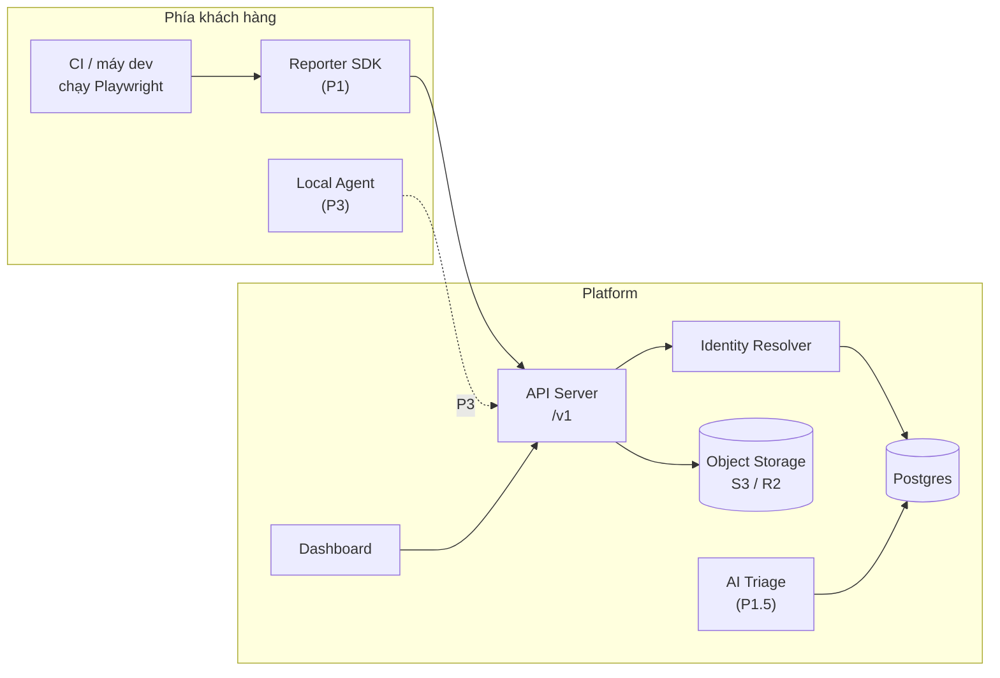
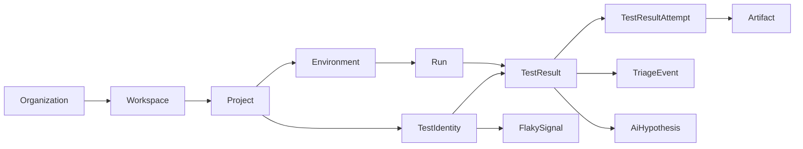
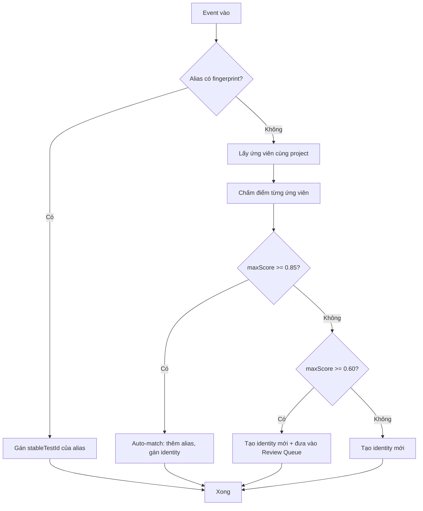

# Automation Testing Platform — Spec hợp nhất

> **Phiên bản:** v3.1-merged · **Ngày:** 24-08-2026 · **Trạng thái:** Chờ review
> **Nguồn:** bộ v3.0 (8 tài liệu, `docs/v3.0/`) + bộ v3.1 (10 tài liệu, `docs/v3.1/`) + bản thẩm định 24-08-2026
> **Quy tắc:** Đây là nguồn sự thật duy nhất. Mọi file trong `docs/` là lịch sử, chỉ để tra cứu. Tài liệu nào nói khác file này → file đó sai.

---

## 0. Cách đọc và những gì đã thay đổi khi gộp

### 0.1 Bộ tài liệu này đến từ đâu

| Bộ | Vị trí | Vai trò |
|---|---|---|
| v3.0 | `docs/v3.0/` | Bản gốc, 8 tài liệu thiết kế + 3 bản đối ngoại. **Đã lỗi thời** |
| v3.1 | `docs/v3.1/` | Bản viết lại sau thẩm định, 10 tài liệu. Nội dung đúng nhưng rời rạc |
| **SPEC.md** | root | **Bản gộp, đã vá lỗi khớp nối. Dùng bản này** |

Việc tách `docs/v3.0/` và `docs/v3.1/` cũng xử lý luôn vụ va chạm đánh số: trước đó root có cả `01-ICP-Personas-and-JTBD.md` lẫn `01-decisions.md`, rất dễ mở nhầm.

### 0.2 Những gì tôi đã SỬA khi gộp

Đây là các lỗi khớp nối giữa các file v3.1 — mỗi file tự nó chặt chẽ, ráp lại thì lệch. Tất cả đã sửa trong bản này:

| # | Lỗi ở bản v3.1 rời | Cách sửa | Xem mục |
|---|---|---|---|
| N01 | Timeline 90 ngày cho P1 bắt đầu tuần 5, nhưng Gate-0 ở tuần 6 → build trước khi được phép; vi phạm QĐ-6 và anti-pattern của chính Phase 0 Playbook | Dời P1 sang sau Gate-0 (tuần 7+); P1.5 sau Gate-1 | §4.3 |
| N02 | P1 ước lượng 4–6 người-tháng, nhưng phạm vi P1 thật nằm rải ở 5 file và lớn hơn nhiều | Gom phạm vi P1 về một chỗ, ước lượng lại **6,5–11,5**; bổ sung phương án **P1-min** cắt được về 4–6 | §4.2, §4.4 |
| N03 | `UNIQUE(runId, clientTestId)` đụng giới hạn đã tự nhận ở thuật toán identity (hai test trùng title+file sinh cùng fingerprint) → lỗi ingest cứng | Thêm `occurrenceIndex`, unique thành `(runId, clientTestId, occurrenceIndex)` | §8.4 |
| N04 | `TestIdentityAlias ... UNIQUE(projectId qua identity, fingerprint)` không tạo được index vì `projectId` không phải cột của bảng; cơ chế chống race lại tựa vào ràng buộc này | Denormalize `projectId` vào bảng alias | §8.5 |
| N05 | `flakyScore` chia cho `(totalRuns − 1)` → chia 0 khi `totalRuns = 1` | Guard `totalRuns ≥ 2`, dưới ngưỡng trả `verdict = insufficient_data` | §8.6 |
| N08 | Observability và JTBD biến mất hoàn toàn khỏi v3.1 (grep 10 file: 0 kết quả) | Khôi phục: JTBD ở §3.3, observability ở §6.4 | §3.3, §6.4 |
| N09 | Gate-1 đo identity bằng "tỉ lệ vỡ < 5%", thuật toán đo bằng "precision ≥ 0.98" — hai thước đo cho cùng một thứ | Hòa giải về một định nghĩa duy nhất | §4.5 |
| N10 | Khẳng định "Currents yếu ở test-identity xuyên rename" viết như sự thật đã biết, chưa kiểm chứng | Gắn nhãn `[CHƯA KIỂM CHỨNG]`, cấm dùng trong tài liệu bán hàng đến khi xác minh | §2.4 |

### 0.3 Những gì CẦN BẠN QUYẾT (tôi cố ý không tự quyết)

| # | Vấn đề | Vì sao không tự quyết | Xem mục |
|---|---|---|---|
| **QĐ-7** | `flaky_pass` biến mất khỏi `Run.status`. v3.0 có nguyên tắc in đậm *"run có flaky pass không được hiện xanh sạch"*; v3.1 bỏ mà không ghi vào decision log | Có thể là quyết định đúng (đẩy flakiness sang `FlakySignal`), nhưng nó xóa một nguyên tắc sản phẩm — phải là quyết định có chủ đích, không phải tai nạn | §1.7 |
| **QĐ-8** | Production Safety Guard biến mất khỏi toàn bộ roadmap v3.1 (grep: 0 kết quả), dù v3.0 coi nó là mục MVP và differentiator #5 | Đây là **hệ quả logic đúng** của reporter-first (không chạy test thì không chặn được), nhưng nó xóa một lời hứa đang nằm trong bản đối ngoại | §1.8 |
| — | Ô ký tên "người giữ quyền kill gate" trong QĐ-6 vẫn trống | Phải là tên một người cụ thể, không thể để tôi điền | §1.6 |

### 0.4 Việc còn treo, KHÔNG được đánh dấu hoàn thành

Ba bản đối ngoại trong `docs/v3.0/` **chưa được sửa** — tôi verify bằng cách đọc file, không phải suy đoán:

```
Automation_Testing_Platform_v3.{md,docx,pptx}    2026-07-07, nguyên vẹn
  MVP mục #1:  "Local Agent"              ← vẫn agent-first, trái QĐ-1
  MVP mục #6:  "Production Safety Guard"  ← lời hứa đã bị bỏ, xem QĐ-8
  Roadmap:     grep "Phase 5|Phase 6" → 0 ← vẫn bị cắt
  .docx:       **Unified Quality...**     ← vẫn còn ** literal
```

README của bộ v3.1 đánh dấu F12 và F16 là "✅ Đóng". **Sai** — quy tắc xuất bản đã viết, nhưng hiện vật chưa sửa. Và nó mâu thuẫn với chính QĐ-1, chỗ ghi *"Chưa sửa xong hai bản đó thì không gửi cho bất kỳ ai bên ngoài."*

Điều này nguy hiểm ở đúng thời điểm: Phase 0 tuần 1–6 là lúc mang deck đi gặp design partner. Ai tin ma trận README sẽ gửi bản pitch agent-first, roadmap cụt, cho đúng nhóm người mà v3.1 vừa quyết định pitch reporter-first.

**Cấm gửi ba file đó ra ngoài cho đến khi regenerate theo §4.7.**

---

## 1. Bản ghi quyết định (ADR)

> Trạng thái: **CHỐT** (đã quyết, mọi phần khác phải theo) · **CHỐT TẠM `[ASSUMPTION]`** (đủ để làm việc, Phase 0 có quyền lật) · **CẦN QUYẾT** (chưa ai quyết).
> Muốn lật một quyết định CHỐT phải có dữ liệu mới — phỏng vấn, số đo, hợp đồng. Không lật bằng cảm giác.

### 1.1 QĐ-1 — Onboarding: reporter-first ✅ CHỐT

Người dùng cài `@platform/playwright-reporter` (một dòng trong `playwright.config.ts`), test vẫn chạy trên CI/máy của họ như cũ, reporter đẩy kết quả + artifact lên platform. Local agent là **đường nâng cấp** cho scheduling và thực thi có kiểm soát, không phải điều kiện dùng sản phẩm.

**Lý do:**
1. Khả thi 8/10 so với 5/10 — đội 1–2 người ship được thay vì không ship được.
2. Time-to-value: 10 phút (cài package) so với nửa ngày (cài, cấu hình, vận hành agent trong mạng nội bộ).
3. Khớp wedge "không bắt bỏ Playwright" — reporter là mô hình xâm lấn thấp nhất có thể.
4. Agent vẫn nằm trong tầm nhìn (P3). Đây là quyết định về **thứ tự**, không phải loại bỏ.

**Hệ quả bắt buộc:**
- Local agent chuyển từ P1 sang **P3** (§4.1).
- Phần Agent Protocol (§7.8) giữ làm thiết kế P3, chưa build. Phần Ingestion API (§7.2) là hợp đồng P1.
- Production Safety Guard mất chỗ đứng ở P1 — xem **QĐ-8**, đây là hệ quả chưa ai ghi nhận.
- Ba bản đối ngoại **phải viết lại** trước khi gửi ra ngoài (§0.4).

**Trade-off chấp nhận:** không kiểm soát môi trường chạy test ở P1 → mất một số tín hiệu (resource máy chạy, network condition). Các tín hiệu đó phục vụ P4+, không chặn giá trị lõi.

### 1.2 QĐ-2 — Wedge: Report Center, định vị quanh aggregation `[ASSUMPTION]`

Wedge 12 tháng đầu: **"Bộ nhớ dài hạn cho bộ test E2E của bạn"** — tổng hợp xuyên nhiều run: lịch sử, trend, flaky detection, triage cấp team. **Không** bán "rich artifacts" làm luận điểm chính (Playwright cho miễn phí rồi).

**Vì sao tạm chọn hướng này thay vì "cầu nối manual → automation":**
1. Đường kỹ thuật ngắn hơn, tận dụng đúng khối đã ước lượng. Hướng "cầu nối" kéo Test Management (P2, 2–4 người-tháng, nhiều importer đuôi dài) lên trước.
2. Chứng minh được TTRC bằng số trong một chu kỳ gate; hướng "cầu nối" khó có chỉ số sắc như vậy.
3. Hướng "cầu nối" không mất đi: nếu Phase 0 cho thấy ≥ 8/15 team phỏng vấn có bộ test thủ công lớn chạy song song và coi đó là pain #1 → lật tại Gate-0, chi phí lật gần bằng 0 vì chưa code.

**Câu hỏi Phase 0 phải trả lời để chốt cứng:** trong 15 phỏng vấn, pain nào được xếp #1 nhiều hơn — "không biết fail vì sao / flaky" hay "quản lý song song manual + automation"?

### 1.3 QĐ-3 — Thị trường: sản phẩm tiếng Anh, GTM từ VN/SEA `[ASSUMPTION]`

- Sản phẩm, docs, UI: **tiếng Anh** ngay từ đầu. Thêm i18n vi/th/id sau — chi phí thêm ngôn ngữ nhỏ hơn nhiều chi phí quốc-tế-hóa một sản phẩm sinh ra bằng tiếng Việt.
- Design partner và khách trả tiền đầu tiên: **VN + SEA** — nơi có lợi thế thật (giá theo mặt bằng địa phương, hỗ trợ tại chỗ, TestRail/Xray đắt khi quy đổi) mà Currents/Allure không có.
- Giá niêm yết USD, có regional pricing cho SEA (§10.5).

**Lý do:** đây không phải ngã ba thật — lấy được cả hai nếu tách "sản phẩm" khỏi "kênh bán". Rủi ro của "quốc tế ngay": không có kênh phân phối, đốt thời gian vào content marketing trong khi Phase 0 cần phỏng vấn mặt-đối-mặt. Rủi ro của "VN-only": khóa sản phẩm vào tiếng Việt, sau gỡ rất đắt.

### 1.4 QĐ-4 — AI Triage v0 vào Phase 1.5 ✅ CHỐT

Phạm vi v0 (cố ý hẹp):
- **Input:** TestResult fail + error message + stack trace + diff so với lần pass gần nhất + lịch sử flaky của `stableTestId`.
- **Output:** *một* root-cause hypothesis có cấu trúc `{category, confidence, evidence[], suggestedAction}`, category lấy từ taxonomy §8.7.
- Chỉ **đề xuất**, người **duyệt**. Hành vi duyệt sinh `TriageEvent` — chính là dữ liệu đo TTRC. AI không bao giờ tự đóng issue, tự re-run, tự sửa test.

**Guardrail chống "giả thuyết rác phá niềm tin":**
- Metric bắt buộc từ ngày đầu: `hypothesis_acceptance_rate = accepted / (accepted + rejected)`.
- Ngưỡng: **< 40% trong 2 tuần liên tiếp → tắt mặc định**, chuyển opt-in, quay lại tinh chỉnh prompt/context.
- Hiển thị confidence; dưới 0.5 gắn nhãn "low confidence" thay vì giấu.
- Chi phí LLM có trần cứng (§10.3): fail trùng fingerprint trong cùng ngày không chạy lại.

**Lý do:** 0,5–1 người-tháng một khi schema chuẩn — rẻ nhất danh sách, đúng thông điệp bán mạnh nhất, và là công cụ chứng minh TTRC tại Gate-1.5.

### 1.5 QĐ-5 — Không build managed agent trong 12 tháng đầu ✅ CHỐT

Managed agent (container do platform vận hành, resource limit, egress policy, sandbox) = tự xây một CI thu nhỏ: 3–6 người-tháng + gánh vận hành vĩnh viễn.

**Điều kiện mở lại** (ghi để khỏi tranh cãi lại từ đầu): ≥ 3 khách trả tiền yêu cầu **bằng văn bản** VÀ sẵn sàng trả gói cao hơn ≥ 2× cho tính năng này; HOẶC một hợp đồng enterprise coi đây là điều kiện ký.

Trước đó, mọi nhu cầu "chạy hộ" trả lời bằng: reporter trên CI sẵn có của khách + local agent (P3) khách tự vận hành.

### 1.6 QĐ-6 — Ngưỡng dừng của Phase 0 ✅ CHỐT

> Nếu sau **6 tuần** kể từ ngày bắt đầu Phase 0 không có đủ **3 design partner** thỏa cả 3 điều kiện: (a) có bộ E2E Playwright/Cypress thật đang chạy ≥ 3 lần/tuần, (b) ký cam kết phản hồi hàng tuần (mẫu §5.5), (c) đồng ý cho đo baseline TTRC — thì **dừng, không chuyển sang Phase 1**. Hai lựa chọn tại điểm dừng: đổi wedge (quay lại QĐ-2, phương án "cầu nối") hoặc đóng dự án.

**Người có quyền tuyên bố gate trượt** — điền trước khi bắt đầu Phase 0. Không được là "cả team quyết": quyết định tập thể về việc dừng là quyết định không bao giờ được ra.

| Vai trò | Tên | Ngày ký |
|---|---|---|
| Người giữ quyền kill gate | ____________ | ____ |

**"Vừa build vừa tìm partner" bị cấm tường minh trong 6 tuần này.** Ngoại lệ duy nhất: prototype test-identity (§4.3 tuần 3–4) — đó là hoạt động giảm rủi ro kỹ thuật, không phải build sản phẩm.

### 1.7 QĐ-7 — `flaky_pass` ở `Run.status` 🔴 CẦN QUYẾT

**Tình trạng:** v3.0 nêu nguyên tắc in đậm *"A run with flaky passes should not appear as clean green."* Bản v3.1 định nghĩa `Run.status = queued|running|passed|failed|error|cancelled` — **không còn `flaky_pass`**. Nó chỉ còn ở `TestResult.finalStatus`. Nghĩa là run có test fail-rồi-retry-pass sẽ hiện **xanh sạch**, đúng thứ v3.0 cấm. Không có dòng nào trong decision log ghi nhận việc bỏ này.

**Ba phương án:**

| | Phương án | Đánh đổi |
|---|---|---|
| A | Thêm `passed_with_flaky` vào `Run.status` | Giữ nguyên tắc v3.0. Enum rộng thêm 1 giá trị; mọi filter "passed" phải nhớ gộp 2 giá trị — nguồn bug âm thầm |
| B | Giữ enum hiện tại, thêm cột `Run.flakyCount int` và **UI bắt buộc** hiện badge khi > 0 | Enum sạch, nguyên tắc được giữ ở tầng hiển thị. Rủi ro: nguyên tắc phụ thuộc kỷ luật UI, không được DB ép |
| C | Giữ nguyên v3.1, chấp nhận run xanh sạch | Đơn giản nhất. Bỏ một nguyên tắc sản phẩm có chủ đích — phải ghi rõ lý do |

**Khuyến nghị: B.** Nguyên tắc được giữ, enum không phình, và `flakyCount` là dữ liệu có ích cho dashboard EM (§2.5) chứ không chỉ để hiển thị badge. Nhưng đây là quyết định của bạn — nếu chọn C, hãy ghi lý do vào đây để 6 tháng nữa không ai đào lại.

### 1.8 QĐ-8 — Số phận của Production Safety Guard 🔴 CẦN QUYẾT

**Tình trạng:** v3.0 coi đây là nguyên tắc sản phẩm #5 ("Safety by Default"), một mục MVP, JTBD 5, và differentiator #5. Grep toàn bộ 10 file v3.1: **0 kết quả** cho safety / production guard / destructive. Nó không bị dời sang phase sau — nó biến mất.

**Phân tích:** đây là hệ quả **logic đúng** của QĐ-1. Ở mô hình reporter-first, platform không thực thi test, nên không thể chặn test phá hoại chạy vào production — chặn cái mình không chạy là vô nghĩa. Safety Guard chỉ có ý nghĩa khi có agent, tức là **P3**.

**Vấn đề:** nó vẫn đang được quảng cáo trong bản đối ngoại (`MVP: Production Safety Guard`), và nó từng là một trong năm differentiator. Bỏ im lặng nghĩa là bán một thứ không có.

**Khuyến nghị:** chốt "dời sang P3, gắn với agent", ghi vào roadmap §4.1, và **xóa khỏi bản đối ngoại** khi regenerate (§4.7). Nếu Phase 0 phát hiện safety là pain thật của ≥ 5/15 người phỏng vấn → xem lại thứ tự P3.

### 1.9 QĐ-9 — Stack: Go backend, Next.js frontend ✅ CHỐT

**Quyết định:** backend **Go** (monolith), frontend **Next.js/TypeScript**, Postgres + object storage (S3/R2) + queue. Khớp nguyên tắc "boring stack" §4.6.

**Vì sao Go hợp bài toán này:** ingestion là hot path (batch 500 event / 5 MB, §7.4); resolver chạy bất đồng bộ p50 < 1 s (§7.6) hợp mô hình goroutine; HMAC token verify (§8.8) là stdlib; chunked upload streaming (§7.7) là thế mạnh; single binary + RAM thấp ăn thẳng vào dòng "DB + compute ~$3–5/team" của §10.3. Levenshtein/Jaccard/trigram của §9.3 dùng `pg_trgm` + `fuzzystrmatch` phía Postgres, phần còn lại vài trăm dòng Go.

**Ràng buộc bắt buộc đi kèm — vi phạm là bug, không phải style:**

1. **Next.js chạy chế độ static export** (`output: 'export'`), phục vụ bởi chính Go binary hoặc CDN. `[ASSUMPTION]` — có quyền lật nếu có nhu cầu SSR thật. Lý do: dashboard nằm sau đăng nhập, nội dung riêng từng người, không cần SEO → SSR gần như không mang lại gì, trong khi chạy thêm Node server là **runtime thứ hai phải deploy và trả tiền**, phá đúng lợi thế single-binary vừa dùng để biện minh cho Go.
2. **Next.js KHÔNG được có route handler chạm database.** Toàn bộ API sống ở Go dưới `/v1/` (§6.5). Đây là failure mode kinh điển của Next: API routes mọc dần cho tới khi có hai backend, hai chỗ enforce quyền, và §11.3.3 ("một hàm `authorize()` duy nhất") sụp.
3. **Cấm `dangerouslySetInnerHTML`**, bật ESLint rule `react/no-danger` ở mức error. §11.5 yêu cầu escape mọi dữ liệu từ report; tên test và stack trace là input do người ngoài kiểm soát, đây là vector XSS thật chứ không phải lo xa. Chặn bằng linter, không bằng code review.

**Hệ quả đã biết:** Reporter SDK bắt buộc là TypeScript (§7.5 — nó là Playwright reporter), nên team đa ngôn ngữ Go + TS từ ngày đầu. Chấp nhận: Go thắng ở vận hành và chi phí, TS dùng chung cho frontend và reporter.

**Chưa chốt — khóa cùng pricing:** model LLM cho AI Triage (§1.4). §10.3 giả định ~$0.01/hypothesis (6k token vào, 500 ra), tương đương model hạng Haiku. Model hạng Opus khoảng $0.04/hypothesis → biến phí nhảy từ $9–10 lên ~$24/team/tháng, và quy tắc "giá Team ≥ 5× biến phí" sẽ đòi giá ~$120 thay vì $49. **Không được chọn model tách rời khỏi pricing.** Benchmark chất lượng hypothesis trên vài model ở P1.5, rồi khóa model và giá cùng lúc trước Gate-1.5.

### 1.10 Phụ lục — 5 câu hỏi mở của v3.0, đã chốt

| Câu hỏi | Quyết định | Ghi chú |
|---|---|---|
| Long polling hay WebSocket cho agent | **Long polling** (P3) | WebSocket chỉ khi có số đo cho thấy cần |
| Timeout mặc định | Bảng chuẩn §7.9 | request 30 s, claim TTL 60 s, heartbeat 20 s |
| Ngưỡng chunked upload | **≥ 8 MB** | Dưới ngưỡng: single PUT |
| Số phiên bản protocol hỗ trợ | **N và N−1** | N−2 trả `426 Upgrade Required` |
| Agent tự cập nhật | **Opt-in, mặc định tắt** | Enterprise không bao giờ chấp nhận auto-update mặc định |

---

## 2. Định vị và cạnh tranh

### 2.1 Định vị một câu

> **"Bộ nhớ dài hạn cho bộ test E2E của bạn"** — Playwright cho bạn biết *lần chạy này* fail thế nào; chúng tôi cho bạn biết *test này* đã hành xử ra sao qua 500 lần chạy gần nhất, nó có flaky không, fail lần này giống lần nào trước đó, và giả thuyết nguyên nhân là gì.

### 2.2 Xếp hạng differentiator

Thứ tự cũ đặt "rich artifacts" ngang hàng các giá trị khác — sai, vì Playwright cho miễn phí screenshot/video/trace viewer.

| Hạng | Differentiator | Vì sao phòng thủ được |
|---|---|---|
| 1 | **Aggregation xuyên run**: lịch sử, trend, flaky detection ở cấp `stableTestId` | Đòi hỏi test identity ổn định (§9) — khối khó nhất, chính là moat. Trace viewer của Playwright chỉ nhìn được 1 run |
| 2 | **AI triage có vòng phản hồi đo được**: hypothesis → accept/reject → TTRC | ReportPortal có AI phân loại, nhưng không đo và không bán bằng chỉ số TTRC. Chỉ số là thông điệp, không phải tính năng |
| 3 | **Triage cấp team**: assign, trạng thái, lịch sử quyết định trên từng failure | Trace viewer là công cụ cá nhân; triage là công cụ của team |
| 4 | Rich artifacts gắn đúng attempt + retention thông minh | Hạ xuống hàng *table stakes* — phải có, không dùng để bán |

> Lưu ý QĐ-8: "Safety Policy" từng là differentiator #5 ở v3.0. Nó không còn trong danh sách này vì reporter-first không thực thi test. Đừng để nó quay lại slide.

### 2.3 Câu trả lời chuẩn cho phản biện nặng nhất

**"Playwright HTML report + trace viewer đủ dùng rồi."**

> "Đúng — cho *một* lần chạy, trên *máy của một người*. Ba câu Playwright report không trả lời được: (1) test này pass hôm nay nhưng đã fail 7 lần trong 30 ngày qua — nó flaky hay vừa hỏng thật? (2) lỗi này đã từng xuất hiện chưa, ai xử lý, kết luận là gì? (3) cả team đang nhìn chung một bức tranh nào về sức khỏe bộ test? Nếu team anh/chị chưa từng cần trả lời 3 câu đó thì sản phẩm này chưa dành cho anh/chị — và đó là dữ liệu Phase 0 chúng tôi cần."

Câu cuối quan trọng: người phỏng vấn **không được tranh cãi** để bảo vệ sản phẩm. Trả lời "đủ dùng" là dữ liệu H1 âm, ghi nhận và đi tiếp.

### 2.4 Bản đồ cạnh tranh

| Đối thủ | Loại | Chồng lấn | Đe dọa | Cách tách mình |
|---|---|---|---|---|
| **Microsoft Playwright Testing (Azure)** | Cloud runner + reporting cho Playwright | Trực diện P1 + P3 | 🔴 **Nghiêm trọng nhất** | MS bán compute (chạy hộ, browser grid), yếu ở triage/lịch sử/flaky, khóa vào Azure. Ta bán *trí nhớ và triage*, framework-agnostic, không bắt đổi CI. Theo dõi hàng quý |
| **Datadog Test Optimization** | Test ingestion trong APM suite | Flaky detection, CI visibility | 🔴 Cao | Bán qua hợp đồng Datadog sẵn có, giá enterprise. Ta thắng ở: team không dùng Datadog (đa số SEA), giá, độ sâu E2E |
| **ReportPortal** | OSS reporting + AI phân loại | Trực diện P1 + P4 | 🟠 Cao | Miễn phí nhưng tự vận hành nặng (Java stack, ES cluster), AI cần train, UX cũ. Ta bán SaaS 10-phút-lên. **Không bao giờ** bán "AI triage" như thể mình phát minh — bán "TTRC giảm X%" |
| **Currents.dev** | SaaS dashboard Playwright/Cypress | Giống ta nhất về hình dáng | 🟠 Cao | Thắng bằng test identity xuyên rename `[CHƯA KIỂM CHỨNG — xem dưới]`, triage workflow, giá SEA, hỗ trợ tại chỗ. Benchmark UX phải theo dõi hàng tháng |
| **Allure TestOps** | Reporting + test management | P1 + P2 | 🟠 TB–cao | Nặng, đắt, hướng enterprise QA process. Ta thắng ở developer-first onboarding |
| **Qase / Testomat.io** | Test management gắn automation | P2 | 🟡 Trung bình | Họ đi từ manual TM sang automation; ta đi ngược. Nếu Phase 0 lật QĐ-2 → nhóm này thành đối thủ chính, phải cập nhật bảng |
| **Launchable / Sealights** | Test intelligence | P4 tầng phân tích | 🟡 Trung bình | Khác bài toán (chạy ít test hơn ≠ hiểu failure nhanh hơn) nhưng cùng ngân sách "QA tooling" |
| **TestRail / Xray** | Test management truyền thống | P2, hệ quy chiếu giá ở SEA | 🟡 Trung bình | Đắt khi quy đổi chi phí địa phương — dùng làm điểm neo giá, không phải đối thủ tính năng |
| Katalon / mabl / Testim | Nền tảng thay thế framework | Gián tiếp | 🟢 Thấp | Chính là phản-định-vị của ta: "không bắt bạn bỏ Playwright" |

> **`[CHƯA KIỂM CHỨNG]`** — khẳng định "Currents yếu ở test-identity xuyên rename" chưa có bằng chứng. **Cấm đưa vào tài liệu bán hàng hoặc so sánh công khai** cho đến khi có người dựng thử tài khoản Currents và kiểm chứng. Nếu sai, đây là loại sai làm mất uy tín trong đúng một cuộc gọi bán hàng.

### 2.5 ICP và người giữ ngân sách

- **ICP (người dùng):** QA Automation Lead / SDET lead. Team 3–15 QA+dev, bộ Playwright/Cypress 100–1000 test, chạy CI hằng ngày.
- **Người giữ ngân sách:** Engineering Manager / Head of Engineering — **thường không phải ICP**. Hệ quả bắt buộc:
  - Dashboard phải có **một màn hình cho EM**: trend sức khỏe bộ test theo tuần, TTRC, thời gian đội đốt vào flaky. Đây là vũ khí để ICP đi xin ngân sách.
  - Pricing phải có con số EM so được với lương giờ kỹ sư: *"flaky đốt của team anh X giờ/tháng ≈ $Y; gói này giá $Y/10"*.
  - Mẫu email "gửi sếp của bạn" là **deliverable của Phase 0**, không phải afterthought.

---

## 3. ICP, Persona và JTBD

> Khôi phục từ `docs/v3.0/01-ICP-Personas-and-JTBD.md` — nội dung này biến mất hoàn toàn khỏi bộ v3.1 (N08). Đã rút gọn về phần còn hiệu lực sau QĐ-1 và QĐ-2.

### 3.1 Persona

| Persona | Vai trò trong MVP | Nhu cầu chính |
|---|---|---|
| **QA Automation Lead** | 🎯 ICP chính | Triage failure nhanh, phát hiện flaky, niềm tin vào CI |
| **Engineering Manager** | 💰 Người duyệt chi | Trend sức khỏe, TTRC, release confidence |
| **Developer** | Người dùng phụ | Artifact gắn commit/branch, lỗi network/console rõ ràng |
| **QA Manual** | Ngoài phạm vi P1 | Vào từ P2 (Test Management) — hoặc sớm hơn nếu QĐ-2 lật |
| **PO / BA** | Ngoài phạm vi | Trạng thái release cấp cao |

**Không tối ưu cho ở MVP:** solo developer, người học Playwright, team chưa có quy trình test, tổ chức đòi SSO/RBAC đầy đủ ngay từ đầu.

### 3.2 Nỗi đau của người mua

> *"Automation E2E của chúng tôi có chạy, nhưng khi nó fail thì mất quá lâu để biết đó là bug thật, test flaky, lỗi môi trường hay lỗi code test."*

### 3.3 Jobs To Be Done

| # | JTBD | Phase phục vụ |
|---|---|---|
| 1 | Khi test fail sau deploy, hiểu nhanh **cái gì fail và vì sao**, để quyết định rollback / sửa app / sửa test | P1 + P1.5 |
| 2 | Gom screenshot, video, trace, console, network vào **một report**, khỏi nhảy giữa CI log và devtools | P1 |
| 3 | Test lúc pass lúc fail → hệ thống **tự nhận diện và gắn nhãn flaky**, để team không coi là pass sạch | P1 |
| 4 | So sánh môi trường / browser / commit khi "local pass, staging fail" | P1 |
| 5 | ~~Chạy smoke test trên production an toàn, test phá hoại bị chặn~~ | ⚠️ **Phụ thuộc QĐ-8** — không khả thi ở reporter-first, sớm nhất P3 |
| 6 | Trước release, thấy flow nào pass/fail/skip để **ra quyết định có bằng chứng** | P1 |
| 7 | Nhận diện case thủ công nào nên chuyển thành automation | P2 (hoặc P1 nếu lật QĐ-2) |
| 8 | AI tóm tắt nguyên nhân khả dĩ + hành động tiếp theo | P1.5 |

### 3.4 Hành trình người dùng MVP

```
Đăng ký → Tạo project → Cài reporter vào repo Playwright sẵn có
   → Run đầu tiên tự đẩy lên → Xem report có artifact
   → (P1.5) AI tóm tắt nguyên nhân → Người duyệt hypothesis
   → Quyết định: công cụ này có tiết kiệm thời gian debug không?
```

---

## 4. Roadmap và Gates

> Đây là **bản đồ định hướng có gate**, không phải kế hoạch thi công. Chỉ P0, P1, P1.5 được lập kế hoạch chi tiết; P2+ chỉ lập kế hoạch sau khi gate trước pass.

### 4.1 Roadmap tổng

| Phase | Tên | Nội dung lõi | Điều kiện vào | Người-tháng |
|---|---|---|---|---|
| **P0** | Validate | 15 phỏng vấn, 3 design partner, baseline TTRC | Bắt đầu ngay | 0 code (trừ prototype identity) |
| **P1** | Report Center v0 | Ingestion API, Reporter SDK, test identity v1, artifact, dashboard v0, trace viewer, authN + RBAC | **Gate-0 pass** | **6,5–11,5** (§4.2) |
| **P1.5** | AI Triage v0 | Hypothesis + accept/reject + TriageEvent + đo TTRC | **Gate-1 pass**, schema đứng yên ≥ 2 tuần | 0,5–1 |
| **P2** | Test Management | Manual test, import TestRail/Xray/Excel | Gate-1.5 pass **và** dữ liệu khách ủng hộ | 2–4 |
| **P3** | Scheduler & Agent | Local agent (pull-only), scheduler, CI ingestion, notification, **Safety Guard (QĐ-8)** | Khách trả tiền yêu cầu scheduling | 3–5 |
| **P4** | AI nâng cao | Smart triage, phân cụm failure, gợi ý fix | `acceptance_rate` v0 ≥ 60% ổn định | 2–3 |
| **P5** | Mở rộng | Visual regression, performance, security, distributed runner | Chỉ khi có cầu trả tiền | — |
| **P6** | Enterprise | SSO, RBAC nâng cao, audit log, plugin marketplace, on-prem | Hợp đồng enterprise cụ thể | — |

**Thay đổi so với v3.0:** local agent P1 → **P3** (QĐ-1); AI triage tách khỏi P4 thành **P1.5** (QĐ-4); managed agent **loại** khỏi 12 tháng đầu (QĐ-5); Safety Guard P1 → **P3** (QĐ-8, chờ chốt).

### 4.2 Phạm vi P1 thật — gom từ 5 nơi (sửa N02)

Bản v3.1 ghi P1 = "4–6 người-tháng" cho một dòng liệt kê ngắn. Nhưng phạm vi P1 thật nằm rải khắp các tài liệu khác. Đây là danh sách đầy đủ:

| Khối | Nguồn yêu cầu | Người-tháng |
|---|---|---|
| Ingestion API (§7.2) | §7 | 0,5–1 |
| Playwright Reporter SDK (§7.5) | §7 | 0,5–1 |
| Test identity v1 + resolver (§9) | §9 | 1,5–3 |
| **Merge / Split / Review Queue UI** | §9.4 — *"bắt buộc có ở P1"* | 0,5–1 |
| Artifact pipeline: cap, chunked, retention job | §7.7, §10.4 | 1–1,5 |
| **Xử lý client-side cho 5 loại artifact** (nén, cắt, strip) | §10.4 | 0,3–0,5 |
| Dashboard v0: run list, test history, flaky view | §4.3 | 1,5–2 |
| Trace viewer nhúng | §4.3 | 0,5–1 |
| **Màn hình EM** | §2.5 — *"phải có"* | 0,3–0,5 |
| **AuthN đầy đủ**: email/pass + OAuth + verify + MFA TOTP + session | §11.2 | 0,5–1 |
| **RBAC 6 role + ma trận quyền + test cross-tenant** | §11.3 | 0,5–1 |
| **Tổng** | | **6,5–11,5** |

Sáu khối in đậm là những khối **không có trong dòng roadmap gốc** nhưng lại được các tài liệu khác tuyên bố "bắt buộc có ở P1". Đây là nguồn gốc của sai lệch ước lượng.

### 4.3 Timeline (sửa N01 — mọi phase nằm sau gate của nó)

Bản v3.1 xếp P1 bắt đầu tuần 5 trong khi Gate-0 ở tuần 6, vi phạm chính QĐ-6. Bản dưới đã sửa.

**Phase 0 — tuần 1–6** (chi tiết vận hành ở §5.6)

| Tuần | Việc | Deliverable kiểm chứng được |
|---|---|---|
| 1–6 | Phỏng vấn, tuyển partner, đo baseline TTRC | 15 bản ghi chú; 3 cam kết đã ký; bảng baseline TTRC |
| 3–4 | **Prototype test identity** — ngoại lệ code duy nhất | Chạy thuật toán §9 trên ≥ 500 test result thật, báo cáo precision/recall |
| 6 | **Gate-0** | Biên bản pass/kill có chữ ký |

**Phase 1 — bắt đầu tuần 7, chỉ khi Gate-0 pass**

| Tuần | Việc | Deliverable |
|---|---|---|
| 7–9 | Ingestion API + schema + authN tối thiểu | `POST /v1/runs` + `/events` production-ready, có test case lỗi |
| 9–12 | Reporter SDK + artifact pipeline | Partner #1 cài reporter vào repo thật, report đầu tiên lên dashboard |
| 12–17 | Dashboard v0 + trace viewer + màn hình EM | Cả 3 partner dùng hàng tuần |
| 15–18 | Merge/Split/Review Queue + RBAC đầy đủ | Bộ test cross-tenant pass 100% |
| 18 | **Gate-1** | Biên bản gate |

**Phase 1.5 — tuần 19–24, chỉ khi Gate-1 pass và schema đứng yên ≥ 2 tuần**

| Tuần | Việc | Deliverable |
|---|---|---|
| 19–21 | AI Triage v0 | Hypothesis sinh ra cho fail mới, có accept/reject |
| 21–24 | Vận hành + đo | TTRC tuần 24 so với baseline tuần 6 |
| 24 | **Gate-1.5** | Biên bản gate |

> ⚠️ **Lịch trên giả định 2 người full-time.** Với 1 người, P1 kéo dài 7–11 tháng, không phải 3. "P0 + P1 + P1.5 trong 90 ngày" là **không khả thi** ở mọi kịch bản — bản v3.1 hứa điều đó vì cộng nhầm phạm vi P1. Nếu 90 ngày là ràng buộc cứng, dùng P1-min ở §4.4.

### 4.4 P1-min — nếu bắt buộc phải vừa 12 tuần

Cắt về đúng lõi chứng minh giá trị. Ước lượng sau cắt: **4–6 người-tháng** (chính là con số v3.1 đưa ra — nó đúng cho phạm vi này, không đúng cho phạm vi §4.2).

| Cắt khỏi P1 | Thay bằng | Dời sang |
|---|---|---|
| OAuth Google/GitHub | Chỉ email + password | P2 |
| MFA TOTP | — | P2 |
| RBAC 6 role | 3 role: `admin` / `member` / `viewer` | P2 mở rộng |
| Merge/Split **UI** | Script vận hành maintainer chạy tay, có ghi audit | P2 |
| Review Queue **UI** | Export CSV + import quyết định | P2 |
| Màn hình EM | — | P1.5 |
| Xử lý client-side 5 loại artifact | Chỉ video + trace | P2 |

**Không được cắt, dù có gì xảy ra:** test identity + resolver (không có nó thì không có sản phẩm), artifact cap phía server (không có nó thì lỗ tiền), tenant isolation + test cross-tenant (không có nó thì rò dữ liệu giữa khách).

### 4.5 Gates

#### Gate-0 — cuối tuần 6

**PASS khi đủ cả 4:**
1. ≥ 15 phỏng vấn ICP hoàn thành, ghi chú theo mẫu §5.3.
2. 3 design partner ký cam kết (§5.5), có bộ E2E thật chạy ≥ 3 lần/tuần.
3. Baseline TTRC đo xong cho cả 3 partner (§5.4) — **có con số**, không phải cảm nhận.
4. Pain ranking: "không biết fail vì sao / flaky" nằm trong top-2 của ≥ 8/15 người.

**KILL:** nguyên văn QĐ-6.

**Nhánh lật wedge:** nếu điều 4 trượt nhưng "quản lý manual + automation song song" là top-1 của ≥ 8/15 → kích hoạt phương án B của QĐ-2, viết lại §2 và §4 trong 1 tuần, chạy lại Gate-0 rút gọn (không phỏng vấn lại; cần ký lại cam kết partner theo wedge mới).

#### Gate-1 — cuối tuần 18

**PASS khi đủ cả 3:**
1. Cả 3 partner đẩy report từ dự án thật ≥ 2 tuần liên tục, ≥ 3 run/tuần/partner.
2. **Test identity v1 đạt ngưỡng** (hòa giải N09 — một định nghĩa duy nhất):
   - `precision` của auto-match **≥ 0.98** — trong số các cặp thuật toán tự gộp, ≥ 98% là gộp đúng.
   - `recall` **≥ 0.80** — miss thì rơi vào Review Queue, chấp nhận được.
   - Đo bằng review thủ công cùng partner trên mẫu ≥ 200 quyết định match, cùng phương pháp với prototype §9.6.
   *(Bản v3.1 dùng hai thước đo khác nhau cho cùng một thứ — "tỉ lệ vỡ < 5%" ở gate và "precision ≥ 0.98" ở thuật toán. Chốt dùng precision/recall vì nó phân biệt được gộp nhầm với tách nhầm, mà hai loại sai này có hậu quả rất khác nhau.)*
3. ≥ 2/3 partner trả lời "có" cho câu: *"nếu ngày mai chúng tôi tắt dịch vụ, anh/chị có bị ảnh hưởng công việc không?"*

**KILL:** < 2 partner còn dùng thật ở tuần 18 → quay lại QĐ-2, không mở P1.5.

#### Gate-1.5 — cuối tuần 24

**PASS:** trung vị TTRC của 3 partner giảm **≥ 30%** so với baseline P0 **và** `hypothesis_acceptance_rate` ≥ 40%.

**KILL cho tính năng, không kill dự án:** `acceptance_rate` < 40% hai tuần liên tiếp → AI triage về opt-in; dự án vẫn tiến bằng differentiator #1 (aggregation); P4 hoãn vô thời hạn.

#### Gate-2 trở đi

Chỉ viết chi tiết khi gate trước pass. Nguyên tắc chung: mỗi gate phải có (a) chỉ số định lượng, (b) người giữ quyền kill (mặc định: người ký ở QĐ-6), (c) hành động cụ thể khi trượt.

### 4.6 Nguyên tắc thi công

1. **Prototype rủi ro cao nhất trước** — test identity đi trước dashboard.
2. **Schema đóng băng trước khi build AI** — P1.5 chỉ bắt đầu khi §8 không có migration mới trong 2 tuần.
3. **Boring stack** — Go monolith + Postgres + object storage (S3/R2) + queue; frontend Next.js static export. Chi tiết và ràng buộc ở **QĐ-9 (§1.9)**. Không K8s, không microservices, không Kafka. Nâng cấp khi có số đo, không khi có cảm giác.
4. **Mọi tuần đều ship cho partner** — không sprint nào kết thúc bằng "demo nội bộ".

### 4.7 Quy tắc tài liệu đối ngoại

1. **Không cắt roadmap.** Bản tóm tắt/deck được rút gọn nhưng phải hiện đủ P0–P6; P5–P6 gắn nhãn *"Vision 3–5 năm, gated by demand"*. Cắt hẳn tạo cảm giác sản phẩm không có đường lên enterprise.
2. **Một nguồn sinh nhiều định dạng.** File `SPEC.md` là gốc; `.docx`/`.pptx` sinh bằng pipeline (pandoc hoặc script). **Cấm copy-paste tay Markdown vào Word** — đó là nguyên nhân của lỗi `**` literal đang còn trong bản hiện tại.
3. **Checklist trước khi gửi ra ngoài:**
   - [ ] Không còn ký tự `**`, `#`, ` ``` ` literal trong bản Word/PowerPoint
   - [ ] MVP mục #1 là **Reporter SDK**, không phải Local Agent
   - [ ] Roadmap hiện đủ P0–P6
   - [ ] **Đã xóa "Production Safety Guard" khỏi mục MVP** (QĐ-8)
   - [ ] Không có khẳng định `[CHƯA KIỂM CHỨNG]` nào về đối thủ
   - [ ] Ghi version + ngày, trỏ về commit của `SPEC.md`
4. Cho đến khi checklist trên xanh hết: **ba file trong `docs/v3.0/` bị cấm gửi ra ngoài.**

### 4.8 Khả thi theo quy mô đội

| Quy mô | Phạm vi khả thi | Thời gian |
|---|---|---|
| 1 người / part-time | P0 + **P1-min** reporter-only | 4–6 tháng |
| 1 người full-time | P0 + P1 đầy đủ | 8–12 tháng |
| 2–3 người full-time | P0 + P1 + P1.5 | 6–9 tháng |
| 2–3 người full-time | Thêm agent cơ bản (P3 sớm) | 9–12 tháng |
| < 5 người | Toàn bộ P0–P6 | Không khả thi trong 1–2 năm. P5–P6 là tầm nhìn 3–5 năm |

---

## 5. Phase 0 Playbook

> Mục tiêu: chứng minh hoặc bác bỏ 3 giả thuyết bằng dữ liệu, trong 6 tuần, **không viết code sản phẩm**.

### 5.1 Ba giả thuyết phải kiểm chứng

| # | Giả thuyết | Cách đo | Ngưỡng chấp nhận |
|---|---|---|---|
| H1 | Pain "không biết fail vì sao / flaky" đủ nặng và đủ tần suất | Pain ranking trong phỏng vấn | Top-2 của ≥ 8/15 người |
| H2 | TTRC hiện tại đủ lớn để đáng tiền | Đo baseline (§5.4) | Trung vị ≥ 20 phút/failure ở ≥ 2/3 partner |
| H3 | ICP kéo được ngân sách | Hỏi thẳng ngân sách + quy trình duyệt (câu B5–B7) | ≥ 5/15 nói được con số họ/sếp sẵn sàng trả |

### 5.2 Tuyển 15 người phỏng vấn

- **Screener** (đủ cả 3 mới tính vào 15): (1) đang trực tiếp maintain bộ Playwright/Cypress ≥ 50 test; (2) bộ test chạy ≥ 3 lần/tuần trên CI; (3) team ≥ 3 người đọc kết quả test.
- **Kênh** (VN/SEA theo QĐ-3): cộng đồng Testing VN (Facebook/Discord/Telegram QA), meetup, LinkedIn outreach cá nhân hóa, mạng lưới cựu đồng nghiệp/học viên. Nhịp mục tiêu: **5 booking/tuần từ tuần 1**.
- **Không tính vào 15:** người chỉ làm manual testing (trừ khi kiểm chứng nhánh wedge B), agency demo, người không xem CI hàng tuần.

### 5.3 Kịch bản phỏng vấn (45 phút, bán cấu trúc)

> Nguyên tắc: hỏi về **quá khứ cụ thể**, không hỏi "anh/chị có muốn tính năng X không" — ai cũng nói muốn, đó là dữ liệu rác.

**Phần A — Bối cảnh (5')**
- A1. Bộ test hiện tại: framework, số test, tần suất chạy, chạy ở đâu?
- A2. Ai xem kết quả? Bằng công cụ gì?

**Phần B — Pain thật (25')**
- B1. *"Kể tôi nghe lần **gần nhất** một test fail mà anh/chị phải điều tra. Chuyện gì xảy ra, từng bước?"* — đào: mở gì, hỏi ai, mất bao lâu, kết luận là gì.
- B2. *"Lần đó mất bao lâu từ lúc thấy fail đến lúc biết nguyên nhân?"* — ghi con số, kể cả ước lượng.
- B3. *"Tháng qua có test nào fail đi fail lại mà team kết luận 'chắc flaky, rerun đi' không? Bao nhiêu cái? Ai quyết định đó là flaky, dựa vào gì?"*
- B4. *"Có lần nào rerun cho qua rồi hóa ra là bug thật lọt ra production không?"* — **câu ăn tiền**; nếu có, hỏi thiệt hại.
- B5. *"Team đang trả tiền cho công cụ QA/CI nào? Bao nhiêu/tháng?"*
- B6. *"Lần gần nhất team mua một tool mới: ai đề xuất, ai duyệt, mất bao lâu?"*
- B7. **Pain ranking** — đưa 5 thẻ, nhờ xếp hạng:
  (i) không biết fail vì sao · (ii) flaky làm mất niềm tin vào CI · (iii) quản lý manual + automation song song · (iv) viết test mới tốn công · (v) chạy test quá chậm.
  *Thẻ (iii) chính là phép thử wedge B của QĐ-2.*

**Phần C — Phản chứng (10')**
- C1. *"Playwright report + trace viewer đang thiếu gì với anh/chị?"* — nếu trả lời "đủ dùng", đào tiếp bằng §2.3; nếu vẫn đủ → **ghi nhận, không tranh cãi**. Đây là dữ liệu H1 âm.
- C2. *"Nếu có công cụ trả lời được [pain #1 của họ], nó phải làm được tối thiểu gì thì mới đáng cài thêm?"*

**Phần D — Chốt (5')**
- D1. Mời làm design partner (đọc nguyên văn cam kết §5.5).
- D2. Xin giới thiệu 2 người cùng vai trò.

### 5.4 Đo baseline TTRC

**Định nghĩa đo** (khớp §8.3): TTRC của một failure = thời điểm team **chấp nhận** một giả thuyết nguyên nhân − thời điểm failure xuất hiện trên CI.

Dùng **cả hai** phương pháp cho mỗi partner:

1. **Hồi cứu** (tuần đầu hợp tác): cùng partner mở 10 failure gần nhất trong CI history + Slack/Jira, dựng lại timeline từng cái. Nhanh, nhưng có recall bias — ghi rõ nhãn `retrospective`.
2. **Tiến cứu** (2 tuần): partner log mỗi failure điều tra vào form 4 ô — `thời điểm thấy fail` / `thời điểm có kết luận` / `kết luận (category theo §8.7)` / `có rerun-cho-qua không`. Nhắc qua Slack 2 lần/tuần. **Đây là số baseline chính thức.**

**Output bắt buộc:** bảng mỗi partner gồm `n failure`, `trung vị TTRC`, `p90 TTRC`, `% rerun-cho-qua`. Không có bảng này = Gate-0 chưa đủ điều kiện pass, kể cả đã đủ 3 partner.

### 5.5 Mẫu cam kết Design Partner

> **Cam kết Design Partner — [Tên platform]**
>
> **Bên A (platform) cam kết:** (1) miễn phí sử dụng ≥ 12 tháng; (2) hỗ trợ trực tiếp qua kênh riêng, phản hồi < 1 ngày làm việc; (3) không sử dụng dữ liệu test của Bên B ngoài mục đích vận hành dịch vụ và cải thiện sản phẩm, không chia sẻ cho bên thứ ba, xóa toàn bộ theo yêu cầu trong 7 ngày; (4) ưu đãi giá sáng lập nếu chuyển sang trả phí.
>
> **Bên B (design partner) cam kết:** (1) tích hợp reporter vào ≥ 1 dự án thật chạy ≥ 3 lần/tuần; (2) call phản hồi 30 phút/tuần trong 12 tuần; (3) cho phép đo baseline TTRC theo §5.4; (4) phản hồi thẳng — chê được hoan nghênh hơn khen.
>
> Hai bên có quyền dừng bất cứ lúc nào bằng thông báo email; điều khoản dữ liệu (A.3) vẫn hiệu lực sau khi dừng.

### 5.6 Vận hành 6 tuần

| Tuần | Việc chính | Cờ đỏ cần phản ứng |
|---|---|---|
| 1 | Outreach đợt 1 (≥ 30 contact), 3–5 phỏng vấn đầu | < 3 booking → **đổi kênh ngay**, không đợi |
| 2 | 5 phỏng vấn, mời partner đầu tiên | Pain ranking phân tán không có pattern → xem lại screener |
| 3 | 5 phỏng vấn; partner #1 ký; bắt đầu đo baseline; **prototype identity** | Không ai chịu ký dù khen → pain không đủ nặng, dữ liệu H1 âm |
| 4 | Phỏng vấn bù; partner #2; baseline chạy | |
| 5 | Partner #3; tổng hợp pain ranking | |
| 6 | Chốt bảng baseline; **họp Gate-0**, đối chiếu từng điều kiện §4.5, ra biên bản có chữ ký | Bất kỳ điều kiện nào trượt → thi hành QĐ-6; **không thương lượng "thêm 2 tuần nữa" quá 1 lần** |

### 5.7 Anti-pattern bị cấm

- Viết code sản phẩm "tranh thủ" — ngoại lệ duy nhất: prototype identity tuần 3–4.
- Demo mockup rồi hỏi "anh/chị có dùng không" và tính câu trả lời "có" là validation.
- Tính bạn bè nể nang vào 3 design partner — partner phải qua screener §5.2 như mọi người.
- Đổi câu hỏi phỏng vấn giữa chừng khiến 15 mẫu không so được với nhau. Được phép **thêm** câu, không được sửa/bỏ câu B1–B7.

---

## 6. Kiến trúc hệ thống

### 6.1 Thành phần



| Thành phần | Phase | Trách nhiệm |
|---|---|---|
| **Reporter SDK** | P1 | Thu kết quả từ Playwright, tính fingerprint, batch event, upload artifact |
| **API Server** | P1 | AuthN/AuthZ, ingestion, artifact, query báo cáo |
| **Identity Resolver** | P1 | `clientTestId` → `stableTestId` (§9) |
| **Dashboard** | P1 | Run list, test history, flaky view, trace viewer, triage UI, màn hình EM |
| **AI Triage** | P1.5 | Sinh hypothesis, ghi `TriageEvent` |
| **Local Agent** | P3 | Thực thi test theo job, pull-only |

### 6.2 Nguyên tắc kiến trúc giữ từ v3.0

1. **Agent pull-only** — agent luôn gọi ra, server không bao giờ gọi vào. Không mở port inbound trong mạng khách. *(Giữ nguyên, đúng.)*
2. **Framework là engine, không phải sản phẩm** — Playwright/Cypress/Jest/Pytest là engine. Platform điều phối và báo cáo, không thay thế.
3. **AI đề xuất, người duyệt** — AI không bao giờ tự sửa test theo cách che giấu regression thật.
4. **Report Center nhận từ mọi nguồn** — không chỉ từ automation: kết quả thủ công (P2), CI ingestion (P3), import lịch sử (P2) đều phải vào chung một schema.

### 6.3 Multi-tenancy

```
Organization → Workspace → Project → Environment → Run
```

Mỗi tenant phải có: cô lập dữ liệu, kiểm soát truy cập, audit, chính sách truy cập artifact, cấu hình retention. Chi tiết quyền ở §11.3, token scope ở §8.8.

### 6.4 Observability (khôi phục — N08)

> Mục này biến mất hoàn toàn khỏi v3.1. Nó không phải nice-to-have: **Gate-1 phụ thuộc vào việc partner đẩy report thành công liên tục 2 tuần**, mà không có gì theo dõi tỉ lệ lỗi ingest thì không biết mình đang trượt cho đến khi partner bỏ đi.

| Nhóm | Chỉ số bắt buộc từ P1 | Ngưỡng cảnh báo |
|---|---|---|
| **Ingestion** | Tỉ lệ lỗi `POST /v1/runs` và `/events` theo project | > 1% trong 15 phút |
| | Số run mở quá 6 giờ bị auto-close | > 2/ngày/project |
| | Độ trễ resolver `clientTestId → stableTestId` (p50, p99) | p99 > 5 s |
| **Artifact** | Tỉ lệ upload thất bại, tỉ lệ checksum mismatch | > 2% |
| | Số artifact ở trạng thái `unlinked` quá 1 giờ | > 0 |
| **Identity** | Số identity mới tạo/ngày/project (đột biến = dấu hiệu vỡ identity) | > 3× baseline tuần |
| | Độ dài Review Queue | > 50 cặp chờ |
| **Chi phí** | Dung lượng storage theo org; biến phí/org so với doanh thu | > 40% doanh thu (§10.3) |
| | Số hypothesis LLM/ngày/org | chạm trần gói |
| **Sản phẩm** | `untriaged_rate`, `hypothesis_acceptance_rate` | acceptance < 40% (§4.5) |
| **Hạ tầng** | Lỗi API 5xx, độ trễ p99, độ trễ queue | theo chuẩn thường |

Mọi log có correlation id. **Không** log token, password, hay nội dung artifact (§11.5).

### 6.5 Versioning API

Mọi API công khai có version: `/v1/runs`, `/v1/artifacts`, `/v1/agent/...`. Reporter SDK và agent protocol gửi kèm `X-Protocol-Version`. Hỗ trợ N và N−1; N−2 trả `426 Upgrade Required`.

---

## 7. Ingestion API & Agent Protocol

> **Phần A (§7.1–7.7) là hợp đồng của P1 — build ngay.**
> **Phần B (§7.8–7.9) là thiết kế P3 — giữ để không thiết kế P1 chặn đường P3, chưa build.**

### 7.1 Nguyên tắc giao thức

1. **Idempotent by default** — mọi request ghi mang idempotency key; server dedupe, retry của client không bao giờ nhân đôi dữ liệu.
2. **Client không cần biết ID của server tại thời điểm phát sự kiện** — mọi sự kiện khóa theo định danh client tự tính (`localRunId`, `clientTestId`, `attempt`); server tự resolve (§7.6).
3. **Server quyết định trần** (kích thước, rate, page size); client chỉ xin trong trần.
4. **Versioning** — prefix `/v1/`, header `X-Protocol-Version`.
5. **Error format thống nhất** — `{"error": {"code": "RUN_NOT_FOUND", "message": "...", "details": {}}}`. Code máy đọc được, không leak stack trace/SQL.

### 7.2 Endpoints (P1)

**Xác thực:** header `Authorization: Bearer <ingest_token>`. Scope tối thiểu `project:ingest` trên đúng 1 Project. Sai/thiếu token → `401`; token đúng nhưng sai project → `404` (không lộ tồn tại của project khác).

| # | Endpoint | Mục đích | Idempotency |
|---|---|---|---|
| 1 | `POST /v1/runs` | Khai báo run mới | `localRunId` (UUID reporter sinh) — gửi lại trả run cũ, `200` |
| 2 | `POST /v1/runs/{localRunId}/events` | Batch sự kiện test (≤ 500 event hoặc 5 MB) | `(localRunId, event.sequence)` |
| 3 | `POST /v1/runs/{localRunId}/finish` | Đóng run, gửi tổng kết | Gọi lần 2 → `200`, không đổi trạng thái |
| 4 | `POST /v1/artifacts` | Khai báo artifact + xin URL upload | `(localRunId, clientTestId, attempt, artifactName)` |
| 5 | `PUT <presigned-url>` / chunked | Upload nội dung | Theo cơ chế storage |
| 6 | `POST /v1/artifacts/{artifactId}/complete` | Chốt upload, gửi checksum | `artifactId` |

### 7.3 Payload

`POST /v1/runs`:

```json
{
  "localRunId": "0198c3e1-...",
  "environmentKey": "staging",
  "trigger": {"type": "ci", "provider": "github-actions", "ref": "refs/heads/main",
              "commitSha": "ab12...", "ciRunUrl": "https://..."},
  "framework": {"name": "playwright", "version": "1.46.0"},
  "reporter": {"name": "@platform/playwright-reporter", "version": "0.3.1", "protocolVersion": "1.1"},
  "startedAt": "2026-08-24T02:11:04.120Z"
}
```

Response `201`: `{"runId": "run_9f2...", "limits": {...}, "identityMap": {}}`. `runId` do server cấp, reporter lưu nhưng **không bắt buộc dùng** — mọi call sau khóa theo `localRunId`. `limits` là trần artifact (§10.4) — reporter đọc từ đây, **không hardcode**.

Event trong batch — ba trường in đậm chính là chỗ v3.0 gãy:

```json
{
  "sequence": 42,
  "type": "test.finished",
  "clientTestId": "ct_5f0e...",
  "occurrenceIndex": 0,
  "attempt": 1,
  "identity": {
    "framework": "playwright",
    "filePath": "tests/checkout/payment.spec.ts",
    "titlePath": ["Checkout", "Payment", "declines expired card"],
    "paramSignature": "browser=firefox"
  },
  "status": "failed",
  "durationMs": 8412,
  "error": {"message": "...", "stack": "...", "snippet": "..."},
  "startedAt": "...", "finishedAt": "..."
}
```

- **`clientTestId`** — fingerprint reporter tự tính theo §9.2, deterministic, không cần mạng. Client không bao giờ cần biết `stableTestId`.
- **`occurrenceIndex`** — 0-based, phân biệt nhiều test **trùng fingerprint trong cùng một run** (§9.7 chấp nhận trường hợp này). Reporter đánh số theo thứ tự gặp. *(Sửa N03 — thiếu trường này thì unique constraint ở §8.4 làm hỏng ingest.)*
- **`attempt`** — 0-based, bắt buộc trên mọi event `test.*` và mọi artifact.
- **`identity`** — raw signals để server chạy matching; gửi kèm mỗi lần vì rẻ và giúp server tự phục hồi khi client tính fingerprint sai version.

Response batch: `{"accepted": 500, "identityMap": {"ct_5f0e...": "st_a91..."}}`. Reporter **có thể** cache để hiển thị link, nhưng giao thức không phụ thuộc vào việc này.

### 7.4 Trần tài nguyên (server-enforced)

| Trần | Mặc định | Khi vượt |
|---|---|---|
| Event/batch | 500 event hoặc 5 MB | `413` + `BATCH_TOO_LARGE` |
| Rate/token | 60 req/phút, burst 120 | `429` + `Retry-After` |
| Kích thước artifact | Theo loại — §10.4 | `413` tại bước khai báo, kèm limit trong `details` |
| Run mở quá 6 giờ không `finish` | — | Auto-close, status `error`, reason `RUN_TIMED_OUT` |

### 7.5 Yêu cầu với Reporter SDK

- Buffer + gửi batch mỗi **5 s hoặc 100 event**; retry exponential backoff (1/2/4/8 s, tối đa 5 lần) cho 5xx/timeout; **không retry** 4xx trừ 429.
- Mất mạng toàn bộ: ghi spool file local, in cảnh báo, **không làm fail test run của người dùng**. Reporter chết thì test vẫn xanh — **đây là bất biến sản phẩm, không được đánh đổi.**
- Timeout mọi request: 30 s.
- HAR strip `Authorization`/`Cookie` **phía client trước khi upload**, mặc định bật (§11.1).

### 7.6 Identity handshake

Vấn đề v3.0: client phát `testId`, schema khóa theo `stableTestId` server cấp — client không thể biết ID server tại thời điểm phát sự kiện. Giải pháp: **hai không gian ID, một chiều resolve.**

1. Client chỉ nói bằng `clientTestId` + `occurrenceIndex` + `attempt` + raw identity signals.
2. Server resolve `clientTestId → stableTestId` bằng §9, **bất đồng bộ với ingest**: event được nhận và lưu ngay theo `clientTestId`; resolver chạy trong pipeline ingest (p50 < 1 s) và backfill `stableTestId` vào `TestResult`.
3. Artifact tham chiếu `(localRunId, clientTestId, occurrenceIndex, attempt)` — server nối về `TestResultAttempt` sau khi resolve. Artifact đến **trước** event `test.finished` vẫn hợp lệ (out-of-order tolerant): giữ trạng thái `unlinked` tối đa 1 giờ rồi mới cảnh báo.
4. Reporter đổi version thuật toán fingerprint → raw signals cho phép server match tiếp mà không vỡ lịch sử (§9.5).

### 7.7 Artifact và upload

Metadata bắt buộc: `{localRunId, clientTestId, occurrenceIndex, attempt, name, kind, contentType, sizeBytes, sha256}`. `kind` enum: `screenshot | video | trace | har | log | attachment`.

**Quy kết theo attempt là bất biến** — video của attempt 0 (fail) và attempt 1 (pass) là hai artifact khác nhau. Chính chênh lệch giữa hai attempt là input đắt giá nhất của AI triage và flaky detection.

- `sizeBytes < 8 MB`: single `PUT` lên presigned URL (TTL 15 phút).
- `≥ 8 MB`: chunked — `POST /v1/artifacts` trả `uploadId` + danh sách presigned part URL (part 8 MB); client upload song song ≤ 4 part; `complete` gửi danh sách ETag + sha256 toàn file. Resume bằng cách gọi lại endpoint 4 với cùng idempotency key → server trả danh sách part đã nhận.
- Server verify sha256 khi complete; lệch → `422 CHECKSUM_MISMATCH`, artifact bị xóa, client upload lại.

### 7.8 Phần B — Agent Protocol (thiết kế P3)

**Mô hình:** pull-only. Agent long-poll `POST /v1/agent/jobs/claim` (giữ kết nối tối đa 30 s; không có job → `204`, poll lại ngay).

**Chốt: long polling, không WebSocket.** Lý do: đơn giản vận hành qua mọi proxy/firewall doanh nghiệp; nhu cầu latency của job scheduling là giây, không phải mili-giây. Điều kiện xét lại: poll chiếm > 5% chi phí hạ tầng, hoặc khách cần cancel latency < 5 s.

**Ánh xạ Job state ↔ Run status.** Nguyên tắc gốc: **Job là hợp đồng giữa server và agent; Run là sự thật nghiệp vụ cho người dùng.** Mọi job state phải chiếu về đúng một run status:

| Job state | Nghĩa | Run status | Ghi chú hòa giải |
|---|---|---|---|
| `pending` | Chờ agent nhận | `queued` | |
| `claimed` | Agent đã claim, chưa chạy | `queued` | **Sửa v3.0:** claimed KHÔNG phải running. Người dùng thấy "queued (claimed by agent-07)" qua `run.claimInfo`, không qua status |
| `running` | Đang thực thi | `running` | |
| `uploading` | Test xong, đang đẩy artifact | `running` | Kết quả chưa đầy đủ thì run chưa kết thúc |
| `completed` | Job xong trọn vẹn | `passed` / `failed` | Theo kết quả test |
| `failed` | Job gãy vì hạ tầng | `error` + `errorReason` | Phân biệt "test fail" với "không chạy được" |
| `cancel_requested` | Server yêu cầu hủy, chờ ack | `running` | Trạng thái chuyển tiếp job-only; UI hiện badge "cancelling" từ `run.cancelRequestedAt` |
| `cancelled` | Agent ack hủy xong | `cancelled` | |
| `abandoned` | Mất heartbeat quá `3 × interval` | `error` + `AGENT_LOST` | **Sửa v3.0:** abandoned có đích đến rõ ràng. Job có thể re-queue thành job MỚI; mặc định run cũ đóng `error`, không resurrect |

**Bất biến kiểm chứng được bằng test:** (1) không job state nào thiếu dòng trong bảng này; (2) run đã ở trạng thái kết thúc thì không job event nào đổi được nó; (3) `cancel_requested` quá 120 s không ack → server tự chuyển `abandoned`.

### 7.9 Bảng timeout chuẩn

| Tham số | Giá trị | Ghi chú |
|---|---|---|
| HTTP request timeout | 30 s | Mọi call |
| Long-poll hold | 30 s | |
| Claim TTL | 60 s | Claim không chuyển `running` trong TTL → job về `pending` |
| Heartbeat interval | 20 s | |
| Abandoned threshold | 60 s | `3 × heartbeat` |
| Cancel ack deadline | 120 s | |
| Job hard timeout | Mặc định 60 phút | Cấu hình theo job. Vượt → agent kill process, job `failed`, `JOB_TIMEOUT` |

### 7.10 Bảo mật giao thức

- Ingest token chỉ có `project:ingest` — **write-only by design**. Lộ trên CI log thì kẻ xấu chỉ ghi được report rác vào 1 project, không đọc được gì.
- Mọi endpoint list có pagination bắt buộc, max page size 100.
- Payload từ reporter là **untrusted input**: validate schema khai báo tại biên; strip HTML trong error message trước khi render — stack trace là vector XSS kinh điển của dashboard test.
- Server **không bao giờ fetch URL do client gửi** trong payload (vd `ciRunUrl`) — chỉ lưu và render như link. Chống SSRF.

---

## 8. Canonical Data Schema

> Quy ước: Postgres, mọi timestamp `timestamptz` UTC, khóa chính `uuid v7`. Bảng dưới ghi trường then chốt; `createdAt`/`updatedAt` mặc định có ở mọi bảng.

### 8.1 Sơ đồ quan hệ



### 8.2 Phân cấp tổ chức

| Entity | Trường then chốt | Ghi chú |
|---|---|---|
| `Organization` | `id, name, slug, planId` | Đơn vị billing |
| `Workspace` | `id, orgId, name` | Nhóm project theo phòng ban/sản phẩm |
| `Project` | `id, workspaceId, name, defaultBranch` | Đơn vị của ingest token và test identity |
| `Environment` | `id, projectId, key` (`staging`, `prod-smoke`…) | Cùng test, khác environment = lịch sử tách nhau |

### 8.3 TriageEvent — nguồn sự thật duy nhất của TTRC

```
TriageEvent
  id              uuid PK
  testResultId    uuid FK → TestResult, NOT NULL, indexed
  runId           uuid FK → Run              -- denormalized cho query
  type            enum NOT NULL:
                    FAILURE_SEEN          -- lần đầu một người mở failure này
                    HYPOTHESIS_PROPOSED   -- người hoặc AI đề xuất nguyên nhân
                    HYPOTHESIS_ACCEPTED   -- ★ mốc chốt TTRC
                    HYPOTHESIS_REJECTED
                    MARKED_FLAKY
                    MARKED_KNOWN_ISSUE
                    ASSIGNED
                    RESOLVED
  actorType       enum NOT NULL: USER | AI | SYSTEM
  actorId         uuid NULL                  -- userId nếu USER
  hypothesisId    uuid NULL FK → AiHypothesis
  payload         jsonb                      -- category, note, assignee…
  occurredAt      timestamptz NOT NULL
```

**Định nghĩa metric — đóng đinh, mọi dashboard dùng chung:**

- `TTRC(testResult) = min(occurredAt WHERE type = HYPOTHESIS_ACCEPTED) − TestResult.firstFailedAt`
- Failure không bao giờ có `HYPOTHESIS_ACCEPTED` → **không tính vào trung vị**, nhưng đếm riêng thành `untriaged_rate`. Chỉ số này quan trọng không kém: **TTRC đẹp mà 70% failure không ai triage là số ảo.**
- Chỉ số phụ chống gian số liệu: `time_to_first_view = FAILURE_SEEN − firstFailedAt` — tách độ trễ nhìn thấy khỏi độ khó chẩn đoán.
- `HYPOTHESIS_ACCEPTED` với `actorType = USER` chấp nhận hypothesis của AI → vẫn là TTRC hợp lệ. Đây chính là cơ chế chứng minh giá trị AI tại Gate-1.5.

**UI bắt buộc phát event:** mở failure detail → `FAILURE_SEEN` (dedupe theo user+testResult trong 24 h); nút Accept / Reject / Mark flaky / Assign phát event tương ứng. **Không có đường nào cập nhật TTRC ngoài TriageEvent.**

### 8.4 Run / TestResult / Attempt / Artifact

```
Run
  id            uuid PK
  environmentId uuid FK NOT NULL
  localRunId    uuid NOT NULL, UNIQUE(environmentId, localRunId)   -- idempotency
  status        enum: queued|running|passed|failed|error|cancelled  -- khớp §7.8
  flakyCount    int NOT NULL DEFAULT 0   -- ⚠️ phụ thuộc QĐ-7, xem §1.7
  errorReason   text NULL                -- AGENT_LOST, RUN_TIMED_OUT…
  trigger       jsonb;  commitSha text;  branch text
  claimInfo     jsonb NULL               -- luồng agent P3
  startedAt / finishedAt  timestamptz

TestResult                          -- một test trong một run (gộp mọi attempt)
  id              uuid PK
  runId           uuid FK NOT NULL
  stableTestId    uuid FK → TestIdentity NULL   -- backfill sau resolve (§7.6)
  clientTestId    text NOT NULL, indexed
  occurrenceIndex int NOT NULL DEFAULT 0        -- sửa N03
  displayName     text;  suiteName text
  finalStatus     enum NOT NULL: passed|failed|skipped|timed_out|interrupted|flaky_pass
  failureCategory enum NULL                     -- taxonomy §8.7
  attemptCount    int NOT NULL DEFAULT 1
  firstFailedAt   timestamptz NULL              -- mốc gốc của TTRC
  durationMs      int
  UNIQUE(runId, clientTestId, occurrenceIndex)  -- sửa N03
```

> **N03 — vì sao có `occurrenceIndex`:** §9.7 chấp nhận rằng hai test khác nhau trùng cả file lẫn title sẽ sinh cùng fingerprint. Với `UNIQUE(runId, clientTestId)` như bản v3.1, hai test đó trong cùng một run sẽ **vi phạm ràng buộc** — test thứ hai bị từ chối hoặc đè lên test thứ nhất. Một "giới hạn chấp nhận được" ở tầng tài liệu biến thành **lỗi ingest cứng** ở tầng DB. Thêm `occurrenceIndex` giữ nguyên giới hạn (hai test vẫn chung `stableTestId`, lịch sử vẫn lẫn) nhưng không làm mất dữ liệu.

```
TestResultAttempt               -- attempt là entity, không phải cột đếm
  id            uuid PK
  testResultId  uuid FK NOT NULL
  attempt       int NOT NULL (0-based), UNIQUE(testResultId, attempt)
  status        enum: passed|failed|skipped|timed_out|interrupted
  error         jsonb           -- message, stack, snippet
  workerId      text NULL;  agentId uuid NULL
  startedAt / finishedAt;  durationMs int

Artifact
  id                  uuid PK
  testResultAttemptId uuid FK NULL   -- NULL khi unlinked (§7.6), job nền nối
  runId               uuid FK NOT NULL
  clientTestId        text;  occurrenceIndex int;  attempt int   -- khóa nối từ giao thức
  kind        enum: screenshot|video|trace|har|log|attachment
  name text;  contentType text;  sizeBytes bigint;  sha256 text
  storageKey  text
  status      enum: pending|uploaded|verified|expired|deleted
  expiresAt   timestamptz NOT NULL   -- retention §10.4, ghi tại lúc ghi-nhận
```

`expiresAt` được tính **tại thời điểm ghi nhận**, không tính lúc dọn — đổi policy chỉ ảnh hưởng artifact mới, khỏi tranh cãi hồi tố.

### 8.5 TestIdentity

```
TestIdentity
  id                 uuid PK          -- chính là stableTestId
  projectId          uuid FK NOT NULL
  status             enum: active|merged|retired
  mergedIntoId       uuid FK → TestIdentity NULL
  canonicalTitlePath text[]           -- bản mới nhất
  canonicalFilePath  text
  paramSignature     text NULL
  templateKey        text             -- sha256(filePath + titlePath), gộp parameterized (§9.5)
  currentFingerprint text NOT NULL, indexed
  firstSeenAt / lastSeenAt  timestamptz
  UNIQUE(projectId, currentFingerprint) WHERE status = 'active'

TestIdentityAlias        -- lịch sử mọi fingerprint từng trỏ về identity này
  id          uuid PK
  identityId  uuid FK NOT NULL
  projectId   uuid FK NOT NULL          -- sửa N04: denormalize để unique chạy được
  fingerprint text NOT NULL
  source      enum: exact|auto_match|manual_merge
  matchScore  numeric NULL;  createdBy uuid NULL
  UNIQUE(projectId, fingerprint)        -- sửa N04
```

> **N04 — vì sao denormalize `projectId`:** bản v3.1 viết `UNIQUE(projectId qua identity, fingerprint)`, không tạo được index vì `projectId` không phải cột của bảng alias. Nghiêm trọng hơn: §9.7 dựa vào **chính ràng buộc này** + `ON CONFLICT` để chống race hai run song song cùng gửi fingerprint lạ giống nhau. Không có ràng buộc thì không có cơ chế chống race.

**Rename = thêm alias, không tạo identity mới** → lịch sử liền mạch. Merge/split thủ công ghi audit qua `source = manual_merge` + `createdBy`.

### 8.6 FlakySignal

```
FlakySignal              -- 1 dòng = trạng thái flaky hiện hành của 1 identity/environment
  id            uuid PK
  identityId    uuid FK NOT NULL
  environmentId uuid FK NOT NULL
  UNIQUE(identityId, environmentId)
  windowDays    int NOT NULL DEFAULT 30
  totalRuns     int;  failedRuns int;  flakyPassRuns int
  flipCount     int                    -- số lần đổi pass↔fail liên tiếp trong cửa sổ
  flakyScore    numeric(4,3) NULL      -- 0–1, NULL khi chưa đủ dữ liệu
  verdict       enum: insufficient_data|stable|suspect|flaky|quarantine_suggested
  computedAt    timestamptz
```

**Công thức** `[ASSUMPTION]` — hệ số khởi điểm, hiệu chỉnh bằng dữ liệu partner ở P1, mọi thay đổi ghi vào changelog schema:

```
if totalRuns < 2:                     -- sửa N05: chặn chia 0
    flakyScore = NULL
    verdict    = 'insufficient_data'
else:
    flakyScore = 0.5 × (flipCount / (totalRuns − 1))
               + 0.3 × (flakyPassRuns / totalRuns)
               + 0.2 × recencyWeight(fail gần nhất)
```

Ngưỡng verdict khởi điểm: `≥ 0.6` → `flaky`; `0.3–0.6` → `suspect`. Job nền tính lại mỗi khi run finish (incremental, không full scan).

`MARKED_FLAKY` của người (TriageEvent) là **nhãn giám sát** — lưu làm ground truth để hiệu chỉnh công thức, **không ghi đè** score.

### 8.7 Taxonomy `failureCategory` — enum đóng, dùng chung cho người và AI

| Code | Nghĩa | Ví dụ tín hiệu |
|---|---|---|
| `app_bug` | Bug thật của ứng dụng | Assertion nghiệp vụ fail ổn định sau deploy |
| `test_bug` | Lỗi trong code test | Selector sai, assertion sai sau đổi UI có chủ đích |
| `flaky_timing` | Race/timing trong test | Fail ngẫu nhiên ở wait, pass khi retry |
| `env_infra` | Môi trường / hạ tầng | DNS, service phụ thuộc down, disk đầy |
| `env_data` | Dữ liệu test | Fixture hết hạn, seed đổi, tài khoản bị khóa |
| `dependency_external` | Bên thứ ba | Sandbox payment lỗi, API ngoài 5xx |
| `unknown` | Chưa xác định | Mặc định trước triage |

Query "failure category trends" chạy thẳng: `GROUP BY failureCategory, date_trunc('week', firstFailedAt)`.

```
AiHypothesis
  id uuid PK;  testResultId uuid FK
  category enum (§8.7);  confidence numeric CHECK (confidence BETWEEN 0 AND 1)
  evidence jsonb;  suggestedAction text
  model text;  promptVersion text;  costUsd numeric
```

Người accept → `TestResult.failureCategory` nhận giá trị của hypothesis.

### 8.8 Token scope

```
ApiToken
  id uuid PK
  hashedSecret text          -- argon2id, không lưu bản rõ
  scopeLevel   enum: organization|workspace|project|environment
  scopeId      uuid NOT NULL
  permissions  text[]        -- {project:ingest}, {project:read}…
  name text;  createdBy uuid
  lastUsedAt;  expiresAt;  revokedAt  timestamptz NULL
```

Chuỗi phân cấp đầy đủ: **Organization → Workspace → Project → Environment**. Run **không** phải tầng scope — run là dữ liệu, không phải ranh giới quyền. Token tầng trên bao trùm tầng dưới; kiểm tra quyền = walk-up cây bằng **một hàm duy nhất** `authorize(token, resource, permission)` dùng chung mọi endpoint (§11.3.3).

Ingest token mặc định: `scopeLevel = project`, `permissions = {project:ingest}` — least privilege, write-only.

### 8.9 Index tối thiểu cho query nóng

| Query | Index |
|---|---|
| Lịch sử một test | `TestResult(stableTestId, createdAt DESC)` |
| Run list theo env | `Run(environmentId, startedAt DESC)` |
| Resolve fingerprint | `TestIdentityAlias(projectId, fingerprint)` + partial unique §8.5 |
| TTRC dashboard | `TriageEvent(testResultId, type, occurredAt)` |
| Dọn retention | `Artifact(expiresAt) WHERE status = 'verified'` |
| Gộp parameterized | `TestIdentity(templateKey)` |

### 8.10 Quy tắc tiến hóa schema

- Mọi thay đổi = migration file, chạy được trên DB có dữ liệu. Expand → migrate → contract.
- Enum chỉ thêm giá trị qua migration có review; **không bao giờ đổi nghĩa giá trị cũ**.
- P1.5 chỉ bắt đầu khi mục này không có migration mới trong 2 tuần (§4.6).

---

## 9. Thuật toán Test Identity

> **Khối rủi ro cao nhất của sản phẩm.** Không có identity ổn định → không có lịch sử, không có trend, không có flaky, không có AI. Vì vậy nó được prototype ở **tuần 3–4 của Phase 0**, trước cả dashboard.

### 9.1 Bài toán và phạm vi v1

- **Input:** dòng event từ reporter, mỗi event mang `identity` raw `{framework, filePath, titlePath[], paramSignature}` + `clientTestId`.
- **Output:** mỗi event được gán về đúng một `stableTestId`, bền vững qua: đổi tên test, đổi tên/di chuyển file, thêm bớt describe block, thay đổi tham số hóa.
- **Ngoài phạm vi v1** (ghi rõ để khỏi phình): match xuyên framework (Playwright ↔ Cypress), match bằng AST của code test, match xuyên project.

### 9.2 Fingerprint (chạy ở client, deterministic)

```
normalizedFilePath = filePath
  → thay '\' bằng '/'
  → bỏ prefix root của repo (reporter tự phát hiện từ cwd/config)
  → lowercase phần đuôi mở rộng
normalizedTitle    = mỗi phần tử titlePath: trim, gộp whitespace liên tiếp thành 1 space
paramSignature     = key=value sort theo key, join bằng '&' (rỗng nếu không tham số hóa)

fingerprint  = "fp1:" + sha256(
                 framework + "\n" + normalizedFilePath + "\n" +
                 join(normalizedTitle, U+0000) + "\n" + paramSignature)
clientTestId = "ct_" + first16bytes(fingerprint) (hex)
```

- **Separator giữa các phần tử `titlePath` là ký tự U+0000 (NUL), không phải dấu cách và tuyệt đối không phải chuỗi rỗng.** Dấu cách gây nhập nhằng (`["a b","c"]` và `["a","b c"]` cho cùng fingerprint); chuỗi rỗng còn tệ hơn (`["Check","outPayment"]` = `["Checkout","Payment"]`) và dẫn thẳng tới gộp nhầm hai test — đúng lỗi mà §9.6 xếp là nặng hơn tách nhầm. Tài liệu này viết `U+0000` thay vì ký hiệu escape kiểu backslash-u có chủ đích: escape đã hai lần bị pipeline chuyển đổi làm hỏng thành byte NUL thật rồi thành chuỗi rỗng.
- Prefix `fp1:` là **version của thuật toán fingerprint** — đổi cách chuẩn hóa = tăng version; server match được cả hai đời nhờ raw signals (§9.5).
- **Không** đưa số thứ tự test, line number, hay thời gian vào fingerprint — chúng đổi liên tục, gây vỡ identity giả.

### 9.3 Pipeline resolve phía server



**Bước 1 — Exact match (đường nóng, > 99% event).** Tra `TestIdentityAlias(projectId, fingerprint)`. Trúng → xong, O(1) theo index. Đây là lý do resolve chạy được inline trong pipeline ingest (p50 < 1 s).

**Bước 2 — Candidate set.** Fingerprint lạ → lấy `TestIdentity.status = active` cùng `projectId` thỏa **ít nhất một**: cùng `canonicalFilePath`; hoặc cùng leaf title; hoặc trigram similarity của leaf title ≥ 0.4 (`pg_trgm`). Giới hạn 50 ứng viên điểm thô cao nhất.

**Bước 3 — Chấm điểm.**

```
score = 0.45·S_title + 0.25·S_file + 0.20·S_param + 0.10·S_recency
```

| Thành phần | Cách tính |
|---|---|
| `S_title` | Leaf giống hệt = 1.0; khác thì normalized Levenshtein trên leaf (trọng số 0.7) + Jaccard trên các describe cha (0.3) |
| `S_file` | Giống hệt = 1.0; cùng thư mục khác tên file = 0.6; cùng tên file khác thư mục (file bị move) = 0.7; còn lại = trigram similarity |
| `S_param` | Giống hệt = 1.0; cùng tập key khác value = 0.5; khác tập key = 0 |
| `S_recency` | `lastSeenAt` trong 7 ngày = 1.0, suy giảm tuyến tính về 0 ở 90 ngày |

`S_recency` có lý do rõ ràng: rename thường thấy ngay run kế tiếp — identity "biến mất" **đúng lúc** fingerprint lạ xuất hiện là tín hiệu mạnh.

**Tín hiệu tăng cường:**
- Trong **cùng run**, identity ứng viên **không** xuất hiện (đúng kịch bản rename) → `+0.05`.
- Ứng viên **vẫn** xuất hiện trong run này với fingerprint cũ (nghĩa là đây là test mới thật, không phải rename) → `score × 0.3`. Phạt nặng, chống gộp nhầm hai test khác nhau.

**Bước 4 — Ngưỡng.**

| Điều kiện | Hành động |
|---|---|
| `score ≥ 0.85` **và** cách ứng viên #2 ≥ 0.10 | Auto-match: thêm alias `source = auto_match`, ghi `matchScore` |
| `0.60 ≤ score < 0.85`, hoặc top-2 sát nhau (< 0.10) | Tạo identity mới **ngay** (không chặn ingest) + đẩy cặp vào **Review Queue** |
| `score < 0.60` | Identity mới, không hỏi |

Ngưỡng `0.85`/`0.60` và các trọng số là `[ASSUMPTION]` khởi điểm — hiệu chỉnh ở prototype §9.6 bằng dữ liệu thật, ghi giá trị chốt vào changelog.

### 9.4 Công cụ thủ công (bắt buộc có ở P1)

Dù xấu cũng phải có — thuật toán **chắc chắn** sai một tỉ lệ, và không có đường undo thì lịch sử bẩn vĩnh viễn.

- **Merge:** chọn 2+ identity → gộp; mọi alias trỏ về identity đích; nguồn `status = merged, mergedIntoId = đích`; `TestResult` backfill bằng job nền; `TriageEvent` giữ nguyên (đã trỏ `testResultId`). Ghi audit `source = manual_merge, createdBy`.
- **Split:** chọn một alias tách khỏi identity → tạo identity mới; `TestResult` có fingerprint đó từ thời điểm T chuyển sang (mặc định T = toàn bộ; cho chọn mốc). Đây là **undo của auto-match sai**.
- **Review Queue UI:** danh sách cặp nghi rename, hiển thị diff title/file/param + score, hai nút Merge / Keep separate. Mỗi quyết định lưu làm **ground truth** để hiệu chỉnh trọng số.

> Ở phương án **P1-min** (§4.4), ba mục trên có thể xuống dạng script + CSV, nhưng **không được bỏ hẳn**.

### 9.5 Parameterized test và tiến hóa thuật toán

**Parameterized:** mỗi tổ hợp param = một `TestIdentity` riêng (vì flaky thường chỉ ở một browser/tham số), NHƯNG các identity cùng `(filePath, titlePath)` khác `paramSignature` được nhóm bằng `templateKey = sha256(filePath + titlePath)`. Dashboard hiển thị gộp theo template, drill-down theo param. Không cần bảng mới, chỉ cần index (§8.9).

**Client nâng fingerprint `fp1 → fp2`:** server thấy prefix lạ → chạy pipeline như fingerprint mới. Vì raw signals đi kèm mọi event (§7.3), exact-match theo `(filePath, titlePath, param)` chuẩn hóa lại server-side sẽ bắt được → thêm alias `fp2` vào identity cũ. **Kịch bản này phải có integration test riêng.**

**Server đổi trọng số:** chỉ ảnh hưởng match tương lai; không re-run quá khứ trừ khi chạy chiến dịch backfill có chủ đích.

### 9.6 Prototype tuần 3–4 — tiêu chí đạt

1. Chạy trên ≥ 500 test result thật từ ≥ 2 design partner (xin export JSON report Playwright).
2. Tự tạo bộ thử nghiệm rename: lấy 50 test thật, mô phỏng 5 kiểu đổi (đổi leaf title, đổi describe, move file, đổi cả hai, thêm param) → đo precision/recall của auto-match.
3. **Ngưỡng đạt: precision ≥ 0.98, recall ≥ 0.80.** Precision quan trọng hơn recall vì **gộp nhầm tệ hơn tách nhầm** — gộp nhầm làm bẩn lịch sử của hai test, tách nhầm chỉ tốn công review.
4. **Không đạt → đơn giản hóa:** v1 chỉ auto-match khi `score ≥ 0.95`, dồn phần còn lại vào Review Queue. Sản phẩm vẫn ship được với nhiều review thủ công hơn. Ghi kết quả vào biên bản Gate-0.

Cùng bộ chỉ số này được dùng lại ở Gate-1 (§4.5) — một định nghĩa duy nhất, không hai thước đo.

### 9.7 Edge case bắt buộc có test

| Case | Hành vi đúng |
|---|---|
| Hai test trùng cả title lẫn file (framework cho phép) | Fingerprint trùng → cùng identity; phân biệt trong run bằng `occurrenceIndex` (§8.4). Ghi rõ giới hạn trong docs người dùng |
| Title chứa dữ liệu động (`"order #8412 succeeds"`) | v1: hai identity — Review Queue sẽ đầy. Backlog v2: phát hiện pattern số/uuid trong title, chuẩn hóa thành placeholder |
| Xóa test rồi thêm lại sau 2 tháng | `S_recency` thấp → thường thành identity mới; nếu fingerprint giống hệt → exact match vẫn nối lại đúng (alias còn đó) |
| 10.000 test/run | Bước 2–3 chỉ chạy cho fingerprint lạ; run bình thường có < 10 fingerprint lạ |
| Hai run song song cùng gửi fingerprint lạ giống nhau | `UNIQUE(projectId, fingerprint)` §8.5 + upsert `ON CONFLICT` → chỉ một identity được tạo, request kia nhận identity đó. **Test race bắt buộc** |

---

## 10. Mô hình chi phí, trần artifact và pricing

> Mọi con số tiền là `[ASSUMPTION]` theo đơn giá phổ biến 2026 — cập nhật theo nhà cung cấp thực tế trước khi chốt giá. **Cấu trúc** của mô hình là phần chốt cứng.

### 10.1 Nguyên tắc kinh tế

1. **Không tài khoản nào được lỗ biến-phí** (storage + egress + LLM) ở trạng thái dùng bình thường của gói.
2. Chi phí biến thiên phải bị chặn trần bằng **cơ chế sản phẩm** (cap, quota, retention), không bằng hy vọng.
3. Chọn storage có **egress rẻ/miễn phí** (Cloudflare R2 hoặc tương đương). Dashboard test là sản phẩm người dùng *xem lại* artifact nhiều lần — egress S3 chuẩn sẽ ăn hết margin.

### 10.2 Mô hình khối lượng — "team chuẩn" làm đơn vị tính

**Team chuẩn:** 300 test E2E, chạy 1 lần/đêm + 10 run nhỏ/ngày, fail rate 5%, retry 1 lần cho fail, bật video-on-fail và trace-on-retry.

| Thành phần | Tính | /đêm | /tháng |
|---|---|---|---|
| Fail + retry | 300 × 5% = 15 fail → 30 attempt có artifact nặng | | |
| Video (cap 20 MB) | 30 × ~12 MB | 360 MB | ~11 GB |
| Trace (cap 50 MB) | 15 × ~15 MB | 225 MB | ~7 GB |
| Screenshot + log | 300 × ~60 KB | 18 MB | ~0,5 GB |
| Run nhỏ ban ngày | ~30% khối đêm | ~180 MB | ~5,5 GB |
| **Tổng ghi mới** | | **~0,8 GB/ngày** | **~24 GB/tháng** |

Với retention §10.4: **storage thường trực ≈ 12–15 GB/team chuẩn**.

### 10.3 Biến phí / team chuẩn / tháng `[ASSUMPTION]`

| Khoản | Đơn giá giả định | Thành tiền |
|---|---|---|
| Storage 15 GB | R2 $0.015/GB | $0.23 |
| Class-A/B operations (~500k) | | ~$0.50 |
| Egress xem lại artifact | R2 = $0 — **chính là lý do chọn** | $0 |
| LLM triage | 15 fail mới/ngày × ~6k token in + 500 out ≈ $0.01/hypothesis | ~$4.50 |
| DB + compute phân bổ | | ~$3–5 |
| **Tổng biến phí** | | **≈ $9–10** |

Gói Team phải ≥ 5× biến phí → **sàn giá an toàn ~$49/tháng**.

**Kill-switch chi phí:**
- Alert khi biến phí một org > **40% doanh thu** org đó trong tháng (§6.4).
- LLM trần cứng: tối đa **200 hypothesis/org/ngày** (Free: 20).
- Fail trùng fingerprint trong cùng ngày **không chạy lại** hypothesis (QĐ-4).

### 10.4 Trần artifact và retention (server-enforced)

| Kind | Cap | Xử lý client trước upload | Retention (Free / Team / Business) |
|---|---|---|---|
| `screenshot` | 5 MB | Nén PNG→WebP nếu > 1 MB | 14 / 30 / 90 ngày |
| `video` | **20 MB** | Reporter cấu hình Playwright ghi 800×450; vượt cap thì cắt giữ 60 s cuối trước fail | 7 / 14 / 30 |
| `trace` | 50 MB | Vượt cap: strip snapshot ảnh, giữ action + network | 7 / 14 / 30 |
| `har` | 20 MB | Strip response body > 100 KB **và** strip `Authorization`/`Cookie` (§11.1) | 7 / 14 / 30 |
| `log` / `attachment` | 10 MB | gzip | 14 / 30 / 90 |

- Vượt cap sau xử lý → artifact bị từ chối `413`, **run vẫn hợp lệ**, dashboard hiện "video exceeded limit" kèm hướng dẫn cấu hình. **Không bao giờ** làm fail run của khách vì artifact.
- Quota tổng theo gói (§10.5): chạm 80% → email + banner; chạm 100% → artifact mới bị từ chối, **metadata + kết quả test vẫn nhận**. Suy giảm có kiểm soát, không chết.
- Kịch bản 400 MB/video của v3.0 không thể xảy ra nữa vì cap chặn ở tầng sản phẩm.

### 10.5 Packaging `[ASSUMPTION — Phase 0 câu B5–B7 phải validate]`

**Trục tính tiền chính: active test count** — số `stableTestId` có kết quả trong 30 ngày. Tương quan thẳng với cả chi phí lẫn giá trị, và **không phạt việc mời cả team vào xem**: viewer miễn phí thúc network effect trong công ty, trong khi per-seat làm ICP giấu tài khoản.

| | Free | Team $49/th | Business $199/th | Enterprise (P6) |
|---|---|---|---|---|
| Active tests | 100 | 1.000 | 5.000 | tùy |
| Projects | 1 | 10 | không giới hạn | |
| Thành viên | 3 | không giới hạn | không giới hạn | |
| Retention artifact | cột Free §10.4 | cột Team | cột Business | tùy |
| Storage quota | 2 GB | 50 GB (+$10/50 GB) | 250 GB | |
| AI hypothesis/ngày | 20 | 200 | 1.000 | |
| Flaky detection + lịch sử | 30 ngày | 1 năm | không giới hạn | |
| RBAC | cơ bản | cơ bản | + custom role | + SSO, audit, on-prem |

- **Founding partner** (design partner chuyển trả phí): −50% trọn đời gói Team — ghi sẵn để giữ lời hứa ở §5.5.
- **Regional pricing SEA** (QĐ-3): −40% theo billing country, chỉ áp cho self-serve.
- **Thẻ neo giá:** *"TestRail ~$37/user/tháng × 10 user = $370. Gói Team phủ cả team với $49."*

### 10.6 Kiểm chứng ở Phase 0

- Câu B5–B7 phải cho ra: ngân sách tool QA hiện tại, ai duyệt, và **ngưỡng "không cần xin sếp"**. Giả thuyết: < $50/tháng tự quẹt được ở startup SEA — nếu đúng, $49 là điểm đặt có chủ đích.
- **Bài test sẵn-sàng-chi-trả:** cuối phỏng vấn, đưa bảng §10.5 và hỏi *"team anh/chị rơi vào gói nào, và giá này so với giá trị thì sao?"* Ghi nguyên văn, không dẫn dắt.
- **Gate-1.5 pass xong mới mở billing thật.** Trước đó mọi partner dùng free — đừng bán thứ chưa chứng minh được TTRC.

---

## 11. Security, AuthN và RBAC

### 11.1 Mô hình đe dọa rút gọn

Dữ liệu test E2E nhạy cảm hơn vẻ ngoài. Nó chứa: URL môi trường staging nội bộ, error message có thể lộ SQL/stack, HAR chứa **token/cookie thật** của môi trường test, và video quay màn hình có dữ liệu.

**Tài sản phải bảo vệ:** (1) artifact, (2) ingest token nằm rải trên CI của khách, (3) ranh giới tenant.
**Kẻ tấn công điển hình:** người nhặt được token từ CI log public; thành viên tenant khác; scraper.

**Hệ quả thiết kế bắt buộc ở P1:**
- HAR được strip `Authorization`/`Cookie` **phía reporter, trước khi upload**. Mặc định bật, tắt được nhưng phải có chủ đích.
- Artifact URL luôn là presigned ngắn hạn (15 phút). **Không có URL công khai bền.**

### 11.2 Xác thực dashboard

- Email + password (argon2id) và OAuth Google/GitHub. Email verify bắt buộc trước khi tạo/join org. **SSO (SAML/OIDC) là P6** — không kéo lên.
- Session: cookie `httpOnly + Secure + SameSite=Lax`, server-side revoke được. Đổi password → revoke mọi session khác.
- Login / forgot-password / OTP: rate limit theo IP **và** theo account (5 lần/15 phút → backoff). Thông báo lỗi **không phân biệt** "sai email" với "sai password" (chống user enumeration); forgot-password luôn trả *"nếu email tồn tại, đã gửi"*.
- **MFA TOTP cho org owner từ P1** — rẻ, và là câu trả lời cho câu hỏi security review đầu tiên của mọi khách doanh nghiệp.

> Ở **P1-min** (§4.4): chỉ email + password, bỏ OAuth và MFA. Rate limit và chống enumeration **không được bỏ**.

### 11.3 RBAC

#### 11.3.1 Vai trò (cố ý phẳng; custom role là P6)

| Role | Gán ở tầng | Dành cho |
|---|---|---|
| `org_owner` | Organization | Founder/quản trị cao nhất — billing, xóa org, quản lý owner |
| `org_admin` | Organization | Quản lý workspace/member/token toàn org |
| `workspace_admin` | Workspace | Quản lý project + member trong workspace |
| `maintainer` | Project | Vận hành project: token ingest, retention, merge identity |
| `member` | Project | Làm việc hằng ngày: triage, assign, xem mọi thứ |
| `viewer` | Project | Chỉ đọc (miễn phí không giới hạn — §10.5) |

Kế thừa xuống theo cây Org → Workspace → Project. Một người có thể giữ role khác nhau ở project khác nhau.

#### 11.3.2 Ma trận quyền (hành động P1)

| Hành động | owner | admin | ws_admin | maintainer | member | viewer |
|---|---|---|---|---|---|---|
| Xem run/test/artifact/dashboard | ✅ | ✅ | ✅ | ✅ | ✅ | ✅ |
| Triage: accept/reject, mark flaky, assign | ✅ | ✅ | ✅ | ✅ | ✅ | ❌ |
| Merge/split test identity | ✅ | ✅ | ✅ | ✅ | ❌ | ❌ |
| Tạo/thu hồi ingest token | ✅ | ✅ | ✅ | ✅ | ❌ | ❌ |
| Sửa retention/cấu hình project | ✅ | ✅ | ✅ | ✅ | ❌ | ❌ |
| Tạo/xóa project | ✅ | ✅ | ✅ | ❌ | ❌ | ❌ |
| Quản lý member (tầng tương ứng) | ✅ | ✅ | ✅ | ❌ | ❌ | ❌ |
| Billing, xóa org | ✅ | ❌ | ❌ | ❌ | ❌ | ❌ |
| Xóa dữ liệu run/artifact thủ công | ✅ | ✅ | ❌ | ✅ | ❌ | ❌ |

**Quy tắc UI:** hành động không có quyền → **ẩn nút**. Gọi thẳng API/URL → `403` (resource nhìn thấy được) hoặc `404` (resource ngoài tenant — không lộ tồn tại). **Cả hai nhánh có integration test.**

#### 11.3.3 Thi hành

- **Một hàm `authorize(principal, resource, action)` duy nhất**, gọi ở service layer, walk-up cây tổ chức. Không endpoint nào tự viết if-check riêng — đây là cách duy nhất để "không endpoint nào quên được".
- Mọi query dữ liệu mang **điều kiện tenant trong chính câu query** (`WHERE project_id IN (accessible)`), không lọc sau ở application. Chống BOLA tận gốc.
- **Test bắt buộc trong CI:** user A gọi từng endpoint với resource của org B → 100% phải `403`/`404`. Bộ test này là **gate release**, không phải nice-to-have.

### 11.4 Vòng đời ingest token

- Cấp theo §8.8: mặc định `project:ingest`, write-only. Hiển thị bản rõ **một lần duy nhất** lúc tạo; lưu argon2id hash + prefix 8 ký tự để nhận diện (`atp_ing_xxxxxxxx…`).
- `lastUsedAt` cập nhật (throttle 5 phút) — bảng token cho maintainer thấy token nào chết để dọn.
- Revoke tức thời. Expiry mặc định 1 năm, nhắc trước 30 ngày.
- **Đăng ký prefix `atp_ing_` với GitHub Secret Scanning** ngay khi có user ngoài. Token loại này nằm trên CI, **sẽ** bị lộ — câu hỏi chỉ là phát hiện nhanh cỡ nào.
- Blast radius khi lộ: ghi report rác vào 1 project. Phòng thêm: rate limit theo token (§7.4) + alert khi ingest volume một token tăng > 10× baseline tuần.

### 11.5 Chuẩn hạ tầng P1

- TLS mọi nơi + HSTS. CORS chỉ định origin cụ thể của dashboard — **không** `*` cho API có credential.
- Error production không leak stack trace/SQL/path. Debug/Swagger không public.
- Secrets qua env/secret manager, có `.env.example`. Log có correlation id, **không** chứa token/password/nội dung artifact.
- Container non-root, image pin version, healthcheck.
- Backup Postgres hằng ngày **và restore thử trước Gate-1** — backup chưa restore thử = chưa có backup. RPO 24 h, RTO 4 h cho giai đoạn design partner.
- Render dữ liệu từ report (title, error, stack) **luôn escape**. Stack trace là untrusted input; XSS qua tên test là vector thật.

### 11.6 Checklist OWASP API Top 10 (chạy trước mọi release)

| # | Rủi ro | Phòng thủ | Bằng chứng phải có |
|---|---|---|---|
| API1 BOLA | Tenant condition trong query + `authorize()` tập trung (§11.3.3) | Bộ test cross-tenant pass 100% |
| API2 AuthN | §11.2: argon2id, session revoke, rate limit login, MFA owner | Test brute-force bị chặn |
| API3 Property-level | DTO/serializer theo role; update qua struct chỉ chứa field cho phép | Test gửi `{"role":"org_owner"}` bị bỏ qua/`400` |
| API4 Resource | Trần §7.4 + cap artifact §10.4 + quota + LLM cap §10.3 | Test vượt từng trần trả đúng `413`/`429` |
| API5 Function-level | Ma trận §11.3.2; admin action check **role**, không chỉ check login | Test viewer gọi endpoint maintainer → `403` |
| API6 Business flow | Đăng ký + mời member + forgot-password có rate limit; Free quota chặn farm storage | Ngưỡng ghi trong config, có test |
| API7 SSRF | Server không fetch URL client cung cấp (§7.10); `ciRunUrl` chỉ render | Grep codebase: không outbound fetch từ input |
| API8 Misconfig | §11.5; review config đủ lớp app → proxy → container → cloud → DB | Checklist ký trước release |
| API9 Inventory | Chỉ `/v1/`; OpenAPI là nguồn sự thật; token có `lastUsedAt`; endpoint bỏ = chặn thật + ghi ngày tắt | Diff OpenAPI mỗi release |
| API10 Unsafe consumption | P1 phụ thuộc ngoài duy nhất: LLM provider + OAuth. Response LLM **validate schema** trước khi lưu `AiHypothesis` (category ∈ enum §8.7, confidence ∈ [0,1]) | Test LLM trả rác → hypothesis bị loại, không crash |

### 11.7 Rủi ro còn lại (cố ý chưa làm ở P1)

- **Chưa có WAF/bot management** — chấp nhận ở quy mô design partner; bật Cloudflare proxy khi mở đăng ký public.
- **Chưa có audit log đầy đủ** (P6) — P1 chỉ log hành động phá hủy (xóa, revoke, merge) vào bảng đơn giản.
- **Chưa pentest bên thứ ba** — điều kiện bắt buộc: trước khách trả phí đầu tiên có dữ liệu production trong artifact, tối thiểu một vòng pentest thuê ngoài hoặc bug bounty private.
- **HAR stripping là best-effort phía client** — khách tắt đi thì token thật của họ nằm trong artifact. Docs phải cảnh báo đậm, mặc định luôn bật.

---

## 12. Ma trận truy vết

### 12.1 Phát hiện từ bản thẩm định v3.0 (F01–F16)

| # | Phát hiện | Xử lý tại | Trạng thái |
|---|---|---|---|
| F01 | TTRC không đo được từ schema | §8.3 `TriageEvent`, §5.4 baseline | ✅ Đóng |
| F02 | Chưa chốt reporter/agent-first | QĐ-1, lan truyền §4, §7 | ✅ Đóng |
| F03 | Chưa có design partner | §5 playbook, Gate-0 kill criteria | 🔶 **Mở theo thiết kế** — đóng bằng hành động, không bằng tài liệu |
| F04 | Bản đồ cạnh tranh thiếu | §2.4 | ✅ Đóng *(1 khẳng định còn `[CHƯA KIỂM CHỨNG]`)* |
| F05 | Job state ≠ Run status | §7.8 bảng ánh xạ | ✅ Đóng |
| F06 | Identity đứt ở giao thức | §7.6 handshake | ✅ Đóng |
| F07 | Artifact mất `attemptId` | §7.7, §8.4 | ✅ Đóng |
| F08 | Identity chưa có thuật toán | §9 | ✅ Đóng |
| F09 | Không có mô hình chi phí | §10.2–10.4 | ✅ Đóng |
| F10 | Thiếu pricing / RBAC / authN | §10.5, §11.2–11.3 | ✅ Đóng |
| F11 | Mục lỗi thời trong tài liệu 07 cũ | File đã chuyển vào `docs/v3.0/`, không còn ở đường đọc chính | ✅ Đóng |
| F12 | Roadmap bị cắt ở bản đối ngoại | Quy tắc §4.7 đã có — **nhưng file chưa regenerate** | 🔴 **ĐANG MỞ** |
| F13 | `FlakySignal`/`TestIdentity` không có trường | §8.5, §8.6 | ✅ Đóng |
| F14 | Thiếu enum và taxonomy | §8.4, §8.7 | ✅ Đóng |
| F15 | Token scope bỏ tầng Workspace | §8.8, §11.3 | ✅ Đóng |
| F16 | `.docx` còn `**` literal | Quy tắc §4.7 đã có — **nhưng file chưa regenerate** | 🔴 **ĐANG MỞ** |

**13 đóng · 1 mở theo thiết kế · 2 đang mở.** README của bộ v3.1 đánh dấu F12 và F16 là đóng — đã sửa lại thành đúng trạng thái ở đây.

### 12.2 Phát hiện mới khi review bộ v3.1 (N01–N10)

| # | Phát hiện | Trạng thái |
|---|---|---|
| N01 | Timeline cho P1 chạy trước Gate-0, P1.5 chạy trước Gate-1 | ✅ Đã sửa §4.3 |
| N02 | Ước lượng P1 4–6 người-tháng không khớp phạm vi thật | ✅ Đã sửa §4.2, thêm P1-min §4.4 |
| N03 | `UNIQUE(runId, clientTestId)` gây lỗi ingest cứng | ✅ Đã sửa §8.4 (`occurrenceIndex`) |
| N04 | `TestIdentityAlias` unique không implement được | ✅ Đã sửa §8.5 (denormalize `projectId`) |
| N05 | `flakyScore` chia 0 khi `totalRuns = 1` | ✅ Đã sửa §8.6 |
| N06 | `flaky_pass` mất khỏi `Run.status` | 🔴 **CẦN QUYẾT — QĐ-7** |
| N07 | Production Safety Guard biến mất khỏi roadmap | 🔴 **CẦN QUYẾT — QĐ-8** |
| N08 | Observability và JTBD biến mất | ✅ Đã khôi phục §6.4, §3.3 |
| N09 | Hai thước đo khác nhau cho chất lượng identity | ✅ Đã hòa giải §4.5, §9.6 |
| N10 | Khẳng định về Currents chưa kiểm chứng | ✅ Đã gắn nhãn §2.4 |

---

## 13. Việc phải làm trước khi bắt đầu Phase 0

| # | Việc | Ai | Xong khi |
|---|---|---|---|
| 1 | **Quyết QĐ-7** (`flaky_pass`) — khuyến nghị phương án B | Bạn | Ghi vào §1.7 |
| 2 | **Quyết QĐ-8** (Safety Guard) — khuyến nghị dời P3 | Bạn | Ghi vào §1.8 + §4.1 |
| 3 | **Điền tên người giữ quyền kill gate** | Bạn | Bảng §1.6 có tên và ngày ký |
| 4 | **Chọn P1 đầy đủ hay P1-min** — quyết định này phụ thuộc quy mô đội | Bạn | Ghi vào §4.1 |
| 5 | **Regenerate 3 bản đối ngoại** theo checklist §4.7 | | F12 + F16 chuyển ✅ |
| 6 | **Kiểm chứng khẳng định về Currents** hoặc bỏ khỏi tài liệu | | §2.4 gỡ nhãn `[CHƯA KIỂM CHỨNG]` |
| 7 | Chốt ngày bắt đầu Phase 0 | Bạn | Tuần 1 của §4.3 có ngày cụ thể |

> Mục 1–4 chặn Phase 0. Mục 5 chặn việc gặp design partner. Mục 6 chặn mọi cuộc gọi bán hàng.

---

*Hết. Lịch sử tài liệu: `docs/v3.0/` (bản gốc), `docs/v3.1/` (bản viết lại rời).*
