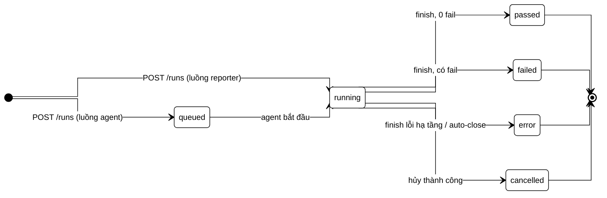

# 05 — Ingestion API & Agent Protocol Spec v1.1

> Thay thế tài liệu 05 cũ. Phần A (Ingestion API) là hợp đồng của **P1** — build ngay. Phần B (Agent Protocol) là thiết kế của **P3** — giữ để không thiết kế P1 chặn đường P3, chưa build.
> Sửa: F05 (ánh xạ job↔run), F06 (identity handshake), F07 (attemptId), F11 (xóa mục lỗi thời), và chốt 5 câu hỏi mở.

## 1. Nguyên tắc giao thức

1. **Idempotent by default:** mọi request ghi đều mang idempotency key; server dedupe, retry của client không bao giờ nhân đôi dữ liệu.
2. **Client không cần biết ID của server tại thời điểm phát sự kiện** — mọi sự kiện khóa theo định danh client tự tính (`localRunId`, `clientTestId`, `attempt`); server tự resolve (§5).
3. **Server quyết định trần** (kích thước, rate, page size) — client chỉ xin trong trần (chuẩn OWASP API4, chi tiết 09).
4. **Versioning:** prefix `/v1/`; header `X-Protocol-Version`. Hỗ trợ N và N−1; N−2 trả `426 Upgrade Required`.
5. **Error format thống nhất:** `{"error": {"code": "RUN_NOT_FOUND", "message": "...", "details": {}}}` — code máy đọc được, không leak stack trace/SQL.

## 2. Phần A — Ingestion API (P1)

### 2.1 Xác thực
- Header `Authorization: Bearer <ingest_token>`. Token scope tối thiểu: `project:ingest` trên đúng 1 Project (phân cấp scope: 06 §8, vòng đời token: 09 §4).
- Sai/thiếu token → 401; token đúng nhưng sai project → 404 (không lộ tồn tại của project khác).

### 2.2 Endpoints

| # | Endpoint | Mục đích | Idempotency |
|---|---|---|---|
| 1 | `POST /v1/runs` | Khai báo run mới | `localRunId` (UUID reporter sinh) — gửi lại trả run cũ, 200 |
| 2 | `POST /v1/runs/{localRunId}/events` | Batch sự kiện test (≤ 500 event hoặc 5 MB/request) | `(localRunId, event.sequence)` — sequence tăng dần do reporter đánh |
| 3 | `POST /v1/runs/{localRunId}/finish` | Đóng run, gửi tổng kết | Gọi lại lần 2 → 200, không đổi trạng thái |
| 4 | `POST /v1/artifacts` | Khai báo artifact + xin URL upload | `(localRunId, clientTestId, attempt, artifactName)` |
| 5 | `PUT <presigned-url>` / chunked (§7) | Upload nội dung | Theo cơ chế storage |
| 6 | `POST /v1/artifacts/{artifactId}/complete` | Chốt upload, gửi checksum | artifactId |

### 2.3 Payload chuẩn (rút gọn, đủ để code)

`POST /v1/runs`:
```json
{
  "localRunId": "0198c3e1-...",
  "environmentKey": "staging",
  "trigger": {"type": "ci", "provider": "github-actions", "ref": "refs/heads/main", "commitSha": "ab12...", "ciRunUrl": "https://..."},
  "framework": {"name": "playwright", "version": "1.46.0"},
  "reporter": {"name": "@platform/playwright-reporter", "version": "0.3.1", "protocolVersion": "1.1"},
  "startedAt": "2026-08-24T02:11:04.120Z"
}
```
Response `201`: `{"runId": "run_9f2...", "identityMap": {}}` — `runId` server cấp, reporter lưu nhưng **không bắt buộc dùng** cho các call sau (mọi call khóa theo `localRunId`).

Event trong batch (endpoint 2) — chú ý 3 trường in đậm, đây chính là chỗ v3.0 gãy:
```json
{
  "sequence": 42,
  "type": "test.finished",
  "clientTestId": "ct_5f0e...",        
  "attempt": 1,                         
  "identity": {                         
    "framework": "playwright",
    "filePath": "tests/checkout/payment.spec.ts",
    "titlePath": ["Checkout", "Payment", "declines expired card"],
    "paramSignature": "browser=firefox"
  },
  "status": "failed",
  "durationMs": 8412,
  "error": {"message": "...", "stack": "...", "snippet": "..."},
  "startedAt": "...", "finishedAt": "..."
}
```
- **`clientTestId`**: fingerprint reporter tự tính theo thuật toán 07 §2 — deterministic, không cần mạng. Sửa F06: client không bao giờ cần biết `stableTestId` của server.
- **`attempt`**: 0-based, bắt buộc trên mọi event `test.*` và mọi artifact. Sửa F07.
- **`identity`**: raw signals để server chạy matching 07 — gửi kèm mỗi lần vì rẻ và giúp server tự phục hồi khi client tính fingerprint sai version.

Response của batch: `{"accepted": 500, "identityMap": {"ct_5f0e...": "st_a91..."}}` — server trả ánh xạ `clientTestId → stableTestId` cho các test đã resolve. Reporter **có thể** cache để hiển thị link, nhưng giao thức không phụ thuộc vào việc này.

### 2.4 Trần tài nguyên (server-enforced)

| Trần | Giá trị mặc định | Khi vượt |
|---|---|---|
| Event/batch | 500 event hoặc 5 MB | 413, error code `BATCH_TOO_LARGE` |
| Rate/token | 60 request/phút, burst 120 | 429 + `Retry-After` |
| Kích thước artifact | theo loại — bảng 08 §4 | 413 tại bước khai báo, kèm limit trong `details` |
| Run mở quá 6 giờ không `finish` | auto-close, status `error`, reason `RUN_TIMED_OUT` | job nền xử lý |

### 2.5 Hành vi reporter phía client (yêu cầu SDK)
- Buffer + gửi batch mỗi 5 s hoặc 100 event; retry exponential backoff (1s/2s/4s/8s, tối đa 5 lần) cho 5xx/timeout; **không retry** 4xx trừ 429.
- Mất mạng toàn bộ: ghi spool file local, in cảnh báo, **không làm fail test run của người dùng** — reporter chết thì test vẫn xanh. Đây là bất biến sản phẩm.
- Timeout mọi request: 30 s.

## 3. Sơ đồ trạng thái Run (chuẩn duy nhất)

Sơ đồ này trả lời: một Run có thể đi qua những trạng thái nào, và trạng thái kết thúc gồm những gì.



Enum `Run.status`: `queued | running | passed | failed | error | cancelled` — đóng, không thêm giá trị ngoài migration có review. Luồng reporter (P1) chỉ dùng `running → passed|failed|error`.

## 4. Ánh xạ Job state ↔ Run status (sửa F05)

Job chỉ tồn tại ở luồng agent (P3). Quy tắc gốc: **Job là hợp đồng giữa server và agent; Run là sự thật nghiệp vụ cho người dùng.** Mọi job state phải chiếu được về đúng một run status — bảng dưới là chuẩn duy nhất:

| Job state | Nghĩa | Run status tương ứng | Ghi chú hòa giải |
|---|---|---|---|
| `pending` | Chờ agent nhận | `queued` | |
| `claimed` | Agent đã claim, chưa chạy | `queued` | Sửa v3.0: claimed KHÔNG phải running — người dùng thấy "queued (claimed by agent-07)" qua trường phụ `run.claimInfo`, không qua status |
| `running` | Đang thực thi | `running` | |
| `uploading` | Test xong, đang đẩy artifact | `running` | Kết quả test chưa đầy đủ thì run chưa kết thúc |
| `completed` | Job xong trọn vẹn | `passed` / `failed` (theo kết quả test) | |
| `failed` | Job gãy vì hạ tầng (agent crash giữa chừng, disk đầy) | `error` + `errorReason` | Phân biệt "test fail" (failed) với "không chạy được" (error) |
| `cancel_requested` | Server yêu cầu hủy, chờ agent ack | `running` | Trạng thái chuyển tiếp job-only; UI hiển thị badge "cancelling" từ `run.cancelRequestedAt` |
| `cancelled` | Agent ack hủy xong | `cancelled` | |
| `abandoned` | Mất heartbeat quá `3 × heartbeatInterval` | `error` + `errorReason = AGENT_LOST` | Sửa v3.0: abandoned có đích đến rõ ràng; job có thể được re-queue thành job MỚI (job mới → run mới hoặc attach lại run cũ theo policy retry — mặc định: run cũ đóng `error`, không resurrect) |

Bất biến kiểm chứng được bằng test: (1) không tồn tại job state nào thiếu dòng trong bảng này; (2) run đã ở trạng thái kết thúc thì không job event nào đổi được nó; (3) `cancel_requested` quá 120 s không được ack → server tự chuyển job `abandoned`.

## 5. Identity handshake (sửa F06)

Vấn đề v3.0: agent phát `testId`, schema khóa theo `stableTestId` server cấp — client không thể biết ID server tại thời điểm phát sự kiện. Giải pháp: **hai không gian ID, một chiều resolve.**

1. Client (reporter/agent) chỉ nói bằng `clientTestId` + `attempt` + raw identity signals.
2. Server resolve `clientTestId → stableTestId` bằng thuật toán 07, **bất đồng bộ với ingest**: event được nhận và lưu ngay theo `clientTestId`; resolver chạy trong pipeline ingest (p50 < 1 s) và backfill `stableTestId` vào TestResult.
3. Artifact tham chiếu `(localRunId, clientTestId, attempt)` — server nối về TestResultAttempt sau khi resolve. Artifact đến trước event `test.finished` vẫn hợp lệ (out-of-order tolerant): giữ trạng thái `unlinked` tối đa 1 giờ rồi mới cảnh báo.
4. Reporter đổi version thuật toán fingerprint → trường `identity` raw cho phép server match tiếp mà không vỡ lịch sử (chi tiết 07 §5).

## 6. Artifact & attempt (sửa F07)

- Mọi artifact bắt buộc có metadata: `{localRunId, clientTestId, attempt, name, kind, contentType, sizeBytes, sha256}`.
- `kind` enum: `screenshot | video | trace | har | log | attachment`.
- Quy kết theo attempt là bất biến: video của attempt 0 (fail) và attempt 1 (pass) là hai artifact khác nhau — chính chênh lệch giữa hai attempt là input đắt giá nhất của AI triage và flaky detection.
- Trần kích thước theo `kind` + xử lý phía client (nén, cắt) định nghĩa ở 08 §4 — reporter đọc trần từ response `POST /v1/runs` (server gửi kèm `limits`), không hardcode.

## 7. Upload

- `sizeBytes < 8 MB`: single `PUT` lên presigned URL (TTL 15 phút).
- `≥ 8 MB`: chunked — `POST /v1/artifacts` trả `uploadId` + danh sách presigned part URL (part 8 MB); client upload song song ≤ 4 part; `complete` gửi danh sách ETag + sha256 toàn file; resume bằng cách gọi lại endpoint 4 với cùng idempotency key → server trả part đã nhận.
- Server verify sha256 khi complete; lệch → 422 `CHECKSUM_MISMATCH`, artifact bị xóa, client upload lại.

## 8. Phần B — Agent Protocol (thiết kế P3, chưa build)

### 8.1 Mô hình
- **Pull-only** (giữ nguyên tắc v3.0 — đúng): agent gọi ra, server không bao giờ gọi vào agent. Không mở port inbound trong mạng khách.
- Agent long-poll `POST /v1/agent/jobs/claim` (giữ kết nối tối đa 30 s, không có job → 204, poll lại ngay). **Chốt câu hỏi mở #1: long polling, không WebSocket** — lý do: đơn giản vận hành qua mọi proxy/firewall doanh nghiệp; nhu cầu latency của job scheduling là giây, không phải mili-giây. Điều kiện xét lại WebSocket: số đo cho thấy poll chiếm > 5% chi phí hạ tầng hoặc khách cần cancel latency < 5 s.

### 8.2 Bảng timeout chuẩn (chốt câu hỏi mở #2)

| Tham số | Giá trị | Ghi chú |
|---|---|---|
| HTTP request timeout (mọi call) | 30 s | |
| Long-poll hold | 30 s | |
| Claim TTL | 60 s | Claim không chuyển `running` trong TTL → job về `pending` |
| Heartbeat interval | 20 s | |
| Abandoned threshold | 3 × heartbeat = 60 s | Khớp bảng §4 |
| Cancel ack deadline | 120 s | |
| Job hard timeout | Cấu hình theo job, mặc định 60 phút | Vượt → agent kill process, job `failed`, reason `JOB_TIMEOUT` |

### 8.3 Còn lại
- Chunked threshold, protocol versioning, auto-update: đã chốt ở 01 Phụ lục (8 MB; N/N−1; auto-update opt-in mặc định tắt).
- Vòng đời chi tiết agent (crash recovery, resumable upload, update flow) viết khi vào P3 — có khung §4 và §8.2 thì phần còn lại không còn rủi ro thiết kế chặn P1.

## 9. Bảo mật giao thức (tóm tắt — chuẩn đầy đủ ở 09)

- Token scope theo phân cấp 5 tầng (06 §8); ingest token chỉ có `project:ingest` — bị lộ trên CI log thì kẻ xấu chỉ ghi được report rác vào 1 project, không đọc được gì (write-only by design).
- Mọi endpoint list có pagination bắt buộc, max page size 100.
- Payload từ reporter là **untrusted input**: validate schema bằng thư viện khai báo tại biên, strip HTML trong error message trước khi render (stack trace là vector XSS kinh điển của dashboard test).
- Server không bao giờ fetch URL do client gửi trong payload (vd `ciRunUrl`) — chỉ lưu và render như link, chống SSRF.
