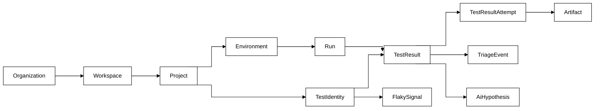

# 06 — Canonical Data Schema v1.1

> Thay thế tài liệu 06 cũ. Sửa: F01 (TriageEvent — đo được TTRC), F13 (TestIdentity, FlakySignal có trường), F14 (enum + taxonomy), F15 (token scope đủ 5 tầng).
> Quy ước: Postgres, mọi timestamp `timestamptz` UTC, khóa chính `uuid v7`, tiền tệ không xuất hiện ở đây. Bảng dưới ghi trường then chốt — trường housekeeping (`createdAt`, `updatedAt`) mặc định có ở mọi bảng.

## 1. Sơ đồ quan hệ tổng

Sơ đồ trả lời: dữ liệu chảy từ run về triage như thế nào, và TestIdentity đứng ở đâu.



## 2. Phân cấp tổ chức

| Entity | Trường then chốt | Ghi chú |
|---|---|---|
| `Organization` | `id, name, slug, planId` | Đơn vị billing |
| `Workspace` | `id, orgId, name` | Tầng bị v3.0 bỏ quên trong token scope — F15. Nhóm project theo phòng ban/sản phẩm |
| `Project` | `id, workspaceId, name, defaultBranch` | Đơn vị của ingest token và test identity |
| `Environment` | `id, projectId, key` (`staging`, `prod-smoke`...) | Cùng test, khác environment = lịch sử tách nhau |

## 3. TriageEvent — nguồn sự thật duy nhất của TTRC (sửa F01)

```
TriageEvent
  id              uuid PK
  testResultId    uuid FK → TestResult, NOT NULL, indexed
  runId           uuid FK → Run (denormalized cho query)
  type            enum NOT NULL:
                    FAILURE_SEEN          -- lần đầu một người mở failure này
                    HYPOTHESIS_PROPOSED   -- người hoặc AI đề xuất nguyên nhân
                    HYPOTHESIS_ACCEPTED   -- ★ mốc chốt TTRC
                    HYPOTHESIS_REJECTED
                    MARKED_FLAKY
                    MARKED_KNOWN_ISSUE
                    ASSIGNED
                    RESOLVED
  actorType       enum NOT NULL: USER | AI | SYSTEM
  actorId         uuid NULL (userId nếu USER)
  hypothesisId    uuid NULL FK → AiHypothesis (bắt buộc khi type liên quan hypothesis)
  payload         jsonb  -- category, note, assignee...
  occurredAt      timestamptz NOT NULL
```

**Định nghĩa metric (đóng đinh, mọi dashboard dùng chung):**
- `TTRC(testResult) = min(occurredAt WHERE type=HYPOTHESIS_ACCEPTED) − TestResult.firstFailedAt`
- Failure không bao giờ có `HYPOTHESIS_ACCEPTED` → **không tính vào trung vị** nhưng đếm riêng thành `untriaged_rate` — chỉ số này quan trọng không kém: TTRC đẹp mà 70% failure không ai triage là số ảo.
- Chỉ số phụ chống gian số liệu: `time_to_first_view = FAILURE_SEEN − firstFailedAt` (đo độ trễ nhìn thấy, tách khỏi độ khó chẩn đoán).
- `HYPOTHESIS_ACCEPTED` với `actorType=USER` chấp nhận hypothesis của AI → vẫn là TTRC hợp lệ (đây chính là cơ chế chứng minh giá trị AI ở Gate-1.5).

UI bắt buộc phát event: mở failure detail → `FAILURE_SEEN` (dedupe theo user+testResult trong 24 h); nút "Accept hypothesis" / "Reject" / "Mark flaky" / "Assign" phát event tương ứng. Không có đường nào cập nhật TTRC ngoài TriageEvent.

## 4. Run / TestResult / Attempt / Artifact

```
Run
  id            uuid PK
  environmentId uuid FK NOT NULL
  localRunId    uuid NOT NULL, UNIQUE(environmentId, localRunId)  -- idempotency
  status        enum: queued|running|passed|failed|error|cancelled   -- khớp 05 §3
  errorReason   text NULL (AGENT_LOST, RUN_TIMED_OUT...)
  trigger       jsonb; commitSha text; branch text
  claimInfo     jsonb NULL   -- luồng agent P3
  startedAt / finishedAt timestamptz

TestResult                       -- một test trong một run (gộp mọi attempt)
  id             uuid PK
  runId          uuid FK NOT NULL
  stableTestId   uuid FK → TestIdentity NULL (backfill sau resolve — 05 §5)
  clientTestId   text NOT NULL, indexed
  finalStatus    enum NOT NULL: passed|failed|skipped|timed_out|interrupted|flaky_pass
                 -- sửa F14: enum đóng. flaky_pass = fail rồi retry pass
  failureCategory  enum NULL — taxonomy §7
  attemptCount   int NOT NULL DEFAULT 1
  firstFailedAt  timestamptz NULL   -- mốc gốc của TTRC
  durationMs     int
  UNIQUE(runId, clientTestId)

TestResultAttempt                -- sửa F07: attempt là entity, không phải cột đếm
  id            uuid PK
  testResultId  uuid FK NOT NULL
  attempt       int NOT NULL (0-based), UNIQUE(testResultId, attempt)
  status        enum: passed|failed|skipped|timed_out|interrupted
  error         jsonb (message, stack, snippet)
  startedAt / finishedAt; durationMs int

Artifact
  id                  uuid PK
  testResultAttemptId uuid FK NULL      -- NULL khi unlinked (05 §5.3), job nền nối
  runId               uuid FK NOT NULL
  clientTestId        text; attempt int -- khóa nối từ giao thức
  kind    enum: screenshot|video|trace|har|log|attachment
  name text; contentType text; sizeBytes bigint; sha256 text
  storageKey text; status enum: pending|uploaded|verified|expired|deleted
  expiresAt timestamptz NOT NULL       -- retention 08 §4 ghi tại ghi-nhận, không tính lúc dọn
```

## 5. TestIdentity (sửa F13 — giờ có trường thật)

```
TestIdentity
  id               uuid PK            -- chính là stableTestId
  projectId        uuid FK NOT NULL
  status           enum: active|merged|retired
  mergedIntoId     uuid FK → TestIdentity NULL (khi status=merged)
  canonicalTitlePath   text[]         -- bản mới nhất
  canonicalFilePath    text
  paramSignature       text NULL
  currentFingerprint   text NOT NULL, indexed
  firstSeenAt / lastSeenAt timestamptz
  UNIQUE(projectId, currentFingerprint) WHERE status='active'

TestIdentityAlias                     -- lịch sử mọi fingerprint từng trỏ về identity này
  id uuid PK
  identityId uuid FK NOT NULL
  fingerprint text NOT NULL, UNIQUE(projectId qua identity, fingerprint)
  source enum: exact|auto_match|manual_merge
  matchScore numeric NULL; createdBy uuid NULL
```

Rename = thêm alias, không tạo identity mới → lịch sử liền mạch. Thuật toán sinh/match ở 07. Merge/split thủ công ghi audit qua `source=manual_merge` + `createdBy`.

## 6. FlakySignal (sửa F13)

```
FlakySignal                    -- 1 dòng = trạng thái flaky hiện hành của 1 identity/environment
  id             uuid PK
  identityId     uuid FK NOT NULL
  environmentId  uuid FK NOT NULL
  UNIQUE(identityId, environmentId)
  windowDays     int NOT NULL DEFAULT 30
  totalRuns      int; failedRuns int; flakyPassRuns int
  flipCount      int            -- số lần đổi pass↔fail liên tiếp trong cửa sổ
  flakyScore     numeric(4,3)   -- 0–1, công thức bên dưới
  verdict        enum: stable|suspect|flaky|quarantine_suggested
  computedAt     timestamptz
```

- `flakyScore = 0.5 × (flipCount / (totalRuns−1)) + 0.3 × (flakyPassRuns / totalRuns) + 0.2 × recencyWeight(fail gần nhất)` — hệ số là `[ASSUMPTION]` khởi điểm, hiệu chỉnh bằng dữ liệu partner ở P1, mọi thay đổi hệ số ghi vào changelog schema.
- Verdict ngưỡng khởi điểm: `≥ 0.6 flaky`, `0.3–0.6 suspect`. Job nền tính lại mỗi run finish (incremental, không full scan).
- `MARKED_FLAKY` của người (TriageEvent) là **nhãn giám sát** — lưu làm ground truth để hiệu chỉnh công thức, không ghi đè score.

## 7. Taxonomy failureCategory (sửa F14 — enum đóng, dùng chung cho người và AI)

| Code | Nghĩa | Ví dụ tín hiệu |
|---|---|---|
| `app_bug` | Bug thật của ứng dụng | Assertion nghiệp vụ fail ổn định sau deploy |
| `test_bug` | Lỗi trong code test | Selector sai, assertion sai sau đổi UI có chủ đích |
| `flaky_timing` | Race/timing trong test | Fail ngẫu nhiên ở wait, pass khi retry |
| `env_infra` | Môi trường/hạ tầng | DNS, service phụ thuộc down, disk đầy |
| `env_data` | Dữ liệu test | Fixture hết hạn, seed đổi, tài khoản bị khóa |
| `dependency_external` | Bên thứ ba | Sandbox payment lỗi, API ngoài 5xx |
| `unknown` | Chưa xác định | Mặc định trước triage |

Query "failure category trends" (yêu cầu của tài liệu cũ) giờ chạy thẳng: `GROUP BY failureCategory, date_trunc('week', firstFailedAt)`. AiHypothesis (bảng: `id, testResultId, category (enum này), confidence numeric, evidence jsonb, suggestedAction text, model text, promptVersion text, costUsd numeric`) dùng chung taxonomy — người accept thì `TestResult.failureCategory` nhận giá trị đó.

## 8. Token scope 5 tầng (sửa F15)

```
ApiToken
  id uuid PK; hashedSecret text (argon2id — không lưu bản rõ)
  scopeLevel  enum: organization|workspace|project|environment
  scopeId     uuid NOT NULL     -- id của đúng tầng đó
  permissions text[]            -- ví dụ: {project:ingest}, {project:read}
  name text; createdBy uuid; lastUsedAt; expiresAt; revokedAt timestamptz NULL
```

- Chuỗi phân cấp đầy đủ: **Organization → Workspace → Project → Environment** (Run không phải tầng scope — run là dữ liệu, không phải ranh giới quyền). Token tầng trên bao trùm tầng dưới; kiểm tra quyền = walk-up cây, một hàm duy nhất `authorize(token, resource, permission)` dùng chung mọi endpoint (chống lỗi "endpoint quên check" — 09 §3).
- Ingest token mặc định: `scopeLevel=project`, `permissions={project:ingest}` — least privilege, write-only.

## 9. Index tối thiểu cho query nóng (P1)

| Query | Index |
|---|---|
| Lịch sử một test | `TestResult(stableTestId, createdAt DESC)` |
| Run list theo env | `Run(environmentId, startedAt DESC)` |
| Resolve fingerprint | `TestIdentityAlias(fingerprint)` + partial unique §5 |
| TTRC dashboard | `TriageEvent(testResultId, type, occurredAt)` |
| Dọn retention | `Artifact(expiresAt) WHERE status='verified'` |

## 10. Quy tắc tiến hóa schema

- Mọi thay đổi = migration file, chạy được trên DB có dữ liệu, expand → migrate → contract.
- Enum chỉ thêm giá trị qua migration có review; không bao giờ đổi nghĩa giá trị cũ.
- P1.5 (AI) chỉ bắt đầu khi file này không có migration mới trong 2 tuần (03 §4.2).
